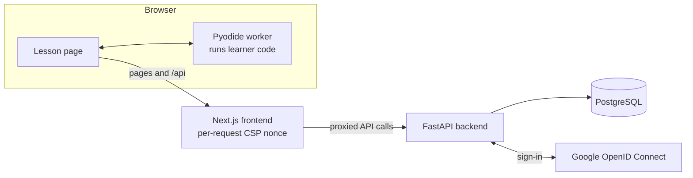

  

  <a href="https://python-academy-dji8.onrender.com/"><b>Open the live site</b></a>
  &nbsp;·&nbsp;
  <a href="https://python-academy-dji8.onrender.com/preview?lesson=hello">Try a lesson (no account)</a>
  &nbsp;·&nbsp;
  <a href="docs/plan/backlog.md">Roadmap</a>
  &nbsp;·&nbsp;
  <a href="#how-it-works">How it works</a>
  &nbsp;·&nbsp;
  <a href="#run-it-locally">Run it locally</a>

  

Python Academy is a learning platform for beginners. It started as a way to help one grade 9 student learn Python and general computing, and to get ready for hackathons. The plan is a Khan Academy-style catalog of courses, units and lessons, with progress, XP and badges, that grows from Python into git, the web, data, SQL, Node.js and working with AI.

> **Early days, said honestly.** This is a personal project built one reviewed step at a time. **Python Foundations units 1 ("Build Your Own Adventure"), 2 ("Numbers and decisions") and 3 ("Repeat and explore") are released, as lessons. The unit project mechanism and end-of-unit checks are not built yet. Everything else in the catalog is labelled "Coming soon".** This page says what works today and what does not.

## What you can do today

| What | What it does |
| --- | --- |
| **🧭 A real catalog** | Browse courses, course pages and a lesson sidebar. A rule-based recommendation on the student home suggests where to go next from a self-chosen goal. |
| **🏕️ Sixteen connected lessons** | Unit 1: output, variables, input, choices and a combined story. Unit 2: arithmetic, whole numbers and decimals, numbers from `input()`, comparisons, Boolean logic and `elif`. Unit 3: `while` loops, loops that end, `for` and `range()`, running totals and loops inside loops. Each lesson has its own picture and is five cards: discover, a worked example, predict what happens, guided practice and an independent challenge. |
| **🐍 Real Python in your browser** | Code runs in a Web Worker using Pyodide, with a time limit (a run is stopped after 15 seconds; 3 seconds per case in a browser check), an output limit (20,000 characters; 10,000 per case in a browser check) and no network access for learner code. |
| **💬 Help that points at the problem** | When Python stops, the page explains the error in plain words, marks the line, and keeps Python's own message one click away. Hints are a three-step ladder (a nudge, a bigger hint, the approach) with no answer button, and the first hint offered matches the error the learner actually has. |
| **✅ Honest results** | A check is labelled in words by what happened: "Check passed", "Not yet", "Python stopped", "Not checked" or "Check unavailable". Only a passed check counts as a pass, and runs on the "Try it" card say "Ran · not checked". |
| **🏅 XP and badges** | 100 XP and a badge for each completed challenge, awarded once. Parents and students have separate accounts, with parent-created invitations and a parent progress view. |
| **👀 Try before signing up** | Open a lesson with no account at [`/preview?lesson=hello`](https://python-academy-dji8.onrender.com/preview?lesson=hello). Preview saves nothing. |

<table>
  <tr>
    <td width="50%" valign="top"></td>
    <td width="50%" valign="top"></td>
  </tr>
  <tr>
    <td align="center">A plain-words explanation, with the failing line marked</td>
    <td align="center">A hint ladder beside the code, with no answer button</td>
  </tr>
</table>

## What is coming

The catalog already lists the courses below. Only Python Foundations has released content.

| Course | Status |
| --- | --- |
| Python Foundations (12 units) | Units 1, 2 and 3 released; the rest planned. Unit projects and end-of-unit checks are not built yet |
| Hackathon Ready (7 units planned), Git and GitHub Essentials, Web Foundations: HTML and CSS, JavaScript and the DOM, Data and SQL, Data Investigation with Python, Computer Science Foundations, Node.js and APIs, Full-Stack Builder, Engineering Depth | Coming soon |

Near-term work: unit 4 (lists and dictionaries), skill checks at the end of units, and a tester feedback button and admin inbox. Further out are a separate public story site (not decided), predict-first tasks and a possible AI helper. The full plan, with priorities and dependencies, is [`docs/plan/backlog.md`](docs/plan/backlog.md), which is the source of truth for the order of work.

## How it works

- **The frontend** (Next.js, React, TypeScript) renders the pages and proxies `/api` to the backend, so cookies stay first-party.
- **The backend** (FastAPI, SQLAlchemy, Alembic migrations) holds accounts, progress, content and the judging of check results.
- **Learner code only ever runs in the browser.** The page runs it in a Pyodide worker and reports the output. The server judges the reported output and never runs learner code. Hidden expected output stays on the server.
- **Lessons are content files** (course, unit, lesson, task) with stable IDs and versions, checked when the API starts. See [`backend/content/README.md`](backend/content/README.md).

## Safety and privacy by design

The short version: learner code never runs on the server, sessions can be ended instantly, tester feedback is anonymous, and the admin is decided on the server only. The details, and the limits we know about, are below.

<b>Show the details and known limits</b>

- **Sign-in:** verified Google sign-in (OpenID Connect with state and nonce checks, through Authlib). Only `openid email profile` is requested; never a Google birthday or other personal scopes. Date of birth is entered in the app and is a self-declared age gate (parents over 25, students 13 or older), not identity verification.
- **Sessions:** the cookie is signed, `HttpOnly`, `SameSite=Lax` and `Secure` in production, and holds only a random session ID. The server stores only the ID's SHA-256 digest, so a database copy cannot be used to sign in, and logging out ends the session immediately. Learner sessions end after 24 hours unused or 7 days at most; admin sessions after 1 hour unused or 8 hours at most.
- **Rate limits** on sign-in, checks and every write, including invitations, counted per account or per visitor address. A refused request gets HTTP 429 with a `Retry-After` header.
- **Headers:** HSTS, no sniffing, no referrer, and framing blocked. The page Content-Security-Policy uses a new nonce on every request. **It currently runs in Report-Only mode; switching it to enforce mode is a planned one-line change after the console is clean.** The Python worker's own policy is already enforced and only allows network connections to the Pyodide CDN, which learner code cannot reach anyway: the worker removes the browser's network functions before running it.
- **Admin:** the admin is whoever signs in with a verified Google email that is listed in the `ADMIN_EMAILS` setting on the server; the list is re-checked on every request. Admin sessions are shorter (above). Admin routes answer 401 when signed out and 403 to anyone else. The admin marks student accounts as testers on a page the API shows only to them.
- **Feedback from testers is anonymous by design:** nothing stored identifies the sender, items are deleted after 50 days, and at most 90 are kept. The storage and its limits exist today; the feedback button and the admin inbox are still to come.
- **No secrets in this repository.** Credentials are entered directly in the hosting settings.

### Known limits

- Browser checks are practice feedback, not a trusted grade. A determined learner could fake a report.
- Python in the browser is not a certified security sandbox. A security review comes before registration is opened broadly.
- Rate limits are counted in the API's memory, so they reset when the API restarts.
- A full accessibility audit and tests with real screen readers, Safari and Firefox are still pending. Browser tests use Chromium.
- Parents' and learners' data retention and deletion workflows, monitoring, backup and restore drills, a full privacy notice, and security and accessibility reviews are still to do. Keep use to test accounts until they exist.

## Run it locally

<b>Show setup and test commands</b>

You need Python 3.12 and Node 22 or newer (Next.js itself needs Node 20.9 or newer; CI uses 22).

1. **Backend:** `cd backend`, `pip install -r requirements.txt`, then `python -m uvicorn app.main:app --reload`.
2. **Frontend:** `cd frontend`, `npm ci`, then `npm run dev`.
3. Open <http://localhost:3000>. Set **both** `APP_ORIGIN` and `API_ORIGIN` to `http://localhost:3000` for the backend. Backend traffic is proxied through Next.js so cookies stay first-party.
4. Environment variables are read from the process; there is no automatic `.env` loading. [`.env.example`](.env.example) lists them: export them or set them in your tool, and never commit real values. Google sign-in needs a Google OAuth client (see [`DEPLOYMENT.md`](DEPLOYMENT.md)); without one you can still use `/preview`.

### Tests

- **Backend:** `cd backend && python -m pytest -q`. Migration tests also run on PostgreSQL when `TEST_POSTGRES_URL` points at a server.
- **Frontend:** `cd frontend && npm run build`, then `npm run test:e2e` (first run `npx playwright install chromium`).
- **CI** (GitHub Actions) runs two jobs on every push and pull request: the backend tests, with a PostgreSQL 16 service for the migration tests, and the frontend production build followed by the Chromium browser tests. Browser tests mock the API but use real Python in the browser worker. Curriculum tests run only trusted, authored solutions, never learner programs.

Database changes are Alembic migrations in `backend/migrations/`, applied automatically when the API starts. Write one with `cd backend && alembic revision -m "describe the change"`. Keep them additive so the previous version keeps working during a deploy, and add a test in `backend/tests/test_migrations.py`.

## More details

<b>Show accounts, lessons, checks and the addresses to review</b>

**Accounts and families**
- Date of birth is self-declared: parents strictly over 25, students 13 or older.
- Invitations are created by a parent for a learner's Google email. They are stored hashed, single-use and bound to that email, and expire after seven days. The parent shares the link; no email is sent.
- Family records, an account history, each student's practice history and a parent progress view.
- After enrolling, a student is asked once for a goal. Skipping it means "Learn to code from scratch", and it can be changed later from their home. The goal only changes the rule-based recommendation (`backend/app/recommend.py`, plan section 4); every released course stays open. Parents see each learner's goal.

**Lessons**
- Only the current card is shown. Coding cards put the instructions next to an editor.
- Illustrated scenes and subtle motion; a reduced-motion setting turns the animation off.
- Player replies for `input()` are typed before a run, in order. Prompts do not appear in the output; only `print()` messages do. The input card explains this.
- Students' completions are saved; preview progress lives only in the page. Badges mark completed independent practice, not clicking through cards.
- The lesson text follows a simple sequence: explanation, worked example, prediction, guided change, independent challenge. Python references: the official tutorial's [introduction](https://docs.python.org/3/tutorial/introduction.html) and [control flow](https://docs.python.org/3/tutorial/controlflow.html).
- The first prototype's loop practice was replaced by the adventure unit; existing account and practice records were kept.

**Checks**
- Unit 1 is checked by a bounded interpreter on the server that reads the code's structure (an abstract syntax tree) and never runs it. It tries different names and both left and right choices, accepts any story wording, and supports only the syntax the unit teaches.
- Unit 2 uses browser checks: the learner's browser runs the code against test cases from the content file, and the server compares the reported output with the expected output ([`docs/plan/browser-checks.md`](docs/plan/browser-checks.md)).
- Either way, a pass is practice evidence, not a trusted grade or proof of understanding.

**Addresses to review**
- The catalog is at `/courses`, each course at `/courses/<id>` (for example `/courses/py`), and students learn at `/learn/<lesson>`. Courses with no released content are labelled "Coming soon" and cannot be started.
- Anyone who is not a signed-in student opens lessons as a preview that saves nothing. `/preview?lesson=hello&card=1` can jump to any card of any lesson, with no access to family or student records.
- `/api/check` is public and returns a check result without saving it. `/api/attempts` and `/api/progress` need a student session.

**Accessibility:** responsive pages, semantic labels, visible keyboard focus, a skip link, announced output and results, and a Stop button for running code. WCAG 2.2 AA conformance has not been audited.

## Project map

| Path | What is there |
| --- | --- |
| `frontend/` | Next.js app, the Pyodide worker and check runner in `public/`, and Playwright tests |
| `backend/` | FastAPI app, Alembic migrations, lesson content in `content/`, and pytest tests |
| `docs/plan/` | The plans: backlog, course catalog, teaching design, lesson feedback, browser checks, feedback security, site design, and the decision log |
| `docs/handoffs/` | One write-up per finished step, as Markdown and PDF |
| `build.md` | How work is planned, built, handed off and verified |
| `render.yaml`, `DEPLOYMENT.md` | Hosting setup and what is running |

## How it is built

Work is done in small stages. Each stage is one pull request with tests, plus a handoff in `docs/handoffs/` that records what changed, why each choice was made, what bugs came up and how it was tested. Pull requests are reviewed and merged one at a time, and the owner runs a live check after each deploy. The decision log in [`docs/plan/decision-log.md`](docs/plan/decision-log.md) collects those reasons in one place. The aim is that anyone can understand not just what the code does, but why it is that way.

## Deploying

The source is in the private `torontojohn/python-academy` repository. The app runs on Render as two web services (frontend and API) and a PostgreSQL database, defined in [`render.yaml`](render.yaml). [`DEPLOYMENT.md`](DEPLOYMENT.md) has the setup, the Google OAuth configuration, the settings to enter by hand, and what to check after each deploy.

## Licence

No licence has been chosen yet; all rights are reserved by the owner.
