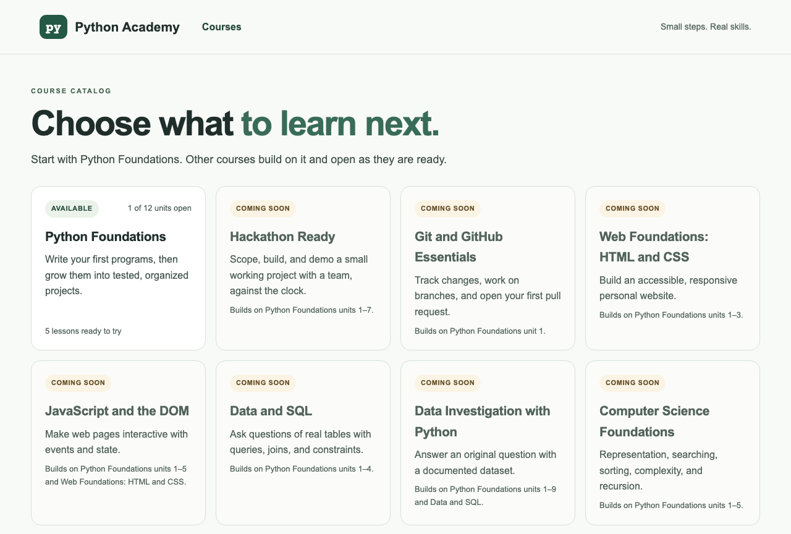
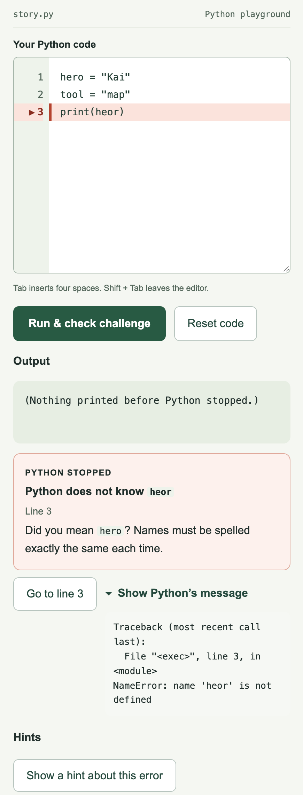
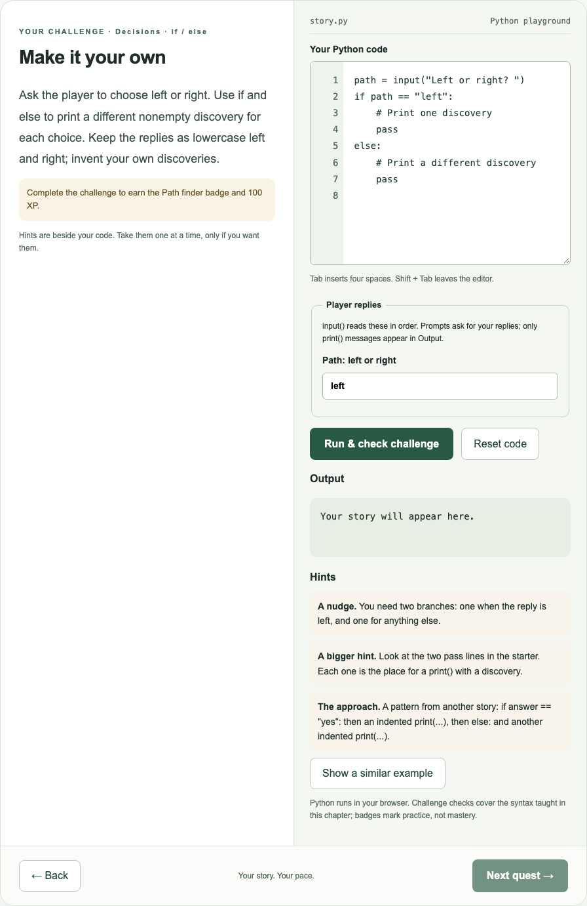
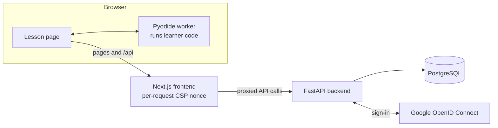

  

  <a href="https://python-academy-dji8.onrender.com/"><b>Open the live site</b></a>
  &nbsp;·&nbsp;
  <a href="https://python-academy-dji8.onrender.com/preview?lesson=hello">Try a lesson (no account)</a>
  &nbsp;·&nbsp;
  <a href="docs/plan/backlog.md">Roadmap</a>
  &nbsp;·&nbsp;
  <a href="#how-it-works">How it works</a>
  &nbsp;·&nbsp;
  <a href="#run-it-locally">Run it locally</a>

  

Python Academy is a learning platform for beginners. It started as a way to help one grade 9 student learn Python and general computing, and to get ready for hackathons. The plan is a Khan Academy-style catalog of courses, units and lessons, with progress, XP and badges, that grows from Python into git, the web, data, SQL, Node.js and working with AI.

> **Early days, said honestly.** This is a personal project built one reviewed step at a time. **Python Foundations, unit 1 ("Build Your Own Adventure") is released. Everything else in the catalog is labelled "Coming soon".** This page says what works today and what does not.

## What you can do today

| | |
| --- | --- |
| **🧭 A real catalog** | Browse courses, course pages and a lesson sidebar. A rule-based recommendation on the student home suggests where to go next from a self-chosen goal. |
| **🏕️ Five connected lessons** | Output, variables, input, choices and a combined story. Each lesson is five cards: discover, a worked example, predict what happens, guided practice and an independent challenge. |
| **🐍 Real Python in your browser** | Code runs in a Web Worker using Pyodide, with a time limit, an output limit and no network access for learner code. |
| **💬 Help that points at the problem** | When Python stops, the page explains the error in plain words, marks the line, and keeps Python's own message one click away. Hints are a three-step ladder (a nudge, a bigger hint, the approach) with no answer button, and the first hint offered matches the error the learner actually has. |
| **✅ Honest results** | A check is labelled by what happened: passed, needs work, error, unsupported or service problem. Only "passed" counts as a pass, and "Try it" runs say "Ran, not checked". |
| **🏅 XP and badges** | Earned for completed challenges. Parents and students have separate accounts, with parent-created invitations and a parent progress view. |
| **👀 Try before signing up** | Open a lesson with no account at [`/preview?lesson=hello`](https://python-academy-dji8.onrender.com/preview?lesson=hello). Preview saves nothing. |

<table>
  <tr>
    <td width="50%"></td>
    <td width="50%"></td>
  </tr>
  <tr>
    <td align="center">A plain-words explanation, with the failing line marked</td>
    <td align="center">A hint ladder beside the code, with no answer button</td>
  </tr>
</table>

## What is coming

The catalog already lists the courses below. Only Python Foundations has released content.

| Course | Status |
| --- | --- |
| Python Foundations (12 units) | Unit 1 released; units 2 to 12 planned |
| Hackathon Ready, Git and GitHub Essentials, Web Foundations, JavaScript and the DOM, Data and SQL, Data Investigation with Python, Computer Science Foundations, Node.js and APIs, Full-Stack Builder, Engineering Depth | Coming soon |

Near-term work, in order: lesson pages that load lessons per unit, unit 2 (numbers and decisions), skill checks at the end of units, and a tester feedback button and admin inbox. Further out are a public story site that introduces the project, product polish, predict-first tasks and a possible AI helper. The full plan, with priorities and dependencies, is [`docs/plan/backlog.md`](docs/plan/backlog.md), which is the source of truth for the order of work.

## How it works

- **The frontend** (Next.js, React, TypeScript) renders the pages and proxies `/api` to the backend, so cookies stay first-party.
- **The backend** (FastAPI, SQLAlchemy, Alembic migrations) holds accounts, progress, content and the judging of check results.
- **Learner code only ever runs in the browser.** The page runs it in a Pyodide worker and reports the output. The server judges the reported output and never runs learner code. Hidden expected output stays on the server.
- **Lessons are content files** (course, unit, lesson, task) with stable IDs and versions, checked when the API starts. See [`backend/content/README.md`](backend/content/README.md).

## Safety and privacy by design

The short version: learner code never runs on the server, sessions can be ended instantly, tester feedback is anonymous, and the admin is decided on the server only. The details, and the limits we know about, are below.

<b>Show the details and known limits</b>

- **Sign-in:** verified Google sign-in (OpenID Connect with state and nonce checks). Only `openid email profile` is requested. Date of birth is entered in the app and is a self-declared age gate (parents over 25, students 13 or older), not identity verification.
- **Sessions:** the cookie holds a random session ID. The server stores only its SHA-256 digest, so a database copy cannot be used to sign in, and logging out ends the session immediately. Learner sessions end after 24 hours unused or 7 days at most; admin sessions after 1 hour unused or 8 hours at most.
- **Rate limits** on sign-in, checks and writes, counted per account or per visitor address.
- **Headers:** HSTS, no sniffing, no referrer, and framing blocked. The page Content-Security-Policy uses a new nonce on every request. **It currently runs in Report-Only mode; switching it to enforce mode is a planned one-line change after the console is clean.** The Python worker's own policy is already enforced.
- **Admin:** the admin is whoever's verified Google email is listed in the `ADMIN_EMAILS` setting on the server, re-checked on every request. Admin routes answer 401 when signed out and 403 to anyone else. Student accounts can be marked as testers by the admin.
- **Feedback from testers is anonymous by design:** nothing stored identifies the sender, items are deleted after 50 days, and at most 90 are kept. The storage and its limits exist today; the feedback button and the admin inbox are still to come.
- **No secrets in this repository.** Credentials are entered directly in the hosting settings.

### Known limits

- Browser checks are practice feedback, not a trusted grade. A determined learner could fake a report.
- Python in the browser is not a certified security sandbox. A security review comes before registration is opened broadly.
- Rate limits are counted in the API's memory, so they reset when the API restarts.
- A full accessibility audit and tests with real screen readers, Safari and Firefox are still pending. Browser tests use Chromium.
- Parents' and learners' data retention and deletion workflows, monitoring and a full privacy notice are still to do. Keep use to test accounts until they exist.

## Run it locally

<b>Show setup and test commands</b>

You need Python 3.12 and Node 22 or newer.

1. **Backend:** `cd backend`, `pip install -r requirements.txt`, then `python -m uvicorn app.main:app --reload`.
2. **Frontend:** `cd frontend`, `npm ci`, then `npm run dev`.
3. Open <http://localhost:3000>. Set **both** `APP_ORIGIN` and `API_ORIGIN` to `http://localhost:3000` for the backend. Backend traffic is proxied through Next.js so cookies stay first-party.
4. Environment variables are read from the process; there is no automatic `.env` loading. Export them or set them in your tool. Google sign-in needs a Google OAuth client (see [`DEPLOYMENT.md`](DEPLOYMENT.md)); without one you can still use `/preview`.

### Tests

- **Backend:** `cd backend && python -m pytest -q`. Migration tests also run on PostgreSQL when `TEST_POSTGRES_URL` points at a server.
- **Frontend:** `cd frontend && npm run build`, then `npm run test:e2e` (first run `npx playwright install chromium`).
- **CI** runs the backend tests, the production build and the Chromium browser tests on every push and pull request. Browser tests mock the API but use real Python in the browser worker.

Database changes are Alembic migrations in `backend/migrations/`, applied automatically when the API starts. Keep them additive so the previous version keeps working during a deploy, and add a test in `backend/tests/test_migrations.py`.

## Project map

| Path | What is there |
| --- | --- |
| `frontend/` | Next.js app, the Pyodide worker and check runner in `public/`, and Playwright tests |
| `backend/` | FastAPI app, Alembic migrations, lesson content in `content/`, and pytest tests |
| `docs/plan/` | The plans: backlog, course catalog, teaching design, lesson feedback, browser checks, feedback security, site design, and the decision log |
| `docs/handoffs/` | One write-up per finished step, as Markdown and PDF |
| `build.md` | How work is planned, built, handed off and verified |
| `render.yaml`, `DEPLOYMENT.md` | Hosting setup and what is running |

## How it is built

Work is done in small stages. Each stage is one pull request with tests, plus a handoff in `docs/handoffs/` that records what changed, why each choice was made, what bugs came up and how it was tested. Pull requests are reviewed and merged one at a time, and the owner runs a live check after each deploy. The decision log in [`docs/plan/decision-log.md`](docs/plan/decision-log.md) collects those reasons in one place. The aim is that anyone can understand not just what the code does, but why it is that way.

## Deploying

The app runs on Render as two web services (frontend and API) and a PostgreSQL database, defined in [`render.yaml`](render.yaml). [`DEPLOYMENT.md`](DEPLOYMENT.md) has the setup, the Google OAuth configuration, the settings to enter by hand, and what to check after each deploy.

## Licence

No licence has been chosen yet; all rights are reserved by the owner.
