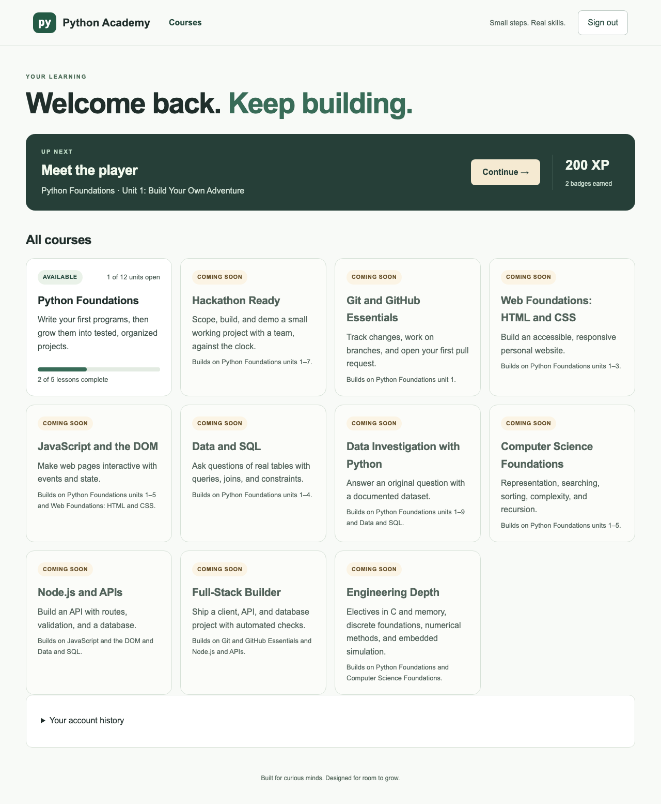
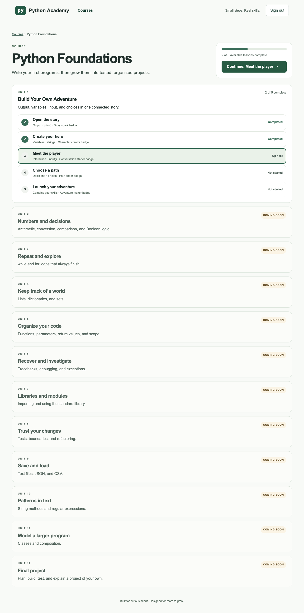
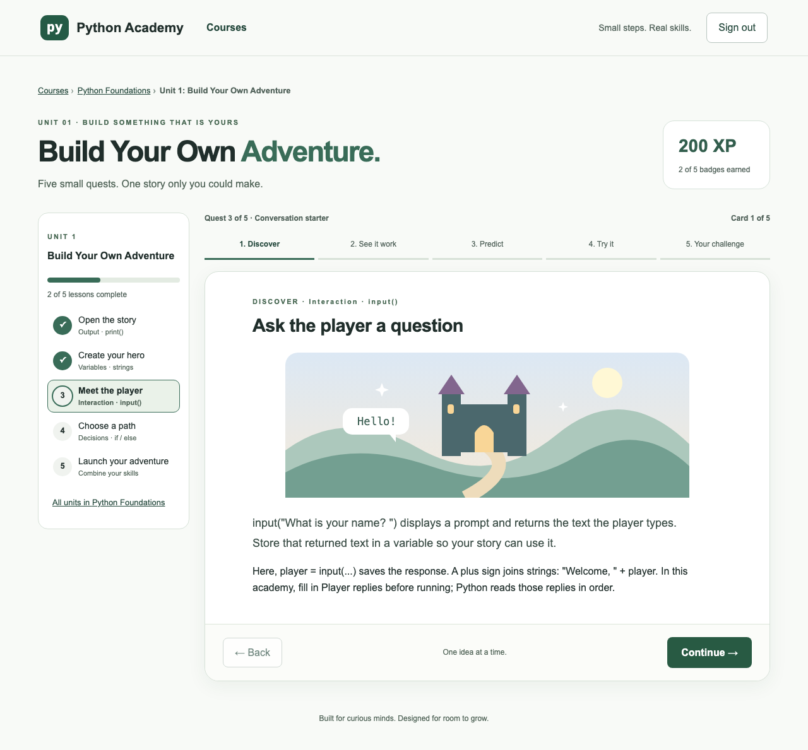
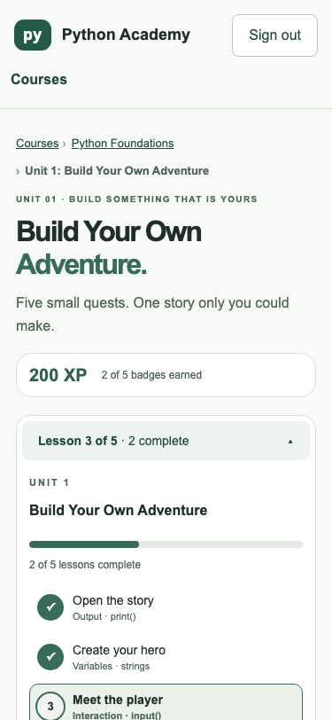
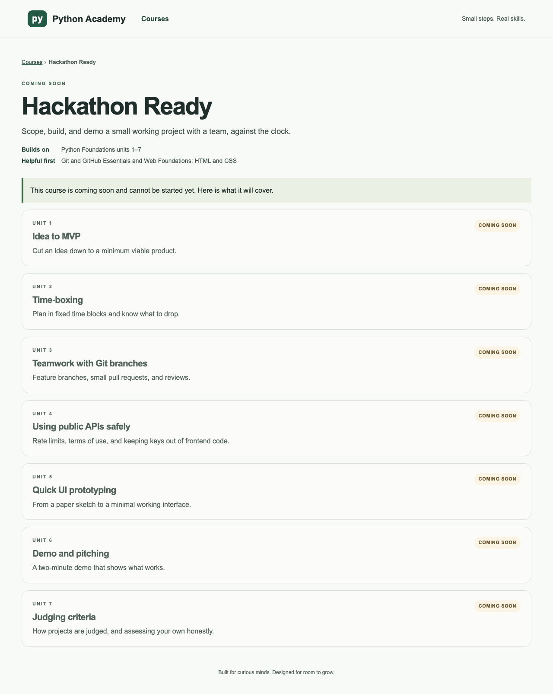

# Handoff 03: Course catalog interface (stage 3)

Date: 2026-10-25 (America/Toronto)  
Written by: Claude Code (implementer)  
For: the human maintainer, and ChatGPT or Claude chat (reviewer) without repository access  
Status: **in_review**: pull request open, not merged, not deployed

> **How to use this file:** upload it with `build.md` (and handoffs 01–02 if the chat is new). It summarizes evidence; the pull request diff and CI results are the source of truth (`build.md` section 14).

## Starter prompt for the chat assistant

```text
You are reviewing Python Academy stage 3: the Khan Academy-style course
catalog interface. I'm attaching build.md and this handoff, including
screenshots. Check it against the acceptance criteria below. Focus on:
is anything misleading to a learner (for example, could a coming-soon
course look startable); does progress shown match what was earned;
accessibility and mobile use; and what is not yet verified. Explain at a
first-year computer engineering level, and only call something tested if
this handoff shows the evidence.
```

## 1. Where we are

| Stage | What | Status |
| --- | --- | --- |
| Plan | `docs/plan/course-catalog.md` | Merged (PR #6) |
| 1. ENG-01 | Content format and result states | Merged (PR #5), verified live |
| 2. ENG-02 | Migrations, XP and badge ledgers, backfill | Merged (PR #7); maintainer confirmed live at migration 0003 |
| 3. Catalog UI | Backfill re-run, read endpoints, catalog/course/lesson pages | **in_review**: this PR |
| 4. Goals and recommendations | Goal card and rule-based recommendation function | Not started |

Rules for every stage: one branch and PR; exact test commands and results; never merge or deploy; no secrets or paid services; no change to age rules or account policy; never run learner code on the server; stop for review.

## 2. Handoff record (build.md template)

| Field | Value |
| --- | --- |
| Task | Stage 3: catalog interface (plan sections 3.3, 7.5 stage 3; decision 8 "Coming soon") |
| Human goal | Let learners see every course, what is available, and their progress, and move through lessons with a clear sidebar, without changing how a lesson teaches |
| Repository and branch | `torontojohn/python-academy`, branch `ui/catalog` |
| Base commit / code commits | Base `60564e5` (`main` after PR #7) / `9eb3b2d` (backend), `5150a63` (interface) |
| Deployment status | Not requested. Not merged, not deployed |

### What changed

**Backend (done first, as asked)**

- **Migration `0004`** re-runs the idempotent award backfill. This closes the gap noted in handoff 02: a pass saved by the old app in the seconds of PR #7's deploy now gets its award before anything reads the ledger.
- **`GET /api/catalog`** (public): every course, unit, and lesson summary, with release status and prerequisites. Frozen in `backend/tests/fixtures/catalog_v1.json`, which the browser tests also use.
- **`GET /api/awards`** (signed-in students only): total XP, completed lessons, and badges, in catalog order.
- **`/api/progress` and the parent's "quests completed"** now read from the XP ledger. The response shape is unchanged. The parent count is now consistent with badges: it previously counted legacy arithmetic attempts as completed quests.

**Interface**

- **`/courses`, catalog:** one card per course with its title, summary, status chip ("Available" or "Coming soon"), and, for students, a progress bar ("2 of 5 lessons complete"). Coming-soon cards say what they build on, for example "Builds on Python Foundations units 1–7".
- **`/courses/<id>`, course page:** breadcrumb; title and summary; "Builds on" and "Helpful first"; progress and a Continue button; then each unit with its lessons marked Completed, Up next, or Not started. Coming-soon units show a label and no links. A coming-soon course says "This course is coming soon and cannot be started yet" and has **no start button**.
- **`/learn/<lesson>`, lesson page:** the same one-card-at-a-time flow, with a **unit sidebar** listing the unit's lessons as done (✓), current (highlighted, `aria-current="page"`), or not started, plus unit progress. Below 1100px wide it becomes a **collapsible menu** ("Lesson 3 of 5 · 2 complete"). Breadcrumbs link back to the course and catalog.
- **Student home (`/`):** "Welcome back. Keep building." with an Up next card (Continue button, XP, badges), then all courses.
- **Parents and visitors** open lessons as a preview that saves nothing, as before. Parents get a "Browse all courses" link.
- **Shared header** with a Courses link; fixed to fit a 375px phone.
- **Accessibility fix found along the way:** the preview banner was a nested `<aside>` landmark (present before this work); it is now a note.

### Screenshots (real local backend, seeded test accounts)

Student home:



Course page:



Lesson page with unit sidebar:



Phone, lesson menu opened:



Coming-soon course (no start button):



### Acceptance criteria

- Catalog with course cards: title, short description, progress, "Coming soon" labels. **Met.**
- Course page with units and lessons. **Met.**
- Lesson page keeps one card at a time, with a sidebar showing done/current/not started; collapsible on mobile. **Met.**
- Existing visual style, accessibility, keyboard, reduced motion, responsive layout. **Met in tests and checks below.**
- Coming-soon courses not startable. **Met:** no start or lesson links (tested).
- Backfill re-run and read endpoints first. **Met:** separate first commit.

### Tests run

Local: Python 3.12.14, Node 24.19.0, PostgreSQL 16.2 (throwaway `pgserver`).

| Command | Before (`main`) | After |
| --- | --- | --- |
| `cd backend && python -m pytest -q` (SQLite) | 80 passed, 7 skipped | **84 passed, 8 skipped** |
| `cd backend && TEST_POSTGRES_URL=… python -m pytest -q` | 87 passed | **92 passed** |
| `cd frontend && npx tsc --noEmit` | — | **no errors** |
| `cd frontend && npm run build` | succeeded | **succeeded** (new routes `/courses`, `/courses/[course]`, `/learn/[lesson]`) |
| `cd frontend && npm run test:e2e` | 15 passed | **19 passed** |

New or changed tests:

- **Backend:** catalog is public and matches the fixture; awards are student-only and correct over repeated passes; progress and the parent's completed list come from the ledger (legacy arithmetic excluded); `0004` awards a pass saved by pre-ledger code after `0003`.
- **Browser:** catalog shows every course with coming-soon labels and no way to start them; course page shows statuses and Continue goes to the right lesson; sidebar shows done/current/not started and works from the keyboard (focus + Enter moves to the lesson and focuses its heading); student home shows next lesson and XP; mobile menu starts collapsed, opens, stays inside 375px, and closes after choosing a lesson; reduced motion stops animations.

**Accessibility check:** axe-core 4.10.3 (WCAG 2.0/2.1/2.2 A and AA plus best practices) on 10 pages × desktop and phone, run against the real stack: **0 violations** after the landmark fix.

**Real stack:** uvicorn plus `next start` with seeded parent and student accounts. No page errors and no horizontal scroll on any page at 1280px or 375px.

### Mocks and unverified behaviour

- Browser tests mock the API from the frozen fixtures; Python execution in them is real.
- Screenshots and axe used a real local backend with locally signed test sessions, not Google sign-in.
- **Not verified:** the deploy on Render, and real Google sign-in through the new pages. Not tested on Safari or Firefox (tests use Chromium).

### Known limitations

- The lesson page still loads the legacy `/api/lessons` shape for unit 1; new units will need the lesson page to read lessons per unit.
- "Up next" is simply the first unfinished lesson; goal-based recommendations come in stage 4.
- No screen-reader testing with a real screen reader (only automated checks and accessible-name assertions).

### After merging: checking the live site

1. Render → **python-academy-api** → **Logs**: `Database schema is at migration 0004`.
2. Open https://python-academy-dji8.onrender.com/courses: Python Foundations "Available", the rest "Coming soon".
3. Open `/courses/hack`: no start button.
4. Sign in as a student: home shows Up next; open a lesson and check the sidebar; on a phone, the lesson menu opens and closes.

### Next concrete action

Maintainer reviews this PR. After merge and a live check, start stage 4: goal card at sign-up and the rule-based recommendation function with tests.
