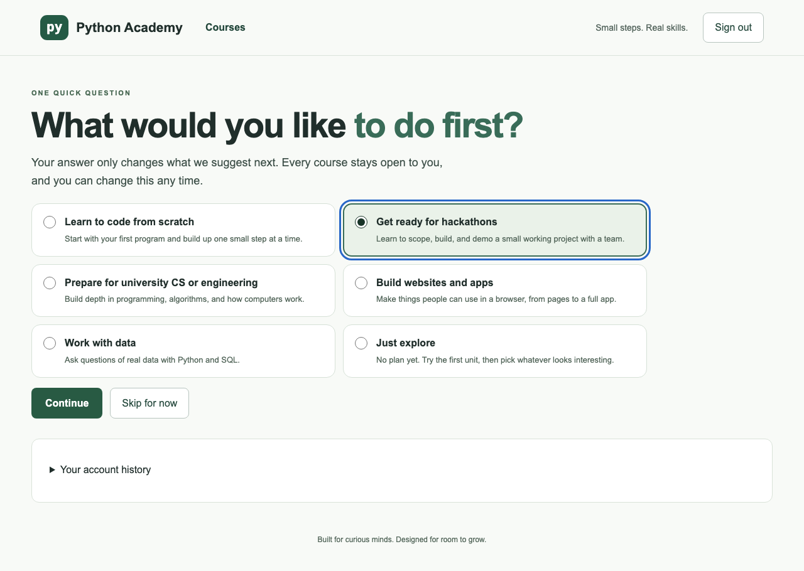
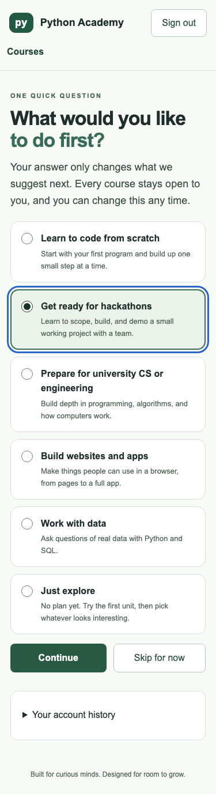
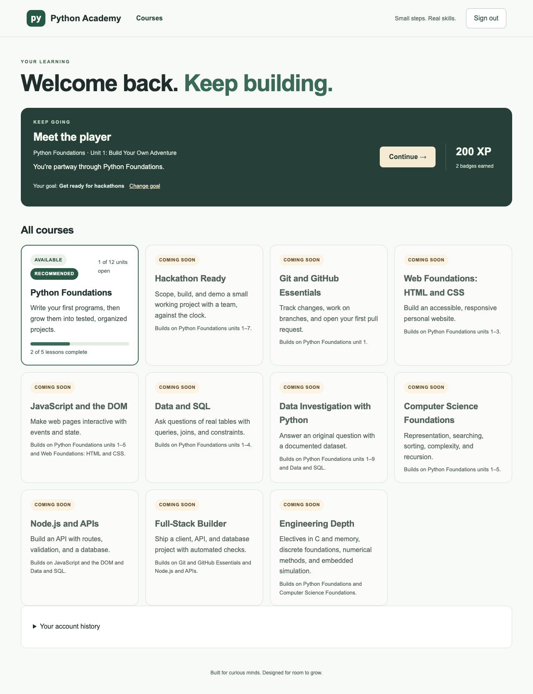
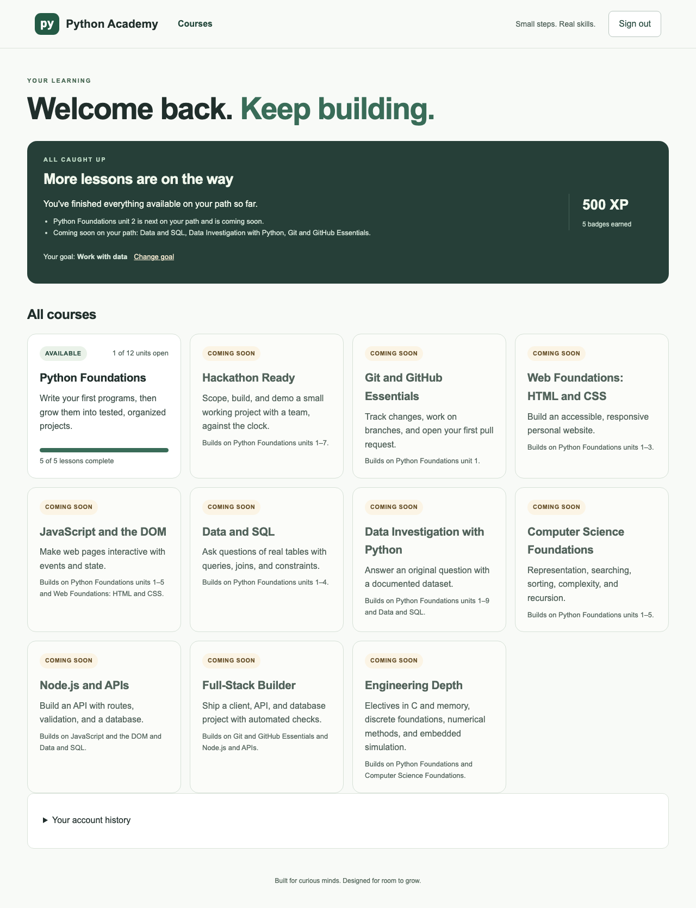
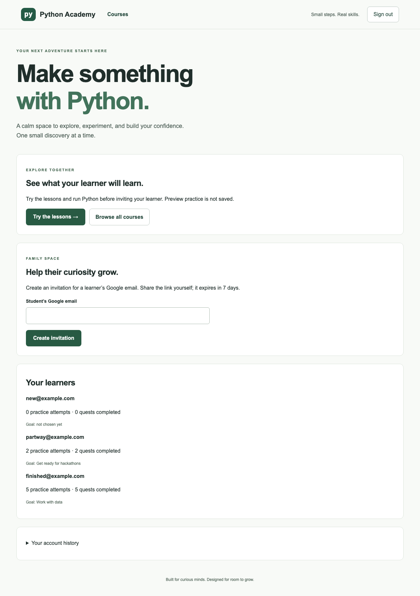

# Handoff 04: Learner goals and recommendations (stage 4)

Date: 2026-10-25 (America/Toronto)  
Written by: Claude Code (implementer)  
For: the human maintainer, and ChatGPT or Claude chat (reviewer) without repository access  
Status: **in_review**: pull request open, not merged, not deployed

> **How to use this file:** upload it with `build.md` and `docs/plan/course-catalog.md` (sections 2 and 4 define this stage). It summarizes evidence; the pull request diff and CI results are the source of truth (`build.md` section 14).

## Starter prompt for the chat assistant

```text
You are reviewing Python Academy stage 4: the learner goal card and the
rule-based "recommended next" function. I'm attaching build.md, the plan
(docs/plan/course-catalog.md), and this handoff with screenshots. Check
the rules against plan section 4.3 and the worked examples in 4.5. Look
for: a recommendation that could be wrong or misleading, any way the goal
could lock or hide a course, anything a parent sees that they shouldn't,
and what is not yet verified. Explain at a first-year computer
engineering level, and only call something tested if this handoff shows
the evidence.
```

## 1. Where we are

| Stage | What | Status |
| --- | --- | --- |
| Plan | `docs/plan/course-catalog.md` | Merged (PR #6) |
| 1. ENG-01 | Content format and result states | Merged (PR #5), verified live |
| 2. ENG-02 | Migrations, XP and badge ledgers | Merged (PR #7), verified live |
| 3. Catalog UI | Catalog, course pages, lesson sidebar | Merged (PR #8); maintainer confirmed live |
| 4. Goals and recommendations | Goal card, recommendation function | **in_review**: this PR |

Rules for every stage: one branch and PR; exact test commands and results; never merge or deploy; no secrets or paid services; no change to age rules or account policy; never run learner code on the server; stop for review.

## 2. Handoff record (build.md template)

| Field | Value |
| --- | --- |
| Task | Stage 4: goal card at sign-up and the rule-based recommendation function (plan sections 2 and 4; decisions 1, 2, 8, 9, 10) |
| Human goal | Ask students what they want, then suggest a sensible next step with a plain reason, without ever locking a course |
| Repository and branch | `torontojohn/python-academy`, branch `goals/recommendations` |
| Base commit / code commits | Base `beb13bd` (`main` after PR #8) / `d62b925` (backend), `29db57c` (interface) |
| Deployment status | Not requested. Not merged, not deployed |

### What changed

**The recommendation function (`backend/app/recommend.py`)**

A pure function: the same goal, catalog, and progress always give the same answer. It uses no database, clock, randomness, or AI service. Rules, in order (plan section 4.3):

1. **Keep going:** if the learner has started a stop on their path (or any other course) and there is a next released lesson, continue it. Reason: "You're partway through Python Foundations."
2. **Coming-soon note:** if the very next stop is not released yet, say so, e.g. "Python Foundations unit 2 is next on your path and is coming soon."
3. **Start the next ready stop** whose required prerequisites are met. Reason: "Start of your hackathon path." or "Next on your hackathon path, and you've finished Python Foundations units 1–7."
4. **Prerequisite first:** if the next released stop needs something unfinished, walk back to a prerequisite that can start now. Reason: "JavaScript and the DOM needs Web Foundations: HTML and CSS first."
5. **Path finished or nothing available:** offer a choice of other ready courses, or say "You've finished everything available on your path so far" and list what is coming soon.

The goal paths follow plan section 2. A stop like "Python through unit 7" covers only its own units, so a hackathon learner who finishes unit 7 moves on to Hackathon Ready instead of being pulled back to Python unit 8. Each answer includes `rules_version: 1`.

**Inputs supported but not yet supplied by the app:** skills-check placement (Issue #4, not built) and "Not now" dismissals (no button yet). Both work in the function and are tested, ready for later stages.

**Goals:** six goals (plan section 2), stored in a new `learner_goals` table (migration `0005`, additive). Skipping stores the default, "Learn to code from scratch", marked as not chosen. Goal changes are also recorded in the account history.

**Endpoints:** `GET /api/goals` (public); `GET` and `POST /api/goal` and `GET /api/recommendation` (students only; parents get 403); the family view now includes each learner's goal (decision 2).

**Interface**

- **Goal card**, once after a student enrols: six options as a radio group, Continue (enabled after choosing) or Skip for now. Focus moves to the question; arrow keys move between options. It says plainly that the goal only changes suggestions and every course stays open.
- **Student home:** the next-step card shows the recommended lesson, the reason, coming-soon notes, and "Your goal: … · Change goal". Change goal reopens the card with Save my goal or Cancel.
- **Catalog:** the recommended course gets a "Recommended" chip.
- **Parents:** each learner shows "Goal: …" or "Goal: not chosen yet".

### Screenshots (real local backend, seeded test accounts)

Goal card after enrolling (hackathons selected, keyboard focus visible):



Goal card on a phone:



Student partway through, goal "Get ready for hackathons":



Student who finished everything available, goal "Work with data":



Parent view showing learner goals:



### Acceptance criteria

- Goal card after enrolment; skippable; skip gives the default; changeable later. **Met.**
- One primary goal; only changes recommendations; never locks or hides a course. **Met:** catalog and course pages are unchanged by the goal.
- Parents don't choose goals but can see them. **Met:** students only can set (403 for parents); goal label in the family view.
- Rule-based, deterministic, explained, no paid AI. **Met.**
- Only released courses recommended; unreleased next stop noted. **Met:** checked by the property test.
- Worked examples in plan 4.5. **Met** (4 of 5 as function tests; the fifth is an override, which the function doesn't decide).

### Tests run

Local: Python 3.12.14, Node 24.19.0, PostgreSQL 16.2 (throwaway `pgserver`).

| Command | Before (`main`) | After |
| --- | --- | --- |
| `cd backend && python -m pytest -q` (SQLite) | 84 passed, 8 skipped | **102 passed, 8 skipped** |
| `cd backend && TEST_POSTGRES_URL=… python -m pytest -q` | 92 passed | **110 passed** |
| `cd frontend && npx tsc --noEmit` | no errors | **no errors** |
| `cd frontend && npm run build` | succeeded | **succeeded** |
| `cd frontend && npm run test:e2e` | 19 passed | **24 passed** |

**Recommendation tests (`backend/tests/test_recommend.py`, 14):** these use test catalogs where later units and courses are released with placeholder lessons, because only Python unit 1 exists today. They cover:

- the plan 4.5 examples
- continuing a started course, including one off the goal path
- prerequisite walk-back
- dismissals
- Just explore offering a choice
- a finished path offering other courses
- unknown goals falling back to the default
- determinism

Plus a **property test** over 400 random situations: the recommended lesson is always released, not finished, not placed out of, and not in a dismissed course.

**API tests:** goals list; only students can set goals; skip gives the default; bad goals rejected (422); account history records goal changes; recommendations follow goal and progress; parents see the goal.

**Browser tests (5 new; enrolment test updated):**

- enrol, see the goal card focused, and skip
- choose a goal with arrow keys, then see the reason and the Recommended chip
- change goal, or cancel without changing it
- the caught-up state with its coming-soon note and no start button
- parents see learner goals
- the goal card fits a phone

**Real stack:** seeded new, partway, and finished students and a parent. No page errors and no horizontal scroll at 1280px or 375px. **axe-core 4.10.3, WCAG 2.0/2.1/2.2 A and AA plus best practices: 0 violations** on all screens. The keyboard path worked: focus on the question, arrow keys to "Prepare for university CS or engineering", Continue, home showing "Start of your university path."

**Bugs caught while building:**

- A course with no units yet (Git, Web, and others) counted as "completed", which hid it from coming-soon notes. Fixed and covered by tests.
- The "path finished" wording read awkwardly, and two layout details were off. All polished before review.

### Mocks and unverified behaviour

- Browser tests mock the API (their recommendation mock mirrors the backend for unit 1; the backend tests check the actual rules).
- **Not verified:** Render deploy; real Google sign-in through the goal card; Safari and Firefox; a real screen reader.

### Known limitations and open questions

- **Placement and dismissals** are supported by the function but not supplied by the app yet. Placement needs the skills check (Issue #4); dismissals need a "Not now" button and storage.
- **Overrides** (starting a course against the recommendation) are allowed but not recorded yet (plan 4.4).
- **"Paused" courses** (plan 4.2) are not implemented; there is no pause control.
- **Previewing the goal card without saving** (allowed by the plan, optional) is not built.
- **Rule 5's "capstone for that goal"** is not included, because the plan doesn't yet map goals to capstones. **Open question for the maintainer:** which capstone belongs to each goal?
- With today's content, every goal recommends the same Python unit 1 lessons; only the reason text differs until more units are released.

### After merging: checking the live site

1. Render → **python-academy-api** → **Logs**: `Database schema is at migration 0005`.
2. Sign in as a test student who has not chosen a goal: the goal card appears. Choose a goal; the home shows the reason.
3. Click **Change goal**, then **Cancel**: the goal stays.
4. As the parent, check the learner's goal appears.

### Next concrete action

Maintainer reviews this PR and answers the capstone question. Possible next stages: the skills check (Issue #4) feeding placement into the recommendation; a "Not now" control; `py.u02` Numbers and decisions with browser behaviour checks (decision 3).
