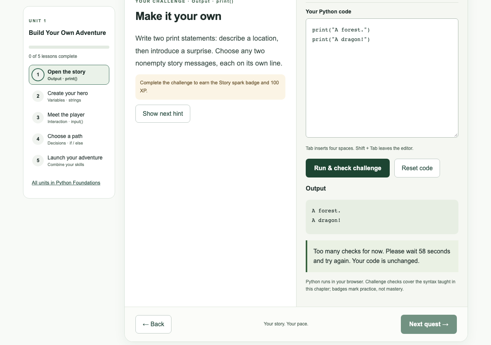

# Handoff 06: Rate limits and security headers (stage 6: SEC-01, SEC-04)

Date: 2026-10-25 (America/Toronto)  
Written by: Claude Code (implementer)  
For: the human maintainer, and ChatGPT or Claude chat (reviewer) without repository access  
Status: **in_review**. PR #11 was merged and deployed on 2026-10-25. Its live check then **failed**: a made-up `X-Forwarded-For` header chose a new rate-limit counter. The fix is in a follow-up pull request (section 13), not merged. No content, XP or account-policy changes.

> **How to use this file:** upload it with `build.md`, `docs/plan/backlog.md` and `docs/plan/feedback-security.md`. It summarizes evidence; the pull request diff and CI results are the source of truth (`build.md` section 14).

## Starter prompt for the chat assistant

```text
You are reviewing Python Academy stage 6: rate limits on the API's write
endpoints and sign-in (SEC-01), and security headers with a
Content-Security-Policy in Report-Only mode (SEC-04). I'm attaching
build.md, the backlog, the feedback security plan and this handoff.
Check that a made-up X-Forwarded-For header cannot dodge or abuse the
limits, that the counters and logs hold no learner code or message text,
that the limits are loose enough for a classroom sharing one address,
and that the proposed enforce-mode policy is as strict as it can be
without breaking Pyodide. Explain at a first-year computer engineering
level.
```

## 1. Where we are

| Stage | What | Status |
| --- | --- | --- |
| 1–3 | Content format, migrations and ledgers, catalog UI | Merged and verified live (PRs #5, #7, #8) |
| 4 | Goals and recommendations | Merged (PR #9); owner's live check not yet recorded |
| 5 | Backlog, feature plans, feedback security | Merged (PR #10, documentation) |
| 6 | SEC-01 rate limits, SEC-04 security headers | **in_review**: this PR |

## 2. Handoff record (build.md template)

| Field | Value |
| --- | --- |
| Task | SEC-01: limit write endpoints and sign-in, return 429 with `Retry-After`. SEC-04: HSTS, `nosniff`, `Referrer-Policy`, framing blocked, page CSP in Report-Only mode with a tested enforce-mode policy. Close decision 19 |
| Human goal | Stop scripted abuse (spam checks, invitation floods, sign-in hammering) before the feedback feature adds a new place to send text, and add browser-side protections without breaking Python in the browser |
| Repository and branch | `torontojohn/python-academy`, branch `sec/rate-limits-headers` |
| Base commit | `6d04ff0` (`main` after PR #10) |
| Deployment status | Not deployed; not merged |
| New dependencies | **None.** The limiter uses only Python's standard library; the tests use the existing pytest and Playwright |

### Files changed

| File | Change |
| --- | --- |
| `backend/app/limits.py` | New. In-memory fixed-window limiter, the rule table, client-address logic, the 429 response |
| `backend/app/main.py` | Each limited route gets `dependencies=[Depends(limit('<rule>'))]`. API responses also get `Content-Security-Policy: default-src 'none'; frame-ancestors 'none'`, and HSTS in production |
| `backend/tests/test_limits.py` | New: 23 tests (exceeding each limit, normal use, counters and logs, client address) |
| `backend/tests/conftest.py` | New: empties the counters before and after every test so tests cannot push each other over a limit |
| `frontend/next.config.mjs` | HSTS; an enforced `frame-ancestors 'none'`; the page CSP in Report-Only mode. The worker's own enforced policy is unchanged and listed last so it still applies to the worker |
| `frontend/tests/academy.spec.ts` | Every test now fails if the page CSP reports a violation; new tests: Python runs with the headers on, the app refuses to be framed, a 429 shows its message and keeps the draft |
| `DEPLOYMENT.md` | Short section on limits and headers |
| `docs/plan/backlog.md`, `course-catalog.md`, `feedback-security.md` | Decision 19 closed; SEC-01 and SEC-04 in_review; new SEC-09 (CSP nonces); a correction to the feedback security plan (section 6 of this file) |

## 3. SEC-01: rate limits

### The limits

| Rule | Endpoint | Signed in (per user) | Signed out (per address) |
| --- | --- | --- | --- |
| `check` | `POST /api/check` (preview checks) | 20 per minute and 300 per hour | 60 per minute and 600 per hour |
| `attempts` | `POST /api/attempts` (saved checks) | 20 per minute and 300 per hour | 60 per minute and 600 per hour (refused with 401 anyway) |
| `invitations` | `POST /api/invitations` | 10 per hour and 30 per day | 10 per hour |
| `goal` | `POST /api/goal` | 10 per minute and 50 per day | 30 per minute |
| `enroll` | `POST /api/enroll` (registration) | 10 per 15 minutes | 30 per 15 minutes |
| `signin` | `GET /auth/google` | always per address: 60 per 10 minutes | same |
| `signin_callback` | `GET /auth/google/callback` | always per address: 60 per 10 minutes | same |

`enroll` was not on your list. I added it because it is a write endpoint where invitation codes are typed in. Logout is the only write endpoint without a limit, and a test fails if a new write endpoint is added without one.

Why these numbers: a busy learner who checks every 15 seconds for a whole hour stays under them (tested). Signed-out and sign-in limits are per address and looser, because a school or a family shares one address. Thirty learners on one address signing in and trying preview checks stay under the limits (tested).

### What a refused request looks like

HTTP 429 with a `Retry-After` header (whole seconds), and a JSON message the app already shows in its notice area. For example: "Too many checks for now. Please wait 58 seconds and try again. Your code is unchanged." The draft stays in the editor and nothing is awarded.



The API log gets one line, `Rate limited: rule=check scope=ip`: no user ID, address, code or message text.

### Where the counters live: memory, not the database

**Choice: in the API process's memory.** Each counter holds only a keyed hash of `u:<user id>` or `ip:<address>`, the start of its window, and a count. The hash key is random and new each time the process starts.

| | Memory (chosen) | Database |
| --- | --- | --- |
| Cost and complexity | No migration, no extra table, no extra database write on every check | A new table, a migration, a write per limited request on the Basic-256mb database, and a cleanup job |
| Privacy | Addresses and user IDs are never written to disk; everything is gone at restart | Hashed addresses stored on disk. The IPv4 range is small enough to reverse a plain hash, so it needs a keyed hash and deletion |
| Restarts and deploys | **Counters reset**, so someone could get a fresh allowance after each deploy. Visitors cannot trigger deploys, so this costs at most one extra allowance per deploy | Survive restarts |
| More than one instance | **Breaks**: each instance would count separately. Today Render runs one API instance (Starter plan, no autoscaling). During a zero-downtime deploy, the old and new instances overlap for a moment | Correct with any number of instances |
| Memory use | Bounded: IPv6 addresses are grouped by /64, and above 50,000 counters the oldest are dropped (tested) | Bounded by cleanup |

For a speed bump against scripts on one Render instance, memory is the simpler and more private choice. **If the API is ever scaled to two or more instances, move the counters to the database first** (noted in `DEPLOYMENT.md`).

The future feedback endpoint is different. Its daily and global limits must survive restarts, so it keeps the plan's own database counters (`feedback-security.md` section 7, keyed HMAC, no text).

### Which address counts as the visitor

**Corrected after the live check: see section 13.** The original rule, "the rightmost public address in `X-Forwarded-For`", could be steered by the caller on Render. The API now uses only one trusted source that you configure after the diagnostic. Until then, all signed-out visitors share one counter.

## 4. SEC-04: security headers

### Headers now sent

| Header | Pages (Next.js) | API (FastAPI) |
| --- | --- | --- |
| `Strict-Transport-Security` | `max-age=31536000; includeSubDomains` | Same, in production only |
| `X-Content-Type-Options` | `nosniff` (already) | `nosniff` (already) |
| `Referrer-Policy` | `no-referrer` (already) | `no-referrer` (already) |
| Framing | `X-Frame-Options: DENY` (already) **and** enforced `Content-Security-Policy: frame-ancestors 'none'` | `Content-Security-Policy: default-src 'none'; frame-ancestors 'none'` (enforced; JSON needs nothing) |
| Page CSP | `Content-Security-Policy-Report-Only` (below) | — |
| Worker `/python-worker.js` | Its existing enforced policy, unchanged: Pyodide from `cdn.jsdelivr.net` only | — |

Three things I found while building this:

- **`frame-ancestors` is ignored inside a Report-Only policy**, so the framing protection is sent as its own small enforced policy now. It cannot break Pyodide.
- **Next.js applies the last matching header rule** when two rules set the same header. The worker's rule is therefore listed last. Otherwise the page's `frame-ancestors` policy would have replaced the worker's policy.
- API responses pass through Next.js without Next.js's headers, so HSTS for `/api/…` comes from the API itself.

### Violations found on the lesson page

Method: production build and the real local API. A strict baseline policy (`default-src 'self'; script-src 'self'; style-src 'self'; img-src 'self'; font-src 'self'; connect-src 'self'; worker-src 'self'; object-src 'none'; base-uri 'none'; form-action 'self'`) was set in Report-Only mode. A browser script then visited `/`, `/courses`, `/courses/py`, `/learn/hello`, `/preview?lesson=hello` and the challenge card, ran Python, got a check result, and ran the `input` lesson. It recorded every `securitypolicyviolation` event and console report. The 27 Playwright flows (signed-in student, parent, goal card, catalog, mobile) were then run with the same listener.

| # | Directive | What was blocked | Where | Cause | Fix in the proposed policy |
| --- | --- | --- | --- | --- | --- |
| 1 | `script-src-elem` | Inline `<script>` elements, 2–4 per page (for example hashes `sha256-IeYfifqR…`, `sha256-OBTN3Riy…`, `sha256-Tt52LbKv…`) | Every page: `/`, `/courses`, `/courses/py`, `/learn/hello`, `/preview` | Next.js puts its page data and start-up code in inline scripts. Their content, and so their hashes, change with every page and every build | `script-src 'self' 'unsafe-inline'`. Hashes cannot list content that changes. Nonces need SEC-09 |

**That was the only violation.** No style, image, font, `connect-src` or `worker-src` violation occurred. Pyodide and its CDN load **inside the worker**, which has its own policy, so the page policy never sees them. The page does not need `'unsafe-eval'` or the CDN.

### Exact enforce-mode policy to switch to

```text
Content-Security-Policy: default-src 'self'; script-src 'self' 'unsafe-inline'; style-src 'self'; img-src 'self'; font-src 'self'; connect-src 'self'; worker-src 'self'; object-src 'none'; base-uri 'none'; form-action 'self'; frame-ancestors 'none'
```

To switch, in `frontend/next.config.mjs` replace these two lines:

```js
      {key:'Content-Security-Policy',value:"frame-ancestors 'none'"},
      {key:'Content-Security-Policy-Report-Only',value:PAGE_POLICY},
```

with this one:

```js
      {key:'Content-Security-Policy',value:PAGE_POLICY+"; frame-ancestors 'none'"},
```

**Already tested in enforce mode:** I made exactly that change locally and rebuilt. All 27 Playwright tests passed, and Python ran and was checked against the real local API with no violations. Then I put the Report-Only version back.

What this policy does and does not do:

- It blocks scripts, styles, images and fonts from other sites. It blocks sending data anywhere except this app (`connect-src 'self'`), plugins, `<base>` tag tricks, forms posting elsewhere, and framing.
- Because of `'unsafe-inline'`, it does **not** block an injected inline `<script>`. React escapes all text, and the app never uses `dangerouslySetInnerHTML`, so there is no known way to inject one today. Closing this needs nonces: a Next.js proxy file adds a fresh random value to each page, and every page then renders per request. That is new backlog item **SEC-09**, which I propose as a dependency of the admin inbox.

## 5. Decision 19 closed

Parents never see the feedback button or any feedback; this follows from decision 23. It is recorded in `docs/plan/backlog.md` section 6, `docs/plan/course-catalog.md` section 9 (with the session record), and `docs/plan/feedback-security.md`. FB-01 no longer waits on it. Still open: 14, 15, 17, 20.

## 6. Correction to the feedback security plan

`feedback-security.md` said the SEC-04 policy "blocks inline script on admin pages". That would have been wrong, because Next.js needs `'unsafe-inline'`. The plan now says the policy blocks outside scripts and outside data sending, and that blocking inline script needs SEC-09. It also says the feedback limits need database counters, not stage 6's in-memory ones.

## 7. Acceptance criteria

- Write endpoints `/api/check`, invitations, attempts and goal changes, plus sign-in, are limited: per user when signed in, per address when not. **Met** (plus enrolment).
- Refusals return 429, `Retry-After`, and a short plain message, and learner code and message text are never logged. **Met** (tested: counters and logs contain no code, address, user ID or email).
- Counter storage chosen, with the trade-off explained for Render, and no message text in counters. **Met** (section 3).
- Tests exceed each limit, and normal use stays under the limits. **Met** (23 backend tests).
- HSTS, `X-Content-Type-Options`, `Referrer-Policy` and `frame-ancestors` are on the main app. **Met.**
- The CSP is in Report-Only mode, every violation found is listed, and the exact enforce-mode policy is given. **Met** (section 4; enforce mode also tested).
- A Playwright test shows the lesson page still runs Python with the headers on. **Met.**
- Decision 19 closed in the plan and backlog. **Met.**
- No new dependencies; no content or XP changes. **Met.**

## 8. Tests run (exact commands and results)

From the repository root, on macOS with Python 3.12.14 (`backend/.venv`) and Node 24:

| Command | Result |
| --- | --- |
| `cd backend && .venv/bin/python -m pytest -q` | `125 passed, 8 skipped` (the 8 are PostgreSQL tests; they need `TEST_POSTGRES_URL`) |
| Same, with `TEST_POSTGRES_URL` set to a local throwaway PostgreSQL 16 (pgserver) | `133 passed` |
| `cd backend && .venv/bin/python -m pytest -q tests/test_limits.py` | `23 passed` |
| `cd frontend && npx tsc --noEmit` | No errors |
| `cd frontend && npm run build` | Compiled successfully |
| `cd frontend && CI=1 npm run test:e2e` | `27 passed (38.9s)`. Every test also asserts no CSP violations |
| Same, built with the enforce-mode policy (section 4) | `27 passed (38.6s)` |
| Control: built with the stricter `script-src 'self'` | The header test **failed** as intended, with `script-src-elem blocked inline on /preview`. This proves the violation check works |
| Real local API: 61 `POST /api/check` from one address | 60 × `200`, then `429`, `retry-after: 60`, and the message shown in the screenshot |

CI runs the same backend tests, with its own PostgreSQL, and the Playwright suite on the pull request.

## 9. Mocks and unverified behaviour

- The Playwright tests mock the API, as before. The 429 test uses a mocked 429. The real 429 was checked against the local API (screenshot), and the backend tests use the real app.
- Render's `X-Forwarded-For` format is not verified (section 3). The live check covers it.
- The Google sign-in round trip was not run. The sign-in limits are tested with the routes called directly.

## 10. Questions for the owner

1. **SEC-09 before the admin inbox?** I propose making nonce-based CSP (SEC-09) a dependency of FB-06, because the admin inbox is where injected script would matter most. It is listed as proposed until you confirm.
2. **Limit numbers.** Are the values in section 3 right for how you expect testers and a classroom to use the app? They are one table in `backend/app/limits.py`.
3. **When to enforce.** I suggest one week of Report-Only with clean consoles during normal testing. Then switch with a one-line PR (section 4).

## 11. Live checks for you after merging

Merging redeploys both services. Use a terminal for the `curl` lines; nothing here needs a secret.

- [ ] **Deploy finished.** Both services show the new deploy as live in Render, and `https://python-academy-dji8.onrender.com/health` returns `{"status":"ok"}`.
- [ ] **Page headers.** `curl -sI https://python-academy-dji8.onrender.com/preview` shows `Strict-Transport-Security`, `Content-Security-Policy: frame-ancestors 'none'` and `Content-Security-Policy-Report-Only: default-src 'self'; …`.
- [ ] **Worker header unchanged.** `curl -sI https://python-academy-dji8.onrender.com/python-worker.js` shows `Content-Security-Policy: default-src 'none'; script-src 'unsafe-eval' https://cdn.jsdelivr.net; …`.
- [ ] **API headers.** `curl -s -D - -o /dev/null https://python-academy-dji8.onrender.com/api/lessons` shows `strict-transport-security` and `content-security-policy: default-src 'none'; frame-ancestors 'none'`.
- [ ] **Python still runs, with no CSP reports.** Open DevTools → Console, then go to a lesson challenge as a signed-in student. Run and check a correct answer, and confirm the badge and XP as before. The console should show **no** messages containing `Report Only` or `Content Security Policy`. Repeat on the home page, `/courses`, a course page, the goal card ("Change goal") and the parent home. Send me any message you see, word for word.
- [ ] **Sign-in still works.** Sign out and sign back in with Google.
- [ ] **Normal use is not limited.** Do one whole lesson at a normal pace. You should never see "Too many …".
- [ ] **Rate limits and visitor addresses:** superseded. Use the checks in section 13.5 instead.
- [ ] **Logs hold no code.** In Render → API service → Logs, search for `Rate limited`. You should see `Rate limited: rule=check scope=ip` lines and nothing else about those requests: no code, email or address in that line. Render's own request log lines still show addresses, as before.
- [ ] **After about a week** of clean consoles, ask me for the one-line enforce-mode PR (section 4).

## 12. Next concrete action

The owner reviews the follow-up PR, merges it, and runs section 13.5. That covers the diagnostic, choosing the trusted source, the spoof tests, and switching the diagnostic off. Then run the rest of section 11. Then, following the backlog: record the stage 4 and stage 6 live checks, then SEC-03 (server-side logout) and SEC-09 (CSP nonces) before the admin inbox, then FB-01.

## 13. Update: live check failure and fix (2026-10-25)

### 13.1 What failed

The owner sent 61 `POST /api/check` requests to the live site, each with a different made-up `X-Forwarded-For: 198.51.100.N`. **All 61 returned 200.** The same 61 requests without the header returned 60 × 200 and 1 × 429. So a caller could pick a new counter for every request, and the per-address limits for signed-out checks and sign-in could be bypassed.

Signed-in limits (attempts, invitations, goal, registration, and checks by signed-in users) were not affected: they count per user, from the signed session cookie.

### 13.2 What the proxies actually send (checked, not guessed)

- **Next.js** (checked by running it). I ran the production build of the frontend in front of a small local server that prints the headers it receives:

  | Sent to Next.js | Received by the server behind it |
  | --- | --- |
  | nothing | no `X-Forwarded-For` at all; only `x-forwarded-host` |
  | `X-Forwarded-For: 198.51.100.7` | `x-forwarded-for: 198.51.100.7` (unchanged) |
  | `X-Forwarded-For: 1.1.1.1, 198.51.100.7` and `X-Real-IP: 9.9.9.9` | both passed through unchanged |

  The code agrees. Next.js's rewrite proxy (`next/dist/server/lib/router-utils/proxy-request.js`) creates its proxy without `xfwd`, so it **neither adds nor replaces** `X-Forwarded-For`. It only sets `x-forwarded-host`. The `x-forwarded-for ??= socket address` line in `base-server.js` only applies to pages Next.js renders itself, not to rewrites. Whatever arrives at Next.js, including caller-made headers, reaches the API.
- **Render's edge.** Render does not document its forwarding headers. Requests to `*.onrender.com` pass through Cloudflare. Cloudflare's documentation says it **appends** to an existing `X-Forwarded-For` rather than replacing it, and sends `CF-Connecting-IP` with the address that connected to Cloudflare. Cloudflare's docs do not say whether a caller-sent `CF-Connecting-IP` is overwritten. They warn that `True-Client-IP` "can be spoofed" unless a setting adds it. Render forum reports say `CF-Connecting-IP` carries the real visitor on Render. **Whether it arrives at our API, and whether a caller can override it, still has to be checked on the live site.** That is what the diagnostic is for.
- **Why the old rule failed** cannot be confirmed without the diagnostic, so this PR does not rely on any explanation. The fix no longer reads any header unless you configure it.

### 13.3 The fix

`backend/app/limits.py` now takes a signed-out visitor's address from **exactly one source that you configure** on the API service. Any other forwarding header is ignored.

| Setting (API service environment) | Address used | Why a caller cannot control it |
| --- | --- | --- |
| Neither set (**default after this PR**) | One shared counter for all signed-out visitors | No header is read, so nothing the caller sends matters. It is too strict, not spoofable |
| `CLIENT_IP_HEADER=cf-connecting-ip` (expected choice) | That header's value, if it is exactly one valid address; otherwise the shared counter | Safe **only if** the edge overwrites any value the caller sends. The live checks in 13.5 prove or disprove that before you rely on it. `X-Forwarded-For`, `X-Real-IP`, `True-Client-IP` and `Forwarded` are ignored |
| `TRUSTED_PROXY_HOPS=N` (alternative) | The entry N places from the **right** of `X-Forwarded-For` | Each proxy only appends on the right, so anything a caller sends ends up further left than N. Correct only if N is exactly the number of entries our own proxies add. The diagnostic's entry count shows this |

The old "rightmost *public* address" rule is gone. Two problems with it: documentation ranges such as 198.51.100.0/24 are not "public", so they were skipped, and the fallback could be a caller-made value.

### 13.4 The temporary diagnostic

Set `RATE_LIMIT_DIAGNOSTIC=1` on the API service. It is off unless it is exactly `1`. For each signed-out limited request, the API then logs one line like:

```text
Client address diagnostic: rule=check xff_entries=2 headers=cf-connecting-ip,cf-ray,x-forwarded-for,x-forwarded-host source=header chosen=3fa9c2e1
```

- `xff_entries`: how many entries `X-Forwarded-For` has (0 if it is missing)
- `headers`: names only of the forwarding headers present: `x-forwarded-*`, `x-real-*`, `x-client-*`, `cf-*`, `true-client-*`, `forwarded`, `rndr-*`, `x-render-*`, `via`, `cdn-loop`
- `source`: `header`, `hops` or `shared`
- `chosen`: the first 8 hex characters of an HMAC of the chosen address, keyed with a random secret that changes on every restart. Equal hashes within one deploy mean the same counter; the address cannot be read back from it

It never logs an address, user ID, code or message text (tested). Signed-in requests are counted per user and log nothing.

Separate from this diagnostic: uvicorn's own access log lines (`INFO: <address>:0 - "POST /api/check …" 200 OK`) already print an address, as they did before stage 6. Running locally, I saw uvicorn put the made-up `X-Forwarded-For` value there, so do not read those lines as the address the limiter used. Only the diagnostic line shows what the limiter chose. Render's own request logs also record addresses (see `feedback-security.md` section 8).

### 13.5 Live checks (exact commands)

Paste this into your terminal first. It defines `check`, which sends one signed-out preview check and prints the status code:

```sh
URL=https://python-academy-dji8.onrender.com
check() { curl -s -o /dev/null -w "%{http_code}\n" -H "Origin: $URL" -H 'Content-Type: application/json' -d '{"lesson_id":"hello","code":"print(1)","output":"1\n"}' "$@" "$URL/api/check"; }
```

Changing an environment variable on Render redeploys the API, which also resets the counters. Wait for the deploy to show **Live** before each step. Wait **one minute** between the 61-request loops so the previous counter expires.

**A. After merging (no setting yet): spoofing no longer helps.**

- [ ] `for i in $(seq 1 61); do check -H "X-Forwarded-For: 198.51.100.$i"; done | sort | uniq -c` gives `60 200` and `1 429`. This is the test that failed before.
- [ ] Wait a minute. `for i in $(seq 1 61); do check -H "X-Forwarded-For: 198.51.100.$i" -H "CF-Connecting-IP: 198.51.100.$i" -H "True-Client-IP: 198.51.100.$i" -H "X-Real-IP: 198.51.100.$i"; done | sort | uniq -c` gives `60 200` and `1 429`. If Cloudflare refuses the header, you may see another code such as `403` instead of `200`s. That is also fine, as long as there are never 61 `200`s.

**B. Diagnostic: what does Render actually send?**

- [ ] In Render → **python-academy-api** → Environment, add `RATE_LIMIT_DIAGNOSTIC` = `1` **and** `CLIENT_IP_HEADER` = `cf-connecting-ip`, then save.
- [ ] After the deploy is live, run these one at a time, a few seconds apart:
  1. `check`
  2. `check -H "X-Forwarded-For: 198.51.100.1"`
  3. `check -H "CF-Connecting-IP: 198.51.100.2"`
  4. `check -H "CF-Connecting-IP: 198.51.100.3" -H "True-Client-IP: 198.51.100.4" -H "X-Real-IP: 198.51.100.5"`
  5. On a phone using **mobile data (Wi-Fi off)**: open `$URL/preview?lesson=hello&card=5`, then run and check the challenge once.
- [ ] In Render → API → Logs, search for `Client address diagnostic`. Copy the five lines to me; they contain no addresses. What they should show:
  - `headers=` includes `cf-connecting-ip`, and `source=header` on every line. If the header is not listed, Render does not send it: remove `CLIENT_IP_HEADER` and send me the lines.
  - Lines 1–4 all have the **same** `chosen=` hash. If line 3 or 4 differs, a caller can set `CF-Connecting-IP`. **Remove `CLIENT_IP_HEADER` at once**, which brings back the safe shared counter, and tell me.
  - Line 5 (phone) has a **different** `chosen=` hash: separate visitors get separate counters.
  - `xff_entries=` on line 2 is one more than on line 1. That would show Render appends to `X-Forwarded-For` (useful if `TRUSTED_PROXY_HOPS` is needed instead).

**C. With `CLIENT_IP_HEADER=cf-connecting-ip` set and the diagnostic confirmed: the spoof tests.**

- [ ] `for i in $(seq 1 61); do check -H "X-Forwarded-For: 198.51.100.$i"; done | sort | uniq -c` gives `60 200` and `1 429`.
- [ ] Wait a minute. `for i in $(seq 1 61); do check -H "CF-Connecting-IP: 198.51.100.$i"; done | sort | uniq -c` gives `60 200` and `1 429` (or a refusal code, but never 61 × `200`).
- [ ] Right after that loop, on the phone using mobile data, run and check the challenge once. It should work, because the phone has its own counter.
- [ ] `curl -s -D - -o /dev/null -H "Origin: $URL" -H 'Content-Type: application/json' -d '{"lesson_id":"hello","code":"print(1)","output":"1\n"}' "$URL/api/check" | grep -i -E "^HTTP|retry-after"`, run straight after a loop, shows `429` and a `retry-after:` value.

**D. Finish.**

- [ ] Delete `RATE_LIMIT_DIAGNOSTIC` from the API environment. Keep `CLIENT_IP_HEADER` only if all of B and C passed.
- [ ] Search the logs for `Rate limited`: lines say only `rule=… scope=…`.

### 13.6 Tests for the fix

| Command | Result |
| --- | --- |
| `cd backend && .venv/bin/python -m pytest -q tests/test_limits.py` | `31 passed` |
| `cd backend && .venv/bin/python -m pytest -q` | `133 passed, 8 skipped` (the 8 PostgreSQL tests need `TEST_POSTGRES_URL`; CI runs them) |
| Control: the new spoof test run against the **old** `limits.py` | **Fails**, as it should. It reproduces the production bypass |

New tests:
- `test_spoofed_forwarding_headers_do_not_change_the_counter`: 61 requests, each with different made-up `X-Forwarded-For`, `X-Real-IP`, `True-Client-IP`, `Forwarded` and `X-Client-IP`, are still limited at request 61.
- The same test with no setting, and with `TRUSTED_PROXY_HOPS`, where even a made-up `CF-Connecting-IP` changes nothing.
- Different visitors, according to the edge header, get separate counters.
- A table test of the address chosen in every mode, including a missing header, a list where one address is expected, and too few entries.
- The diagnostic logs counts, header names and an 8-character hash only, and is off by default.

