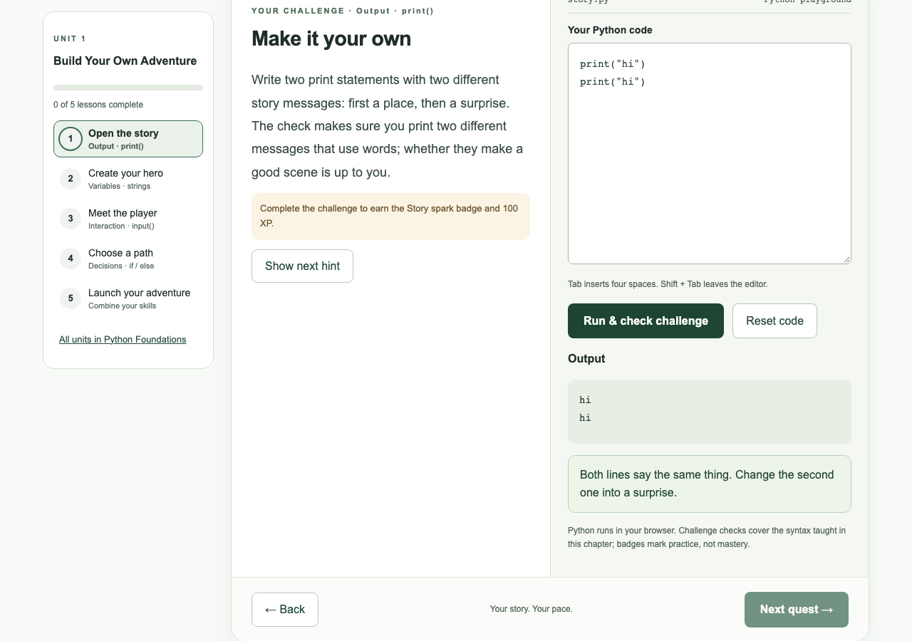

# Handoff 10: Honest unit 1 checks and hints (stage 10: ASSESS-07)

Date: 2026-10-26 (America/Toronto)  
Written by: Claude Code (implementer)  
For: the human maintainer, and ChatGPT or Claude chat (reviewer) without repository access  
Status: **in_review**: one pull request, not merged, not deployed. **No database migration.** No XP, badge or ID changes; challenge versions bumped as the content format requires.

> **How to use this file:** upload it with `build.md`, `docs/plan/lesson-feedback.md` (appendix A and section 8) and `docs/plan/teaching-design.md` section 2.10. The pull request diff is the source of truth (`build.md` section 14).

## Starter prompt for the chat assistant

```text
You are reviewing Python Academy stage 10 (ASSESS-07): the unit 1
challenge checks now say only what they verified, the first challenge
("Open the story") refuses identical lines, lines without letters, and
the worked example or a hint copied unchanged, and the hints were
rewritten so that no combination of them passes a check. I'm attaching
build.md, docs/plan/lesson-feedback.md and this handoff. Check that every
success message claims nothing the check does not test, that no valid
creative answer is now refused, that the hint audit really tries the
combinations a learner could make, and that learners who already passed
keep their completion, XP and badge. Explain at a first-year computer
engineering level.
```

## 1. Where we are

| Stage | What | Status |
| --- | --- | --- |
| 7 | SEC-03 server-side sessions | Merged (PR #13); your live check not yet recorded |
| 8 | SEC-09 nonce-based CSP, Report-Only | Merged (PR #14); your live check not yet recorded |
| 9 | Teaching design and lesson feedback (docs) | Merged (PR #15) |
| 10 | ASSESS-07 honest unit 1 checks | **in_review**: this PR |

## 2. Handoff record (build.md template)

| Field | Value |
| --- | --- |
| Task | Build `lesson-feedback.md` appendix A as written: honest success messages with a self-check question; a stricter `hello` check (lines differ, contain letters, are not the worked example or a hint copied unchanged; no word minimum); a matching prompt; hint 3 replaced; `input` and `variables` hints rewritten; tests |
| Human goal | A pass in unit 1 means what the card says it means, and hints guide without handing over the answer |
| Repository and branch | `torontojohn/python-academy`, branch `assess/honest-unit1-checks` (assumption 1) |
| Base commit | `f7bfa28` (`main` after PR #15) |
| Implementer / reviewer | Claude Code / owner, plus ChatGPT or Claude chat |
| Deployment status | Not deployed; not merged |
| New dependencies | None |
| Database migration | **None** |

### Files changed

| File | Change |
| --- | --- |
| `backend/app/lesson_checks.py` | New rules for `hello` (letters, different lines, no `___` placeholder, not the worked example or a hint copied unchanged); all five success messages reworded |
| `backend/app/content.py` | The `bounded-story` validator is now version 2 (only v2 is accepted) |
| `backend/content/py/u01/*.json` | All five lessons: lesson version 2, challenge version 2, validator v2. `hello`: new prompt and hint 3. `input`: three new hints. `variables`: hints 2 and 3 rewritten |
| `backend/tests/fixtures/legacy_lessons_v1.json` | Regenerated: `/api/lessons` now serves the new prompt and hints (the content README requires this in the same PR) |
| `backend/tests/test_honest_checks.py` | New: 36 tests (section 6) |
| `backend/tests/test_academy.py` | Tests that used `hello`'s worked example as a passing answer now use their own answer; the worked example is expected to **fail** for `hello` and pass for the other four; new awards record challenge v2; a v1 award is not repeated |
| `backend/tests/test_content.py` | The "unknown validator" test now uses v3, since v2 is valid |
| `docs/plan/lesson-feedback.md` | Appendix A marked as built; a correction in section 8 (section 5 below) |
| `docs/plan/backlog.md` | ASSESS-07 in_review; stage rows 8 to 10 |
| `docs/handoffs/images/10-hello-*.png` | Screenshots from the local check (section 6) |

## 3. What changed for learners

### 3.1 Success messages: only what was checked, then a question

| Lesson | Before | After |
| --- | --- | --- |
| `hello` | "Your scene has a setting and a surprise. Python displays your two messages in order." | "Python printed your two different messages in order. Read them back: does the first set the scene and the second surprise you? That part is your call." |
| `variables` | "Your hero and tool both come from variables. Changing their values changes the story." | "hero and tool both hold text, and your program prints their values by using the variables. Change one value and run again: does your story change the way you expect?" |
| `input` | "Your greeting responds to different names. input() gives the player a part in the story." | "Your greeting used the reply: it changed when we tried two different player names. Run it with your own name as the reply: does the greeting read the way you want?" |
| `choices` | "Both paths work and lead to different discoveries." | "Your program asks once and prints a different discovery for left and for right. Which path would you pick, and does each discovery fit your story?" |
| `adventure` | "Your adventure welcomes different players and has two working paths. You combined all four Python skills!" | "Your adventure opens with a scene, welcomes players by the name they type, and gives left and right different endings. You combined all four Python skills! Read both endings: do they finish the story you started?" |

Each "after" message was compared with what that lesson's check actually tests in `lesson_checks.py`. For example, the `input` check really does run the program with two different names and look for each one in the output.

### 3.2 The "Open the story" (`hello`) check

These rules were added after the existing ones (exactly two `print` statements, two non-empty lines). Each has its own message:

| Rule | Message |
| --- | --- |
| Each line contains at least one letter | "Use words for each message: first a place, then something unexpected. Numbers or punctuation on their own don't tell a story." |
| The two lines differ, ignoring case, spacing and final `.`, `!` or `?` | "Both lines say the same thing. Change the second one into a surprise." |
| No `___` left from the hint's pattern | "Fill in the ___ from the hint with your own words." |
| Not the worked example copied unchanged (both lines), or hint 3 as published before | "That's the example from the card. Make it your own: change the place and the surprise." |
| No line copied from a current hint | "That line comes straight from a hint. Change it into your own words." |

- **Not checked, on purpose:** whether a line describes a place or a surprise, and any minimum number of words (decision 5). So `print("hi")` then `print("woah")` **still passes**, and the message now says honestly what was checked.
- **Keeping one example line and changing the other passes.** Only the example copied **unchanged** is refused.
- **Old hint 3 refused by name.** "You land on Mars." / "A robot offers you tea." is refused even though it is no longer a hint, because learners were given it as an answer (assumption 3).

### 3.3 Prompt and hints

- **`hello` prompt:** "Write two print statements with two different story messages: first a place, then a surprise. The check makes sure you print two different messages that use words; whether they make a good scene is up to you."
- **`hello` hint 3:** "A pattern to complete: print("You wake up in ___.") Then add a second print() with something unexpected." Hints 1 and 2 are unchanged.
- **`input` hints** use another variable name, so they teach the idea without writing the answer:
  1. "input() gives back whatever the player typed. The starter keeps it in the variable player."
  2. "Join text and a variable with +: print("Good morning, " + friend) greets whatever is stored in friend. Which variable holds your player's reply?"
  3. "Another way is an f-string: put a variable name in braces inside the text, like f"See you soon, {friend}". Remember the f before the opening quote."
- **`variables` hints 2 and 3** use `pet` and `bed` instead of `hero` and `tool`:
  - "…like print(pet) for a variable called pet."
  - "…like print(pet + " sleeps on the " + bed). Try the same with your own variables."
- `choices` and `adventure` hints are unchanged. The audit found they do not add up to an answer.

## 4. Existing completions, XP, badges, IDs and versions

- **No IDs changed:** lesson, task, badge and validator IDs are unchanged.
- **Versions** follow the content README ("for a wording or bug fix, increase version"):
  - all five lessons and their challenge tasks are now version 2
  - the `bounded-story` validator is now version 2
  - badge versions stay at 1
- **XP is unchanged:** 100 per challenge, once. `award_challenge` gives XP only if the learner has **no** award for that task ID at any version.
  - Someone who passed under v1, even with `print("hi")` twice, keeps their completion, 100 XP and badge.
  - Passing again under v2 adds nothing (tested through the API).
  - New awards are recorded with `task_version = 2`.
- **No database migration:** no table or column changed, and existing rows are untouched.
- **Attempts saved before** keep their stored result (`passed`). They are not re-checked.

## 5. Correction to handoff 09 and `lesson-feedback.md`

Handoff 09 and `lesson-feedback.md` section 8 said `variables` hints 1 and 3 together were a complete passing answer. That was overstated. The hints only passed once **I** typed values for `hero` and `tool`; the starter leaves them empty (`hero = ""`). The new hint audit confirms that the old `variables` hints pass nothing on their own. I rewrote them anyway, as you asked, because they spelled out the whole `print` line. `lesson-feedback.md` section 8 now carries this correction.

## 6. Tests run (exact commands and results)

From the repository root, on macOS (Python 3.12.14 in `backend/.venv`, Node 24):

| Command | Result |
| --- | --- |
| `cd backend && .venv/bin/python -m pytest -q tests/test_honest_checks.py` | `36 passed` |
| `cd backend && .venv/bin/python -m pytest -q` | `213 passed, 9 skipped` (the 9 need PostgreSQL) |
| Same with `TEST_POSTGRES_URL` set to a local throwaway PostgreSQL 16 | `222 passed` |
| `cd frontend && npx tsc --noEmit` | No errors |
| `cd frontend && npm run build` | Compiled successfully |
| `cd frontend && CI=1 npm run test:e2e` | `30 passed` |
| Real local API, production frontend build and real Python in Chromium, no mocks, on `/preview?lesson=hello&card=5` | `hi`/`woah`: passed, with the new message. `hi` twice: "Both lines say the same thing…". The worked example: "That's the example from the card…". `print(1)`/`print(2)`: "Use words…". The new prompt is shown. Screenshot below |



### What `test_honest_checks.py` covers

| Requirement | Tests |
| --- | --- |
| The cases from appendix A | 7 cases with their exact result and message: `hi`/`woah` passes; the same line twice, punctuation, numbers, the worked example and old hint 3 need work; one line needs work |
| Every old passing answer that should now fail | 10 more cases: the same words in different case or spacing, lines without letters (including an emoji-only line), the worked example in capitals, old hint 3 without full stops, the new hint's pattern left unfilled |
| Valid answers still pass | 5 cases: "Mars." / "Boom!" (no word minimum), the hint pattern filled in, one example line kept, accented text, "Room 101" |
| Honest success messages | For all five lessons: a passing answer gets a message with none of the old claims and with a self-check question |
| Every hint combination through the real checker | For each of the five challenges, the audit builds every program a learner could make from the starter and the hints alone. It takes every subset of the hints' `print(...)` and `name = input(...)` statements, adds them after the starter, puts them in place of the starter's `pass` lines, and also tries each hint's code from its first `print(` onwards. Every program runs through the real `assess()`; **none may pass** (3 to 16 programs per lesson) |
| The audit works (control) | With the **old** `input` hints, the audit finds a passing program, as it should. Old `hello` hint 3 is among the programs it builds, and v2 refuses it |
| Versions, IDs, XP, badges | Lesson and challenge v2, validator v2, badges v1, other tasks v1, unchanged IDs, 100 XP |
| Existing completions | A learner holding a v1 award keeps their progress, XP and badge; passing again under v2 changes nothing |

## 7. Mocks and unverified behaviour

- **No mocks** in `test_honest_checks.py`: it calls the real checker and the real API, with a real session.
- **Program output in unit tests** comes from the checker's own bounded interpreter, not from Pyodide. The local browser check in section 6 used real Pyodide and gave the same results.
- **The hint audit** only builds programs from code the hints spell out (`print(...)` and `name = input(...)`). If a future hint used other statements, the extractor would need extending. It is in the test file and easy to grow.
- **The Playwright suite mocks the API**, as before. It still passes, because its mocked `/api/check` always says "passed".
- **Not verified:** the live site. Your checks in section 9 cover it after merge.

## 8. Assumptions

1. **Branch name** `assess/honest-unit1-checks`: the task did not name one.
2. **Version bumps:**
   - all five lessons, because every challenge's success message and validator version changed, not only `hello`'s
   - badges not bumped, since nothing about them changed
3. **Old hint 3** (Mars and robot) is refused by name as well as the worked example, because learners were given it as an answer. If you would rather allow it now that it is gone, delete `RETIRED_HELLO_HINT` in `lesson_checks.py` and its two test cases.
4. **"Contain letters"** means at least one Unicode letter per line. So an emoji-only line is refused, and accented text is accepted.

## 9. Live checks for you after merging

Merging redeploys both services. No migration runs: the API log still says `Database schema is at migration 0006`. Use a browser; no sign-in is needed for preview.

- [ ] **Deploy finished.** Render → **python-academy-api** → Logs shows `Database schema is at migration 0006`, and both services show the new deploy as live.
- [ ] **The original case still passes, with an honest message.** Open `https://python-academy-dji8.onrender.com/preview?lesson=hello&card=5`. The prompt starts "Write two print statements with two different story messages". Type `print("hi")` and `print("woah")` on two lines, then **Run & check challenge**. It passes, and says "Python printed your two different messages in order. Read them back: … That part is your call."
- [ ] **The same line twice is refused.** Change the second line to `print("hi")` and check again: "Both lines say the same thing. Change the second one into a surprise."
- [ ] **Numbers are refused.** `print(1)` and `print(2)`: "Use words for each message…"
- [ ] **The worked example is refused.** Go back to card 2, copy its two lines into card 5 and check: "That's the example from the card. Make it your own…"
- [ ] **Hint 3 is a pattern.** Show all three hints. Hint 3 starts "A pattern to complete". Copying `print("You wake up in ___.")` and adding any second line gives "Fill in the ___ from the hint with your own words."
- [ ] **Other lessons' messages.** On `/preview?lesson=input&card=5`, type `player = input("Name? ")` and `print("Hi, " + player)`, enter a player name in the reply box, and check. The message starts "Your greeting used the reply" and ends with a question. The hints mention `friend`, not `player`.
- [ ] **Your own progress is kept.** Sign in as the student account that already finished unit 1. The home page and `/courses/py` still show "Open the story" as done, with the same XP and Story spark badge as before. Passing it again does not add XP.

## 10. Questions for the owner

1. Keep refusing the old hint 3 (Mars and robot) now that it is no longer shown (assumption 3)?
2. Should this PR or ENG-04 also give the other four lessons' failure messages the same style? They already say what is missing; I left them unchanged because the task was about success messages and `hello`.

## 11. Next concrete action

The owner reviews and merges this PR and runs section 9. Record the stage 7 and stage 8 live checks too. Next in the backlog: ENG-04 (the feedback engine, unit 1 first), then ENG-03 and unit 2 (EDU-04).
