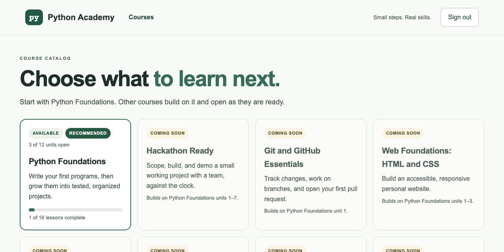

# Handoff 36: Two cosmetic fixes (master run WE5, UI-01)

Date: 2026-11-02 (America/Toronto)  
Written by: Claude Code (implementer), in a separate git worktree  
For: the human maintainer, and ChatGPT or Claude chat (reviewer) without repository access  
Status: **in_review**: one pull request (#41), not merged, not deployed. CSS and one class name only.

> **How to use this file:** the pull request diff is the source of truth (`build.md` section 14).

## Starter prompt for the chat assistant

```text
You are reviewing two small visual fixes to Python Academy's course card and
parent view. Check the picture and the diff. Say if anything looks worse.
```

## Run plan details

| Field | Value |
| --- | --- |
| Stage | WE5, first part (UI-01). UI-02 to UI-04 and UI-06 are not in this PR |
| Base | `main`, at `ac167e3`. No other PR needs to merge first |
| Part 2 boxes relied on | **None** |
| Stages passed over | WD3, WD6 to WD12: depend on unmerged or blocked stages. **WD5 (ENG-10): stopped, its spec contradicts itself** (section 7). WE1 to WE4: B-W1 is empty |

## 1. Step 0

`git fetch --all`, `gh pr list --state all`: #39 and #40 open. Worktree `../python-academy-ui01`; the main folder was not switched.

## 2. Handoff record (build.md template)

| Field | Value |
| --- | --- |
| Task | UI-01: stacked chips on the Python course card; small "Goal:" text in the parent view |
| Human goal | The two look tidy, and a parent can read a learner's goal easily |
| Non-goals | Anything else on these pages |
| Data and compatibility | None. No API change |
| Deployment status | Not requested |

### Files changed

`frontend/app/style.css`, `frontend/app/academy.tsx`, `frontend/tests/academy.spec.ts` (4 new tests), `docs/run-log.md`, this handoff, its PDF and one picture.

## 3. What changed



| Where | Before | After |
| --- | --- | --- |
| Course card | "Available" and "Recommended" stacked, with "3 of 12 units open" wrapped beside them | The chips share a line. The count moves below when there is no room |
| Parent view | "Goal: …" at 12 px, in the muted style | 15 px, in the dark green used for chips |

## 4. Decisions and why

| Decision | Options considered | Reason | Who decided |
| --- | --- | --- | --- |
| Let the row wrap | Drop the count; shrink the chips | Nothing is lost, and it works at any width | Implementer |
| 15 px for the goal | 14 px | Close to body text, for something a parent reads on purpose | Implementer (**assumption 1**) |

## 5. Bugs found and how they were fixed

**My first version added `white-space:nowrap` to the count, which caused sideways scrolling at 375 px.** The new phone test caught it. A deliberate-break run then showed the line wasn't needed, so I removed it.

## 6. How it was tested

| Command | Result |
| --- | --- |
| Backend, SQLite and PostgreSQL | **785 passed, 11 skipped; 796 passed** |
| `npx tsc --noEmit && npm run build` | OK |
| `CI=1 npx playwright test` | **259 passed** |

New tests measure the page: the chips have the same top at 1280, 1024 and 375 px, the count is one line, nothing scrolls sideways, and the goal is at least 14 px.

| Deliberate break (each undone) | Tests that failed |
| --- | --- |
| B1. The row no longer wraps | **3** |
| B2. The goal goes back to the muted style | **2**: the new test, and one more that matched it |
| B3. The `nowrap` line added back | **1**, at 375 px |

**Mocks:** recorded-style API answers, as in `academy.spec.ts`. **Not checked:** real phones, or a screen reader; no text changed.

## 7. Stopped: WD5, ENG-10

Plan Part 9 says "references stay server-side; tests run in the worker with limits". Those can't both hold. To run a learner's tests against a reference program, both must be in one place. The server may never run learner code, so the references would have to reach the browser. For a lesson like `py.refactor`, the correct reference is the answer. No code was written.

## 8. Live checks for you

- [ ] `/courses` as a student: the Python card's two chips share a line.
- [ ] The same page on a phone: nothing scrolls sideways.
- [ ] The parent view: "Goal: …" reads easily.

## 9. Questions for you

1. **Assumption 1, 15 px.** *Recommended, not yet confirmed: keep.*
2. **ENG-10: may reference programs reach the browser?** *Recommended, not yet confirmed: broken references yes, because finding their bug is the point and they give nothing away. The correct reference only as a program that the lesson doesn't treat as a secret. Decide with the same hidden-data rule as handoffs 29, 30 and 35.*

## 10. For the docs sync

| Where | What |
| --- | --- |
| Backlog UI-01 | proposed → in_review (#41, handoff 36) |
| Backlog ENG-10 | Note the contradiction and question 2 |
| Stage table | "36. UI-01 \| Cosmetic fixes \| in_review (#41, handoff 36)" |

## 11. Next concrete action

Review and merge.

## 12. Removing the worktree safely

From the **main** folder, after this PR is merged:

```sh
cd /Users/DEV/Projects/python-academy
git -C ../python-academy-ui01 status --short   # expect nothing, or only ?? frontend/AGENTS.md
rm -f ../python-academy-ui01/frontend/AGENTS.md   # generated by Next.js, not part of the project
git worktree remove ../python-academy-ui01     # deletes only that folder; refuses if anything is uncommitted
git worktree prune
git branch -d ui/cosmetic-fixes                # refuses if the branch is not merged
```

Don't delete the folder in the Finder or with `rm -rf`; Git would keep a stale record of it (`git worktree prune` fixes that).
