# Handoff 52: Visual redesign (one pull request)

Date: 2026-11-09 (America/Toronto)  
Written by: Claude Code (implementer), in a separate git worktree  
For: the human maintainer, and ChatGPT or Claude chat (reviewer) without repository access  
Status: **in_review**: one pull request (#60), not merged, not deployed. **No migration, no new dependency, no backend change, no Content-Security-Policy change.**

> **How to use this file:** upload it with `docs/design/prototype/index.html` (the design source) and `docs/design/art-style.md`. The pull request diff is the source of truth (`build.md` section 14).

## Starter prompt for the chat assistant

```text
You are reviewing the visual redesign of Python Academy. The owner's prototype
(docs/design/prototype/index.html) is now the real site: one stylesheet with design tokens, 16
lesson pictures keyed by lesson id with a plain fallback, a five-stop progress path and card-type
tabs on the lesson page, worked-example markers, a challenge "quest ticket" built from the check's
visible cases plus locked hidden ones, and new signed-out and student home pages. Check that hidden
expected output can never reach or appear on the page, that the account-rule wording is true, that
the home page playground cannot load Python, and that nothing in the lesson text changed.
```

## Run plan details

| Field | Value |
| --- | --- |
| Request | The owner's "Build the visual redesign as ONE pull request" prompt, 2026-11-09 |
| Base | `main`, at `f37387d` (after #59) |
| Branch and worktree | `ui/visual-redesign`, `../python-academy-redesign`; the main folder was not switched |
| Merge order | Any. No other PR is open |

## 1. What was built

| Request item | Where | Notes |
| --- | --- | --- |
| Prototype copied into the repo | `docs/design/prototype/index.html` | Byte-for-byte copy of the owner's revised file |
| 1. Tokens and one stylesheet | `frontend/app/style.css` (rewritten) | Prototype palette as `:root` variables; serif headings, mono code; card-type colours: discover amber, example moss, predict slate, try plum, challenge clay. The topographic texture is `public/topo.svg` (the page policy's `img-src 'self'` blocks the prototype's `data:` URL) |
| 2. 16 lesson pictures and fallback | `frontend/app/lesson-art.tsx` | Generated from the prototype's `<symbol>` elements, then kept by hand. `LESSON_ART` maps each lesson id to its picture and a written description. Unknown ids get a plain picture. The castle `World()` is gone |
| 3. Lesson page | `frontend/app/adventure.tsx` | Lesson title as the heading with its picture; five-stop path with icons; card-type tab; pictures in the unit list; worked-example markers; predict answer tiles; quest ticket |
| 4. Home, signed out | `frontend/app/home.tsx` (`Landing`) | Prototype copy, minus the switcher bar, with the account line and parents section checked (section 3) |
| 4. Home, student | `home.tsx` (`StudentHome`) | Continue card with the recommended lesson's picture, "Your path" unit strips with a dot per lesson, "Coming later" cards |
| 4. Course page and catalog rows | `frontend/app/course.tsx`, `catalog.tsx` | Side box, unit cards, rows with each lesson's picture and state |
| Header and footer | `site-header.tsx`, `page-shell.tsx` | Prototype header; "Sign in" and "Try a lesson" only when signed out |
| 5. Art guide | `docs/design/art-style.md` | Frame, tints by unit, shapes, words in pictures, accessibility, how to add one |

### How the quest ticket gets its cases (and why hidden output can't leak)

On the challenge card of a lesson with a browser check, the page fetches the same plan a run already uses (`GET /api/checks/<lesson>`). The API leaves hidden cases' expected output out (`browser_checks.plan`). The ticket lists each **visible** case's description and what it should print (or return); **hidden cases appear only as a count with a lock**, and their descriptions aren't shown either. Even if a plan ever carried a hidden case's output, the ticket would not display it; a test checks that with a doctored plan. After a check, each visible case shows passed or not, from the `cases` statuses the API already returns, in words for screen readers as well as colour. The run now reuses the plan the ticket fetched, so there is no extra request. Unit 1's challenges have no browser check, so they show no ticket.

### Worked-example markers

On "See it work", a number beside each `print()` line matches the output line it made. They appear only when the pairing is certain: top-level code with no blocks, one `print()` per line, no `end=` or `sep=`, and as many prints as output lines. Otherwise (loops, `if`) there are no markers. The numbers are CSS generated content, so the code and output text stay exactly as written.

## 2. Screenshots

Desktop (1280 px) and phone (390 px), from the built app with the recorded API answers:

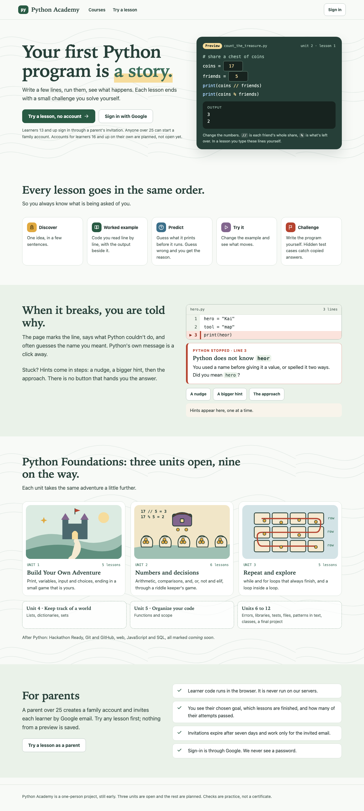
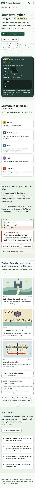
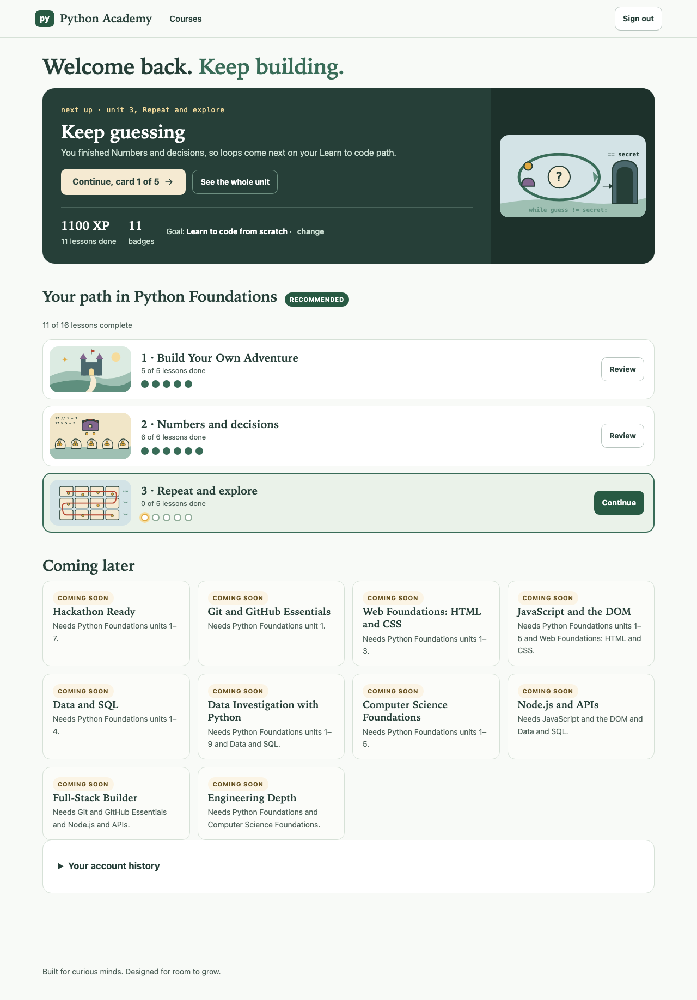
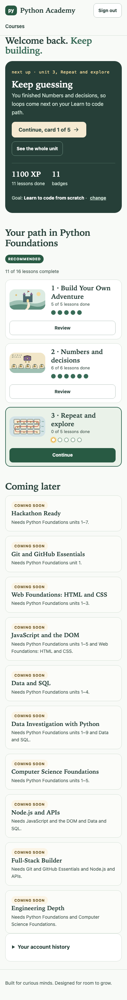
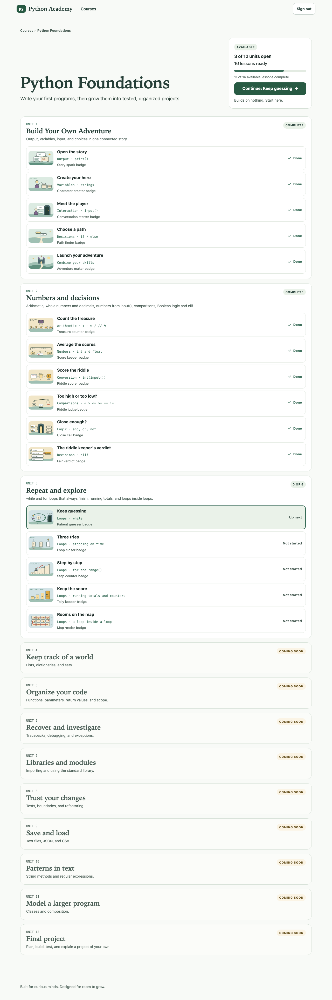
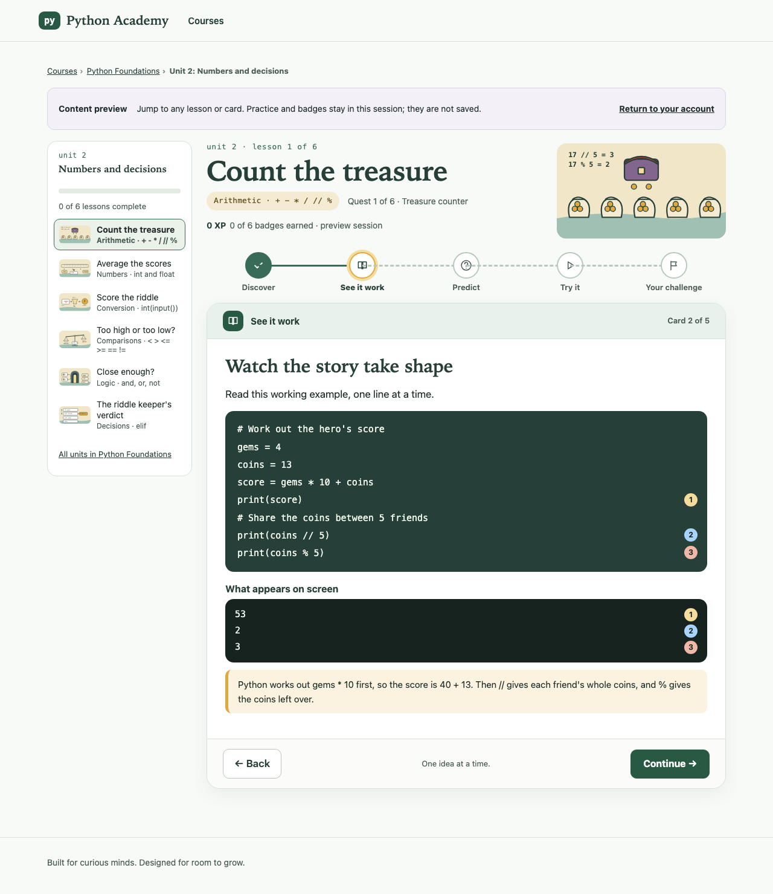
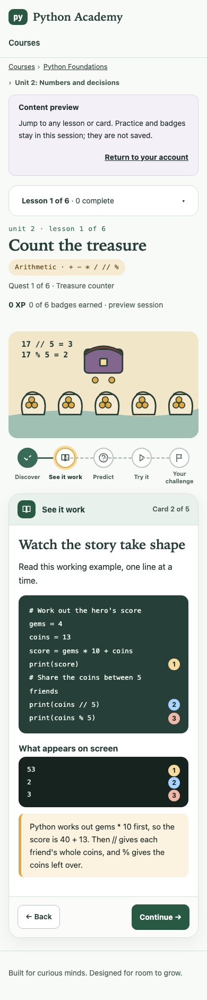
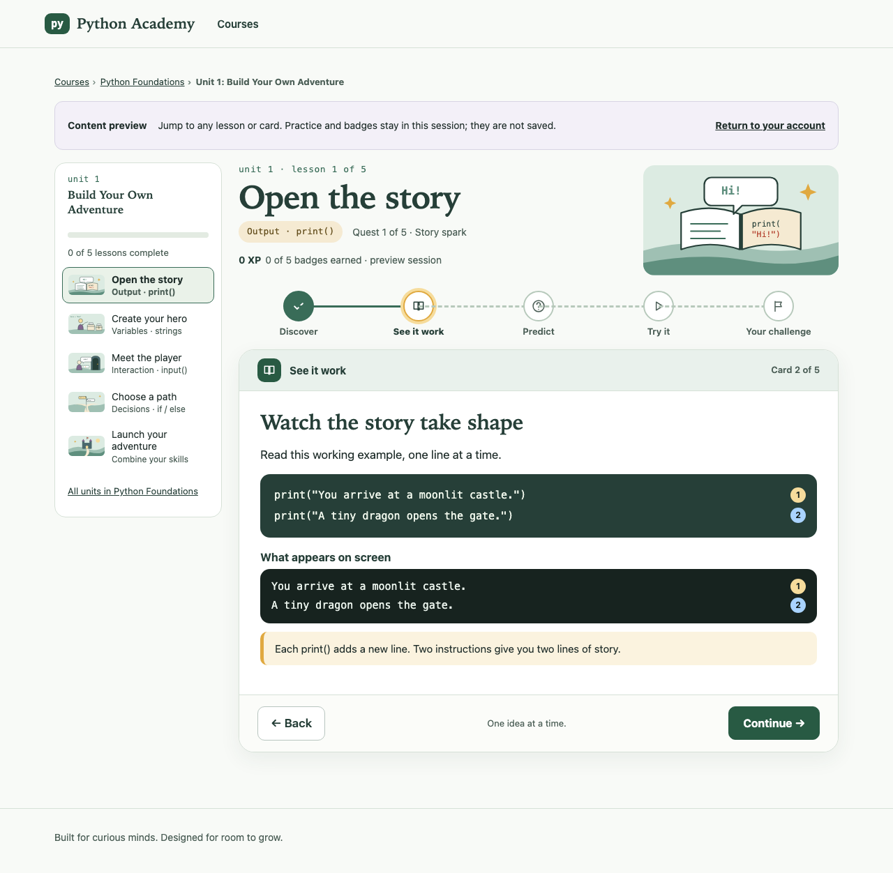
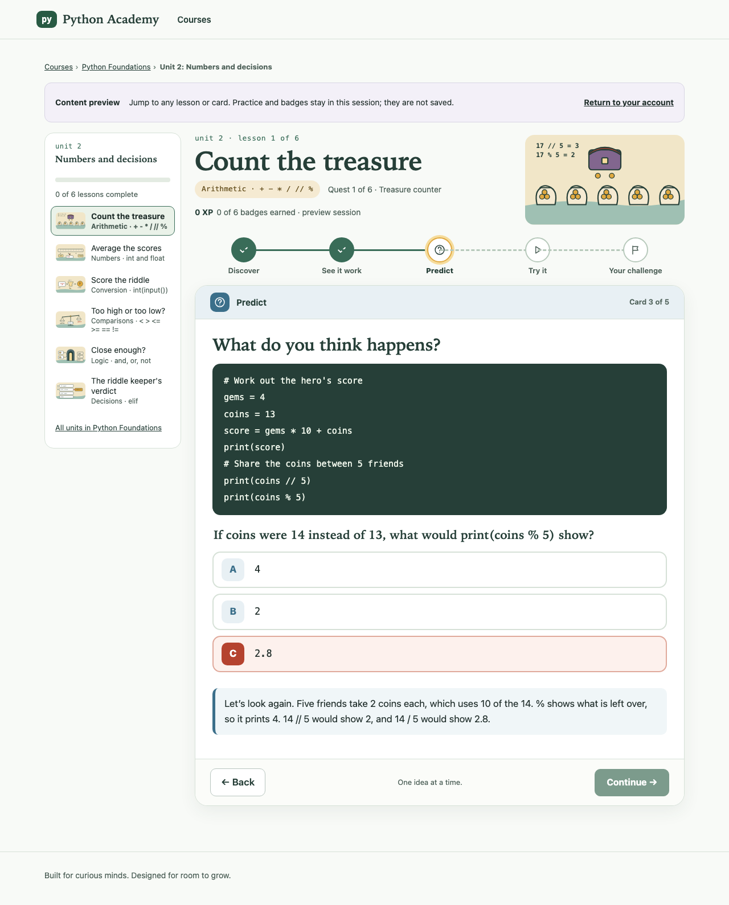
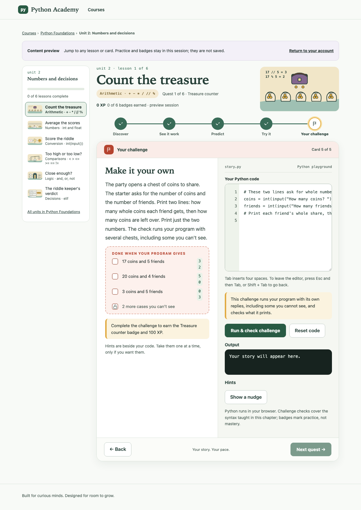
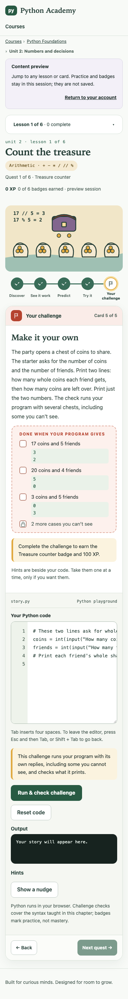

## 3. Account rules on the home page

Checked against `backend/app/main.py` `enroll()`, `docs/plan/independent-learners.md` and decision-log chapter 20:

| Claim | Source | Result |
| --- | --- | --- |
| Invited learners 13 and up; parents over 25 | `enroll()` refuses under 13 with an invitation, 25 or under without one | True today |
| Accounts of their own for learners 16 and up | ID-01, decided 2026-10-27; **ID-01d not built** | Worded as "planned, not open yet" |
| Invitations expire after seven days and work only for the invited email | `invite()` sets 7 days; `enroll()` checks the email | True |
| Sign-in is through Google; we never see a password | Google OAuth only | True |
| Learner code runs in the browser, never on our servers | Pyodide worker; the API compares reports and checks text only | True. Kept because it is in your revised prototype; it is a safety fact, not a "nothing to install" line |
| Parents see the goal, finished lessons, and attempts | `/api/family` returns each attempt's `passed`, but the page showed only a count | Prototype said "whether each attempt passed". **Changed** to "how many of their attempts passed", and the parent view now shows "N practice attempts, M passed" |
| "Nothing from a preview is saved" | `/api/check` saves no attempt | True |

**The line under the sign-in buttons now reads:** "Learners 13 and up sign in through a parent's invitation. Anyone over 25 can start a family account. Accounts for learners 16 and up on their own are planned, not open yet."

**Could not confirm:** whether anyone with a Google account can already sign in today (SEC-10, still open). If they can, a 16 to 25 year old who signs in gets refused at enrolment, as before; the page doesn't promise otherwise.

## 4. Where I departed from the prototype, and why

| Change | Reason |
| --- | --- |
| No prototype switcher bar; no "Python in your browser" line | As asked |
| Playground labelled "Preview", worked out in JavaScript with Python's rules for `//` and `%` (so `-7 // 5` is `-2`) | As asked; it never loads Pyodide, and a test checks no Python file is requested |
| Lesson stage names kept: Discover, **See it work**, Predict, Try it, **Your challenge** | The prototype says "Worked example" and "Challenge". Kept the existing names so lesson wording and tests stay the same. A one-line change if you prefer the prototype's |
| Card headings kept ("Watch the story take shape"); the prototype's per-lesson headings ("Share a chest of coins") aren't in the content | No content change in this PR |
| Discover card has no operator table or callout | Content has only `learn` and `detail` text |
| The student home keeps an h1 ("Welcome back. Keep building.") | Every page needs one heading; the prototype had none there |
| The parent and pending pages got simple headings ("Your family space.") | Not in the prototype; the old "Make something with Python" heading is gone |
| On phones the header's "Courses" link wraps to a second row instead of hiding | Hiding it left no route to the catalog on a phone |
| Expected output on the ticket is one line per output line, not "3, 2" | Commas are ambiguous when output contains commas |
| The home page's unit cards and counts come from the catalog | So "three units open, nine on the way" stays true when unit 4 ships. The prototype's descriptions are used for units 1 to 3 |

## 5. Tests

| Command | Result |
| --- | --- |
| `npx tsc --noEmit` and `npm run build` | OK |
| `CI=1 npx playwright test tests/redesign.spec.ts` (new) | **12 passed** |
| `CI=1 npx playwright test` (the full browser suite, locally, after the last change) | **374 passed**, including the re-recorded unit 1 snapshot. Earlier runs had one keyboard-test timeout that passed on rerun |
| Backend | Not changed. Runs in CI |

### 5.1 New tests (`frontend/tests/redesign.spec.ts`)

- The course page's 16 rows each show the picture written out in the test for that lesson id, and each is a real drawing; three lesson headings show theirs, with a description.
- A lesson with no picture (the test fixture lesson) shows the fallback, with its description.
- The ticket shows exactly the plan's visible cases (3 for `py.arithmetic`, 4 for `py.compare`, 3 for `py.while-loops`) and "2 more cases you can't see", and no hidden case's description.
- A doctored plan with a hidden expected output: the page never shows it.
- Unit 1's challenge has no ticket and asks for no plan.
- Markers pair `print(score)`, `print(coins // 5)` and `print(coins % 5)` with `53`, `2`, `3`, and the text stays exact; a loop gets none.
- The playground: `3`/`2`, Python's negative rules, the zero message, the whole-number message, and no Pyodide, worker or check-runner request.
- The sign-in line's exact words; no "Design prototype" text.
- No sideways scroll at 390 and 1280 px on six pages; cards don't animate with reduced motion.

### 5.2 Deliberate-break controls (each undone; files matched saved copies byte for byte afterwards)

| What I broke | Tests that failed |
| --- | --- |
| B1. Two lessons' pictures swapped in `LESSON_ART` | **1** |
| B2. No fallback for an unknown lesson | **1** |
| B3. The ticket shows hidden cases as visible | **4** |

### 5.3 Existing tests I changed (intended copy or layout changes only)

| Test | Change |
| --- | --- |
| `academy.spec.ts` (2), `accessibility.spec.ts` (1) | "Continue with Google" is now "Sign in with Google" (prototype copy) |
| `academy.spec.ts`, course page | Row state "Completed" is now "Done" (prototype copy) |
| `academy.spec.ts`, student home (2) | "2 of 16 lessons complete" and "Recommended" are on "Your path in Python Foundations", not an "All courses" card |
| `lesson-units.spec.ts` (2), `unit2.spec.ts`, `unit3.spec.ts` | The page heading is now the lesson's title; the unit's title heads the lesson list and names the region. The unit summary is no longer on the lesson page |
| `fixtures/unit1-page.snapshot.json` | Re-recorded. I compared every line of the old and new snapshot (55 views): **every removed line is page chrome** (the old unit heading and tagline, "1. Discover"-style stage labels, the "DISCOVER · Output · print()" eyebrows, the old number marks). **No lesson, hint, check or result line changed.** Added lines are the new heading, path, the words drawn in the pictures, and a screen-reader sentence about markers |

**One real fault caught by an existing test:** my first stylesheet gave every button a hover transition, which broke the rule that the hint nudge never animates (`hints.spec.ts`). Fixed: plain buttons no longer transition.

**The full browser suite locally:** 374 passed in one run. It has not always been reliable on this Mac, so CI on this PR is the authoritative full run.

## 6. Accessibility and the rules

- **No new dependency; no inline `style`; no CSP change.** Pictures use classes only.
- **Contrast:** text colours are the prototype's, which meet AA on their backgrounds. The existing axe checks (`accessibility.spec.ts`, WCAG A and AA on the home pages, course page and every lesson card, desktop and phone) pass.
- **Keyboard:** every control keeps a visible 3 px focus ring; the path buttons and predict tiles are buttons; `keyboard.spec.ts` passes.
- **Screen readers:** pictures beside their own title are hidden; the others have a description. Predict letters are hidden so each answer is announced by its text. The path's buttons are announced "1. Discover" and so on. Ticket states are in words.
- **Reduced motion:** card and badge animations and transitions only apply under `prefers-reduced-motion: no-preference`.

## 7. Visual track overlap

Other stages that only change looks stay blocked on this PR, as asked:

| Stage | Overlap | Recommendation |
| --- | --- | --- |
| **SITE-03** (product polish: tokens, course header art, lesson celebration) | This PR does the tokens, the pictures and most of the polish | Rescope SITE-03 to what's left (course emblems, a celebration) after this merges |
| **SITE-02** (separate public story site) | The new signed-out home already works as a landing page | Decide whether SITE-02 is still wanted, or whether this home page is enough for now |
| **SITE-01 rules** (`site-design.md` section 2) | It says "no text inside images" and "soft gradients". Your prototype's pictures contain code text and are flat | I followed the prototype. If you agree, update `site-design.md` in the next docs sync |
| **UI-01** (cosmetic fixes, merged) | Its tests (chips on one line, goal text size) still pass | None |
| **UI-02 to UI-04** (wait, decision 29) | Not visual, but they would change the student home, now `home.tsx` | Build on this PR's `StudentHome` |
| **WE6 / QA-03** (accessibility, cross-browser) | The weekly cross-browser run will now cover the new pages | Watch the first WebKit run after merge (4 known WebKit failures before this PR) |

I did not edit `backlog.md` or the decision log, as asked; the next docs sync should add this PR.

## 8. What I could not verify

- **Real devices and screen readers.** Checked in Chromium with Playwright at 390 and 1280 px only; not in Safari, Firefox, on a real phone, or with VoiceOver or NVDA.
- **The live site.** Not deployed.
- **Fonts:** serif headings use the system serif stack (Iowan Old Style, Palatino, Georgia). How they look on Windows and Android wasn't seen.
- **"returns" values on the ticket** are shown in Python style from JSON, so a whole-number float such as `2.0` would show as `2`. No released lesson's visible case has one today.
- **The footer** says "Three units are open": prototype copy, written by hand. Update it when unit 4 ships.
- **Pictures in the 52 px unit list** are decoration at that size; their code text is unreadable there (the lesson title sits beside them).

## 9. Questions for you

1. **Stage names:** keep "See it work" and "Your challenge", or switch to the prototype's "Worked example" and "Challenge"? *Recommended: the prototype's, in a small follow-up that also updates the lesson tests.*
2. **Text in pictures:** accept code text inside the lesson pictures, against `site-design.md`'s rule? *Recommended: yes for code, which is the idea being taught, but never sentences.*
3. **Parents' fact line:** is "how many of their attempts passed" right, or do you want the parent view to list each attempt?

## 10. Live checks for you (after merge and deploy)

1. Open the home page signed out, on a phone and a computer. Change the playground's numbers; check DevTools → Network shows no `pyodide` or `python-worker.js` request.
2. Sign in as a student: the home shows your next lesson with its picture.
3. Open a unit 2 challenge: the ticket lists the cases; run a wrong answer and see a case marked "not yet".
4. DevTools → Console shows no CSP reports on any page.

## 11. Next concrete action

Review the screenshots and merge once CI is green.

## 12. Removing the worktree safely

From the **main** folder, after this PR is merged:

```sh
cd /Users/DEV/Projects/python-academy
git -C ../python-academy-redesign status --short   # expect nothing
git worktree remove ../python-academy-redesign
git worktree prune
git branch -d ui/visual-redesign
```
