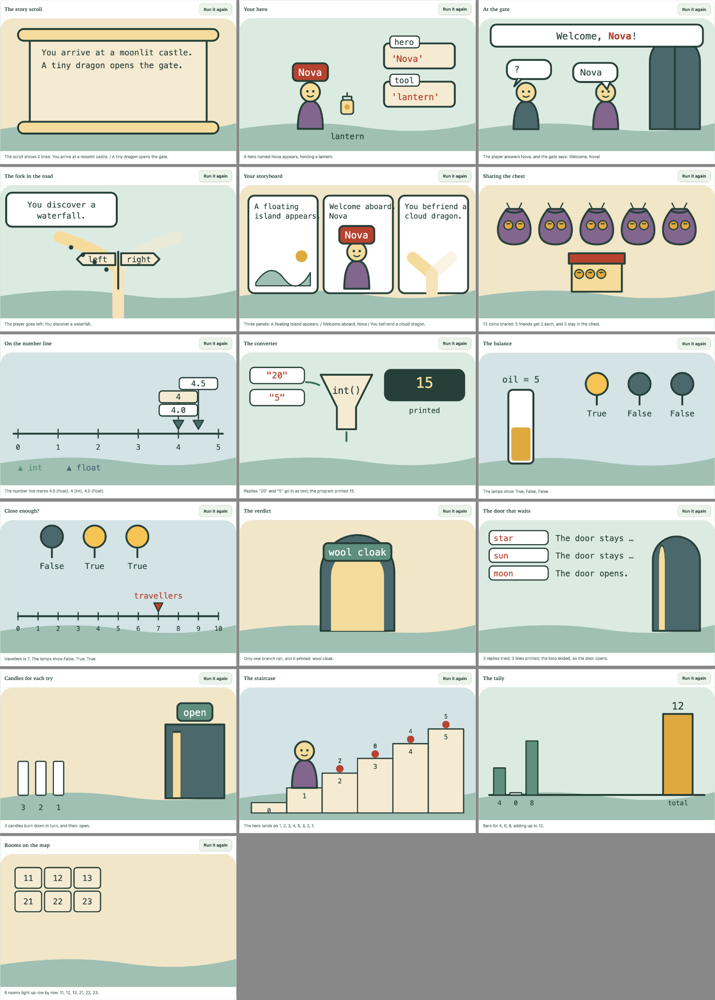
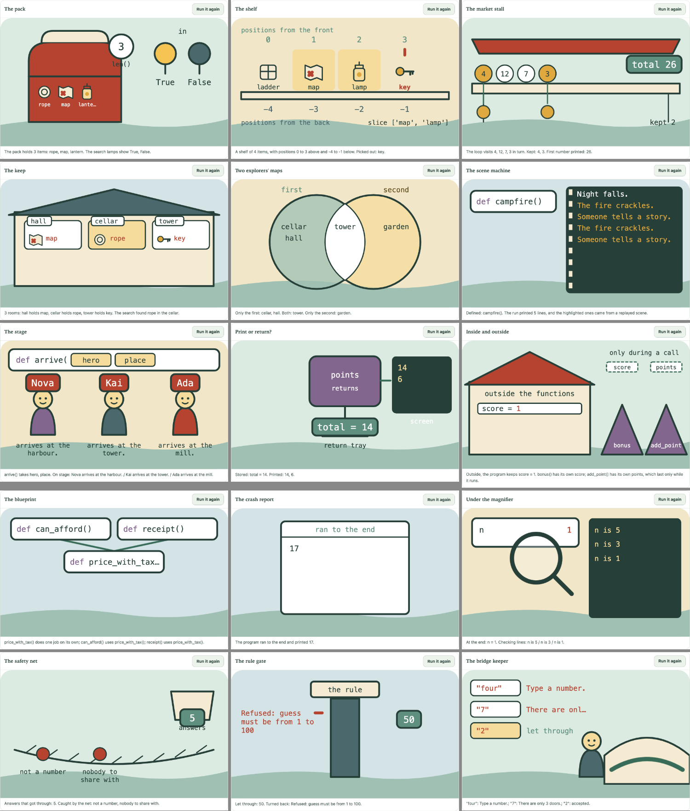
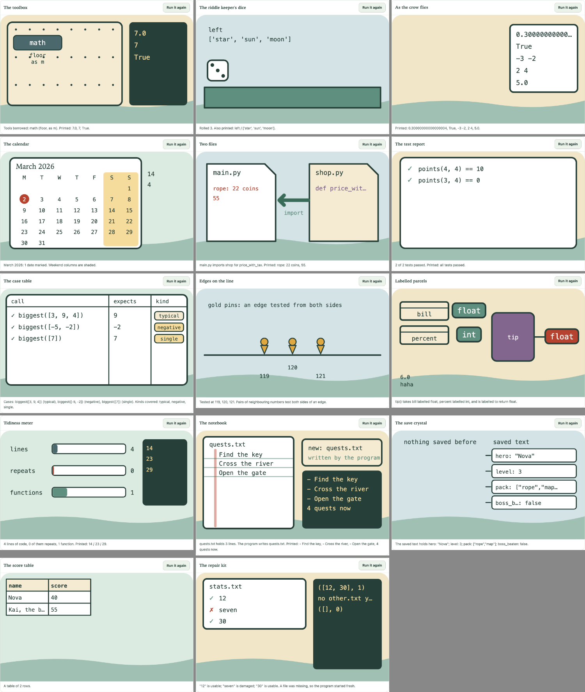
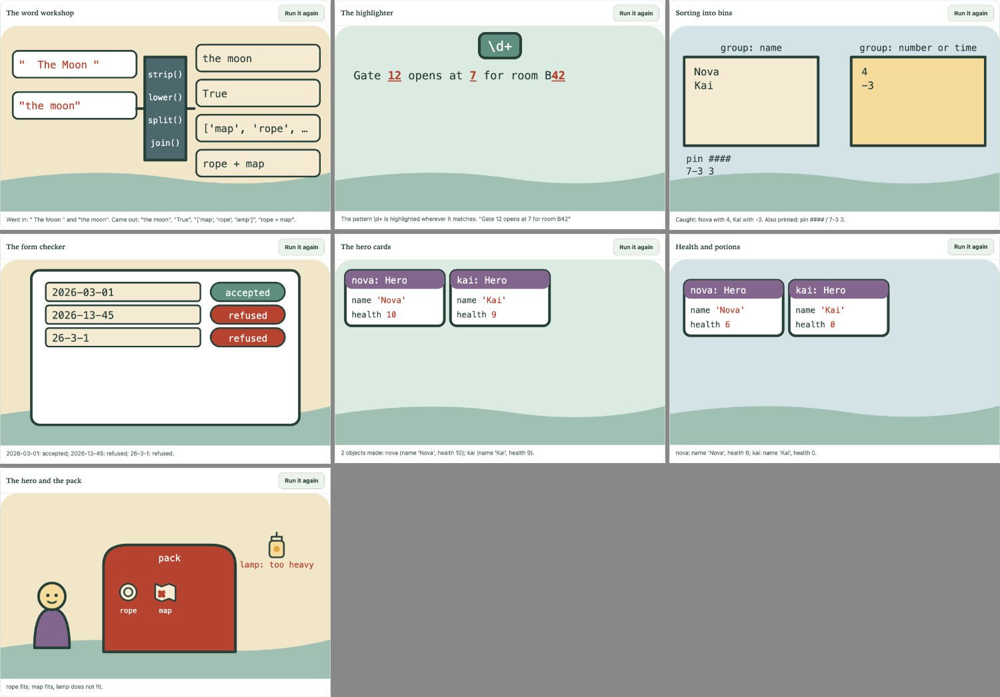

# Handoff 55: Interactive lessons, and Python units 4 to 11 (one pull request)

Date: 2026-11-20 (America/Toronto)  
Written by: Claude Code (implementer), in a separate git worktree  
For: the human maintainer, and ChatGPT or Claude chat (reviewer) without repository access  
Status: **in_review**: one pull request (#63), not merged, not deployed. **No migration, no new dependency, no API change, no Content-Security-Policy change.**

> **How to use this file:** upload it with `build.md`. The pull request diff is the source of truth (`build.md` section 14). Appendix A has every new card, hint and check case word for word.

## Starter prompt for the chat assistant

```text
You are reviewing a large Python Academy pull request. It does two things. 1. Every lesson now has its
own "scene": a picture on the lesson page that comes alive from the learner's own run (a hero with the
name they stored, a pack holding their list, a calendar marking their dates). The Python worker reports a
plain copy of the program's variables after a Try it run, for the scene only; it is never sent to the API.
2. 36 new lessons: Python units 4 to 11, with browser checks, tagged hints, similar examples and other
ways, released together. Check that hidden expected output never reaches the browser, that no hint
combination passes a check, that the scenes never claim a run is right (only checks do), that the
worker change cannot leak anything new, and that the wording on every card is true Python 3.12.
```

## Run plan details

| Field | Value |
| --- | --- |
| Request | The owner's message of 2026-11-20: "continue it, read through the rules … idc abt prs anymore just do all in 1 … I want as many lessons as possible, HOWEVER … make the interactive elements good … when we named a hero using variables maybe a hero pops up on screen with the name we entered over it … for everything" |
| Base | `main` at `847a64d` (after #62) |
| Branch and worktree | `content/py-lessons-interactive`, `../python-academy-lessons`; the main folder was not switched |
| Stages from `MASTER-RUN.md` | S06, S07, S08, S09 (units 4 and 5), WWD1 (unit 6), WD3 (unit 7), WD6 (unit 8), WD7 (unit 9), WD8 (unit 10), WD9 (unit 11), each in the lesson-template form; plus an owner-requested interactive layer that has no stage ID yet |
| Part 2 boxes relied on | **None is ticked.** See "Owner instructions taken as decisions" below |
| Merge order | Any. #61 (documentation only) is the only other open PR, and nothing here touches its files |

### Owner instructions taken as decisions (assumptions, please confirm)

| Rule in `MASTER-RUN.md` | What I did | Why |
| --- | --- | --- |
| 1.2: one stage = one PR, at most 3 lessons per PR | One PR for everything | "idc abt prs anymore just do all in 1". **Assumption:** this overrides 1.2 for this run only |
| Box B-R2 (release a unit in parts) is empty, which blocked S06 onward | Units 7, 9 and 11 are released with `more_lessons_coming`, because each one's last lesson needs ENG-09 | "I want as many lessons as possible". **Assumption:** this answers B-R2 with yes. Recommended: tick B-R2 |
| Box B-T1 (unit 6's friendly-message revisit) is empty | Not revisited. Unit 6 keeps the friendly message first and teaches reading Python's own traceback through "Show Python's message" | As the plan says for an empty box |
| Part 0.5: lesson art is the visual track's | New lessons use the existing plain fallback picture in their header. The new scenes are in a separate component, below the output | The scenes are what you asked for. The header pictures can be drawn later without touching the scenes |

## 1. What was built

### 1.1 Scenes: every lesson comes alive (the "interactive elements")

Each of the **52 released lessons has its own scene**, with its own title and drawing (a browser test fails if two lessons share one). A scene appears in three places:

- **See it work:** a new **Run the example** button runs the worked example in real Python and plays its scene.
- **Try it:** the scene redraws after every run, from the learner's own program.
- **Your challenge:** after a check, the scene draws the first visible case ("With three items, looking for one of them").

What a scene draws comes from the run itself:

| Source | Example |
| --- | --- |
| The **names the program made** (new: a snapshot from the worker, Try it and the example only) | `hero = "Zephyr"` makes a hero labelled Zephyr; `pack = [...]` fills a backpack; objects become hero cards with their attributes |
| What it **printed** | Dice faces for rolls; lamps for True/False; a calendar marking every printed date; a JSON save before and after |
| The **replies** it read and the **files** it was given | The bridge keeper ticks or rejects each reply; the CSV table is drawn from the case's file |
| The **code** itself (read as text, never run) | The blueprint of which function calls which; the test report ticking each `assert`; the tidiness meter counting repeated lines |
| **Where Python stopped** | The crash report: the error, the line, and "called from the program, into total_cost()" |

Highlights by unit (all 52 are listed in Appendix B):

- **Unit 1:** your hero appears with the name you stored and an item drawn from what the tool is called (lantern, rope, key, sword…); the fork in the road lights the path you chose; a three-panel storyboard of your adventure.
- **Units 2 and 3:** coins drop into pouches as they are shared; a balance tips between secret and guess; candles go out one try at a time; the hero hops up the staircase onto each printed number; rooms of the grid light up row by row.
- **Units 4 to 6:** the pack, the shelf with positions 0 to n−1 above and −n to −1 below, the market stall's conveyor, the keep's rooms, a Venn diagram of two explorers; the stage where each call puts a new hero; a house for outside names and a tent for each function's own; the safety net that catches errors; the bridge keeper.
- **Units 7 to 11:** the toolbox of imported modules, dice, the straight line versus the grid walk, the calendar, two files joined by an import; test reports and case tables; the notebook, the save crystal, the score table, the repair kit; the word workshop, a regex highlighter, form stamps; hero cards, health bars, and the hero's pack.

**What a scene never does:** say a program is right. Only the check says that. A scene draws what happened, including what happened before an error ("Python stopped with TypeError on line 4, inside total_cost()").

**Accessibility and motion:** each picture is `role="img"` named by the sentence printed under it, so screen reader users get the same information in words. Motion is CSS only and runs only under `prefers-reduced-motion: no-preference`; with less motion asked for, every scene shows its end state (a test checks both). No `style` attributes: positions are SVG attributes, colours are classes.

### 1.2 The worker change (security-relevant, please review)

`frontend/public/python-worker.js`, Try it runs only (not checks): after the program finishes, or stops with an error, `__academy_snapshot` makes a **plain copy** of the program's top-level names: `None`, `bool`, `int`, `float` (as its `repr`), `str` (first 200 characters), lists, tuples, sets, dicts, functions (name and parameter names), classes and objects of the learner's own classes (their public attributes), modules (name only), and for anything else only its type's name. At most 40 names and 300 values, 4 levels deep.

- It is posted to the page with the output, and **never sent to the API**: the page's request bodies are unchanged (a test runs all 36 new references and checks every request is byte for byte the recorded one, with no `vars`).
- It runs after the program, in the same worker, with the same 15-second stop.
- Python's own names are bound when the worker starts, so a program that names a variable `list`, `len` or `type` cannot change how the snapshot works (tested). It calls no learner code except through Python's own `repr` of a float and the sort of a set's items.
- It is defined after the import guard is on and imports nothing at run time; `types` is imported with the worker's other setup modules, before the guard, like `json` and `re`. The guard test (`test_allowed_imports.py`) passes unchanged.
- **Not changed:** the worker's Content-Security-Policy, the network removal, the import guard, the check runner, or what a check reports.

### 1.3 Thirty-six new lessons

| Unit | Lessons (ID, title, badge) | Check style | State |
| --- | --- | --- | --- |
| 4 Keep track of a world | `py.lists` Pack the bag (Pack keeper), `py.indexing` First and last (Quartermaster), `py.iterate-lists` Market day (Bargain hunter), `py.dicts` Rooms of the keep (Keeper of keys), `py.sets` Rooms already visited (Trailblazer) | replies → output | complete |
| 5 Organize your code | `py.functions` A scene you can replay (Scene maker), `py.parameters` Any hero, any place (Storyteller), `py.return-values` Score the guess (Return trip), `py.scope` The purse that must change (Name keeper), `py.decompose` Break the battle into parts (Architect) | **function calls** (ENG-06), visible and hidden (decision 28) | complete; first real use of ENG-06 |
| 6 Recover and investigate | `py.tracebacks` Read the crash report (Crash reader), `py.debug-strategy` Wrong by one (Bug hunter), `py.try-except` A safe share (Safety net), `py.raise` Rules of the game (Rule maker), `py.validate-input` Ask until it is right (Gatekeeper) | replies → output; two lessons start from a broken program with three bugs | complete |
| 7 Libraries and modules | `py.import` The toolbox (Toolsmith), `py.random` The riddle keeper's dice (Dice roller), `py.math-module` As the crow flies (Navigator), `py.datetime` A study schedule (Timekeeper), `py.own-modules` A helper file (Librarian) | seeded random (ENG-07), learner files (ENG-08b) | **more coming**: `py.packages-local` needs ENG-09 |
| 8 Trust your changes | `py.assert-tests` Test the scorer (Tester), `py.test-cases` Choose good cases (Case finder), `py.boundaries` Edges of the rule (Edge walker), `py.type-hints` Labels for values (Label maker), `py.refactor` Tidy without breaking (Tidy coder) | **learner tests against correct and broken references** (ENG-10); calls | complete; first real use of ENG-10 |
| 9 Save and load | `py.text-files` The save file (Scribe), `py.json` Save the game (Save keeper), `py.csv` The score table (Table keeper), `py.missing-data` The damaged save (Data medic) | **file fixtures** per case (ENG-08) | **more coming**: `py.environments` needs ENG-09 |
| 10 Patterns in text | `py.string-methods` Clean up the answers (Wordsmith), `py.regex-basics` Spot the ticket code (Pattern spotter), `py.regex-groups` Read the message log (Code breaker), `py.validate-formats` Check the form (Form checker) | replies → output; calls | complete |
| 11 Model a larger program | `py.classes` Make a hero (Hero maker), `py.methods` Potions and blows (Spellcaster), `py.composition` A hero with a pack (Outfitter) | replies → output | **more coming**: `py.when-not-oop` needs ENG-09 |

Every lesson follows the lesson template: five cards (discover, worked example, predict, try it, challenge), a three-step hint ladder that never gives the answer, tagged hints for its case rules and likely errors, a similar example from another context, two other ways shown after passing, 100 XP and one practice badge, awarded once. Every challenge has at least two visible and one hidden case; hidden descriptions never quote their inputs, files, call values or answers (content loading refuses them). Support fades: from unit 4 every starter is one comment, except where the lesson *is* a broken program to repair (`py.tracebacks`, `py.debug-strategy`, `py.refactor`).

Story thread: the same adventure keeps going. The hero's pack (lists), the quartermaster's supplies, treasure, the keep's rooms, explorers, scenes as functions, battles split into parts (Adventure v2), the shop's ledger and tally, the ferry and the bridge keeper, the riddle keeper's dice, the quiz tool v1 (`grader.py`), the save file and settings, and a hero class with a pack.

### 1.4 Supporting changes

| File | Change |
| --- | --- |
| `frontend/app/feedback.ts` | Plain-English explanations for `IndexError`, `KeyError` (unit 4), `AttributeError`, including the `None` from `append()` (unit 4), `UnboundLocalError` (unit 5) and `AssertionError` (unit 8). Shown only from the unit that teaches them, like the others |
| `backend/app/content.py` | The same five error types accepted as hint tags. Additive |
| `frontend/app/home.tsx`, `academy.tsx` | The "planned units" list now shows only unit 12; the footer's "Three units are open" now says eleven of twelve, some still gaining lessons |
| `backend/content/catalog.json` | Units 4 to 11 released (one line each); summaries describe what is really in them |
| `backend/tests/case_runner.py` | Calls a learner's function the way the worker's `__academy_call` does, so ENG-06 lessons are judged on real reports in the tests |
| `backend/tests/lesson_suite.py` (new) | The unit 2 and 3 lesson tests, as one reusable suite (section 5) |

## 2. Screenshots

Every scene, after pressing **Run the example** (desktop width, from the built app with the real API):







## 3. Decisions and why

| Decision | Why | Status |
| --- | --- | --- |
| Scenes are in the frontend, keyed by lesson ID, like `LESSON_ART` | No content-schema change, no API change, and the visual track can restyle them without touching lessons | decided by me; **assumption** |
| The snapshot is for Try it and the example only, not for checks | Checks stay exactly as they were, and their reports are what the API judges. A challenge's scene uses the first visible case's output, replies and files, which the page already has | **assumption** |
| A scene never says "right" or "wrong" | Only the check can see hidden cases. A scene that looked like a pass would break the rule "a message may only claim what was checked" | follows Part 1.1 rule 8 |
| No construct rules anywhere (`require` and `forbid` stay empty) | Part 1.6 forbids inventing construct-rule naming. So unit 11's class lessons, and `py.own-modules`'s helper file, are checked by behaviour: a correct program without a class, or with `grade()` in `main.py`, also passes. Each lesson says what to use, and the scene shows the objects or files when they exist | **limit**, see section 7 |
| `py.refactor` forces structure with a call case: the check calls `cost()` | A refactor is "same behaviour, new shape"; calling the new function is the one shape a behaviour check can see without construct rules | **assumption** |
| `py.type-hints` checks the hints by having the program print `shares.__annotations__` | Python does not enforce hints, so printing them is the only honest way to check they were written; the prompt says so | **assumption** |
| Seeded `random` and dates: expected outputs were produced by running the reference program in Python 3.12, and the tests run them again; the browser test runs them in Pyodide | Hand-written random numbers would be a guess | decided by me |
| `py.tracebacks` and `py.debug-strategy` give a broken program as the starter, and say there are three bugs | Fix-the-bug is in the template; the count tells a learner when to stop | **assumption** |
| Unit 6's B-T1 revisit not done | Box empty | per plan |
| A misspelt-name hint added to six lessons that lacked one | `test_check_rules.py` asks every lesson for a NameError or IndentationError hint; I added the hint (and a program that triggers it) rather than relaxing the rule | decided by me |

## 4. Bugs found and how they were fixed

| Found | Fix |
| --- | --- |
| My first snapshot used `list`, `type` and `len` by name: a program with `list = 3` would have broken it | Python's own names are bound once, when the worker starts. Test: "a variable called list does not break the scene" |
| My first worker change put `pyodide = py` between `noNetwork()` and the guard, which the guard-order test rightly refused | The snapshot is defined after the guard instead, and the startup lines are as before |
| `case_runner.py` could not call functions, so ENG-06 lessons could not be tested on real reports | Added, mirroring `__academy_call`; the browser test then proved Pyodide reports exactly the same for all 36 references |
| The suite's XP test dropped `returned` from reports, so call cases looked like `service_error` | Reports are sent with `returned` the way the page sends them |
| A hidden description quoted an answer twice: "a bigger party" contains the hero "Ty", and "scores on the boundaries" contains the letters A, B and C, which were expected output lines | Content loading caught both; renamed |
| One "other way" for `py.composition` had a line break inside an f-string, and one for `py.random` used `choice()`, which gives different numbers from `randint()` with the same seed | Both failed their own check in the tests; fixed (the second now uses `randrange()`, with a note saying why it matches) |
| Wrong-file-name samples used a capital letter, which macOS's file system ignores but the browser's does not | Samples now misspell the name, which fails everywhere |
| `AssertionError` was a tagged hint in the test-writing lessons, but a failing test on correct code is reported under the case's own rule, so that hint could never be offered | Retagged to the case rule |

## 5. How it was tested

| Command | Result |
| --- | --- |
| `cd backend && python -m pytest -q` (SQLite) | **1,794 passed, 25 skipped** |
| PostgreSQL | **Not run locally**: no PostgreSQL on this Mac. There is no migration in this PR; CI runs the suite on PostgreSQL 16 |
| `npx tsc --noEmit` and `npm run build` | OK |
| `npx playwright test tests/scenes.spec.ts` (new) | **105 passed**: 104 in `scenes.spec.ts` plus the unit 1 snapshot, after the final fixes |
| `npx playwright test` (the whole browser suite, Chromium, locally) | **478 tests**. In one run with 4 workers, 462 passed. 11 failed on expectations this PR changes (catalog counts, the 26 error explanations, the unit 1 snapshot) and were updated, each rerun and passing. 5 failed on time under load (one at 40.4 s against a 40 s limit) and passed when rerun alone. CI on this PR is the authoritative full run |

### 5.1 The lesson suite (`backend/tests/lesson_suite.py`), for every new lesson

The unit 2 and 3 tests, made data-driven. Each unit's test file lists, per lesson, a reference program, creative correct programs, and wrong programs with the exact rule or error each must fail with. 350 wrong programs, 92 reference and creative programs, and 124 card claims, run for real. The suite checks:

- every worked example prints exactly what its card shows (with its files and learner files);
- every other claim on a card (predict answers, "this is an error", similar examples, hint statements) is run in Python 3.12;
- the reference, creative programs and both "other ways" pass; every wrong program fails with its intended case rule, or with its error type and line;
- every case rule has a wrong program that fails on it, so no case is decoration;
- printing the visible answers (or looking up the replies in a table of them) fails;
- every tagged hint is for a rule or error the lesson can actually report;
- **the hint audit:** every piece of code in the hints and tagged hints, alone and in every combination up to six, assembled every way the unit 2 audit assembles them, with and without the reading lines, with and without the similar example, and again with the hints' names swapped for the challenge's own, never passes. Extended here so method calls (`pack.append(item)`), `raise` and `assert` count as code;
- hidden expected output never appears in any API answer, including the check plan and the judge's feedback for wrong programs;
- 100 XP and the badge are awarded once per lesson.

### 5.2 The browser tests (`frontend/tests/scenes.spec.ts`), with real Pyodide

- All 52 lessons have a scene and no two share a title; every worked example runs and draws (52 tests);
- every new lesson's reference program, typed into the editor (learner files into their tabs), passes in Pyodide, and the request the page sends is **exactly** the one `test_units_4_to_11_recordings.py` recorded from the real API (36 tests);
- Try it scenes use the program's own names; `list = 3` doesn't break them; an error still draws, and says so;
- reduced motion: no scene element animates; with motion allowed, the same scene does;
- axe (WCAG 2.0 to 2.2 A and AA) on five lessons' scene cards, at desktop and phone width, with no sideways scroll.

### 5.3 Deliberate-break checks (each undone; the files matched their committed versions afterwards)

| What I broke | Caught by |
| --- | --- |
| B1. `py.lists`'s third hint rewritten to spell out the whole program | The hint audit (`test_no_combination_of_hints_passes_the_check[py.lists]`): **1 failed** |
| B2. `case_runner.py` keeps what the program printed before a function call | `test_reference_creative_and_other_ways_all_pass[py.functions]`: **1 failed** |
| B3. A hidden case of `py.validate-input` described as "zero, then 5" | Content loading refuses it ("its description shows one of its inputs"): **1 failed** |
| B4. Scene motion added outside the reduced-motion guard | "scenes do not move for people who ask for less motion": **1 failed** |
| B5. The snapshot uses the program's own `list` instead of Python's | "a variable called list does not break the scene": **1 failed**. **The first time, nothing failed**: the scene fell back to reading the printed list. The test now prints no list, so it depends on the snapshot, and the break is caught |
| B6. The CSV lesson's scene unregistered | "every released lesson has its own scene title": **1 failed** |


### 5.4 Existing tests I changed

| Test | Change and why |
| --- | --- |
| Recorded answers: `unit2-api.json`, `unit2-part2-api.json`, `unit3-api.json`, `unit3-part2-api.json`, `lesson-units-api.json`, `file-checks-api.json`, `hidden-calls-api.json`, `learner-modules-api.json`, `reference-checks-api.json`, `backend/tests/fixtures/catalog_v1.json` | Re-recorded from the real API with each file's own `WRITE_…` switch (one added for `lesson-units-api.json`). The only differences are the catalog's units 4 to 11 and, in unit 3's, the home recommendation |
| "No real lesson uses imports / files / learner files / hidden calls / reference tests yet" | Each now names exactly the lessons that do, so a surprise still fails |
| Tests that used unit 4 as "the coming-soon unit" | Use unit 12 |
| `test_recommend.py`, `test_unit3_part2.py` | Finishing unit 3 now continues into unit 4; finishing everything says unit 7 has more lessons on the way; the "no lessons written" note is tested with unit 12 |
| `test_check_rules.py` | `KeyError` is now a valid tag, so the "not a valid tag" example is `MemoryError` |
| Unit 1 page snapshot | Re-recorded with `WRITE_UNIT1_SNAPSHOT=1`. I compared every line: **no line was removed or changed**. The only added lines are scene text (titles, the Run the example button, captions, and words drawn in the pictures, such as Nova and lantern) |

## 6. Accessibility and the rules

No new dependency; no `style` attribute; no API change; no migration; worker CSP unchanged; hidden expected output never sent (tested for every new lesson); learner code never leaves the browser except the reports the ENG-03 contract defines; no lesson wording, exercise or data copied from outside sources (all written for this course); `backlog.md` and `decision-log.md` not edited (the docs sync does that; table below).

## 7. Limits and what I could not verify

- **Class and module lessons are checked by behaviour.** Without construct rules, a correct program that uses no class (unit 11) or keeps `grade()` in `main.py` (`py.own-modules`) also passes. The construct-rule proposal (#38) is the way to change that.
- **Seeded random:** a visible case shows the numbers it expects, so a learner could print them. Hidden cases use other seeds. Practice evidence, as before.
- **Test-writing lessons** send the broken references to the browser (decision 28). A learner who reads them could aim tests at those bugs.
- **Scenes are drawn from the run, not from understanding:** a scene parses printed text and the code's shape, so an unusual program can draw a sparse scene. It never fails a check, and it says in words what it drew.
- **Not seen:** real devices, Safari and Firefox (CI's weekly cross-browser run will cover the new pages), screen readers beyond the accessible names, PostgreSQL locally, the live site.
- **The header pictures** of the 36 new lessons are the plain fallback until the visual track draws them.
- **Next.js:** `npm run build` stopped once with "Your version of Next.js is affected by a known security vulnerability" and continued on the retry. I changed no dependency; see question 5.

## 8. What is not built (and why)

| Item | Why |
| --- | --- |
| `py.packages-local`, `py.environments`, `py.when-not-oop` | Need ENG-09 (local-tutorial and reflection task types), which depends on S23 and box B-A1 |
| Unit 12 (final project) and Hackathon Ready | ENG-09 and S23 |
| Unit checks and unit projects (ASSESS-02 onward, PROJ-01) | Box B-A1 is empty |
| Everything else gated in Part 2 (privacy notice, sign-ups switch, CSP enforce, feedback inbox) | Boxes empty; not part of this request |

## 9. Live checks for you (after merge and deploy)

1. Sign in as a student and open unit 4's first lesson. On See it work, press **Run the example**: a backpack fills with rope, map and lantern.
2. On Try it, change `pack` to hold your own three items and run: the scene redraws with your items.
3. Open **Create your hero** (unit 1), Try it: put your own name in `hero` and run. The hero appears with your name.
4. Open a unit 5 challenge (`py.return-values`) and submit a wrong answer that prints instead of returning: the result explains printing versus returning.
5. Turn on "Reduce motion" in your device settings and reload a lesson: scenes appear without moving.
6. DevTools → Network on a Try it run: no request carries your variables (only `/api/check` or `/api/attempts`, on the challenge card, as before).
7. DevTools → Console: no CSP reports on a lesson page.
8. Ask your sister to try one lesson from unit 4 and one from unit 6, and tell me which scene she noticed first.

## 10. Questions for you (each recommended, not yet confirmed)

1. **Did your message mean "tick B-R2" (release units in parts)?** *Recommended: yes, and tick it in `MASTER-RUN.md` so the next run reads it.*
2. **One PR for everything this time: should that stay the rule?** *Recommended: no. Go back to smaller PRs from the next run, because this one is hard to review in one go. The handoff's appendix is ordered unit by unit to help.*
3. **Construct rules for classes and modules?** *Recommended: decide the #38 proposal before unit 11's reflection lesson, so "use a class" can be checked.*
4. **Header pictures for the 36 new lessons:** draw them in the visual track, or use each lesson's scene (empty state) as its header picture? *Recommended: the scene, which is already unique per lesson, and saves 36 drawings.*
5. **Next.js security notice:** may I run the Next.js security upgrade in its own branch and PR? *Recommended: yes, as a separate PR, because it changes a dependency.*

## 11. For the docs sync

| Where | Row or change |
| --- | --- |
| Stage table | This PR: S06 to S09, WWD1, WD3, WD6, WD7, WD8, WD9 (lessons only), and "Lesson scenes (owner request)"; handoff 55 |
| Backlog | EDU-06, EDU-07 and EDU-08 (units 6 to 11 lessons): `in_review`, merged later; units 7, 9 and 11 with their ENG-09 lessons still `proposed` |
| New ID to propose | `UI-07` lesson scenes, or whatever ID you prefer (I did not add one: Part 1.5) |
| Decision log | Section 3 above (decisions and why), section 4 (bugs) and section 5 (how tested) |
| `teaching-design.md` | A short section on scenes: what they show, and that they never judge |
| `browser-checks.md` sections 8, 10 to 12 | "No real lesson uses this yet" is no longer true: units 5 and 7 to 10 use calls, seeds, files, learner files and reference tests |

## 12. Next concrete action

Review sections 1.2 (the worker change) and 3, skim Appendix A for one unit, merge once CI is green, and then run the live checks in section 9.

## 13. Removing the worktree safely

From the **main** folder, after this PR is merged:

```sh
cd /Users/DEV/Projects/python-academy
git -C ../python-academy-lessons status --short   # expect nothing
git worktree remove ../python-academy-lessons
git branch -d content/py-lessons-interactive
```

## Appendix B. The 52 scenes

| Unit | Lesson | Scene |
| --- | --- | --- |
| 1 | `hello` | The story scroll |
| 1 | `variables` | Your hero |
| 1 | `input` | At the gate |
| 1 | `choices` | The fork in the road |
| 1 | `adventure` | Your storyboard |
| 2 | `py.arithmetic` | Sharing the chest |
| 2 | `py.int-float` | On the number line |
| 2 | `py.convert-input` | The converter |
| 2 | `py.compare` | The balance |
| 2 | `py.boolean-logic` | Close enough? |
| 2 | `py.elif` | The verdict |
| 3 | `py.while-loops` | The door that waits |
| 3 | `py.loop-termination` | Candles for each try |
| 3 | `py.for-range` | The staircase |
| 3 | `py.accumulate` | The tally |
| 3 | `py.nested-loops` | Rooms on the map |
| 4 | `py.lists` | The pack |
| 4 | `py.indexing` | The shelf |
| 4 | `py.iterate-lists` | The market stall |
| 4 | `py.dicts` | The keep |
| 4 | `py.sets` | Two explorers' maps |
| 5 | `py.functions` | The scene machine |
| 5 | `py.parameters` | The stage |
| 5 | `py.return-values` | Print or return? |
| 5 | `py.scope` | Inside and outside |
| 5 | `py.decompose` | The blueprint |
| 6 | `py.tracebacks` | The crash report |
| 6 | `py.debug-strategy` | Under the magnifier |
| 6 | `py.try-except` | The safety net |
| 6 | `py.raise` | The rule gate |
| 6 | `py.validate-input` | The bridge keeper |
| 7 | `py.import` | The toolbox |
| 7 | `py.random` | The riddle keeper's dice |
| 7 | `py.math-module` | As the crow flies |
| 7 | `py.datetime` | The calendar |
| 7 | `py.own-modules` | Two files |
| 8 | `py.assert-tests` | The test report |
| 8 | `py.test-cases` | The case table |
| 8 | `py.boundaries` | Edges on the line |
| 8 | `py.type-hints` | Labelled parcels |
| 8 | `py.refactor` | Tidiness meter |
| 9 | `py.text-files` | The notebook |
| 9 | `py.json` | The save crystal |
| 9 | `py.csv` | The score table |
| 9 | `py.missing-data` | The repair kit |
| 10 | `py.string-methods` | The word workshop |
| 10 | `py.regex-basics` | The highlighter |
| 10 | `py.regex-groups` | Sorting into bins |
| 10 | `py.validate-formats` | The form checker |
| 11 | `py.classes` | The hero cards |
| 11 | `py.methods` | Health and potions |
| 11 | `py.composition` | The hero and the pack |

## Appendix A. Every new lesson, word for word

Generated from `backend/content/py/u04` to `u11`. Hidden cases are listed with their inputs and expected output here, for review; the browser never receives a hidden expected output.

### Unit 4: Keep track of a world

Lists, positions and slices, looping over a list, dictionaries, and sets.

#### `py.lists`: Pack the bag

*Lists · append, len and in*. Pack the hero's bag one item at a time, count what is in it, and check whether something was packed. Badge: **Pack keeper** (`py.badge.pack-keeper`). Scene: **The pack**.

**1. Discover: Keep many things under one name**

A list holds several values in order, inside square brackets: pack = ["rope", "map"]. pack.append("lamp") adds one more to the end, and len(pack) says how many there are.

item in pack is True when the item is somewhere in the list, and False when it is not. append() changes the list itself and gives back nothing, so it goes on a line of its own: pack.append("lamp"). An empty list, [], has a length of 0.

**2. See it work**

```python
# Pack for the journey
pack = ["rope", "map"]
pack.append("lantern")
print(len(pack))
print("map" in pack)
print("sword" in pack)
print(pack)
```

Output:

```text
3
True
False
['rope', 'map', 'lantern']
```

append() put lantern at the end, so the pack holds three things. in looks through the whole list for an exact match. print(pack) shows the list the way Python writes one, with brackets and quotes.

**3. Predict.** Suppose the third line were pack = pack.append("lantern"), and the only print were print(pack). What would it show?

- ['rope', 'map', 'lantern']
- **None (answer)**
- ['lantern']

append() changes the list and gives back None. Storing that None in pack replaces the whole list with it.

**4. Try it.** Predict, then run: add one more item with append() and check that len() goes up by one. Then make the first line pack = [] and see what len(pack) and print(pack) show for a pack that starts empty.

**5. Your challenge.** Pack the hero's bag. Ask how many items to pack (it can be 0), then ask for each item and add it to a list. Then ask for one more item to look for. Print three lines: how many items are in the pack, True or False for whether the item you looked for is in it, and the pack itself, with print(). Print just those three lines.

Starter:

```python
# Ask how many items, then pack them one at a time
```

Hint ladder:

1. You need a list that starts empty, above the loop, and grows by one item each time round the loop.
2. A for loop over range() asks once per item. After the loop, one more input() gives the item to look for, and in tells you whether it is there.
3. The same pattern with other names: shelf = [] goes before the loop, and shelf.append(book) goes inside it. len(shelf) counts the books.


Tagged hints:

| Tag | Hint |
| --- | --- |
| `TypeError` | range() needs a number. Turn the first reply into one with int(...) before the loop. |
| `AttributeError` | append() changes the list and gives back None. Write the append on its own line, without storing what it gives back. |
| `EOFError` | Your program asked for one more reply than it gets. range() with the number of items runs exactly once per item, and the item to look for comes after the loop. |
| `NameError` | Make the list before the loop uses it, and spell its name the same way every time. |
| `py.lists.case.three` | With three items packed and map looked for, the lines are 3, True and the whole list. If your count says 1, the list starts again inside the loop: make it once, above the loop. |
| `py.lists.case.missing` | When the item looked for was never packed, the answer is False. Check that you look through the whole pack, not just one item of it. |
| `py.lists.case.empty` | With 0 items the loop runs no times, the length is 0, and print() shows an empty list as []. |
| `py.lists.case.twice` | Pack every reply, even one that is already in the pack. A list can hold the same thing twice. |
| `py.lists.case.longer` | Check a longer pack: the loop should run once for every item, however many there are. |


Similar example:

```python
songs = []
songs.append("river tune")
songs.append("night song")
print(len(songs))
print("river tune" in songs)
```
Another list that grows: two songs added one at a time, then counted and searched. Your challenge reads its items from the player, in a loop.


Other way 1:

```python
count = int(input("How many items? "))
pack = []
while len(pack) < count:
    pack.append(input("Item? "))
wanted = input("Look for? ")
print(len(pack))
print(pack.count(wanted) > 0)
print(pack)
```
The loop can stop when the pack is full, using len(). count() says how many times a value is in the list, so more than 0 means it is there.


Other way 2:

```python
count = int(input("How many items? "))
pack = []
for n in range(count):
    pack = pack + [input("Item? ")]
wanted = input("Look for? ")
print(len(pack))
print(wanted in pack)
print(pack)
```
+ joins two lists into a new one, so pack = pack + [item] also grows the pack. append() changes the list you already have, which is quicker for long lists.


Check cases (rule `py.lists.case.<id>`):

| Case | Shown | Description | Runs with | Expects |
| --- | --- | --- | --- | --- |
| `three` | visible | three items, looking for one of them | replies "3", "rope", "map", "lantern", "map" | prints `3`<br>`True`<br>`['rope', 'map', 'lantern']` |
| `missing` | visible | looking for an item that was not packed | replies "2", "apple", "key", "sword" | prints `2`<br>`False`<br>`['apple', 'key']` |
| `empty` | visible | an empty pack | replies "0", "map" | prints `0`<br>`False`<br>`[]` |
| `twice` | hidden | the same item packed twice | replies "4", "coin", "coin", "gem", "rope", "coin" | prints `4`<br>`True`<br>`['coin', 'coin', 'gem', 'rope']` |
| `longer` | hidden | a longer pack | replies "6", "bread", "water", "rope", "torch", "map", "cloak", "cloak" | prints `6`<br>`True`<br>`['bread', 'water', 'rope', 'torch', 'map', 'cloak']` |


#### `py.indexing`: First and last

*Lists · positions, -1 and slices*. Pick supplies out of the quartermaster's list by their position, and slice off the middle. Badge: **Quartermaster** (`py.badge.quartermaster`). Scene: **The shelf**.

**1. Discover: Every item has a position**

Positions in a list start at 0. In pack = ["rope", "map", "lamp"], pack[0] is "rope" and pack[2] is "lamp". A negative position counts from the end, so pack[-1] is the last item.

pack[1] = "key" puts a new value at position 1, replacing what was there. A slice such as pack[0:2] is a new list of the items from position 0 up to, but not including, position 2. Asking for a position past the end, like pack[3] here, stops the program with an IndexError.

**2. See it work**

```python
# Pick tools from the pack by position
pack = ["rope", "map", "lamp", "key"]
print(pack[0])
print(pack[-1])
print(pack[1:3])
pack[0] = "ladder"
print(pack)
```

Output:

```text
rope
key
['map', 'lamp']
['ladder', 'map', 'lamp', 'key']
```

pack[0] is the first item and pack[-1] the last. The slice 1:3 starts at position 1 and stops before 3, so it holds two items. Assigning to pack[0] replaces rope, and the list keeps its length.

**3. Predict.** With the same four items, what does print(pack[len(pack) - 1]) show?

- **key (answer)**
- lamp
- It stops with an IndexError

len(pack) is 4, so len(pack) - 1 is 3, the last position. pack[len(pack)] would be the IndexError: a list of 4 has no position 4.

**4. Try it.** Predict, then run: add print(pack[4]) and read the error. Then change it to show the last item, in two different ways.

**5. Your challenge.** The quartermaster lists the party's supplies. Ask how many supplies there are (always at least 1), then ask for each one, in order. Then ask for a position, counting from 1 the way people do. Print four lines: the first supply, the last supply, the supply at the position asked for, and a list of every supply except the first and the last. Print just those four lines.

Starter:

```python
# Ask for the supplies, then a position
```

Hint ladder:

1. Collect the supplies in a list first. Positions start at 0, so the first supply is at 0, and a person who says position 1 means Python position 0.
2. A negative position counts from the end. A slice gives a list: it starts at its first number and stops just before its second, and either number can be negative.
3. With other names: name = songs[0] is the first song, name = songs[-1] the last, and the song a person calls number is one position earlier than number.


Tagged hints:

| Tag | Hint |
| --- | --- |
| `IndexError` | A position is past the end of the list. The last item of a list of 4 is at 3, which is also -1, and a person's position 1 is Python's 0. |
| `TypeError` | Positions and range() need whole numbers: turn the number replies into them with int(...). |
| `EOFError` | Your program asked for more replies than it gets. Read the supplies with a loop that runs once per supply, then read the position. |
| `NameError` | Make the list before the loop uses it, and spell each name the same way every time. |
| `py.indexing.case.four` | With bread, rope, tent and lamp, and position 2, the lines are bread, lamp, rope and ['rope', 'tent']. If you got tent, the position needs turning into Python's, which starts at 0. |
| `py.indexing.case.two` | With two supplies there is nothing between the first and the last, so the slice is an empty list, []. |
| `py.indexing.case.single` | With one supply, it is the first, the last and position 1 all at once. |
| `py.indexing.case.five` | Check a longer list: the middle slice should keep every supply between the first and the last. |
| `py.indexing.case.first-asked` | Check position 1: it is the first supply, at Python position 0. |


Similar example:

```python
days = ["mon", "tue", "wed", "thu", "fri"]
print(days[2])
print(days[-2])
print(days[:2])
```
The same positions in a week: the middle day, the day before last, and a slice from the start, because a slice with no first number starts at 0.


Other way 1:

```python
count = int(input("How many supplies? "))
supplies = []
for n in range(count):
    supplies.append(input("Supply? "))
position = int(input("Position? "))
print(supplies[0])
print(supplies[len(supplies) - 1])
print(supplies[position - 1])
print(supplies[1:len(supplies) - 1])
```
len() - 1 is the last position too. -1 is shorter, and works for a list of any length.


Other way 2:

```python
count = int(input("How many supplies? "))
supplies = []
for n in range(count):
    supplies.append(input("Supply? "))
position = int(input("Position? "))
print(supplies[0])
print(supplies[-1])
place = 1
for item in supplies:
    if place == position:
        print(item)
    place = place + 1
print(supplies[1:-1])
```
Counting along the list the way a person would finds the same supply. Indexing goes straight to it.


Check cases (rule `py.indexing.case.<id>`):

| Case | Shown | Description | Runs with | Expects |
| --- | --- | --- | --- | --- |
| `four` | visible | four supplies, the second one asked for | replies "4", "bread", "rope", "tent", "lamp", "2" | prints `bread`<br>`lamp`<br>`rope`<br>`['rope', 'tent']` |
| `two` | visible | two supplies, the last one asked for | replies "2", "map", "key", "2" | prints `map`<br>`key`<br>`key`<br>`[]` |
| `single` | visible | a single supply | replies "1", "torch", "1" | prints `torch`<br>`torch`<br>`torch`<br>`[]` |
| `five` | hidden | five supplies, one from the middle | replies "5", "oats", "salt", "rope", "cloak", "flint", "3" | prints `oats`<br>`flint`<br>`rope`<br>`['salt', 'rope', 'cloak']` |
| `first-asked` | hidden | the first supply asked for | replies "3", "axe", "net", "pot", "1" | prints `axe`<br>`pot`<br>`axe`<br>`['net']` |


#### `py.iterate-lists`: Market day

*Lists · looping over the items*. Go through every treasure in the list: add them up, keep the valuable ones, and find the biggest. Badge: **Bargain hunter** (`py.badge.bargain-hunter`). Scene: **The market stall**.

**1. Discover: Visit every item in turn**

for price in prices: runs its block once for each item in the list, in order, with price holding that item. Nothing needs counting: the loop stops after the last item.

Inside the loop you can add up, remember the biggest so far, or keep some items: start an empty list and append only the ones an if lets through. Build a new list rather than adding to or removing from the list you are looping over. sum() and max() do two of these jobs for you, but max() of an empty list is an error.

**2. See it work**

```python
# Prices at the market stall
prices = [4, 12, 7, 3]
total = 0
cheap = []
for price in prices:
    total = total + price
    if price < 5:
        cheap.append(price)
print(total)
print(cheap)
print(max(prices))
```

Output:

```text
26
[4, 3]
12
```

The loop visits 4, 12, 7 and 3. Every price adds to total, and only prices under 5 go into cheap. max() finds the biggest without a loop.

**3. Predict.** What would print(cheap) show if the if line said price > 5 instead?

- **[12, 7] (answer)**
- [4, 3]
- [12]

Only 12 and 7 are more than 5, and they go in in the order the loop meets them.

**4. Try it.** Predict, then run: change the 5 to 10 and check which prices go into cheap. Then add a counter that counts the prices over 5.

**5. Your challenge.** Treasure hunt: ask how many treasures were found (it can be 0), then ask for the value of each one, as a whole number. Then ask for the hero's limit. Print three lines: the total value, a list of the values that are more than the limit, in the order they were found, and the biggest value, or 0 if nothing was found. Print just those three lines.

Starter:

```python
# Read the treasure values, then the limit
```

Hint ladder:

1. Keep the values in a list as you read them, because the limit only comes after them.
2. One loop over the list can do the rest: add each value to a total, keep the ones over the limit in a new list, and remember the biggest so far. All three start before that loop.
3. With other names: for score in scores: visits each score, and if score > best: followed by best = score keeps the best one.


Tagged hints:

| Tag | Hint |
| --- | --- |
| `ValueError` | max() of an empty list is an error. When nothing was found the biggest is 0: start a biggest-so-far at 0, or check that the list has something in it first. |
| `TypeError` | Turn each reply into a number with int(...) before you add it up or compare it. |
| `EOFError` | Your program asked for more replies than it gets. Read one value per treasure, then the limit. |
| `NameError` | Give the total, the list and the biggest a value before the loop uses them. |
| `py.iterate-lists.case.four` | With values 5, 20, 10 and 40 and a limit of 10, the lines are 75, [20, 40] and 40. 10 is not more than 10, so it stays out. |
| `py.iterate-lists.case.none-over` | When no value is more than the limit, the list of big ones is empty: []. |
| `py.iterate-lists.case.no-treasures` | With no treasures the total is 0, the list is [], and the biggest is 0. |
| `py.iterate-lists.case.all-over` | Check a hunt where every value beats the limit: every one belongs in the list. |
| `py.iterate-lists.case.biggest-last` | Check a hunt where the biggest value is found last: look at every value, to the end. |


Similar example:

```python
temps = [12, 18, 9, 21]
warm = []
for t in temps:
    if t > 15:
        warm.append(t)
print(warm)
print(len(warm))
```
Keeping only some items: the warm days. Your challenge also adds up every value and finds the biggest.


Other way 1:

```python
count = int(input("Treasures? "))
values = []
for n in range(count):
    values.append(int(input("Value? ")))
limit = int(input("Limit? "))
over = []
for value in values:
    if value > limit:
        over.append(value)
print(sum(values))
print(over)
if values:
    print(max(values))
else:
    print(0)
```
sum() and max() do the adding and the finding. An empty list counts as False in an if, so max() is only asked when there is something to look at.


Other way 2:

```python
count = int(input("Treasures? "))
values = []
total = 0
biggest = 0
for n in range(count):
    value = int(input("Value? "))
    values.append(value)
    total += value
    biggest = max(biggest, value)
limit = int(input("Limit? "))
over = []
for value in values:
    if value > limit:
        over.append(value)
print(total)
print(over)
print(biggest)
```
The total and the biggest can grow while the values are read. The list is still needed for the limit, which comes last.


Check cases (rule `py.iterate-lists.case.<id>`):

| Case | Shown | Description | Runs with | Expects |
| --- | --- | --- | --- | --- |
| `four` | visible | four treasures and a limit of 10 | replies "4", "5", "20", "10", "40", "10" | prints `75`<br>`[20, 40]`<br>`40` |
| `none-over` | visible | nothing over the limit | replies "3", "1", "2", "3", "5" | prints `6`<br>`[]`<br>`3` |
| `no-treasures` | visible | no treasures at all | replies "0", "10" | prints `0`<br>`[]`<br>`0` |
| `all-over` | hidden | every treasure over the limit | replies "3", "50", "60", "55", "40" | prints `165`<br>`[50, 60, 55]`<br>`60` |
| `biggest-last` | hidden | a longer hunt | replies "5", "3", "9", "1", "2", "30", "4" | prints `45`<br>`[9, 30]`<br>`30` |


#### `py.dicts`: Rooms of the keep

*Dictionaries · keys, values and get()*. Remember what is in every room of the keep, look a room up by its name, and cope with a room that is not there. Badge: **Keeper of keys** (`py.badge.keeper-of-keys`). Scene: **The keep**.

**1. Discover: Look things up by name**

A dictionary pairs each key with a value: rooms = {"hall": "lamp", "cellar": "rope"}. rooms["hall"] gives "lamp". Keys must match exactly, so "Hall" is a different key.

rooms["tower"] = "key" adds a pair, or replaces the value if that key is already there. rooms["attic"], for a key that is not there, stops with a KeyError; rooms.get("attic", "nothing") gives "nothing" instead. for room, item in rooms.items(): visits each pair, in the order the keys were first added.

**2. See it work**

```python
# What is in each room?
rooms = {"hall": "lamp", "cellar": "rope"}
rooms["tower"] = "key"
rooms["hall"] = "map"
print(rooms["cellar"])
print(rooms.get("attic", "nothing"))
for room, item in rooms.items():
    print(room, item)
```

Output:

```text
rope
nothing
hall map
cellar rope
tower key
```

hall already had a value, so it changed to map without moving. get() gives its second value for a key that is missing. items() goes through the pairs in the order the keys were first added.

**3. Predict.** What would print(rooms["attic"]) do here?

- Print nothing
- **Stop with a KeyError (answer)**
- Print None

Square brackets need the key to be there. get() is the gentle way to ask about a key that may be missing.

**4. Try it.** Predict, then run: print len(rooms), add a fourth room, and print it again. Then look up "Hall", with a capital, using get(), and see what comes back.

**5. Your challenge.** Each room of the keep holds one thing. Ask how many rooms there are, then for each room ask for its name and then what it holds. A room named twice is one room, holding the thing given last. Then ask for a room to search. Print three lines: what the searched room holds, or empty if there is no such room; how many rooms there are; and the whole dictionary, with print(). Print just those three lines.

Starter:

```python
# Read each room and what it holds, then the room to search
```

Hint ladder:

1. Make an empty dictionary, {}, before the loop. Each time round, read a name and a thing, and pair them, with the name as the key.
2. Assigning to a key that is already there replaces its value, which is just what a room named twice needs. get() with a second value answers for a room that is not there.
3. With other names: prices = {} before the loop, then prices[fruit] = cost inside it. prices.get(fruit, 0) gives 0 for a fruit with no price.


Tagged hints:

| Tag | Hint |
| --- | --- |
| `KeyError` | That room is not a key in the dictionary. get() with a second value answers without stopping the program. |
| `TypeError` | range() needs a whole number: use int(...) on the number of rooms. |
| `EOFError` | Your program asked for more replies than it gets. Each room has two replies, its name and then its thing, and the room to search comes after the loop. |
| `NameError` | Make the dictionary before the loop uses it, and spell its name the same way every time. |
| `py.dicts.case.three` | With hall, cellar and tower, searching cellar gives rope. Check which reply is the key and which is the value: the name is the key. |
| `py.dicts.case.missing` | A room that is not there gives the word empty, not None and not an error. |
| `py.dicts.case.twice` | A room named twice keeps the thing given last. Assigning to the same key again replaces its value. |
| `py.dicts.case.no-rooms` | Check a keep with no rooms: the count is 0 and print() shows an empty dictionary as {}. |
| `py.dicts.case.capitals` | Check names that differ only in capital letters: keys must match exactly, so they are different rooms. |


Similar example:

```python
ages = {"Ada": 15, "Ben": 14}
ages["Cy"] = 16
ages["Ada"] = 16
print(ages.get("Dee", "unknown"))
print(ages)
```
Names and ages instead of rooms and things: a new key adds a pair, an old key gets a new value, and get() answers for a missing one.


Other way 1:

```python
count = int(input("Rooms? "))
rooms = {}
for n in range(count):
    name = input("Room? ")
    rooms[name] = input("Holds? ")
search = input("Search? ")
if search in rooms:
    print(rooms[search])
else:
    print("empty")
print(len(rooms))
print(rooms)
```
in works on a dictionary too: it checks the keys. Once you know the key is there, square brackets are safe.


Other way 2:

```python
count = int(input("Rooms? "))
rooms = {}
while count > 0:
    name = input("Room? ")
    thing = input("Holds? ")
    rooms.update({name: thing})
    count -= 1
print(rooms.get(input("Search? "), "empty"))
print(len(rooms))
print(rooms)
```
update() adds every pair of another dictionary, replacing values for keys already there. The search reply can go straight into get().


Check cases (rule `py.dicts.case.<id>`):

| Case | Shown | Description | Runs with | Expects |
| --- | --- | --- | --- | --- |
| `three` | visible | three rooms, one of them searched | replies "3", "hall", "lamp", "cellar", "rope", "tower", "key", "cellar" | prints `rope`<br>`3`<br>`{'hall': 'lamp', 'cellar': 'rope', 'tower': 'key'}` |
| `missing` | visible | searching a room that is not there | replies "2", "hall", "lamp", "cellar", "rope", "attic" | prints `empty`<br>`2`<br>`{'hall': 'lamp', 'cellar': 'rope'}` |
| `twice` | visible | a room named twice | replies "3", "hall", "lamp", "cellar", "rope", "hall", "map", "hall" | prints `map`<br>`2`<br>`{'hall': 'map', 'cellar': 'rope'}` |
| `no-rooms` | hidden | a keep with no rooms | replies "0", "hall" | prints `empty`<br>`0`<br>`{}` |
| `capitals` | hidden | names that differ only in capitals | replies "2", "Hall", "gem", "hall", "coin", "Hall" | prints `gem`<br>`2`<br>`{'Hall': 'gem', 'hall': 'coin'}` |


#### `py.sets`: Rooms already visited

*Sets · unique values, | & and -*. Keep track of the rooms two explorers have seen, with no repeats, and compare where they have been. Badge: **Trailblazer** (`py.badge.trailblazer`). Scene: **Two explorers' maps**.

**1. Discover: Keep each thing once**

A set holds values with no repeats: visited = {"hall", "cellar"}. visited.add("hall") changes nothing, because hall is already in it, and len(visited) counts each value once.

An empty set is written set(), because {} is an empty dictionary. A set has no positions and no fixed order, so to print one dependably use sorted(visited), which gives a sorted list. a | b holds everything in either set, a & b only what is in both, and a - b what is in a but not in b.

**2. See it work**

```python
# Where have the two explorers been?
kai = {"hall", "cellar", "tower"}
nova = {"tower", "garden"}
kai.add("hall")
print(len(kai))
print(sorted(kai | nova))
print(sorted(kai & nova))
print("garden" in kai)
```

Output:

```text
3
['cellar', 'garden', 'hall', 'tower']
['tower']
False
```

Adding hall again leaves three rooms. | joins the two sets with no repeats, & keeps the one room both have visited, and sorted() lists them in alphabetical order.

**3. Predict.** What would print(len(kai | nova)) show?

- **4 (answer)**
- 5
- 3

There are five names in the two sets, but tower is in both and is counted once.

**4. Try it.** Predict, then run: add "garden" to kai and print sorted(kai & nova) again. Then try visited = {} followed by visited.add("hall"), and read the error.

**5. Your challenge.** Two explorers walk the keep. Ask how many rooms the first explorer visited, then each room's name, then do the same for the second explorer. A room can be named more than once. Print four lines: how many different rooms the first explorer saw; a sorted list of every room either of them saw; a sorted list of the rooms both of them saw; and a sorted list of the rooms only the first explorer saw. Print just those four lines.

Starter:

```python
# Read each explorer's rooms
```

Hint ladder:

1. Collect each explorer's rooms in a set, so a room named twice counts once. An empty set is made with set().
2. | gives every room in either set, & the rooms in both, and - the rooms in the first but not the second. sorted() turns each answer into a list in alphabetical order.
3. With other names: birds = set() goes before a loop, and birds.add(name) inside it. sorted(birds) lists them.


Tagged hints:

| Tag | Hint |
| --- | --- |
| `AttributeError` | {} is an empty dictionary, and a dictionary has no add(). Start an empty set with set(). |
| `TypeError` | range() needs a whole number: use int(...) on each count. |
| `EOFError` | Your program asked for more replies than it gets. Each explorer's count comes just before their rooms. |
| `NameError` | Make each set before the loop that fills it, and spell its name the same way every time. |
| `py.sets.case.both` | With hall, cellar and tower, and then tower and garden, the lines are 3, all four rooms, ['tower'] and ['cellar', 'hall']. & gives only the rooms in both sets. |
| `py.sets.case.repeats` | A room named twice is still one room. A set keeps one copy, so count the set, not the replies. |
| `py.sets.case.stayed-home` | When the second explorer saw no rooms, nothing is in both, and every room is one only the first explorer saw. |
| `py.sets.case.never-met` | Check two explorers who saw different rooms: no room is in both. |
| `py.sets.case.same-walk` | Check two explorers who saw the same rooms: no room is only the first explorer's. |


Similar example:

```python
red = {"apple", "cherry", "plum"}
sweet = {"plum", "fig", "apple"}
print(sorted(red & sweet))
print(sorted(sweet - red))
```
Fruit instead of rooms: & finds what both sets share, and - what is only in the first. Your challenge builds its sets from the replies, one room at a time.


Other way 1:

```python
first = set()
for n in range(int(input("Rooms? "))):
    first.add(input("Room? "))
second = set()
for n in range(int(input("Rooms? "))):
    second.add(input("Room? "))
print(len(first))
print(sorted(first | second))
print(sorted(first & second))
print(sorted(first - second))
```
int(input()) can go straight into range(), because each count is only needed once.


Other way 2:

```python
count = int(input("Rooms? "))
first = []
for n in range(count):
    first.append(input("Room? "))
count = int(input("Rooms? "))
second = []
for n in range(count):
    second.append(input("Room? "))
a = set(first)
b = set(second)
print(len(a))
print(sorted(a.union(b)))
print(sorted(a.intersection(b)))
print(sorted(a.difference(b)))
```
set() turns a list into a set, dropping repeats. union(), intersection() and difference() are the method names for |, & and -.


Check cases (rule `py.sets.case.<id>`):

| Case | Shown | Description | Runs with | Expects |
| --- | --- | --- | --- | --- |
| `both` | visible | rooms both explorers saw | replies "3", "hall", "cellar", "tower", "2", "tower", "garden" | prints `3`<br>`['cellar', 'garden', 'hall', 'tower']`<br>`['tower']`<br>`['cellar', 'hall']` |
| `repeats` | visible | a room named more than once | replies "4", "hall", "hall", "well", "hall", "1", "well" | prints `2`<br>`['hall', 'well']`<br>`['well']`<br>`['hall']` |
| `stayed-home` | visible | the second explorer stayed home | replies "2", "gate", "moat", "0" | prints `2`<br>`['gate', 'moat']`<br>`[]`<br>`['gate', 'moat']` |
| `never-met` | hidden | explorers who saw different rooms | replies "2", "attic", "bell", "2", "crypt", "dock" | prints `2`<br>`['attic', 'bell', 'crypt', 'dock']`<br>`[]`<br>`['attic', 'bell']` |
| `same-walk` | hidden | explorers who took the same walk | replies "2", "yard", "forge", "3", "forge", "yard", "forge" | prints `2`<br>`['forge', 'yard']`<br>`['forge', 'yard']`<br>`[]` |


### Unit 5: Organize your code

Functions: defining and calling, parameters, return values, local names, and splitting a program into parts.

#### `py.functions`: A scene you can replay

*Functions · def and calling*. Name a scene once with def, then play it as often as the story needs. Badge: **Scene maker** (`py.badge.scene-maker`). Scene: **The scene machine**.

**1. Discover: Give a set of steps a name**

def campfire(): followed by an indented block makes a function: a named set of steps. Nothing runs yet. campfire() on its own line calls it, and its steps run then, each time it is called.

Define a function above the line that first calls it. Calling it three times runs its steps three times, so one function replaces copied lines. The brackets matter: campfire on its own names the function but does not run it.

**2. See it work**

```python
# A scene the adventure can replay
def campfire():
    print("The fire crackles.")
    print("Someone tells a story.")

print("Night falls.")
campfire()
campfire()
```

Output:

```text
Night falls.
The fire crackles.
Someone tells a story.
The fire crackles.
Someone tells a story.
```

def only stores the steps. The first line printed is Night falls., because the function's lines run only when campfire() is called, here twice.

**3. Predict.** If the last two lines were taken away, what would the program print?

- **Night falls. (answer)**
- Night falls. and the campfire lines once
- Nothing at all

Without a call, the function's steps never run. Defining a function prints nothing.

**4. Try it.** Predict, then run: take the brackets off one campfire() call and see what changes. Then write a second function, sunrise(), and call it once at the end.

**5. Your challenge.** Write a function called crossing() that prints three lines: Step on the stones. then The water rushes past. then You reach the far bank. Then write a function called journey() that prints Day begins., uses crossing() twice, and prints Night falls. At the end of your program, call journey() once. The check runs your program, and also calls your functions on their own.

Starter:

```python
# Define crossing() and journey(), then call journey()
```

Hint ladder:

1. Each function starts with def, its name, empty brackets and a colon. The lines that belong to it are indented by four spaces.
2. journey() can call crossing() inside its own block, so the three river lines are written only once. The last line of the program, not indented, calls journey().
3. The same shape with other names: def chorus(): holds the lines, and def song(): calls chorus() between its own print() lines.


Tagged hints:

| Tag | Hint |
| --- | --- |
| `NameError` | A function has to be defined above the line that first calls it, and spelled the same way in both places. |
| `IndentationError` | The lines inside a function start with four spaces. The final call to journey() has none. |
| `py.functions.case.program` | Run on its own, your program should print the whole journey once: eight lines. If it prints nothing, add a call to journey() at the end, with no indent. |
| `py.functions.case.crossing` | crossing() should print exactly the three river lines, in order, and nothing else. |
| `py.functions.case.journey` | Check journey() on its own: it should print Day begins., the river lines twice, and Night falls. |


Similar example:

```python
def chorus():
    print("La la la")

def song():
    print("Verse one")
    chorus()
    print("Verse two")
    chorus()

song()
```
A song whose chorus is written once and sung twice. Your journey does the same with the river crossing.


Other way 1:

```python
def crossing():
    for line in ["Step on the stones.", "The water rushes past.", "You reach the far bank."]:
        print(line)

def journey():
    print("Day begins.")
    for n in range(2):
        crossing()
    print("Night falls.")

journey()
```
A loop can call crossing() twice, and another can print its lines from a list.


Other way 2:

```python
def crossing():
    print("Step on the stones.")
    print("The water rushes past.")
    print("You reach the far bank.")

def journey():
    print("Day begins.")
    crossing()
    crossing()
    print("Night falls.")

if __name__ == "__main__":
    journey()
```
if __name__ == "__main__": runs journey() only when this file is the program being run, not when another file imports it. You will meet this again with modules.


Check cases (rule `py.functions.case.<id>`):

| Case | Shown | Description | Runs with | Expects |
| --- | --- | --- | --- | --- |
| `program` | visible | the program on its own | nothing | prints `Day begins.`<br>`Step on the stones.`<br>`The water rushes past.`<br>`You reach the far bank.`<br>`Step on the stones.`<br>`The water rushes past.`<br>`You reach the far bank.`<br>`Night falls.` |
| `crossing` | visible | crossing() on its own | calls crossing() | prints `Step on the stones.`<br>`The water rushes past.`<br>`You reach the far bank.` |
| `journey` | hidden | the journey, called by the check | calls journey() | prints `Day begins.`<br>`Step on the stones.`<br>`The water rushes past.`<br>`You reach the far bank.`<br>`Step on the stones.`<br>`The water rushes past.`<br>`You reach the far bank.`<br>`Night falls.` |


#### `py.parameters`: Any hero, any place

*Functions · parameters, defaults and named arguments*. Write one scene that works for every hero and place, with a mood that has a sensible default. Badge: **Storyteller** (`py.badge.storyteller`). Scene: **The stage**.

**1. Discover: Hand a function the details**

def greet(name): gives the function a parameter: a name for a value it is handed. greet("Nova") calls it with the argument "Nova", so inside the function, name holds "Nova".

A function can take several parameters, matched in order: def trade(item, price):. A default, as in def trade(item, price=5):, is used when a call leaves that value out. A call can also name them, trade(price=2, item="rope"), and then their order does not matter.

**2. See it work**

```python
# One scene, many heroes
def arrive(hero, place="the harbour"):
    print(hero + " arrives at " + place + ".")

arrive("Nova")
arrive("Kai", "the tower")
arrive(place="the mill", hero="Ada")
```

Output:

```text
Nova arrives at the harbour.
Kai arrives at the tower.
Ada arrives at the mill.
```

The first call leaves place out, so it uses the default. The second matches its arguments in order. The third names them, so they can come in any order.

**3. Predict.** What would arrive("the tower", "Kai") print?

- Kai arrives at the tower.
- **the tower arrives at Kai. (answer)**
- It stops with an error

Arguments without names are matched in order: the first one becomes hero, whatever it says.

**4. Try it.** Predict, then run: swap the two arguments in the second call. Then give hero a default too, and call arrive() with no arguments at all.

**5. Your challenge.** Write a function called scene(hero, place, mood="calm") that prints one line: the hero, the words is in, the place, a comma, the word feeling, and the mood, ending with a full stop. For example, scene("Nova", "the cave") prints Nova is in the cave, feeling calm. Your program should not ask for input: the check calls your functions with its own values.

Starter:

```python
# Define scene(hero, place, mood="calm")
```

Hint ladder:

1. The def line lists three parameters, and the last one has a default: mood="calm".
2. Inside, build the line from the parameters, not from any one hero's name, so that every call gets its own hero and place.
3. The same idea with other names: def order(dish, drink="water"): can print dish + " with " + drink + "." for any dish.


Tagged hints:

| Tag | Hint |
| --- | --- |
| `TypeError` | Check the def line: scene() takes the hero, the place and then the mood, and the mood has a default so calls may leave it out. |
| `NameError` | Inside the function, use the parameter names from the def line, spelled the same way. |
| `py.parameters.case.default` | With scene("Nova", "the cave") the line is Nova is in the cave, feeling calm. Check the spaces, the comma and the full stop. |
| `py.parameters.case.mood` | A mood given in the call replaces the default: scene("Kai", "the market", "brave") feels brave. |
| `py.parameters.case.named` | A call can name the mood, mood="sleepy". The parameter must be called mood for that to work. |
| `py.parameters.case.other` | Check another hero and place: the line must come from the parameters, never from a name written into the function. |
| `py.parameters.case.named-all` | Check a call that names every argument: the parameters must be called hero, place and mood. |


Similar example:

```python
def order(dish, drink="water"):
    print(dish + " with " + drink + ".")

order("soup")
order("pie", "milk")
```
A meal order with a default drink. Your scene() has two parameters before its default, and different words around them.


Other way 1:

```python
def scene(hero, place, mood="calm"):
    print(f"{hero} is in {place}, feeling {mood}.")
```
An f-string puts each value straight into the sentence, with no + signs.


Other way 2:

```python
def scene(hero, place, mood="calm"):
    words = [hero, "is in", place + ",", "feeling", mood + "."]
    print(" ".join(words))
```
join() puts a space between the pieces of a list. Useful when a sentence is built from many parts.


Check cases (rule `py.parameters.case.<id>`):

| Case | Shown | Description | Runs with | Expects |
| --- | --- | --- | --- | --- |
| `default` | visible | scene("Nova", "the cave") | calls scene("Nova", "the cave") | prints `Nova is in the cave, feeling calm.` |
| `mood` | visible | scene("Kai", "the market", "brave") | calls scene("Kai", "the market", "brave") | prints `Kai is in the market, feeling brave.` |
| `named` | visible | scene("Ada", "the mill", mood="sleepy") | calls scene("Ada", "the mill", mood="sleepy") | prints `Ada is in the mill, feeling sleepy.` |
| `other` | hidden | another hero and place | calls scene("Bo", "a boat") | prints `Bo is in a boat, feeling calm.` |
| `named-all` | hidden | every argument named | calls scene(place="the woods", hero="Lin", mood="lost") | prints `Lin is in the woods, feeling lost.` |


#### `py.return-values`: Score the guess

*Functions · return, not print*. Have the riddle keeper's scoring hand its answer back, so the rest of the game can use it. Badge: **Return trip** (`py.badge.return-trip`). Scene: **Print or return?**.

**1. Discover: Hand an answer back**

return sends a value back to the line that called the function. With def double(n): return n * 2, the line x = double(4) stores 8. print() inside a function only shows text: the caller gets nothing it can use.

return also ends the function at once, so lines after it in the same block never run. A function with no return gives back None. return a, b gives back two values together, and low, high = pair() unpacks them into two names.

**2. See it work**

```python
# Points for a riddle, worked out in one place
def points(tries):
    if tries == 1:
        return 10
    return 10 - tries * 2

total = points(1) + points(3)
print(total)
print(points(2))
```

Output:

```text
14
6
```

points() hands back a number, so two calls can be added together. When tries is 1 the first return ends the function, so the second return never runs.

**3. Predict.** Suppose both return lines in points() were print() lines instead. What would total = points(1) + points(3) do?

- Store 14
- **Stop with a TypeError (answer)**
- Store None

A function that only prints gives back None, and None + None is a TypeError. print() shows a number; return hands it back to be used.

**4. Try it.** Predict, then run: add print(points(5)) and work out the answer before you run it. Then change points() so that 5 or more tries scores 0, with one more if and return.

**5. Your challenge.** Write score(secret, guess), which returns 10 if the guess is right, 5 if it is no more than 2 away, 1 if it is no more than 10 away, and 0 otherwise. Then write verdict(secret, guess), which returns two values: the score, and True if the guess is too high or False if it is not. Return the answers; do not print them. Your program should not ask for input: the check calls your functions with its own values.

Starter:

```python
# Define score(secret, guess) and verdict(secret, guess)
```

Hint ladder:

1. Work out how far apart the two numbers are first, ignoring which is bigger: abs() does that. Then check the closest band first, and return as soon as one matches.
2. verdict() can call score() instead of repeating its rules, then return the score and a comparison together, separated by a comma.
3. The same shape with other names: def grade(mark): with if mark >= 90: return "A" first, then the lower bands, and a last return for everything else.


Tagged hints:

| Tag | Hint |
| --- | --- |
| `NameError` | Use the parameters from the def line inside the function, spelled the same way. |
| `TypeError` | Check that each function takes two values, the secret and then the guess, and that score() returns a number in every case. |
| `py.return-values.case.right` | score(50, 50) should return 10. If the check says your function returned None, it printed the answer instead of returning it. |
| `py.return-values.case.close` | 48 is exactly 2 away from 50, and no more than 2 away includes 2 itself. |
| `py.return-values.case.verdict` | verdict(20, 25) should return 1 and True together: return the score, a comma, and whether the guess is bigger. |
| `py.return-values.case.far` | Check a guess more than 10 away: every guess needs a score, so the function needs a return for the last band too. |
| `py.return-values.case.verdict-low` | Check a guess just below the secret: too high means bigger than the secret, not just different from it. |


Similar example:

```python
def grade(mark):
    if mark >= 90:
        return "A"
    if mark >= 70:
        return "B"
    return "C"

print(grade(95))
print(grade(72))
print(grade(10))
```
Bands checked from the top, each ending the function with return. Your score() measures distance instead of marks.


Other way 1:

```python
def score(secret, guess):
    gap = abs(secret - guess)
    if gap == 0:
        return 10
    elif gap <= 2:
        return 5
    elif gap <= 10:
        return 1
    else:
        return 0

def verdict(secret, guess):
    return score(secret, guess), guess > secret
```
elif and else make it clear that exactly one band applies. verdict() reuses score().


Other way 2:

```python
def score(secret, guess):
    gap = abs(secret - guess)
    for limit, points in [(0, 10), (2, 5), (10, 1)]:
        if gap <= limit:
            return points
    return 0

def verdict(secret, guess):
    points = score(secret, guess)
    too_high = guess > secret
    return points, too_high
```
The bands as a list of pairs: the loop returns from the first band the gap fits. Adding a band means adding a pair.


Check cases (rule `py.return-values.case.<id>`):

| Case | Shown | Description | Runs with | Expects |
| --- | --- | --- | --- | --- |
| `right` | visible | score(50, 50) | calls score(50, 50) | returns `10` |
| `close` | visible | score(50, 48) | calls score(50, 48) | returns `5` |
| `verdict` | visible | verdict(20, 25) | calls verdict(20, 25) | returns `[1, true]` |
| `far` | hidden | a guess far from the secret | calls score(10, 90) | returns `0` |
| `verdict-low` | hidden | the verdict on a low guess | calls verdict(70, 69) | returns `[5, false]` |


#### `py.scope`: The purse that must change

*Functions · local and global names*. Keep the hero's coins right by handing values in and back, instead of reaching outside a function. Badge: **Name keeper** (`py.badge.name-keeper`). Scene: **Inside and outside**.

**1. Discover: Names inside a function stay inside**

A name given a value inside a function is local: it exists only while that call runs, and a name outside with the same spelling is a different name. A function can read a name from outside, but assigning to it inside makes a new local name.

So score = score + 1 inside a function stops with an UnboundLocalError: the function's own score has no value yet. The clean fix is to hand the value in and return the new one: score = add_point(score). A global line would work too, but it makes a function harder to test and reuse.

**2. See it work**

```python
# Who changes the score?
score = 0

def bonus():
    score = 50
    print(score)

def add_point(points):
    return points + 1

bonus()
print(score)
score = add_point(score)
print(score)
```

Output:

```text
50
0
1
```

bonus() makes its own local score, which disappears when the call ends, so the outer score is still 0. add_point() is handed the score and gives back a new value, which the caller stores.

**3. Predict.** What would happen if bonus() said score = score + 50 instead?

- The outer score becomes 50
- **It stops with an UnboundLocalError (answer)**
- It prints 50, and the outer score stays 0

Because bonus() assigns to score, every score inside it is local, and the local one has no value yet when score + 50 is worked out.

**4. Try it.** Predict, then run: inside bonus(), add print(score) above the assignment, and read the error. Then call add_point() three times in a row, storing the result each time.

**5. Your challenge.** Write collect(coins, found), which returns the hero's new number of coins after finding some more. Then write spend(coins, price), which returns two values: the coins left and True if there were enough to pay, or the coins unchanged and False if there were not. Neither function may change or depend on a name outside itself: hand the values in and return the answers. Your program should not ask for input: the check calls your functions with its own values.

Starter:

```python
# Define collect(coins, found) and spend(coins, price)
```

Hint ladder:

1. Everything each function needs arrives as a parameter, and everything it works out leaves by return. No name outside the functions is needed at all.
2. spend() has two outcomes: an if decides whether the coins cover the price, and each branch returns two values separated by a comma.
3. The same shape with other names: def eat(food, bite): return food - bite hands the new amount back, and the caller stores it with food = eat(food, 2).


Tagged hints:

| Tag | Hint |
| --- | --- |
| `UnboundLocalError` | A function that assigns to coins makes its own local coins. Use the parameter instead, and return the new value. |
| `NameError` | Inside each function, use the parameters from its def line, spelled the same way. |
| `py.scope.case.collect` | collect(10, 5) should return 15: the coins handed in, plus the coins found. |
| `py.scope.case.spend` | spend(20, 8) should return 12 and True together. |
| `py.scope.case.too-dear` | When the price is more than the coins, nothing is paid: return the coins unchanged, and False. |
| `py.scope.case.exact` | Check spending every coin: having exactly the price is enough to pay. |
| `py.scope.case.collect-zero` | Check an empty purse: the answer must come from the coins handed in, not from a name outside the function. |


Similar example:

```python
def eat(food, bite):
    return food - bite

food = 10
food = eat(food, 2)
food = eat(food, 3)
print(food)
```
The amount goes in, a new amount comes back, and the caller stores it. Your spend() also says whether it could pay.


Other way 1:

```python
def collect(coins, found):
    return coins + found

def spend(coins, price):
    if price > coins:
        return coins, False
    return coins - price, True
```
Checking the refusal first means the normal case needs no else.


Other way 2:

```python
def collect(coins, found):
    total = coins
    total += found
    return total

def spend(coins, price):
    enough = coins >= price
    left = coins - price if enough else coins
    return left, enough
```
Names made inside a function, like total and enough, are local: they cannot clash with anything outside.


Check cases (rule `py.scope.case.<id>`):

| Case | Shown | Description | Runs with | Expects |
| --- | --- | --- | --- | --- |
| `collect` | visible | collect(10, 5) | calls collect(10, 5) | returns `15` |
| `spend` | visible | spend(20, 8) | calls spend(20, 8) | returns `[12, true]` |
| `too-dear` | visible | spend(3, 8) | calls spend(3, 8) | returns `[3, false]` |
| `exact` | hidden | spending every coin | calls spend(8, 8) | returns `[0, true]` |
| `collect-zero` | hidden | collecting into an empty purse | calls collect(0, 7) | returns `7` |


#### `py.decompose`: Break the battle into parts

*Functions · one job per function*. Adventure v2: split a fight into small functions that each do one job, and build the whole from them. Badge: **Architect** (`py.badge.architect`). Scene: **The blueprint**.

**1. Discover: One job per function**

Big programs are easier to read and fix when each function does one small job and has a name that says what it is. A function that works something out returns its answer, and another function can use it.

A good test of a function: can you call it on its own, with made-up values, and check its answer? If one function reads input(), prints and changes outside names all at once, split it. Then the main part of the program just calls the parts in order.

**2. See it work**

```python
# A shop, split into small jobs
def price_with_tax(price):
    return price + price // 10

def can_afford(coins, price):
    return coins >= price_with_tax(price)

def receipt(item, price):
    return item + ": " + str(price_with_tax(price)) + " coins"

print(receipt("rope", 20))
print(can_afford(21, 20))
print(can_afford(25, 20))
```

Output:

```text
rope: 22 coins
False
True
```

price_with_tax() is written once and used by both other functions, so a change to the tax happens in one place. Each function can be checked on its own.

**3. Predict.** If the tax changed to price // 5, how many functions would need editing?

- **One (answer)**
- Two
- Three

Only price_with_tax() works out the tax. The others call it, so they change with it.

**4. Try it.** Predict, then run: change the tax to price // 5 and check all three answers. Then write total_cost(prices), which adds up price_with_tax() of every price in a list.

**5. Your challenge.** Write three functions for the adventure's battles. damage(attack, armour) returns the attack minus the armour, but never less than 0. fight(hero_hp, attack, armour) returns the hero's health after one hit, using damage(), and never less than 0. survives(hero_hp, attacks, armour) takes a list of attack values, applies them in order with fight(), and returns True if the hero has more than 0 health at the end, or False. Your program should not ask for input: the check calls your functions with its own values.

Starter:

```python
# Define damage(), fight() and survives()
```

Hint ladder:

1. Write damage() first and check it alone: max() of two numbers picks the bigger one, which is a short way to say never less than 0.
2. fight() takes the damage away from the health and keeps the result from going below 0. survives() loops over the attacks list, storing what fight() returns each time.
3. The same layering with other names: def heal(hp, potion): returns the bigger health, and def rest(hp, potions): loops over potions, storing hp = heal(hp, p) each time.


Tagged hints:

| Tag | Hint |
| --- | --- |
| `NameError` | A function can call another one defined anywhere in the file, as long as the name is spelled the same way. |
| `TypeError` | Check the order of the parameters in each def line, and that every function returns a value in every case. |
| `py.decompose.case.damage` | damage(7, 3) should return 4: the attack minus the armour. |
| `py.decompose.case.armour` | damage(2, 5) should return 0: armour stronger than the attack stops it completely, and damage is never negative. |
| `py.decompose.case.fight` | fight(10, 6, 2) should return 6: the damage is 6 - 2, which is 4, taken off 10. |
| `py.decompose.case.survives` | survives(10, [4, 4, 4], 1) should return True: each hit does 3, leaving 1 health. |
| `py.decompose.case.falls` | Check a fight the hero loses: health that reaches 0 means the hero did not survive. |
| `py.decompose.case.heavy` | Check one very heavy hit: health stops at 0, it never goes below. |


Similar example:

```python
def heal(hp, potion):
    return min(hp + potion, 20)

def rest(hp, potions):
    for p in potions:
        hp = heal(hp, p)
    return hp

print(rest(5, [6, 6, 6]))
```
Two layers: heal() does one potion and never goes past 20, and rest() applies a list of them with it. Your fight goes the other way, down to 0.


Other way 1:

```python
def damage(attack, armour):
    if attack > armour:
        return attack - armour
    return 0

def fight(hero_hp, attack, armour):
    hp = hero_hp - damage(attack, armour)
    if hp < 0:
        return 0
    return hp

def survives(hero_hp, attacks, armour):
    for attack in attacks:
        hero_hp = fight(hero_hp, attack, armour)
    return hero_hp > 0
```
if statements instead of max(), and survives() returns the comparison itself, which is already True or False.


Other way 2:

```python
def damage(attack, armour):
    return max(0, attack - armour)

def fight(hero_hp, attack, armour):
    return max(0, hero_hp - damage(attack, armour))

def survives(hero_hp, attacks, armour):
    for attack in attacks:
        hero_hp = fight(hero_hp, attack, armour)
        if hero_hp == 0:
            return False
    return True
```
survives() can stop as soon as the health reaches 0, because nothing after that can bring it back.


Check cases (rule `py.decompose.case.<id>`):

| Case | Shown | Description | Runs with | Expects |
| --- | --- | --- | --- | --- |
| `damage` | visible | damage(7, 3) | calls damage(7, 3) | returns `4` |
| `armour` | visible | damage(2, 5) | calls damage(2, 5) | returns `0` |
| `fight` | visible | fight(10, 6, 2) | calls fight(10, 6, 2) | returns `6` |
| `survives` | visible | survives(10, [4, 4, 4], 1) | calls survives(10, [4, 4, 4], 1) | returns `true` |
| `falls` | hidden | a battle the hero loses | calls survives(5, [9, 1], 0) | returns `false` |
| `heavy` | hidden | one very heavy hit | calls fight(3, 50, 1) | returns `0` |


### Unit 6: Recover and investigate

Reading tracebacks, debugging step by step, try and except, raising your own errors, and asking until the reply is valid.

#### `py.tracebacks`: Read the crash report

*Errors · reading a traceback*. The shop's ledger crashes. Read each crash report from the bottom up, and fix the line it points to. Badge: **Crash reader** (`py.badge.crash-reader`). Scene: **The crash report**.

**1. Discover: Read it from the bottom up**

When Python stops, it prints a traceback. Its last line names the kind of error and says what went wrong. The line just above that says where: the line number, and the line itself.

Lines higher up show how the program got there, such as the line that called the function that failed. Start with the last line, go to the line it names, and only then read further up. This page explains an error in plain words first, and Show Python's message has the whole traceback, where your program is called "<exec>".

**2. See it work**

```python
# Fixed: each price was text, so total + price failed
prices = ["5", "12"]
total = 0
for price in prices:
    total = total + int(price)
print(total)
```

Output:

```text
17
```

Before the fix, the last line of the traceback was TypeError: unsupported operand type(s) for +: 'int' and 'str', and the line above it showed total = total + price. Turning each price into a number fixed it.

**3. Predict.** A traceback ends with File "<exec>", line 7, in <module> and then NameError: name 'totl' is not defined. Where do you look first?

- **Line 7 (answer)**
- Line 1
- The last line of the program

The line above the error names the place. Line 7 uses a name that was never given a value, probably a typo for total.

**4. Try it.** Predict, then run: take int() out again and read the error. Open Show Python's message and find the line number. Then misspell total on the print line, and compare the two messages.

**5. Your challenge.** The shop's ledger in your editor asks how many items there are (always at least 1) and each item's price, then prints the total and the most expensive price, as Total: 25 and Most expensive: 12. It crashes. Run it, read each traceback from the bottom up, fix what it points to, and run again until it works. There are three bugs.

Starter:

```python
# The shop's ledger crashes. Fix it one traceback at a time.
def total_cost(prices):
    total = 0
    for i in range(len(prices) + 1):
        total = total + prices[i]
    return total

count = int(input("How many items? "))
prices = []
for n in range(count):
    prices.append(input("Price? "))
print("Total: " + total_cost(prices))
print("Most expensive: " + str(max(prices)))
```

Hint ladder:

1. Run the program and read the last line of the error first: it names the kind of error. The line number above it says where.
2. There are three separate bugs. Fix only what the error points to, run again, and read the next error. A program can fail inside a function because of the values the caller handed it.
3. With other names: when ages = ["14", "15"] holds text, sum = sum + int(age) fixes the adding, and str(sum) turns a number into text that can be joined.


Tagged hints:

| Tag | Hint |
| --- | --- |
| `TypeError` | Python cannot add text and a number. A reply from input() is text until int() turns it into a number, and a number must be turned into text with str() before + joins it to words. |
| `IndexError` | A position is past the end of the list. range(len(prices)) already gives every position; one more is one too many. |
| `NameError` | A name is used that has no value: check its spelling against the line where it was made. |
| `py.tracebacks.case.three` | With prices 5, 9 and 8, the lines are Total: 22 and Most expensive: 9. |
| `py.tracebacks.case.one` | With one price of 7, the total and the most expensive price are both 7. |
| `py.tracebacks.case.digits` | With prices 9 and 10 the most expensive is 10. If you got 9, the prices were compared as text, where "9" comes after "10". |
| `py.tracebacks.case.longer` | Check a longer list: every price is added, the first and the last too. |
| `py.tracebacks.case.same` | Check prices that are all the same. |


Similar example:

```python
ages = ["14", "15", "13"]
oldest = 0
for age in ages:
    if int(age) > oldest:
        oldest = int(age)
print("Oldest: " + str(oldest))
```
Text turned into numbers before comparing, and a number turned back into text to be joined. Your ledger needs both kinds of fix.


Other way 1:

```python
count = int(input("How many items? "))
prices = []
for n in range(count):
    prices.append(int(input("Price? ")))
print("Total: " + str(sum(prices)))
print("Most expensive: " + str(max(prices)))
```
sum() replaces the whole total_cost() function. Fixing a bug can also mean finding a simpler way.


Other way 2:

```python
def total_cost(prices):
    total = 0
    for price in prices:
        total = total + price
    return total

count = int(input("How many items? "))
prices = []
for n in range(count):
    prices.append(int(input("Price? ")))
print(f"Total: {total_cost(prices)}")
print(f"Most expensive: {max(prices)}")
```
Looping over the prices instead of their positions removes the off-by-one bug for good, and f-strings turn numbers into text for you.


Check cases (rule `py.tracebacks.case.<id>`):

| Case | Shown | Description | Runs with | Expects |
| --- | --- | --- | --- | --- |
| `three` | visible | three prices | replies "3", "5", "9", "8" | prints `Total: 22`<br>`Most expensive: 9` |
| `one` | visible | one price | replies "1", "7" | prints `Total: 7`<br>`Most expensive: 7` |
| `digits` | visible | prices with one and two digits | replies "2", "9", "10" | prints `Total: 19`<br>`Most expensive: 10` |
| `longer` | hidden | a longer list | replies "5", "1", "2", "3", "4", "50" | prints `Total: 60`<br>`Most expensive: 50` |
| `same` | hidden | every price the same | replies "3", "4", "4", "4" | prints `Total: 12`<br>`Most expensive: 4` |


#### `py.debug-strategy`: Wrong by one

*Debugging · find the line that is wrong*. A tally that never crashes but gives the wrong answers. Find its bugs by testing small cases and printing what is going on. Badge: **Bug hunter** (`py.badge.bug-hunter`). Scene: **Under the magnifier**.

**1. Discover: When the answer is wrong, not the program**

Some bugs never crash: the program runs and prints the wrong thing. To find one, guess what each name should hold at each step, then check it with a print() inside the code.

Change one thing at a time and run again, so you know which change mattered. Try the smallest input that goes wrong, like a single round. Explaining each line out loud, even to a rubber duck, often shows the line that does not do what you meant. Take the extra print() lines out when you are done.

**2. See it work**

```python
# Why does the countdown miss numbers?
for n in range(5, 0, -2):
    print("n is", n)
print("done")
```

Output:

```text
n is 5
n is 3
n is 1
done
```

Printing n at every turn shows the loop goes 5, 3, 1: the step of -2 skips the numbers in between. A label like "n is" makes the extra lines easy to spot and remove later.

**3. Predict.** With rounds = 3, how many times does the body of for r in range(1, rounds): run?

- **2 (answer)**
- 3
- 4

range(1, 3) gives 1 and 2, then stops before 3: one turn fewer than there are rounds.

**4. Try it.** Predict, then run: change the step to -1 and read the printed values. Then add a second print inside the loop that shows n * 2.

**5. Your challenge.** The tally in your editor should ask how many rounds were played (always at least 1), then the points from each round, which can be negative. It should print two lines: the best score of any round, and how many rounds were wins, where a win scores 10 or more. It runs, but its answers are wrong. Find and fix its three bugs.

Starter:

```python
# The tally gives wrong answers, but never crashes. Find out why.
rounds = int(input("Rounds? "))
best = 0
wins = 0
for r in range(1, rounds):
    points = int(input("Points? "))
    if points > best:
        best = points
    if points > 10:
        wins = wins + 1
print(best)
print(wins)
```

Hint ladder:

1. Run it with one round of 15 points. One round should give 15 and 1; what do you get instead? That small case shows the first bug.
2. Put print("round", r, "points", points) inside the loop to watch each turn. Check three things: how many rounds are read, what counts as a win, and where best starts.
3. With other names: when the first value must count even if it is negative, start lowest = None and check if lowest is None or temp < lowest: before storing lowest = temp.


Tagged hints:

| Tag | Hint |
| --- | --- |
| `NameError` | A name was used that has no value yet: check its spelling against the line where it was made. |
| `TypeError` | If best starts as None, check for None before comparing: None > 5 is an error. |
| `EOFError` | Your loop asked for more points than there were rounds. range(rounds) runs exactly once per round. |
| `py.debug-strategy.case.three` | With 4, 12 and 10 points, the best is 12 and there are 2 wins: 10 counts as a win. |
| `py.debug-strategy.case.single` | With one round of 15, the answers are 15 and 1. If you got 0 and 0, the loop never ran: count how many numbers range(1, 1) gives. |
| `py.debug-strategy.case.lost` | With -3 and -1, the best score is -1. A best that starts at 0 is already higher than every score here. |
| `py.debug-strategy.case.long` | Check a longer game, counting every round that scores 10 or more. |
| `py.debug-strategy.case.boundary` | Check scores just below, at and above 10. |


Similar example:

```python
temps = [3, -2, 5]
lowest = None
for temp in temps:
    print("checking", temp, "lowest so far", lowest)
    if lowest is None or temp < lowest:
        lowest = temp
print(lowest)
```
A debugging print shows each step, and lowest starts as None so even the first value counts. Your tally looks for the highest score instead.


Other way 1:

```python
rounds = int(input("Rounds? "))
best = None
wins = 0
for r in range(rounds):
    points = int(input("Points? "))
    if best is None or points > best:
        best = points
    if points >= 10:
        wins += 1
print(best)
print(wins)
```
best starts as None, meaning nothing yet, so the first round always counts.


Other way 2:

```python
rounds = int(input("Rounds? "))
scores = []
for r in range(rounds):
    scores.append(int(input("Points? ")))
print(max(scores))
wins = 0
for points in scores:
    if points >= 10:
        wins += 1
print(wins)
```
Keeping every score in a list lets max() find the best, so there is no starting value to get wrong.


Check cases (rule `py.debug-strategy.case.<id>`):

| Case | Shown | Description | Runs with | Expects |
| --- | --- | --- | --- | --- |
| `three` | visible | three rounds | replies "3", "4", "12", "10" | prints `12`<br>`2` |
| `single` | visible | a single round | replies "1", "15" | prints `15`<br>`1` |
| `lost` | visible | every round below zero | replies "2", "-3", "-1" | prints `-1`<br>`0` |
| `long` | hidden | a longer game | replies "6", "10", "3", "10", "22", "0", "9" | prints `22`<br>`3` |
| `boundary` | hidden | scores around ten | replies "4", "9", "10", "11", "8" | prints `11`<br>`2` |


#### `py.try-except`: A safe share

*Exceptions · try and except*. Share the coins without crashing, whatever the player types. Badge: **Safety net** (`py.badge.safety-net`). Scene: **The safety net**.

**1. Discover: Catch an error before it stops the program**

Code inside try: runs as usual. If one of its lines raises an error that an except names, Python jumps to that except block instead of stopping. int("seven") raises a ValueError, so except ValueError: catches it.

Name the error you expect. A bare except: catches every error, even a typing mistake of your own, and hides it. else: runs when nothing went wrong, and finally: runs either way. Keep the try block short, so you know which lines it protects.

**2. See it work**

```python
# Share the gold, safely
replies = ["12", "zero", "0"]
for reply in replies:
    try:
        friends = int(reply)
        print(60 // friends)
    except ValueError:
        print("not a number")
    except ZeroDivisionError:
        print("nobody to share with")
```

Output:

```text
5
not a number
nobody to share with
```

Each reply gets its own try. "zero" fails inside int() and jumps to the ValueError block. 0 gets through int() but fails at the division, so the other block catches it.

**3. Predict.** What would happen with the reply "4.5"?

- It prints 13
- **It prints not a number (answer)**
- It stops with an error

int() only reads whole numbers, so "4.5" raises a ValueError, which the first except catches.

**4. Try it.** Predict, then run: add "4.5" and "-3" to the replies. Then take out the ZeroDivisionError block and see what happens to the 0.

**5. Your challenge.** Ask how many coins there are, then how many friends share them. Print each friend's share, using //, and then the coins left over, using %. If either reply is not a whole number, print just not a number instead. If there are 0 friends, print just nobody to share with instead.

Starter:

```python
# Read both replies, and share the coins safely
```

Hint ladder:

1. Put the lines that can fail, the two int() calls and the sharing, inside one try: block.
2. Add one except block for each kind of error you expect: a reply that is not a whole number, and a share among 0 friends. Each one prints its own message.
3. With other names: try: with n = int(reply) inside it, then except ValueError: with print("try again") inside that.


Tagged hints:

| Tag | Hint |
| --- | --- |
| `ValueError` | int() could not read a reply. Put the int() lines inside try:, and add an except ValueError: block. |
| `ZeroDivisionError` | Sharing among 0 friends raises a ZeroDivisionError. Catch it with an except block of its own. |
| `IndentationError` | The lines inside try: and inside each except: start with four spaces. |
| `py.try-except.case.share` | With 60 coins and 7 friends, each gets 8 and 4 are left over. |
| `py.try-except.case.word` | When the coins are typed as a word, the program prints only not a number. |
| `py.try-except.case.nobody` | With 0 friends the program prints only nobody to share with, and no share. |
| `py.try-except.case.bad-friends` | Check a number of friends that is not a whole number. |
| `py.try-except.case.decimal` | Check a number of coins with a decimal point: int() refuses it. |


Similar example:

```python
for reply in ["3", "three"]:
    try:
        print(int(reply) * 2)
    except ValueError:
        print("try again")
```
One kind of error caught for two replies. Your share needs two except blocks, because two different things can go wrong.


Other way 1:

```python
try:
    coins = int(input("Coins? "))
    friends = int(input("Friends? "))
    share = coins // friends
except ValueError:
    print("not a number")
except ZeroDivisionError:
    print("nobody to share with")
else:
    print(share)
    print(coins % friends)
```
else: runs only when the try block raised nothing, so the printing is kept apart from the lines that can fail.


Other way 2:

```python
try:
    coins = int(input("Coins? "))
    friends = int(input("Friends? "))
except ValueError:
    print("not a number")
else:
    if friends == 0:
        print("nobody to share with")
    else:
        print(coins // friends)
        print(coins % friends)
```
An if can check for 0 before dividing. try suits errors you cannot easily check first, like text that may not be a number.


Check cases (rule `py.try-except.case.<id>`):

| Case | Shown | Description | Runs with | Expects |
| --- | --- | --- | --- | --- |
| `share` | visible | 60 coins and 7 friends | replies "60", "7" | prints `8`<br>`4` |
| `word` | visible | coins typed as a word | replies "sixty", "7" | prints `not a number` |
| `nobody` | visible | no friends to share with | replies "10", "0" | prints `nobody to share with` |
| `bad-friends` | hidden | friends typed as a word | replies "10", "two" | prints `not a number` |
| `decimal` | hidden | coins with a decimal point | replies "7.5", "2" | prints `not a number` |


#### `py.raise`: Rules of the game

*Exceptions · raise your own*. Make a function refuse a value that breaks the rules, with a message that says why. Badge: **Rule maker** (`py.badge.rule-maker`). Scene: **The rule gate**.

**1. Discover: Refuse a value that breaks the rules**

raise ValueError("guess must be from 1 to 100") stops a function with that error and message, just as int("x") stops with one of its own. The code that called it can catch it with try and except, and read the message.

Raise an error that fits: ValueError for a value of the right kind but a bad amount, TypeError for the wrong kind of value. except ValueError as error: gives the caught error a name, and printing it shows its message. Raising early, at the top of a function, keeps the rest of it simple.

**2. See it work**

```python
# A guess must be from 1 to 100
def check_guess(guess):
    if guess < 1 or guess > 100:
        raise ValueError("guess must be from 1 to 100")
    return guess

for g in [50, 200]:
    try:
        print(check_guess(g))
    except ValueError as error:
        print("Refused:", error)
```

Output:

```text
50
Refused: guess must be from 1 to 100
```

50 passes the check and comes back. 200 makes check_guess() raise, so the print never happens, and the except prints the message instead.

**3. Predict.** What would check_guess(0) do if nothing caught the error?

- Return 0
- **Stop the program with a ValueError (answer)**
- Print Refused

Nothing catches it, so the error stops the program, just like any other ValueError.

**4. Try it.** Predict, then run: add 0 and 100 to the list. Then make check_guess() also refuse odd numbers, with a message of your own.

**5. Your challenge.** Write a function set_lives(lives) that returns lives if it is from 1 to 9, and otherwise raises a ValueError with the message lives must be from 1 to 9. Then ask the player for a number of lives, as a whole number, and pass it to set_lives() inside a try: print the lives it returns, or, if a ValueError is raised, print Refused: followed by a space and the message.

Starter:

```python
# Define set_lives(lives), then use it with the reply
```

Hint ladder:

1. In set_lives(), check the rule first, and raise the error when it is broken. If the function gets past that check, the lives are fine to return.
2. Call set_lives() inside try:. except ValueError as error: catches the error you raised, and error holds its message.
3. With other names: def set_speed(speed): can raise ValueError("speed must be positive") when speed < 0 is True, and print("Slow down:", error) shows the message.


Tagged hints:

| Tag | Hint |
| --- | --- |
| `ValueError` | An error stopped the program without being caught. Call set_lives() inside try:, with an except ValueError as error: block. |
| `NameError` | Check the function is called set_lives everywhere, and that error is the name given in the except line. |
| `py.raise.case.keep` | With 5 lives, the program prints just 5. |
| `py.raise.case.too-many` | With 12 lives, it prints Refused: lives must be from 1 to 9, the message coming from the error you raised. |
| `py.raise.case.function` | set_lives(3) should return 3. If it returned None, it printed instead of returning. |
| `py.raise.case.zero` | Check 0 lives: fewer than 1 breaks the rule too. |
| `py.raise.case.edges` | Check the edges of the rule: 1 and 9 are both allowed. |
| `py.raise.case.negative` | Check a negative number of lives. |


Similar example:

```python
def set_speed(speed):
    if speed < 0:
        raise ValueError("speed must be positive")
    return speed

try:
    set_speed(-3)
except ValueError as error:
    print("Slow down:", error)
```
Another rule, refused with a message and caught by the caller. Your lives rule has two edges, not one.


Other way 1:

```python
def set_lives(lives):
    if not 1 <= lives <= 9:
        raise ValueError("lives must be from 1 to 9")
    return lives

try:
    print(set_lives(int(input("Lives? "))))
except ValueError as error:
    print(f"Refused: {error}")
```
A chained comparison checks both edges at once. Here int() is inside the try too, so a word would be refused with int()'s own message.


Other way 2:

```python
def set_lives(lives):
    if lives in range(1, 10):
        return lives
    raise ValueError("lives must be from 1 to 9")

lives = int(input("Lives? "))
try:
    lives = set_lives(lives)
except ValueError as error:
    print("Refused: " + str(error))
else:
    print(lives)
```
range(1, 10) holds exactly the numbers 1 to 9. else: prints only when nothing was raised.


Check cases (rule `py.raise.case.<id>`):

| Case | Shown | Description | Runs with | Expects |
| --- | --- | --- | --- | --- |
| `keep` | visible | 5 lives | replies "5" | prints `5` |
| `too-many` | visible | 12 lives | replies "12" | prints `Refused: lives must be from 1 to 9` |
| `function` | visible | set_lives(3) on its own | replies "5"; calls set_lives(3) | returns `3` |
| `zero` | hidden | no lives at all | replies "0" | prints `Refused: lives must be from 1 to 9` |
| `edges` | hidden | the most lives allowed | replies "9" | prints `9` |
| `negative` | hidden | a negative number of lives | replies "-4" | prints `Refused: lives must be from 1 to 9` |


#### `py.validate-input`: Ask until it is right

*Input · asking again until the reply is valid*. The bridge keeper keeps asking until the reply makes sense, and says what was wrong each time. Badge: **Gatekeeper** (`py.badge.gatekeeper`). Scene: **The bridge keeper**.

**1. Discover: Keep asking until the reply makes sense**

A while True: loop can ask again and again. Inside it, try to turn the reply into a number; when that works and the number is in range, break leaves the loop. Otherwise, say what was wrong, and the loop asks again.

Every path through the loop must either break or ask again, or the loop never ends. An empty reply is text too: int("") raises a ValueError. continue jumps straight back to the top of the loop. On this page, if the replies run out, input() raises an EOFError, which means the program asked more times than it was answered.

**2. See it work**

```python
# Ask for a door from 1 to 3
while True:
    reply = input("Door? ")
    try:
        door = int(reply)
    except ValueError:
        print("Type a number.")
        continue
    if 1 <= door <= 3:
        break
    print("There are only 3 doors.")
print("You open door", door)
```

Replies: "four", "7", "2"

Output:

```text
Type a number.
There are only 3 doors.
You open door 2
```

continue goes straight back to the top to ask again, and break leaves the loop for good. The loop ends only on a reply that passes both checks.

**3. Predict.** If the replies were an empty one and then 3, what would print first?

- **Type a number. (answer)**
- You open door 3
- There are only 3 doors.

An empty reply is still text, and int("") raises a ValueError.

**4. Try it.** Predict, then run: make the replies an empty one and then 3. Then change the range to 1 to 5, and try 5.

**5. Your challenge.** The bridge keeper asks how many travellers are crossing, from 1 to 8. Keep asking until the reply is a whole number from 1 to 8. For a reply that is not a whole number, print not a number. For a whole number outside 1 to 8, print from 1 to 8 only. Once a reply is valid, print how many replies it took, counting the good one, and then the number of travellers.

Starter:

```python
# Keep asking until the reply is a whole number from 1 to 8
```

Hint ladder:

1. A while True: loop asks once per turn. Count the turns with a number that starts at 0 above the loop.
2. Inside the loop, try int() on the reply. A ValueError means not a number; a number outside the range gets the other message; anything else is good, and break leaves the loop.
3. With other names: while True: then age = int(input()) inside a try:, and if 1 <= age <= 120: then break.


Tagged hints:

| Tag | Hint |
| --- | --- |
| `ValueError` | int() could not read a reply. Put it inside try:, and print not a number in the except ValueError: block. |
| `NameError` | Give each name a value before it is used, and spell it the same way every time, such as the count of replies. |
| `EOFError` | Your loop asked again after a good reply. When the reply is valid, break out of the loop. |
| `py.validate-input.case.first-time` | A good first reply of 3 gives 1 and 3: one reply, three travellers. |
| `py.validate-input.case.mixed` | With many, 12 and 8: not a number, from 1 to 8 only, then 3 replies and 8 travellers. 8 is allowed. |
| `py.validate-input.case.empty` | An empty reply is not a number either. Count it as a reply. |
| `py.validate-input.case.zero` | Check 0, which is a whole number but not from 1 to 8. |
| `py.validate-input.case.decimal` | Check a number with a decimal point, and a negative one. |


Similar example:

```python
replies = ["", "200", "15"]
for reply in replies:
    try:
        age = int(reply)
    except ValueError:
        print("not a number")
        continue
    if 1 <= age <= 120:
        print("ok", age)
        break
    print("out of range")
```
The same checks over a fixed list of replies. Your bridge keeper asks with input() instead, for as long as it takes, and counts the replies.


Other way 1:

```python
tries = 0
while True:
    tries += 1
    reply = input("Travellers? ")
    if not reply.lstrip("-").isdigit():
        print("not a number")
    elif not 1 <= int(reply) <= 8:
        print("from 1 to 8 only")
    else:
        break
print(tries)
print(int(reply))
```
isdigit() checks the text before int() is used, so no try is needed. lstrip("-") lets a negative number through to the range check.


Other way 2:

```python
tries = 0
travellers = None
while travellers is None:
    tries = tries + 1
    try:
        number = int(input("Travellers? "))
    except ValueError:
        print("not a number")
    else:
        if 1 <= number <= 8:
            travellers = number
        else:
            print("from 1 to 8 only")
print(tries)
print(travellers)
```
The loop can run while there is no answer yet, instead of while True with break.


Check cases (rule `py.validate-input.case.<id>`):

| Case | Shown | Description | Runs with | Expects |
| --- | --- | --- | --- | --- |
| `first-time` | visible | a good first reply | replies "3" | prints `1`<br>`3` |
| `mixed` | visible | a word, too many, then a good reply | replies "many", "12", "8" | prints `not a number`<br>`from 1 to 8 only`<br>`3`<br>`8` |
| `empty` | visible | an empty reply first | replies "", "1" | prints `not a number`<br>`2`<br>`1` |
| `zero` | hidden | zero, then a good reply | replies "0", "5" | prints `from 1 to 8 only`<br>`2`<br>`5` |
| `decimal` | hidden | a decimal, a negative, then a good reply | replies "2.5", "-1", "4" | prints `not a number`<br>`from 1 to 8 only`<br>`3`<br>`4` |


### Unit 7: Libraries and modules

Importing modules, random numbers with a seed, the math module, dates with datetime, and modules of your own. A local setup lesson comes later. **More lessons coming.**

#### `py.import`: The toolbox

*Modules · import and from*. Borrow ready-made tools from Python's math module to measure the round tower. Badge: **Toolsmith** (`py.badge.toolsmith`). Scene: **The toolbox**.

**1. Discover: Borrow tools that are already made**

import math loads Python's math module, and math.sqrt(16) uses one of its tools: the module's name, a dot, then the tool. from math import sqrt brings in just that tool, so you can write sqrt(16).

import math as m gives the module a shorter name. Once imported, a module stays loaded for the rest of the program. On this page only some modules can be imported: math, random, datetime, json, csv and re. Asking for any other, such as os, stops with a ModuleNotFoundError that says it is not available here.

**2. See it work**

```python
# Three ways to reach a tool
import math
from math import floor
import math as m

print(math.sqrt(49))
print(floor(7.9))
print(m.pi > 3)
```

Output:

```text
7.0
7
True
```

math.sqrt() names the module each time. floor came in on its own, so it needs no math. in front. m is just another name for the same module.

**3. Predict.** What does print(sqrt(49)) do in a program that only has import math?

- Prints 7.0
- **Stops with a NameError (answer)**
- Prints 7

import math brings in the module, not each of its tools by itself: the tool is math.sqrt. from math import sqrt would make sqrt work on its own.

**4. Try it.** Predict, then run: try print(sqrt(49)) with only import math. Then add import os and read the message.

**5. Your challenge.** Ask for the radius of a round tower, as a whole number. Print three lines: the distance around it, which is 2 times pi times the radius, rounded to 1 decimal place; the area inside it, pi times the radius times the radius, rounded to 1 decimal place; and how many steps of length 1 it takes to walk all the way round, rounded up to a whole step. Use pi and ceil() from the math module.

Starter:

```python
# Import what you need, then measure the tower
```

Hint ladder:

1. The math module has pi, to many more decimal places than 3.14, and a tool that rounds a number up.
2. round(x, 1) keeps one decimal place. The steps are the distance around rounded up, so even a little extra is one more step.
3. With other names, for a square pen: import math, then edge = 4 * side, and math.ceil(edge / 3) is how many fence panels of length 3 it needs.


Tagged hints:

| Tag | Hint |
| --- | --- |
| `NameError` | math is a name only after import math at the top of the program. A tool brought in with from math import ... is used without math. in front. |
| `TypeError` | Turn the radius reply into a number with int(...) before working with it. |
| `py.import.case.one` | With a radius of 1: 6.3 around, 3.1 inside, and 7 steps, because 6.28... rounds up to 7. |
| `py.import.case.ten` | With a radius of 10 the area is 314.2. If you got 314.0, pi was 3.14: use math.pi. |
| `py.import.case.zero` | A radius of 0 gives 0.0, 0.0 and 0 steps. |
| `py.import.case.three` | Check another radius: every answer comes from the reply. |
| `py.import.case.seven` | Check a radius whose distance around rounds to a whole number of tenths. |


Similar example:

```python
import math
side = 2.5
edge = 4 * side
print(edge)
print(math.ceil(edge / 3))
print(round(math.pi, 3))
```
A square pen instead of a round tower: the math module's ceil() rounds the panels up. Your tower needs pi as well.


Other way 1:

```python
from math import pi, ceil
radius = int(input("Radius? "))
around = 2 * pi * radius
print(round(around, 1))
print(round(pi * radius ** 2, 1))
print(ceil(around))
```
from math import brings in pi and ceil by name, so they need no math. in front. ** 2 squares the radius.


Other way 2:

```python
import math as m
radius = int(input("Radius? "))
print(round(m.tau * radius, 1))
print(round(m.pi * m.pow(radius, 2), 1))
print(m.ceil(m.tau * radius))
```
tau is 2 times pi, and the math module has it too. as m is a shorter name for the module.


Check cases (rule `py.import.case.<id>`):

| Case | Shown | Description | Runs with | Expects |
| --- | --- | --- | --- | --- |
| `one` | visible | a radius of 1 | replies "1" | prints `6.3`<br>`3.1`<br>`7` |
| `ten` | visible | a radius of 10 | replies "10" | prints `62.8`<br>`314.2`<br>`63` |
| `zero` | visible | a radius of 0 | replies "0" | prints `0.0`<br>`0.0`<br>`0` |
| `three` | hidden | a small tower | replies "3" | prints `18.8`<br>`28.3`<br>`19` |
| `seven` | hidden | a middle-sized tower | replies "7" | prints `44.0`<br>`153.9`<br>`44` |


#### `py.random`: The riddle keeper's dice

*random · seed, randint, choice and shuffle*. Roll the riddle keeper's dice, and learn why a seed makes chance repeatable. Badge: **Dice roller** (`py.badge.dice-roller`). Scene: **The riddle keeper's dice**.

**1. Discover: Numbers you cannot guess**

import random gives a program chance. random.randint(1, 6) picks a whole number from 1 to 6, both included. random.choice(paths) picks one item from a list, and random.shuffle(cards) mixes a list in place.

The numbers only look random: they are worked out from a starting number called a seed. random.seed(7) at the start makes every run give the same numbers, which is how games are tested and how this page checks your program. Without a seed, each run differs.

**2. See it work**

```python
# The same seed gives the same "random" story every time
import random
random.seed(7)
print(random.randint(1, 6))
print(random.choice(["left", "right", "up"]))
cards = ["sun", "moon", "star"]
random.shuffle(cards)
print(cards)
```

Output:

```text
3
left
['star', 'sun', 'moon']
```

With the seed set to 7, these three lines come out the same on every run, on any computer with the same Python.

**3. Predict.** If the program ran again with the same seed, what would it print?

- **The same three lines (answer)**
- Three different lines
- An error

A seed fixes where the numbers start, so the same seed gives the same numbers in the same order.

**4. Try it.** Predict, then run it twice: the same lines both times. Then take out random.seed(7) and run it a few times.

**5. Your challenge.** The riddle keeper rolls dice. Ask for the number of dice and the number of sides each one has. Roll every die with random.randint(), from 1 to the number of sides, and print each roll on its own line, then the total of all the rolls on the last line. Do not call random.seed() yourself: the check sets the seed, so its numbers match yours.

Starter:

```python
# Import random, then roll each die
```

Hint ladder:

1. Import random at the top. A for loop over range() rolls once per die.
2. Each roll is random.randint(1, sides): store it, print it, and add it to a total that starts at 0 before the loop.
3. With other names: coin = random.randint(0, 1) flips a coin, and heads = heads + coin counts the heads.


Tagged hints:

| Tag | Hint |
| --- | --- |
| `NameError` | random is a name only after import random, at the top of the program. |
| `TypeError` | randint() and range() need whole numbers: turn each reply into one with int(...). |
| `py.random.case.two` | If your rolls differ from the ones shown, check that you did not call random.seed() yourself, and that each die is rolled once, with randint(1, sides), in order. |
| `py.random.case.twenty` | A die with 20 sides rolls from 1 to 20: the second number in randint() is the number of sides. |
| `py.random.case.coins` | With three two-sided dice, each roll is 1 or 2, and the last line adds them up. |
| `py.random.case.many` | Check many dice: one roll per die, and the total of them all at the end. |
| `py.random.case.one-side` | Check a die with only one side: it always rolls 1. |


Similar example:

```python
import random
random.seed(1)
heads = 0
for flip in range(4):
    coin = random.randint(0, 1)
    heads = heads + coin
print(heads)
```
Four coin flips with a fixed seed, counting heads. Your dice print every roll as well as the total.


Other way 1:

```python
from random import randint
dice = int(input("Dice? "))
sides = int(input("Sides? "))
rolls = []
for n in range(dice):
    rolls.append(randint(1, sides))
for roll in rolls:
    print(roll)
print(sum(rolls))
```
Keep the rolls in a list first, then print them and add them up with sum().


Other way 2:

```python
import random
dice = int(input("Dice? "))
sides = int(input("Sides? "))
total = 0
while dice > 0:
    roll = random.randrange(1, sides + 1)
    print(roll)
    total += roll
    dice -= 1
print(total)
```
randrange() stops just before its second number, so randrange(1, sides + 1) picks from the same numbers as randint(1, sides), and gives the same rolls.


Check cases (rule `py.random.case.<id>`):

| Case | Shown | Description | Runs with | Expects |
| --- | --- | --- | --- | --- |
| `two` | visible | two six-sided dice | replies "2", "6"; seed 1 | prints `2`<br>`5`<br>`7` |
| `twenty` | visible | one die with 20 sides | replies "1", "20"; seed 2 | prints `2`<br>`2` |
| `coins` | visible | three dice with two sides | replies "3", "2"; seed 3 | prints `1`<br>`1`<br>`2`<br>`4` |
| `many` | hidden | many dice | replies "5", "8"; seed 4 | prints `4`<br>`5`<br>`2`<br>`7`<br>`8`<br>`26` |
| `one-side` | hidden | dice with only one side | replies "2", "1"; seed 5 | prints `1`<br>`1`<br>`2` |


#### `py.math-module`: As the crow flies

*math · roots, rounding and nearly-equal numbers*. Measure how far the treasure is in a straight line, and round the answers honestly. Badge: **Navigator** (`py.badge.navigator`). Scene: **As the crow flies**.

**1. Discover: Rounding, roots, and numbers that are nearly equal**

math.sqrt() finds a square root, and math.hypot(a, b) the long side of a right-angled triangle. math.floor() rounds down, math.ceil() rounds up, and round(x, 2) rounds to 2 decimal places.

Decimal numbers are stored in binary, so 0.1 + 0.2 is 0.30000000000000004, not 0.3. Compare such numbers with math.isclose(a, b), or round them before printing. round() rounds a number that is exactly half way to the nearest even number, so round(2.5) is 2.

**2. See it work**

```python
import math
print(0.1 + 0.2)
print(math.isclose(0.1 + 0.2, 0.3))
print(math.floor(-2.5), math.ceil(-2.5))
print(round(2.5), round(3.5))
print(math.hypot(3, 4))
```

Output:

```text
0.30000000000000004
True
-3 -2
2 4
5.0
```

0.1 + 0.2 is very slightly more than 0.3, and isclose() allows for that. floor() and ceil() go down and up even for negative numbers, and round() picks the even neighbour for a half.

**3. Predict.** What does print(0.1 + 0.2 == 0.3) show?

- True
- **False (answer)**
- 0.3

== compares exactly, and 0.1 + 0.2 is stored as 0.30000000000000004. isclose() is the honest test for decimals.

**4. Try it.** Predict, then run: try round(0.5) and round(1.5). Then print math.sqrt(2), and round it to 3 places.

**5. Your challenge.** The treasure lies on the map grid. Ask how many squares east it is, then how many north, as whole numbers (either can be 0). Print three lines: the straight-line distance to it, rounded to 2 decimal places; how many squares the hero walks if they can only move along the grid, east plus north; and the straight-line distance rounded up to a whole number.

Starter:

```python
# Import math, then measure the way to the treasure
```

Hint ladder:

1. The straight-line distance is the square root of east squared plus north squared, or math.hypot(east, north) in one step.
2. round(x, 2) keeps two decimal places, and math.ceil() rounds up. The grid walk needs no square roots at all.
3. With other names: import math, then side = math.sqrt(area) and boxes = math.ceil(items / 6).


Tagged hints:

| Tag | Hint |
| --- | --- |
| `NameError` | math is a name only after import math at the top of the program. |
| `TypeError` | Turn the replies into numbers with int(...) before working with them. |
| `py.math-module.case.three-four` | With 3 east and 4 north: 5.0 in a straight line, 7 along the grid, and 5 rounded up. |
| `py.math-module.case.one-one` | With 1 east and 1 north the distance is the square root of 2, so the first line is 1.41 and the last is 2. |
| `py.math-module.case.north` | Straight north, the distance is just the number north, as a decimal: 6.0. |
| `py.math-module.case.longer` | Check a longer walk: round to 2 places, and round up for the last line, even when the decimal part is small. |
| `py.math-module.case.start` | Check a treasure at the start: everything is 0. |


Similar example:

```python
import math
area = 50
side = math.sqrt(area)
print(round(side, 1))
print(math.ceil(side))
```
A square plot of 50: its side is a square root, rounded two ways. Your treasure needs the root of two squares added together.


Other way 1:

```python
import math
east = int(input("East? "))
north = int(input("North? "))
distance = math.hypot(east, north)
print(round(distance, 2))
print(east + north)
print(math.ceil(distance))
```
hypot() works out the straight-line distance in one step.


Other way 2:

```python
from math import ceil
east = int(input("East? "))
north = int(input("North? "))
distance = (east ** 2 + north ** 2) ** 0.5
print(round(distance, 2))
print(east + north)
print(ceil(distance))
```
** 0.5 is a square root too. Only ceil() is needed from math.


Check cases (rule `py.math-module.case.<id>`):

| Case | Shown | Description | Runs with | Expects |
| --- | --- | --- | --- | --- |
| `three-four` | visible | 3 east and 4 north | replies "3", "4" | prints `5.0`<br>`7`<br>`5` |
| `one-one` | visible | 1 east and 1 north | replies "1", "1" | prints `1.41`<br>`2`<br>`2` |
| `north` | visible | straight north | replies "0", "6" | prints `6.0`<br>`6`<br>`6` |
| `longer` | hidden | a longer walk | replies "10", "7" | prints `12.21`<br>`17`<br>`13` |
| `start` | hidden | treasure at the start | replies "0", "0" | prints `0.0`<br>`0`<br>`0` |


#### `py.datetime`: A study schedule

*datetime · dates and timedelta*. Plan study sessions on real calendar dates, across month ends and leap days, and spot the weekends. Badge: **Timekeeper** (`py.badge.timekeeper`). Scene: **The calendar**.

**1. Discover: Work with dates, not just numbers**

from datetime import date gives a tool for calendar dates: date(2026, 3, 1) is the first of March 2026. Taking one date from another gives a timedelta, and its .days says how many days apart they are.

Adding timedelta(days=10) to a date moves it 10 days on, across month and year ends, and through 29 February in a leap year. .weekday() gives 0 for Monday up to 6 for Sunday, and .isoformat() writes a date as 2026-03-01, which is also how print() shows it. Checks here never read today's date, because it changes: they use fixed dates.

**2. See it work**

```python
from datetime import date, timedelta
start = date(2026, 2, 20)
exam = date(2026, 3, 6)
print((exam - start).days)
print(start + timedelta(days=10))
print(exam.weekday())
```

Output:

```text
14
2026-03-02
4
```

2026 is not a leap year, so February has 28 days. Adding 10 days to 20 February lands in March, and weekday() 4 means Friday.

**3. Predict.** How many days are there from date(2028, 2, 20) to date(2028, 3, 6)?

- 14
- **15 (answer)**
- 16

2028 is a leap year, so February has a 29th day, one more than in 2026.

**4. Try it.** Predict, then run: change both years to 2028. Then print the weekday of your own birthday this year.

**5. Your challenge.** Plan study sessions. Ask for a start date as three whole numbers, the year, the month and the day, then how many sessions there are and how many days apart they are. Print the date of every session, starting with the start date, one per line, in the form 2026-03-02. On the last line, print how many of the sessions fall on a Saturday or a Sunday.

Starter:

```python
# Read the start date, then list the sessions
```

Hint ladder:

1. Make the start date with date(year, month, day), after turning the replies into whole numbers.
2. Each session is the start plus a timedelta of days: the session number times the gap. weekday() gives 5 for Saturday and 6 for Sunday.
3. With other names: lesson = first + timedelta(days=7 * week) gives a weekly lesson, and lesson.weekday() >= 5 says whether it falls on a weekend.


Tagged hints:

| Tag | Hint |
| --- | --- |
| `NameError` | date and timedelta are names only after from datetime import date, timedelta at the top. |
| `TypeError` | date() and timedelta() need whole numbers: turn each reply into one with int(...). |
| `ValueError` | date() refused a date that does not exist, such as month 13 or 30 February. Check the order: year, then month, then day. |
| `py.datetime.case.weekly` | Three sessions a week apart from Monday 2 March 2026 are 2, 9 and 16 March, and none is at a weekend. |
| `py.datetime.case.month-end` | Adding days carries across the end of a month for you: 30 January plus 2 days is 1 February. |
| `py.datetime.case.single` | One session is just the start date, and the last line counts whether it is at a weekend. |
| `py.datetime.case.leap` | Check a leap year: 2028 has a 29 February. |
| `py.datetime.case.daily` | Check sessions on every day of a week. |


Similar example:

```python
from datetime import date, timedelta
first = date(2026, 9, 7)
for week in range(3):
    lesson = first + timedelta(days=7 * week)
    print(lesson, lesson.weekday() >= 5)
```
Weekly lessons from a fixed first date, each with whether it falls at a weekend. Your schedule counts the weekends at the end.


Other way 1:

```python
from datetime import date, timedelta
start = date(int(input()), int(input()), int(input()))
sessions = int(input())
step = timedelta(days=int(input()))
day = start
weekend = 0
for n in range(sessions):
    print(day)
    if day.isoweekday() in (6, 7):
        weekend += 1
    day = day + step
print(weekend)
```
Keep one date and step it on each time. isoweekday() counts 1 for Monday to 7 for Sunday, so the weekend is 6 and 7.


Other way 2:

```python
import datetime
y, m, d = int(input()), int(input()), int(input())
sessions, gap = int(input()), int(input())
days = [datetime.date(y, m, d) + datetime.timedelta(days=gap * n) for n in range(sessions)]
for day in days:
    print(day.isoformat())
print(sum(1 for day in days if day.weekday() > 4))
```
A list of every session date first, then one pass to print them and one to count the weekends.


Check cases (rule `py.datetime.case.<id>`):

| Case | Shown | Description | Runs with | Expects |
| --- | --- | --- | --- | --- |
| `weekly` | visible | three sessions a week apart | replies "2026", "3", "2", "3", "7" | prints `2026-03-02`<br>`2026-03-09`<br>`2026-03-16`<br>`0` |
| `month-end` | visible | sessions across the end of a month | replies "2026", "1", "30", "3", "2" | prints `2026-01-30`<br>`2026-02-01`<br>`2026-02-03`<br>`1` |
| `single` | visible | a single session | replies "2026", "12", "31", "1", "5" | prints `2026-12-31`<br>`0` |
| `leap` | hidden | sessions around a leap day | replies "2028", "2", "27", "3", "1" | prints `2028-02-27`<br>`2028-02-28`<br>`2028-02-29`<br>`1` |
| `daily` | hidden | a session every day for a week | replies "2026", "5", "1", "7", "1" | prints `2026-05-01`<br>`2026-05-02`<br>`2026-05-03`<br>`2026-05-04`<br>`2026-05-05`<br>`2026-05-06`<br>`2026-05-07`<br>`2` |


#### `py.own-modules`: A helper file

*Modules · your own files*. Quiz tool v1: keep the grading rules in a file of their own, and use them from the main program. Badge: **Librarian** (`py.badge.librarian`). Scene: **Two files**.

**1. Discover: Split a program into files**

A file of your own, such as helpers.py, is a module too. import helpers runs it once and lets the program use what it defines, as helpers.greet("Nova"). from helpers import greet brings in one name.

Keep the tools in the helper file and the story in main.py. A module's top-level lines run when it is imported, so a helper file should mostly hold definitions. On this page a file can't take the name of one of Python's own modules, such as random.py, and files are not saved between runs.

**2. See it work**

```python
# main.py uses the tools in shop.py
import shop
from shop import price_with_tax

print(shop.receipt("rope", 20))
print(price_with_tax(50))
```

Learner file `shop.py`:

```python
# Tools for the shop: definitions only
def price_with_tax(price):
    return price + price // 10

def receipt(item, price):
    return f"{item}: {price_with_tax(price)} coins"

```

Output:

```text
rope: 22 coins
55
```

main.py reaches receipt() through the module name, and price_with_tax() by itself, because from brought it in by name. The tools are written once, in shop.py.

**3. Predict.** If shop.py also had print("shop ready") at its top level, when would that line print?

- **Once, when main.py imports shop (answer)**
- Every time a shop function is called
- Never

A module's top-level lines run once, the first time it is imported. Calling its functions later runs only the functions.

**4. Try it.** Predict, then run: add print("shop ready") to shop.py, then import shop twice in main.py and count the lines it prints.

**5. Your challenge.** Quiz tool v1. In grader.py, write grade(score, total), which returns the letter A for 90 percent or more, B for 70 or more, C for 50 or more, and F otherwise. In main.py, use it: ask how many quizzes there were, then each quiz's score and total, as whole numbers. Print each quiz's letter, and on the last line how many quizzes got an A. The check runs main.py with your grader.py.

Starter:

```python
# Use grade() from grader.py
```

Learner file `grader.py` starts as:

```python
# Write grade(score, total) here
```

Hint ladder:

1. In grader.py, write grade() so it returns a letter. In main.py, from grader import grade at the top brings it in.
2. The percentage is score * 100 / total. Compare it with 90, 70 and 50, highest first. main.py loops once per quiz and counts the A grades.
3. With other names: in tools.py, def size(n): returns "big" or "small", and in main.py, label = size(9) uses it.


Tagged hints:

| Tag | Hint |
| --- | --- |
| `NameError` | grade is a name in main.py only after from grader import grade, or written grader.grade() after import grader. |
| `TypeError` | Turn each score and total into a number with int(...), and make sure grade() returns a letter in every case. |
| `py.own-modules.case.three` | With 9 of 10, 7 of 10 and 2 of 10, the letters are A, B and F, and one quiz got an A. |
| `py.own-modules.case.perfect` | A perfect score, 20 of 20, is an A, and the count is 1. |
| `py.own-modules.case.none` | With no quizzes, the program prints only the count: 0. |
| `py.own-modules.case.boundaries` | Check scores exactly on the boundaries: 90, 70 and 50 percent each reach the higher letter. |
| `py.own-modules.case.just-below` | Check a score just below 50 percent. |


Similar example:

```python
def size(n):
    if n >= 10:
        return "big"
    return "small"

print(size(9))
print(size(12))
```
A function that returns a word, ready to move into a file of its own. Your grade() returns a letter, and lives in grader.py.


Other way 1:

```python
def grade(score, total):
    percent = score * 100 / total
    if percent >= 90:
        return "A"
    if percent >= 70:
        return "B"
    if percent >= 50:
        return "C"
    return "F"

quizzes = int(input())
top = 0
for n in range(quizzes):
    letter = grade(int(input()), int(input()))
    print(letter)
    if letter == "A":
        top = top + 1
print(top)

```
The same program in one file, with grade() at the top. A program this small fits in one file; a module pays off when several programs use the same grade().


Other way 2:

```python
def grade(score, total):
    for letter, need in [("A", 90), ("B", 70), ("C", 50)]:
        if score * 100 >= need * total:
            return letter
    return "F"

letters = []
for n in range(int(input())):
    letters.append(grade(int(input()), int(input())))
for letter in letters:
    print(letter)
print(letters.count("A"))
```
Comparing score * 100 with need * total avoids decimals entirely. In one file here, so it can be shown in one block.


Check cases (rule `py.own-modules.case.<id>`):

| Case | Shown | Description | Runs with | Expects |
| --- | --- | --- | --- | --- |
| `three` | visible | three quizzes | replies "3", "9", "10", "7", "10", "2", "10" | prints `A`<br>`B`<br>`F`<br>`1` |
| `perfect` | visible | one perfect quiz | replies "1", "20", "20" | prints `A`<br>`1` |
| `none` | visible | no quizzes at all | replies "0" | prints `0` |
| `boundaries` | hidden | right on the lines | replies "4", "45", "50", "5", "10", "35", "50", "18", "20" | prints `A`<br>`C`<br>`B`<br>`A`<br>`2` |
| `just-below` | hidden | a score just below a pass | replies "1", "49", "100" | prints `F`<br>`0` |


### Unit 8: Trust your changes

Writing tests with assert, choosing test cases and boundary values, type hints, and refactoring safely.

#### `py.assert-tests`: Test the scorer

*Testing · assert*. Write tests that prove the streak bonus works, and that catch it when it doesn't. Badge: **Tester** (`py.badge.tester`). Scene: **The test report**.

**1. Discover: Write down what should be true**

assert total == 15 does nothing when it is true. When it is false, it stops the program with an AssertionError. A list of asserts is a test: it checks that code gives the answers you expect.

Test a function by calling it with values you have worked out by hand: assert add_points(2, 3) == 5. A test that can never fail, such as assert True, checks nothing. A message after a comma explains a failure: assert lives > 0, "out of lives".

**2. See it work**

```python
# Tests for a tiny scorer
def points(guess, secret):
    if guess == secret:
        return 10
    return 0

assert points(4, 4) == 10
assert points(3, 4) == 0
print("all tests passed")
```

Output:

```text
all tests passed
```

Both asserts are true, so the program reaches the print. If points() had a bug, an assert would stop the program, and the print would never run.

**3. Predict.** What would happen if the first assert said assert points(4, 4) == 5?

- It prints all tests passed
- **It stops with an AssertionError (answer)**
- It prints False

points(4, 4) is 10, so the assert is false and stops the program. The test itself was wrong here, not points(): a failing test can mean either.

**4. Try it.** Predict, then run: change the 10 to 5 in the first assert and read the error. Then break points() itself, by making it return 1, and see which assert notices.

**5. Your challenge.** The check has a function bonus(points, streak) that doubles the points when the streak is 3 or more, and otherwise returns the points unchanged. Write asserts that test bonus(). The check runs your tests on a correct bonus(), where they must all pass, and on broken versions, where at least one must fail. Do not write bonus() yourself: the check provides it.

Starter:

```python
# Write asserts that test bonus(points, streak)
```

Hint ladder:

1. Each test calls bonus() with values you choose, and compares the answer with one you worked out by hand: assert, the call, ==, and the answer.
2. Test both sides of the rule: a streak below 3, a streak of exactly 3, and one above it. Use more than one number of points too.
3. With other names: for a function half(n), assert half(10) == 5 checks a typical value, and assert half(0) == 0 checks an edge.


Tagged hints:

| Tag | Hint |
| --- | --- |
| `py.assert-tests.case.correct` | A test failed on the correct bonus(). Work the answer out again by hand: is the value after == right? |
| `TypeError` | bonus() takes two values: the points, then the streak. |
| `NameError` | The check provides bonus(): spell it exactly that way, and do not define or import it. |
| `py.assert-tests.case.never` | Your tests passed on a bonus() that never doubles. Add a test with a streak of 3 or more. |
| `py.assert-tests.case.needs-four` | Your tests passed on a bonus() that only doubles from a streak of 4. Test a streak of exactly 3. |
| `py.assert-tests.case.always` | Your tests passed on a bonus() that always doubles. Test a short streak too, where the points stay the same. |
| `py.assert-tests.case.adds` | Your tests passed on a broken bonus(). Try your tests with more than one number of points. |


Similar example:

```python
def half(n):
    return n // 2

assert half(10) == 5
assert half(0) == 0
assert half(7) == 3
print("half() passed")
```
Tests for another function: a typical value, an edge and an odd number. Your tests are for bonus(), which the check provides.


Other way 1:

```python
cases = [(5, 0, 5), (5, 2, 5), (5, 3, 10), (7, 4, 14), (0, 9, 0)]
for points, streak, expected in cases:
    assert bonus(points, streak) == expected, (points, streak)
```
A table of cases checked in a loop. The message after the comma says which case failed.


Other way 2:

```python
def test_bonus():
    assert bonus(4, 1) == 4
    assert bonus(4, 3) == 8
    assert bonus(9, 10) == 18

test_bonus()
```
Tests often live in functions whose names start with test_. Tools such as pytest find and run them for you; here you call it yourself.


Check cases (rule `py.assert-tests.case.<id>`):

| Case | Shown | Description | Runs with | Expects |
| --- | --- | --- | --- | --- |
| `correct` | visible | the correct bonus() | reference:<br>`def bonus(points, streak):`<br>`    if streak >= 3:`<br>`        return points * 2`<br>`    return points`<br>`` | tests should pass |
| `never` | visible | a bonus() that never doubles | reference:<br>`def bonus(points, streak):`<br>`    return points`<br>`` | tests should fail |
| `needs-four` | visible | a bonus() that needs a streak of 4 | reference:<br>`def bonus(points, streak):`<br>`    if streak > 3:`<br>`        return points * 2`<br>`    return points`<br>`` | tests should fail |
| `always` | hidden | a bonus() that always doubles | reference:<br>`def bonus(points, streak):`<br>`    return points * 2`<br>`` | tests should fail |
| `adds` | hidden | a bonus() with another bug | reference:<br>`def bonus(points, streak):`<br>`    if streak >= 3:`<br>`        return points + 10`<br>`    return points`<br>`` | tests should fail |


#### `py.test-cases`: Choose good cases

*Testing · typical, edge and unusual cases*. Pick the test cases a careless average() would trip on: empty lists, decimals, and the last score. Badge: **Case finder** (`py.badge.case-finder`). Scene: **The case table**.

**1. Discover: Pick the cases a bug would trip on**

One test with an easy value catches few bugs. Good tests mix a typical case, the edges, such as an empty list, a single item or a zero, and unusual values, such as negative numbers.

Work out the right answer for each case by hand before running anything. Ask what a careless version might get wrong, such as dividing with //, skipping the last item, or crashing on an empty list, and pick a case that would show it. For decimals, pick numbers whose answer is exact, such as 7 / 2 = 3.5.

**2. See it work**

```python
def biggest(numbers):
    best = numbers[0]
    for n in numbers:
        if n > best:
            best = n
    return best

assert biggest([3, 9, 4]) == 9
assert biggest([-5, -2]) == -2
assert biggest([7]) == 7
print("typical, negative and single cases pass")
```

Output:

```text
typical, negative and single cases pass
```

Three kinds of case: a typical list, all negative numbers, and a single item. Each one could catch a different bug.

**3. Predict.** Which case would show the bug if best started at 0 instead of numbers[0]?

- [3, 9, 4]
- **[-5, -2] (answer)**
- [7]

With all negative numbers, none is bigger than 0, so a best that starts at 0 would wrongly return 0.

**4. Try it.** Predict, then run: change best = numbers[0] to best = 0 and see which assert fails. Then add a test for biggest([]) and read the error: what should an empty list give?

**5. Your challenge.** The check has a function average(scores) that returns the average of a list of numbers, or 0 for an empty list. Write asserts that test it well. The check runs them on a correct average(), where they must all pass, and on several broken ones, where at least one must fail for each. Do not write average() yourself.

Starter:

```python
# Write asserts that test average(scores)
```

Hint ladder:

1. Start with a typical list whose average you can work out by hand, such as [2, 4], then add the edges.
2. Which lists would a careless average() get wrong? An empty one, one whose average is not a whole number, and one where the last score makes a difference.
3. With other names: for total(prices), assert total([]) == 0 tests the empty edge, and assert total([1, 2]) == 3 a typical case.


Tagged hints:

| Tag | Hint |
| --- | --- |
| `py.test-cases.case.correct` | A test failed on the correct average(). Work the answer out again by hand, as a decimal: the average of 3 and 4 is 3.5. |
| `TypeError` | average() takes one list: average([2, 4]), with square brackets. |
| `NameError` | The check provides average(): spell it exactly that way, and do not define it yourself. |
| `py.test-cases.case.empty` | Your tests passed on an average() that crashes on an empty list. Test the empty list, []. |
| `py.test-cases.case.whole` | Your tests passed on an average() that divides with //. Test a list whose average is not a whole number. |
| `py.test-cases.case.last` | Your tests passed on a broken average(). Check that a change to the last score changes your answer. |
| `py.test-cases.case.first` | Your tests passed on a broken average(). Test lists with more than one score. |


Similar example:

```python
def total(prices):
    result = 0
    for p in prices:
        result = result + p
    return result

assert total([]) == 0
assert total([1, 2]) == 3
assert total([5]) == 5
print("total() passed")
```
The empty, typical and single cases for a total. Your tests are for average(), which can go wrong in more ways.


Other way 1:

```python
import math
assert average([]) == 0
assert average([2, 4]) == 3
assert average([3, 4]) == 3.5
assert math.isclose(average([1, 2, 2]), 5 / 3)
assert average([10, 0, 5]) == 5
```
math.isclose() compares decimals that cannot be written exactly, such as five thirds.


Other way 2:

```python
table = {(): 0, (6,): 6, (1, 2): 1.5, (2, 2, 8): 4, (-1, -3): -2}
for scores, expected in table.items():
    assert average(list(scores)) == expected, scores
```
A dictionary of cases, each list written as a tuple so it can be a key.


Check cases (rule `py.test-cases.case.<id>`):

| Case | Shown | Description | Runs with | Expects |
| --- | --- | --- | --- | --- |
| `correct` | visible | the correct average() | reference:<br>`def average(scores):`<br>`    if not scores:`<br>`        return 0`<br>`    return sum(scores) / len(scores)`<br>`` | tests should pass |
| `empty` | visible | an average() that crashes on an empty list | reference:<br>`def average(scores):`<br>`    return sum(scores) / len(scores)`<br>`` | tests should fail |
| `whole` | visible | an average() that divides with // | reference:<br>`def average(scores):`<br>`    if not scores:`<br>`        return 0`<br>`    return sum(scores) // len(scores)`<br>`` | tests should fail |
| `last` | hidden | an average() with a bug at the end | reference:<br>`def average(scores):`<br>`    if not scores:`<br>`        return 0`<br>`    return sum(scores[:-1]) / len(scores)`<br>`` | tests should fail |
| `first` | hidden | an average() with a bug at the start | reference:<br>`def average(scores):`<br>`    if not scores:`<br>`        return 0`<br>`    return scores[0]`<br>`` | tests should fail |


#### `py.boundaries`: Edges of the rule

*Testing · boundary values*. The ferry charges by age. Test right at the edges of each price, where off-by-one bugs hide. Badge: **Edge walker** (`py.badge.edge-walker`). Scene: **Edges on the line**.

**1. Discover: Bugs live at the edges**

A rule like "children from 5 to 12 pay 5" has edges: 4 and 5, then 12 and 13. Off-by-one bugs, such as < where <= was meant, change the answer only right at an edge.

For every edge, test the value on each side of it. Testing 8 and 30 says little about whether 12 counts as a child. 0 and 1, an empty list and a one-item list, and the first and last positions are edges too.

**2. See it work**

```python
def can_ride(height):
    return height >= 120

assert can_ride(119) == False
assert can_ride(120) == True
assert can_ride(121) == True
print("both sides of 120 tested")
```

Output:

```text
both sides of 120 tested
```

119 and 120 sit either side of the edge, and 121 is just past it. A bug in >= would show up in one of the first two.

**3. Predict.** If can_ride() said height > 120, which assert would fail?

- can_ride(119) == False
- **can_ride(120) == True (answer)**
- can_ride(121) == True

Only exactly 120 is treated differently by > and >=, so only the test right on the edge notices.

**4. Try it.** Predict, then run: change >= to > and check. Then add a second rule, height <= 200, and test both sides of 200.

**5. Your challenge.** The ferry has a function ticket_price(age) in the check: under 5 travel free, ages 5 to 12 pay 5, ages 13 to 64 pay 10, and 65 and over pay 6. Write asserts that test it, especially at the edges. The check runs your tests on the correct ticket_price(), where they must all pass, and on broken versions, where at least one must fail for each. Do not write ticket_price() yourself.

Starter:

```python
# Write asserts that test ticket_price(age)
```

Hint ladder:

1. List the edges first: where does each price start and stop? Each edge needs a test on both sides of it.
2. The rule has three edges, at 5, at 13 and at 65. A test on the last age of one price and the first age of the next catches a bug at that edge.
3. With other names: for a rule that 120 and over may ride, assert can_ride(119) == False and assert can_ride(120) == True test both sides of its edge.


Tagged hints:

| Tag | Hint |
| --- | --- |
| `py.boundaries.case.correct` | A test failed on the correct ticket_price(). Read the rule again: from 5 to 12 includes both 5 and 12. |
| `TypeError` | ticket_price() takes one whole number, the age. |
| `NameError` | The check provides ticket_price(): spell it exactly that way. |
| `py.boundaries.case.five` | Your tests passed on a ticket_price() that lets 5-year-olds travel free. Test age 5. |
| `py.boundaries.case.twelve` | Your tests passed on a ticket_price() that charges 12-year-olds the full price. Test age 12. |
| `py.boundaries.case.senior` | Your tests passed on a ticket_price() with a broken edge. Test the ages on both sides of every edge. |
| `py.boundaries.case.teen` | Your tests passed on a ticket_price() with a broken edge. Check the edge between children and the full price from both sides. |


Similar example:

```python
def can_ride(height):
    return height >= 120

assert can_ride(119) == False
assert can_ride(120) == True
print("edge tested")
```
One edge, tested on both sides. Your ticket rule has three edges.


Other way 1:

```python
edges = {4: 0, 5: 5, 12: 5, 13: 10, 64: 10, 65: 6}
for age, price in edges.items():
    assert ticket_price(age) == price, age
```
A dictionary of edge ages and their prices, checked in a loop.


Other way 2:

```python
for age in range(0, 100):
    if age < 5:
        expected = 0
    elif age <= 12:
        expected = 5
    elif age < 65:
        expected = 10
    else:
        expected = 6
    assert ticket_price(age) == expected, age
```
Testing every age from 0 to 99 against the rule written out again. Thorough, but if you copy the same bug into both, the test cannot see it.


Check cases (rule `py.boundaries.case.<id>`):

| Case | Shown | Description | Runs with | Expects |
| --- | --- | --- | --- | --- |
| `correct` | visible | the correct ticket_price() | reference:<br>`def ticket_price(age):`<br>`    if age < 5:`<br>`        return 0`<br>`    if age <= 12:`<br>`        return 5`<br>`    if age < 65:`<br>`        return 10`<br>`    return 6`<br>`` | tests should pass |
| `five` | visible | a ticket_price() that lets 5-year-olds go free | reference:<br>`def ticket_price(age):`<br>`    if age <= 5:`<br>`        return 0`<br>`    if age <= 12:`<br>`        return 5`<br>`    if age < 65:`<br>`        return 10`<br>`    return 6`<br>`` | tests should fail |
| `twelve` | visible | a ticket_price() that charges 12-year-olds full price | reference:<br>`def ticket_price(age):`<br>`    if age < 5:`<br>`        return 0`<br>`    if age < 12:`<br>`        return 5`<br>`    if age < 65:`<br>`        return 10`<br>`    return 6`<br>`` | tests should fail |
| `senior` | hidden | a ticket_price() with a broken edge | reference:<br>`def ticket_price(age):`<br>`    if age < 5:`<br>`        return 0`<br>`    if age <= 12:`<br>`        return 5`<br>`    if age <= 65:`<br>`        return 10`<br>`    return 6`<br>`` | tests should fail |
| `teen` | hidden | a ticket_price() with another broken edge | reference:<br>`def ticket_price(age):`<br>`    if age < 5:`<br>`        return 0`<br>`    if age <= 13:`<br>`        return 5`<br>`    if age < 65:`<br>`        return 10`<br>`    return 6`<br>`` | tests should fail |


#### `py.type-hints`: Labels for values

*Type hints · saying what a function takes and gives*. Label what goes into the coin-sharing function and what comes out, so anyone reading it knows how to use it. Badge: **Label maker** (`py.badge.label-maker`). Scene: **Labelled parcels**.

**1. Discover: Say what kind of value goes where**

def tip(bill: float, percent: int) -> float: tells a reader that bill is a decimal number, percent a whole number, and that the function gives back a decimal. These hints are for people and tools: Python does not check them when the program runs.

Common hints are int, float, str, bool, list[int] for a list of whole numbers, and dict[str, int]. A name can have one too: lives: int = 3. Because Python ignores hints while running, a call such as twice("ha") is not stopped by them. A function's hints are kept in its __annotations__, which you can print.

**2. See it work**

```python
def tip(bill: float, percent: int) -> float:
    return bill * percent / 100

def twice(word: int) -> int:
    return word * 2

print(tip(40.0, 15))
print(twice("ha"))
```

Output:

```text
6.0
haha
```

tip() is used as its hints say. twice() says it takes a whole number, but Python runs it with text anyway, because hints describe and do not check.

**3. Predict.** What does twice("ha") do?

- Stops with a TypeError
- **Returns haha (answer)**
- Returns None

The hint says int, but nothing checks it: "ha" * 2 is "haha", so that is what comes back.

**4. Try it.** Predict, then run: call twice(3). Then give twice() honest hints for text, word: str and -> str, and run it again.

**5. Your challenge.** Write shares(coins: int, friends: int) -> list[int], with exactly those hints, which returns a list of how many coins each friend gets, shared as evenly as possible: everyone gets coins // friends, and the first coins % friends friends get one more. At the end of your program, print(shares.__annotations__) so the check can read your hints. Do not ask for input.

Starter:

```python
# Define shares() with type hints, then print its __annotations__
```

Hint ladder:

1. The def line carries the hints: a colon and a type after each parameter, then -> and the return type before the final colon.
2. Every friend gets coins // friends, and the first coins % friends of them get one more. Build the list with a loop over range(friends).
3. With other names: def split(total: int, parts: int) -> list[int]: starts a function, and base = total // parts is everyone's share before the extras.


Tagged hints:

| Tag | Hint |
| --- | --- |
| `NameError` | Hints use the type names int and list, spelled in lowercase, and the function must be called shares. |
| `ZeroDivisionError` | Every call in the check has at least one friend, so check the order of the two parameters: coins first, then friends. |
| `TypeError` | Check that shares() takes two whole numbers and returns a list. |
| `py.type-hints.case.hints` | Your program's last line should print shares.__annotations__, showing int for both parameters and list[int] for what it returns. |
| `py.type-hints.case.even` | shares(12, 3) should return [4, 4, 4]. |
| `py.type-hints.case.extra` | shares(14, 4) should return [4, 4, 3, 3]: two coins are left over, so the first two friends get one more. |
| `py.type-hints.case.fewer` | Check fewer coins than friends: some friends get 0. |
| `py.type-hints.case.one` | Check a single friend, who gets every coin. |


Similar example:

```python
def label(name: str, age: int) -> str:
    return name + " (" + str(age) + ")"

print(label("Ada", 15))
print(label.__annotations__)
```
Hints on a function that joins text, and its __annotations__ printed. Your shares() takes two whole numbers and returns a list.


Other way 1:

```python
def shares(coins: int, friends: int) -> list[int]:
    base, extra = divmod(coins, friends)
    return [base + 1 if n < extra else base for n in range(friends)]

print(shares.__annotations__)
```
divmod() gives // and % together, and the list is built in one line.


Other way 2:

```python
def shares(coins: int, friends: int) -> list[int]:
    result: list[int] = [0] * friends
    for n in range(coins):
        result[n % friends] += 1
    return result

print(shares.__annotations__)
```
Dealing the coins out one at a time, like cards, gives the same shares. The list name carries a hint too.


Check cases (rule `py.type-hints.case.<id>`):

| Case | Shown | Description | Runs with | Expects |
| --- | --- | --- | --- | --- |
| `hints` | visible | the program on its own | nothing | prints `{'coins': <class 'int'>, 'friends': <class 'int'>, 'return': list[int]}` |
| `even` | visible | shares(12, 3) | calls shares(12, 3) | returns `[4, 4, 4]` |
| `extra` | visible | shares(14, 4) | calls shares(14, 4) | returns `[4, 4, 3, 3]` |
| `fewer` | hidden | fewer coins than friends | calls shares(2, 5) | returns `[1, 1, 0, 0, 0]` |
| `one` | hidden | a single friend | calls shares(9, 1) | returns `[9]` |


#### `py.refactor`: Tidy without breaking

*Refactoring · same behaviour, clearer code*. The shop's till works but repeats itself. Tidy it into a price list and one function, without changing a single line it prints. Badge: **Tidy coder** (`py.badge.tidy-coder`). Scene: **Tidiness meter**.

**1. Discover: Change the shape, keep the behaviour**

Refactoring means rewriting code so it is easier to read and change, while it does exactly what it did before. Repeated lines become one function, and values scattered through the code become one dictionary.

Work in small steps, and run the program after each one, comparing its output with what it printed before. Tests are a safety net: if they pass before and after, the behaviour has not changed. Leave new features for later, because mixing them in makes a mistake hard to find.

**2. See it work**

```python
# Before: the same rule written three times
# print(4 * 3 + 2)
# print(7 * 3 + 2)
# print(9 * 3 + 2)

# After: one function, used three times
def stamps(pages):
    return pages * 3 + 2

for pages in [4, 7, 9]:
    print(stamps(pages))
```

Output:

```text
14
23
29
```

The commented lines show the program before: one rule, written three times. After, the rule lives in stamps(), and the output is exactly the same.

**3. Predict.** If the rule changed to 4 stamps a page, how many places would change in the After version?

- **One (answer)**
- Three
- None

The rule is written once, inside stamps(). That is the point of the refactor.

**4. Try it.** Predict, then run: change the 3 to 4. Then add assert stamps(1) == 5 above the loop, so the rule is tested, and run it again.

**5. Your challenge.** The till in your editor works, but each price is written three times. Tidy it: keep the prices in one dictionary, write a function cost(item, amount) that returns the cost of one order (0 for anything the shop does not sell), and use cost() in the loop. Your program must print exactly what it prints now. The check runs it with orders, and calls cost() on its own.

Starter:

```python
# Works, but repeats itself. Tidy it without changing what it prints.
orders = int(input("How many orders? "))
total = 0
for n in range(orders):
    item = input("Item? ")
    amount = int(input("Amount? "))
    if item == "bread":
        print(item, amount * 3)
        total = total + amount * 3
    elif item == "milk":
        print(item, amount * 2)
        total = total + amount * 2
    elif item == "apple":
        print(item, amount * 1)
        total = total + amount * 1
    else:
        print(item, 0)
print("total", total)
```

Hint ladder:

1. Start with the prices: one dictionary from each item to its price. Run the program: nothing should change yet.
2. cost() looks the item up with get() and a default of 0, and multiplies by the amount. Then the loop calls cost() once per order, prints, and adds to the total.
3. With other names: rates = {"walk": 1, "ride": 4} and def fee(kind, hours): returns rates.get(kind, 0) * hours.


Tagged hints:

| Tag | Hint |
| --- | --- |
| `NameError` | Define the dictionary and cost() above the loop that uses them, and spell each name the same way every time. |
| `KeyError` | An item the shop does not sell is not a key in the dictionary. get(item, 0) gives 0 instead of an error. |
| `TypeError` | cost() takes the item and then the amount, and the amount must be a number: keep its int(). |
| `py.refactor.case.orders` | With bread 2, milk 1 and apple 5, the lines are bread 6, milk 2, apple 5 and total 13, exactly as before. |
| `py.refactor.case.unknown` | Something the shop does not sell costs 0, and its line still prints: fish 0. |
| `py.refactor.case.cost` | cost("milk", 4) should return 8. If it returned None, it printed instead of returning. |
| `py.refactor.case.none` | Check a day with no orders: only the total line, total 0. |
| `py.refactor.case.cost-unknown` | Check cost() for something the shop does not sell. |


Similar example:

```python
rates = {"walk": 1, "ride": 4}

def fee(kind, hours):
    return rates.get(kind, 0) * hours

print(fee("ride", 2))
print(fee("swim", 3))
```
A price list and one function that uses it, with 0 for anything not on the list. Your till also loops over the orders and keeps a total.


Other way 1:

```python
PRICES = {"bread": 3, "milk": 2, "apple": 1}

def cost(item, amount):
    if item in PRICES:
        return PRICES[item] * amount
    return 0

def till():
    total = 0
    for n in range(int(input("How many orders? "))):
        item = input("Item? ")
        price = cost(item, int(input("Amount? ")))
        print(item, price)
        total += price
    print("total", total)

till()
```
The whole till moved into a function too, so the program is one call at the bottom.


Other way 2:

```python
def cost(item, amount):
    return {"bread": 3, "milk": 2, "apple": 1}.get(item, 0) * amount

lines = []
for n in range(int(input("How many orders? "))):
    item = input("Item? ")
    lines.append((item, cost(item, int(input("Amount? ")))))
for item, price in lines:
    print(item, price)
print("total", sum(price for item, price in lines))
```
The orders kept as pairs in a list, then printed and added up afterwards. The prices live inside cost(), the one place that uses them.


Check cases (rule `py.refactor.case.<id>`):

| Case | Shown | Description | Runs with | Expects |
| --- | --- | --- | --- | --- |
| `orders` | visible | three orders | replies "3", "bread", "2", "milk", "1", "apple", "5" | prints `bread 6`<br>`milk 2`<br>`apple 5`<br>`total 13` |
| `unknown` | visible | an item the shop does not sell | replies "2", "fish", "3", "bread", "1" | prints `fish 0`<br>`bread 3`<br>`total 3` |
| `cost` | visible | cost("milk", 4) | replies "0"; calls cost("milk", 4) | returns `8` |
| `none` | hidden | a day with no orders | replies "0" | prints `total 0` |
| `cost-unknown` | hidden | the cost of something not sold | replies "0"; calls cost("rope", 2) | returns `0` |


### Unit 9: Save and load

Reading and writing text files, saving with JSON, tables in CSV files, and coping with missing or damaged data. A local setup lesson comes later. **More lessons coming.**

#### `py.text-files`: The save file

*Files · open, read and write text*. Read the scores the game saved, line by line, and write a summary file of your own. Badge: **Scribe** (`py.badge.scribe`). Scene: **The notebook**.

**1. Discover: Read and write a file**

with open("notes.txt") as f: opens a file and closes it again when the block ends. f.read() gives all its text, and for line in f: goes through it a line at a time, each line still ending in its newline.

open("log.txt", "w") opens a file for writing and wipes what was there; "a" adds to the end instead. f.write("text\n") writes text, and the newline is yours to add. line.strip() removes the newline and any spaces at each end. Files here are temporary: they exist only while your program runs.

**2. See it work**

```python
# Read the quest log, then add to it
with open("quests.txt") as f:
    for line in f:
        print("-", line.strip())

with open("quests.txt", "a") as f:
    f.write("Rest at the inn\n")

with open("quests.txt") as f:
    print(len(f.readlines()), "quests now")
```

File `quests.txt`:

```text
Find the key
Cross the river
Open the gate

```

Output:

```text
- Find the key
- Cross the river
- Open the gate
4 quests now
```

strip() takes the newline off each line before printing. "a" added a fourth quest at the end, and reading the file again counts it.

**3. Predict.** What would the last line say if the second open() used "w" instead of "a"?

- 4 quests now
- **1 quests now (answer)**
- 3 quests now

"w" wipes the file before writing, so only the new quest is left in it.

**4. Try it.** Predict, then run: change "a" to "w". Then print each line without strip(), and look at the gaps that appear.

**5. Your challenge.** The game saves its scores in scores.txt, one whole number per line, and some lines may be blank or hold only spaces. Read the file and print three lines: how many scores there are, the highest score, and the total. Then write the total, on a line of its own, into a new file called summary.txt, and print what summary.txt holds, read back from the file.

Starter:

```python
# Read scores.txt, then write summary.txt
```

Hint ladder:

1. Open scores.txt inside a with block, and go through it a line at a time. strip() each line, and skip it if nothing is left.
2. Keep the scores in a list as whole numbers, then len(), max() and sum() do the rest. Open summary.txt with "w", write the total and a newline, then read it back in a second with block.
3. With other names: with open("names.txt") as f: then for row in f: and name = row.strip() inside the loop.


Tagged hints:

| Tag | Hint |
| --- | --- |
| `FileNotFoundError` | The file name must match exactly: scores.txt, all in lowercase, with no folder before it. |
| `NameError` | Make the list of scores before the loop that fills it, and spell it the same way every time. |
| `ValueError` | int() could not read a line. A blank line, or one holding only spaces, has to be skipped before int(). |
| `TypeError` | f.write() takes text: turn the total into text with str() first. |
| `py.text-files.case.three` | With 10, 40 and 25 in the file, the lines are 3, 40, 75, and 75 again, read back from summary.txt. |
| `py.text-files.case.blanks` | Blank lines are not scores: skip them, and count only the lines with a number. |
| `py.text-files.case.single` | A file with one score and no newline at the end still has one score. |
| `py.text-files.case.many` | Check a longer file: every line with a number counts. |
| `py.text-files.case.spaces` | Check a line holding only spaces: after strip() it is empty, so it is skipped too. |


Similar example:

```python
with open("names.txt", "w") as f:
    f.write("Ada\n\nBen\n")
with open("names.txt") as f:
    for row in f:
        name = row.strip()
        if name:
            print(name)
```
Writing a file, then reading it back and skipping the blank line. Your program reads numbers, and writes a summary of them.


Other way 1:

```python
with open("scores.txt") as f:
    scores = [int(word) for word in f.read().split()]
print(len(scores))
print(max(scores))
print(sum(scores))
with open("summary.txt", "w") as f:
    print(sum(scores), file=f)
with open("summary.txt") as f:
    print(f.read().strip())
```
split() with no argument splits on any run of spaces and newlines, so blank lines vanish on their own. print(..., file=f) writes a line to a file.


Other way 2:

```python
total = 0
count = 0
best = None
for line in open("scores.txt"):
    if line.strip() == "":
        continue
    score = int(line)
    count += 1
    total += score
    if best is None or score > best:
        best = score
print(count)
print(best)
print(total)
open("summary.txt", "w").write(f"{total}\n")
print(open("summary.txt").read().strip())
```
Without with, the files close when Python is done with them. with is safer, because it closes the file even when something goes wrong.


Check cases (rule `py.text-files.case.<id>`):

| Case | Shown | Description | Runs with | Expects |
| --- | --- | --- | --- | --- |
| `three` | visible | three scores | files scores.txt: "10\n40\n25\n" | prints `3`<br>`40`<br>`75`<br>`75` |
| `blanks` | visible | blank lines between the scores | files scores.txt: "5\n\n7\n\n" | prints `2`<br>`7`<br>`12`<br>`12` |
| `single` | visible | a single score | files scores.txt: "99" | prints `1`<br>`99`<br>`99`<br>`99` |
| `many` | hidden | a longer file | files scores.txt: "3\n1\n4\n1\n5\n9\n2\n6\n" | prints `8`<br>`9`<br>`31`<br>`31` |
| `spaces` | hidden | a line of nothing but spaces | files scores.txt: "12\n   \n8\n" | prints `2`<br>`12`<br>`20`<br>`20` |


#### `py.json`: Save the game

*json · saving lists and dictionaries*. Load the hero's saved game, add what they found, and save it again, ready for next time. Badge: **Save keeper** (`py.badge.save-keeper`). Scene: **The save crystal**.

**1. Discover: Save lists and dictionaries as text**

json.dumps(state) turns a dictionary or a list into text, and json.loads(text) turns that text back. json.dump(state, f) and json.load(f) do the same, straight into and out of a file.

JSON holds dictionaries with text keys, lists, text, numbers, True, False and None. A set or a date cannot be saved as it is: turn it into a list or text first. JSON writes True as true and None as null, and every key comes back as text, even one that was a number.

**2. See it work**

```python
import json
state = {"hero": "Nova", "level": 3, "pack": ["rope", "map"], "boss_beaten": False}
text = json.dumps(state)
print(text)
loaded = json.loads(text)
print(loaded["pack"][1])
print(json.dumps({1: "one"}))
```

Output:

```text
{"hero": "Nova", "level": 3, "pack": ["rope", "map"], "boss_beaten": false}
map
{"1": "one"}
```

The text looks almost like Python, but False is written false. Loading it gives a dictionary again, so loaded["pack"][1] is map. The key 1 became the text "1".

**3. Predict.** What would json.dumps({"lit": True}) give?

- {"lit": True}
- **{"lit": true} (answer)**
- {"lit": "True"}

JSON spells it true, in lowercase, without quotes. json.loads() turns it back into Python's True.

**4. Try it.** Predict, then run: add "seen": {"hall"} to the state and read the error. Then save it as a sorted list instead.

**5. Your challenge.** A saved game is in save.json: a dictionary with the hero's name, their gold (a whole number) and a list of items. Load it. Then ask for an item the hero found, and how much gold they found with it. Add the item to the end of the list, unless it is already there, and add the gold. Save the new state back to save.json with json.dump(), then print the file's text, read back from save.json.

Starter:

```python
# Load save.json, update it, and save it again
```

Hint ladder:

1. Load the save with json.load() inside a with block. It gives back a dictionary, so state["items"] is the list and state["gold"] the gold.
2. Change the dictionary, then open save.json with "w" and json.dump() it back. A second with block reads the file's text so you can print it.
3. With other names: data = json.load(f) and data["visits"] = data["visits"] + 1, then json.dump(data, f) into a file opened for writing.


Tagged hints:

| Tag | Hint |
| --- | --- |
| `FileNotFoundError` | The file is save.json, all in lowercase. Open it to read before you open it to write. |
| `KeyError` | The save's keys are hero, gold and items, all in lowercase. |
| `TypeError` | The gold from input() is text: turn it into a number with int() before adding it. |
| `NameError` | json is a name only after import json at the top. |
| `py.json.case.new-item` | With map worth 5, the gold goes from 10 to 15 and map joins the end of the list. |
| `py.json.case.already` | An item the hero already has is not added again, but its gold still counts. |
| `py.json.case.empty` | An empty list of items gets its first item. |
| `py.json.case.longer` | Check a longer save: the new item goes at the end of the list. |
| `py.json.case.similar` | Check an item whose name differs only in capitals: it is a different item. |


Similar example:

```python
import json
data = {"visits": 1}
data["visits"] = data["visits"] + 1
text = json.dumps(data)
print(text)
print(json.loads(text)["visits"])
```
A counter saved as JSON text and read back. Your save lives in a file, and holds a list as well.


Other way 1:

```python
import json
with open("save.json") as f:
    state = json.loads(f.read())
item, gold = input(), int(input())
if item not in state["items"]:
    state["items"] += [item]
state["gold"] += gold
text = json.dumps(state)
with open("save.json", "w") as f:
    f.write(text)
with open("save.json") as f:
    print(f.read())
```
loads() and dumps() work on text, so you can read and write the file yourself. dump() and load() do both steps at once.


Other way 2:

```python
import json

def load(name):
    with open(name) as f:
        return json.load(f)

def save(name, state):
    with open(name, "w") as f:
        json.dump(state, f)

state = load("save.json")
found = input()
state["gold"] = state["gold"] + int(input())
if found not in state["items"]:
    state["items"].append(found)
save("save.json", state)
print(open("save.json").read())
```
load() and save() as small functions, ready for every other part of the game that needs them.


Check cases (rule `py.json.case.<id>`):

| Case | Shown | Description | Runs with | Expects |
| --- | --- | --- | --- | --- |
| `new-item` | visible | a new item | replies "map", "5"; files save.json: "{\"hero\": \"Nova\", \"gold\": 10, \"items\": [\"rope\"]}" | prints `{"hero": "Nova", "gold": 15, "items": ["rope", "map"]}` |
| `already` | visible | an item the hero already has | replies "rope", "3"; files save.json: "{\"hero\": \"Nova\", \"gold\": 10, \"items\": [\"rope\"]}" | prints `{"hero": "Nova", "gold": 13, "items": ["rope"]}` |
| `empty` | visible | a save with no items yet | replies "gem", "50"; files save.json: "{\"hero\": \"Kai\", \"gold\": 0, \"items\": []}" | prints `{"hero": "Kai", "gold": 50, "items": ["gem"]}` |
| `longer` | hidden | a longer save | replies "shield", "0"; files save.json: "{\"hero\": \"Ada\", \"gold\": 120, \"items\": [\"lamp\", \"key\", \"bread\"]}" | prints `{"hero": "Ada", "gold": 120, "items": ["lamp", "key", "bread", "shield"]}` |
| `similar` | hidden | names that differ only in capitals | replies "Map", "2"; files save.json: "{\"hero\": \"Lin\", \"gold\": 7, \"items\": [\"map\", \"maps\"]}" | prints `{"hero": "Lin", "gold": 9, "items": ["map", "maps", "Map"]}` |


#### `py.csv`: The score table

*csv · tables in a text file*. Read the tournament's results table, add up each team's points, and find the top player. Badge: **Table keeper** (`py.badge.table-keeper`). Scene: **The score table**.

**1. Discover: Rows and columns in a text file**

A CSV file holds a table: one row per line, values separated by commas, usually with a header row of column names first. csv.DictReader(f) reads each row as a dictionary keyed by those names.

Every value comes back as text, so turn numbers into numbers with int() or float(). A value that contains a comma is written in quotes, "like, this", and the csv module handles it for you, which splitting on commas by hand gets wrong. csv.writer(f).writerow([...]) writes a row. Open CSV files with newline="", as the csv module asks.

**2. See it work**

```python
import csv
with open("scores.csv", newline="") as f:
    for row in csv.DictReader(f):
        print(row["name"], int(row["score"]) * 2)
with open("scores.csv") as f:
    print(f.readlines()[2].split(","))
```

File `scores.csv`:

```text
name,score
Nova,40
"Kai, the brave",55

```

Output:

```text
Nova 80
Kai, the brave 110
['"Kai', ' the brave"', '55\n']
```

DictReader skips the header and reads Kai's name whole, comma and all. Splitting the raw line on commas cuts that name in two, quotes and all.

**3. Predict.** What does int(row["score"]) do that row["score"] does not?

- **Turns the text "40" into the number 40 (answer)**
- Rounds the score
- Nothing

Every value from a CSV file is text. int() makes it a number, so it can be doubled or added.

**4. Try it.** Predict, then run: take int() away from the score and see what * 2 does to text. Then add a third player to the file, with a comma in their name.

**5. Your challenge.** The tournament's results are in results.csv, with the columns name, team and points. For each team, in alphabetical order, print the team and its total points with a comma between them and no spaces, like Owls,25. On the last line, print the name of the player with the most points; if players tie, the one who comes first in the file.

Starter:

```python
# Read results.csv and total the points for each team
```

Hint ladder:

1. csv.DictReader gives each row as a dictionary, so row["team"] and row["points"] are there by name. The points are text until int().
2. Add up the points for each team in a dictionary, then go through sorted() of it to print them. For the top player, remember the most points so far, and only replace it when a row has more.
3. With other names: totals[house] = totals.get(house, 0) + int(row["stars"]) adds a row's stars to its house.


Tagged hints:

| Tag | Hint |
| --- | --- |
| `FileNotFoundError` | The file is results.csv, all in lowercase. |
| `KeyError` | The column names are name, team and points, exactly as in the header row. |
| `ValueError` | int() could not read a value. Read the file with csv.DictReader, which skips the header row and handles quotes. |
| `TypeError` | Points from the file are text: use int() before adding them. |
| `NameError` | csv is a name only after import csv at the top. |
| `py.csv.case.two-teams` | With two teams, Foxes comes before Owls, and Owls has 10 + 15 = 25. Ada has the most points. |
| `py.csv.case.comma-name` | A name with a comma in it is in quotes in the file. csv.DictReader reads it whole; splitting on commas does not. |
| `py.csv.case.tie` | When two players tie, the first one in the file stays the top player: replace it only when a row has more points, not the same. |
| `py.csv.case.more` | Check a bigger table, with every team in alphabetical order. |
| `py.csv.case.one` | Check a table with a single player. |


Similar example:

```python
import csv
with open("stars.csv", "w", newline="") as f:
    writer = csv.writer(f)
    writer.writerow(["house", "stars"])
    writer.writerow(["Oak", "3"])
    writer.writerow(["Elm", "5"])
    writer.writerow(["Oak", "4"])
totals = {}
with open("stars.csv", newline="") as f:
    for row in csv.DictReader(f):
        totals[row["house"]] = totals.get(row["house"], 0) + int(row["stars"])
print(totals)
```
Writing a small table, then adding up each house's stars. Your results also need sorting, and a top player.


Other way 1:

```python
import csv
with open("results.csv", newline="") as f:
    rows = list(csv.DictReader(f))
teams = sorted({row["team"] for row in rows})
for team in teams:
    total = sum(int(row["points"]) for row in rows if row["team"] == team)
    print(f"{team},{total}")
top = max(rows, key=lambda row: int(row["points"]))
print(top["name"])
```
Read every row into a list first. max() with a key finds the top player, and keeps the first one when players tie.


Other way 2:

```python
import csv
totals = {}
best = ("", -1)
with open("results.csv", newline="") as f:
    reader = csv.reader(f)
    next(reader)
    for name, team, points in reader:
        totals[team] = totals.get(team, 0) + int(points)
        if int(points) > best[1]:
            best = (name, int(points))
for team in sorted(totals):
    print(team, totals[team], sep=",")
print(best[0])
```
csv.reader gives each row as a list instead, and next() skips the header row. A pair holds the best name and its points together.


Check cases (rule `py.csv.case.<id>`):

| Case | Shown | Description | Runs with | Expects |
| --- | --- | --- | --- | --- |
| `two-teams` | visible | two teams | files results.csv: "name,team,points\nNova,Owls,10\nKai,Foxes,7\nAda,Owls,15\n" | prints `Foxes,7`<br>`Owls,25`<br>`Ada` |
| `comma-name` | visible | a name with a comma in it | files results.csv: "name,team,points\n\"Bo, the bold\",Bears,9\nLin,Bears,4\n" | prints `Bears,13`<br>`Bo, the bold` |
| `tie` | visible | a tie for the most points | files results.csv: "name,team,points\nAl,Cats,5\nBea,Dogs,5\n" | prints `Cats,5`<br>`Dogs,5`<br>`Al` |
| `more` | hidden | a bigger table | files results.csv: "name,team,points\nMo,Wolves,3\nIvy,Ants,8\nJo,Wolves,12\nRay,Bees,1\nSam,Ants,2\nTia,Bees,9\n" | prints `Ants,10`<br>`Bees,10`<br>`Wolves,15`<br>`Jo` |
| `one` | hidden | a single player | files results.csv: "name,team,points\nZed,Yaks,0\n" | prints `Yaks,0`<br>`Zed` |


#### `py.missing-data`: The damaged save

*Files · coping with missing and bad data*. Load the game's settings even when the file is missing or damaged, and say what was skipped. Badge: **Data medic** (`py.badge.data-medic`). Scene: **The repair kit**.

**1. Discover: Expect the file to be wrong**

Real files go missing and get damaged. Opening a file that does not exist raises a FileNotFoundError, and a line that int() cannot read raises a ValueError. Catch each one where it happens, and decide what the program should do instead.

A missing save might mean "start a new game" with default values. A bad line might be skipped and counted, so the player can be told. Do not hide every problem with one bare except: name the errors you expect, so a real bug still shows.

**2. See it work**

```python
def load_numbers(name):
    numbers = []
    skipped = 0
    try:
        with open(name) as f:
            for line in f:
                try:
                    numbers.append(int(line))
                except ValueError:
                    skipped = skipped + 1
    except FileNotFoundError:
        print("no", name, "yet")
    return numbers, skipped

print(load_numbers("stats.txt"))
print(load_numbers("other.txt"))
```

File `stats.txt`:

```text
12
seven
30

```

Output:

```text
([12, 30], 1)
no other.txt yet
([], 0)
```

seven cannot be read as a number, so it is skipped and counted. other.txt does not exist, so the outer except prints a message, and the function still returns an empty list.

**3. Predict.** What would load_numbers("stats.txt") give if the file held 5, then an empty line, then 6?

- **([5, 6], 1) (answer)**
- ([5, 6], 0)
- It stops with a ValueError

An empty line is just "\n", which int() cannot read, so it is caught and counted as skipped.

**4. Try it.** Predict, then run: make the second call load "stats.txt" too, and compare the two lines. Then change load_numbers() so it skips blank lines without counting them.

**5. Your challenge.** The game's settings are in settings.txt, one per line, written like lives=3. Start from these defaults: lives 3, speed 5, level 1. Each line with a name, an = and a whole number sets that setting, ignoring spaces around the name and the number. If settings.txt does not exist, print new game first and use the defaults. Blank lines are ignored. Any other line without an =, or whose value is not a whole number, is skipped. Print the three settings in the order lives, speed, level, written like lives=3, then skipped and the number of lines skipped, like skipped 1.

Starter:

```python
# Read settings.txt, coping with a missing file and bad lines
```

Hint ladder:

1. Start from a dictionary of the defaults. Each good line replaces one of them, so a missing setting keeps its default.
2. Put the open() inside try, with except FileNotFoundError: for the new game. Split each line once at the =, strip the name, and try int() on the value, counting the lines that fail.
3. With other names: key, sep, value = row.partition(":") splits a row once, and sep is empty when the row had no colon.


Tagged hints:

| Tag | Hint |
| --- | --- |
| `FileNotFoundError` | A missing settings.txt is expected here: catch FileNotFoundError around the open(), and print new game. |
| `NameError` | Give the settings and the skipped count their values before the file is read, and spell them the same way every time. |
| `ValueError` | int() could not read a value. Catch ValueError around it, and count the line as skipped. |
| `KeyError` | Start from a dictionary that already holds lives, speed and level, so every setting has a value to print. |
| `py.missing-data.case.complete` | With every setting in the file, the defaults are all replaced: lives=5, speed=2, level=4, skipped 0. |
| `py.missing-data.case.missing-file` | With no file, print new game, then the three defaults, then skipped 0. |
| `py.missing-data.case.damaged` | lives=two cannot be read, so lives keeps its default of 3 and the line counts as skipped. level=9 still works. |
| `py.missing-data.case.no-equals` | Check a line with no = in it: it is skipped and counted. A blank line is ignored and not counted. |
| `py.missing-data.case.spaces` | Check spaces around a name, and a setting the game does not use: neither should stop the others. |


Similar example:

```python
rows = ["size: 4", "colour red", "depth: x"]
found = {}
for row in rows:
    key, sep, value = row.partition(":")
    if not sep:
        continue
    try:
        found[key.strip()] = int(value)
    except ValueError:
        pass
print(found)
```
Rows checked one at a time: one without a colon, and one that is not a number. Your settings come from a file, may be missing entirely, and are counted when skipped.


Other way 1:

```python
def read_settings(name):
    settings = {"lives": 3, "speed": 5, "level": 1}
    skipped = 0
    try:
        f = open(name)
    except FileNotFoundError:
        print("new game")
        return settings, 0
    with f:
        for line in f:
            if "=" not in line:
                skipped += line.strip() != ""
                continue
            key, value = line.split("=", 1)
            if value.strip().lstrip("-").isdigit():
                settings[key.strip()] = int(value)
            else:
                skipped += 1
    return settings, skipped

settings, skipped = read_settings("settings.txt")
for key in ("lives", "speed", "level"):
    print(f"{key}={settings[key]}")
print("skipped", skipped)
```
The reading lives in a function that returns the settings and the count. The value is checked before int(), so only the file needs a try.


Other way 2:

```python
settings = {"lives": 3, "speed": 5, "level": 1}
skipped = 0
try:
    lines = open("settings.txt").read().splitlines()
except FileNotFoundError:
    print("new game")
    lines = []
for line in lines:
    if line.strip() == "":
        continue
    if line.count("=") == 0:
        skipped += 1
        continue
    name, value = line.split("=", 1)
    try:
        settings[name.strip()] = int(value)
    except ValueError:
        skipped += 1
print("lives=" + str(settings["lives"]))
print("speed=" + str(settings["speed"]))
print("level=" + str(settings["level"]))
print("skipped", skipped)
```
Reading all the lines first keeps the try around the file short. split("=", 1) splits at the first = only.


Check cases (rule `py.missing-data.case.<id>`):

| Case | Shown | Description | Runs with | Expects |
| --- | --- | --- | --- | --- |
| `complete` | visible | a complete settings file | files settings.txt: "lives=5\nspeed=2\nlevel=4\n" | prints `lives=5`<br>`speed=2`<br>`level=4`<br>`skipped 0` |
| `missing-file` | visible | no settings file at all | nothing | prints `new game`<br>`lives=3`<br>`speed=5`<br>`level=1`<br>`skipped 0` |
| `damaged` | visible | a damaged line | files settings.txt: "lives=two\nlevel=9\n" | prints `lives=3`<br>`speed=5`<br>`level=9`<br>`skipped 1` |
| `no-equals` | hidden | a line with no equals sign | files settings.txt: "speed 4\nlives=1\n\n" | prints `lives=1`<br>`speed=5`<br>`level=1`<br>`skipped 1` |
| `spaces` | hidden | spaces, and a setting the game does not use | files settings.txt: "colour=7\n speed = 8\n" | prints `lives=3`<br>`speed=8`<br>`level=1`<br>`skipped 0` |


### Unit 10: Patterns in text

String methods and f-strings, searching with regular expressions, groups and replacing, and checking formats honestly.

#### `py.string-methods`: Clean up the answers

*Text · string methods and f-strings*. Check the riddle keeper's answers fairly, whatever capitals and spaces the player types, and tidy them for display. Badge: **Wordsmith** (`py.badge.wordsmith`). Scene: **The word workshop**.

**1. Discover: Tools that come with every piece of text**

Text has methods of its own: " Nova ".strip() is "Nova", "nova".upper() is "NOVA", and "a,b".split(",") is ["a", "b"]. A method never changes the text itself, because text cannot be changed: store what it gives back.

More of them: lower(), title(), capitalize(), replace("old", "new"), startswith("x"), find("x"), which gives a position or -1, and " ".join(words), which joins a list of words with spaces. split() with nothing in the brackets splits on any run of spaces. An f-string puts values into text: f"{name} has {coins} coins", and f"{price:.2f}" shows two decimal places.

**2. See it work**

```python
answer = "  The Moon "
clean = answer.strip().lower()
print(clean)
print(clean == "the moon")
print("map,rope,lamp".split(","))
print(" + ".join(["rope", "map"]))
print(f"{clean.title()} costs {2.5:.2f} coins")
```

Output:

```text
the moon
True
['map', 'rope', 'lamp']
rope + map
The Moon costs 2.50 coins
```

strip() and lower() tidy the reply before comparing it. split() makes a list, join() makes text again, and :.2f in the f-string writes 2.5 as 2.50.

**3. Predict.** After name = "nova", with name.upper() on a line of its own, what does print(name) show?

- **nova (answer)**
- NOVA
- None

upper() gives back a new piece of text, which nothing stored. name still holds "nova".

**4. Try it.** Predict, then run: try " ".join(clean.split()) on "  lots   of   space ". Then change :.2f to :.1f.

**5. Your challenge.** Ask for the right answer to a riddle, then the player's answer. They match if they are the same once capital letters and every space are ignored. Print correct or wrong. Then print the player's answer tidied: no spaces at either end, single spaces between words, and each word starting with a capital letter with the rest in lowercase.

Starter:

```python
# Read the right answer and the reply, then compare and tidy
```

Hint ladder:

1. To compare fairly, make both answers lowercase and take every space out with replace(), then use ==.
2. For the tidy version, split() the reply into words, which also drops extra spaces, capitalise each word, and join them back with single spaces.
3. With other names: label = title.replace(" ", "").lower() squashes a title, and " ".join(parts) puts a list back together with spaces.


Tagged hints:

| Tag | Hint |
| --- | --- |
| `AttributeError` | That method does not exist on text, or was called on a list. split() gives a list; join() is called on the text that goes between the words. |
| `NameError` | A name was used that has no value yet: check its spelling against the line where it was made. |
| `TypeError` | join() needs a list of text. Make sure every item you join is text. |
| `py.string-methods.case.the-moon` | With The Moon and "  the moon ", the answers match once capitals and spaces are ignored: correct, then The Moon. |
| `py.string-methods.case.plural` | shadow and Shadows are different words, even ignoring capitals: wrong. The tidy version is Shadows. |
| `py.string-methods.case.inside` | ice cream and icecream match once every space is ignored, including the one inside. |
| `py.string-methods.case.shouting` | Check an answer typed in capitals with extra spaces between words: tidy it to single spaces. |
| `py.string-methods.case.many-words` | Check a reply of several words with odd spacing: each word gets its own capital. |


Similar example:

```python
title = "  The  Lost   Key "
label = title.replace(" ", "").lower()
parts = title.split()
print(label)
print(" ".join(parts))
```
Squashing a title for comparing, and rebuilding it with single spaces. Your answers also need capitals fixed, word by word.


Other way 1:

```python
right = input("Answer? ")
reply = input("Reply? ")
squash = lambda text: "".join(text.split()).casefold()
print("correct" if squash(right) == squash(reply) else "wrong")
print(" ".join(word.capitalize() for word in reply.split()))
```
"".join(text.split()) removes every space, and casefold() is a stronger lower() for comparing text in any language.


Other way 2:

```python
def tidy(text):
    return " ".join(w[:1].upper() + w[1:].lower() for w in text.split())

right = input("Answer? ")
reply = input("Reply? ")
same = tidy(right).replace(" ", "").lower() == tidy(reply).replace(" ", "").lower()
print("correct" if same else "wrong")
print(tidy(reply))
```
Slices build each word: its first letter in capitals, and the rest in lowercase.


Check cases (rule `py.string-methods.case.<id>`):

| Case | Shown | Description | Runs with | Expects |
| --- | --- | --- | --- | --- |
| `the-moon` | visible | the same answer with other capitals and spaces | replies "The Moon", "  the moon " | prints `correct`<br>`The Moon` |
| `plural` | visible | a different word | replies "shadow", "Shadows" | prints `wrong`<br>`Shadows` |
| `inside` | visible | a space missing inside the answer | replies "ice cream", "icecream" | prints `correct`<br>`Icecream` |
| `shouting` | hidden | an answer in capitals with extra spaces | replies "Full  Stop", "FULL   STOP" | prints `correct`<br>`Full Stop` |
| `many-words` | hidden | a long reply with odd spacing | replies "sun", "moon  and   sun" | prints `wrong`<br>`Moon And Sun` |


#### `py.regex-basics`: Spot the ticket code

*re · searching for a pattern*. Recognise ticket codes in the messages that come in, whether a whole message is one or it hides inside other text. Badge: **Pattern spotter** (`py.badge.pattern-spotter`). Scene: **The highlighter**.

**1. Discover: Describe the shape of text**

import re, then re.search(r"\d+", text) finds the first run of digits in text, or gives None if there is none. A pattern describes a shape: \d is a digit, \w a letter, digit or _, \s a space, [A-Z] a capital letter, and . any character.

+ means one or more, * zero or more, ? zero or one, and {3} exactly three. re.fullmatch() checks that the whole text has the shape, re.search() looks for it anywhere, and re.match() only at the start. Write patterns as r"..." so Python leaves the backslashes for re. .group() gives the text that matched.

**2. See it work**

```python
import re
note = "Gate 12 opens at 7 for room B42"
print(re.search(r"\d+", note).group())
print(re.findall(r"\d+", note))
print(re.fullmatch(r"[A-Z]\d+", "B42") is not None)
print(re.search(r"x", note))
```

Output:

```text
12
['12', '7', '42']
True
None
```

\d+ takes as many digits as it can, so it finds 12, not 1. findall() gives every match. fullmatch() says B42 is a capital letter and digits, and a search that finds nothing gives None.

**3. Predict.** What does re.search(r"\d+", "room 305").group() give?

- 3
- **305 (answer)**
- room

+ means one or more, and it takes as many as it can: all three digits.

**4. Try it.** Predict, then run: try re.fullmatch on "B42!" and on "b42". Then change the pattern to [A-Za-z] and try "b42" again.

**5. Your challenge.** A ticket code is two capital letters, a dash, and three digits, like AB-123. Ask how many lines of text there are, then read each line. For each line, print yes if the whole line is a ticket code, or no if not. On the last line, print how many of the lines had a ticket code somewhere in them, even with other text around it.

Starter:

```python
# Import re, then check each line
```

Hint ladder:

1. The shape of a code is [A-Z]{2}, a dash, then \d{3}. fullmatch() asks whether the whole line is that shape.
2. search() looks for the shape anywhere in the line, which is what the count needs. match() is not enough for either job: it only looks at the start.
3. With other names: re.fullmatch(r"\d{4}", pin) checks a whole PIN, and re.search(r"\d{4}", note) finds one inside a note.


Tagged hints:

| Tag | Hint |
| --- | --- |
| `NameError` | re is a name only after import re at the top. |
| `TypeError` | range() needs a whole number: use int() on the number of lines. |
| `AttributeError` | search() and fullmatch() give None when nothing matches, and None has no .group(). Check the result with if before using it. |
| `py.regex-basics.case.mixed` | AB-123 is a code; ab-123 is not, because the letters must be capitals; and Gate CD-404 now holds a code inside it, so the count is 2. |
| `py.regex-basics.case.too-long` | XYZ-123 is not a code as a whole line, but YZ-123 is inside it, so it counts as holding one. |
| `py.regex-basics.case.single` | A single line that is exactly a code: yes, and a count of 1. |
| `py.regex-basics.case.near-misses` | Check lines that nearly match: an extra digit, spaces at the start, an underscore instead of a dash. |
| `py.regex-basics.case.empty` | Check empty lines: no code, and a count of 0. |


Similar example:

```python
import re
pin = "4071"
note = "door code 4071, then left"
print(re.fullmatch(r"\d{4}", pin) is not None)
print(re.fullmatch(r"\d{4}", note) is not None)
print(re.search(r"\d{4}", note).group())
```
A whole PIN, and a PIN inside a note. Your ticket codes need letters, a dash and digits.


Other way 1:

```python
import re
CODE = re.compile(r"[A-Z]{2}-\d{3}")
lines = [input() for n in range(int(input()))]
for line in lines:
    print("yes" if CODE.fullmatch(line) else "no")
print(sum(1 for line in lines if CODE.search(line)))
```
re.compile() turns a pattern into an object you can reuse, with the same methods.


Other way 2:

```python
import re
count = int(input())
found = 0
for n in range(count):
    line = input()
    print("yes" if re.search(r"^[A-Z][A-Z]-[0-9][0-9][0-9]$", line) else "no")
    found += bool(re.findall(r"[A-Z]{2}-\d{3}", line))
print(found)
```
^ and $ pin a search to the start and end, which is what fullmatch() does. [0-9] is another way to write \d.


Check cases (rule `py.regex-basics.case.<id>`):

| Case | Shown | Description | Runs with | Expects |
| --- | --- | --- | --- | --- |
| `mixed` | visible | a code, a code in lowercase, and a code inside a sentence | replies "3", "AB-123", "ab-123", "Gate CD-404 now" | prints `yes`<br>`no`<br>`no`<br>`2` |
| `too-long` | visible | codes that are too short or too long | replies "2", "XY-12", "XYZ-123" | prints `no`<br>`no`<br>`1` |
| `single` | visible | one line that is a code | replies "1", "QQ-000" | prints `yes`<br>`1` |
| `near-misses` | hidden | lines that nearly match | replies "3", "AB-1234", "  AB-123", "AB_123" | prints `no`<br>`no`<br>`no`<br>`2` |
| `empty` | hidden | empty lines | replies "2", "", "" | prints `no`<br>`no`<br>`0` |


#### `py.regex-groups`: Read the message log

*re · groups, findall and sub*. Pull the time and the speaker out of each message, then print the log again with every time hidden. Badge: **Code breaker** (`py.badge.code-breaker`). Scene: **Sorting into bins**.

**1. Discover: Catch the parts you need**

Brackets in a pattern make a group: re.search(r"(\d+)-(\d+)", "score 7-3") matches, and .group(1) is "7" and .group(2) is "3". re.findall() with groups gives a list of tuples, one tuple per match.

re.sub(pattern, new, text) replaces every match: re.sub(r"\d", "#", "pin 4071") gives "pin ####". Groups are numbered from 1 by their opening bracket, left to right, and group(0) is the whole match. re.match() looks only at the start of the text.

**2. See it work**

```python
import re
log = "Nova scored 7-3, Kai scored 2-5"
for name, ours, theirs in re.findall(r"(\w+) scored (\d+)-(\d+)", log):
    print(name, int(ours) - int(theirs))
print(re.sub(r"\d", "#", "pin 4071"))
m = re.search(r"(\d+)-(\d+)", log)
print(m.group(0), m.group(2))
```

Output:

```text
Nova 4
Kai -3
pin ####
7-3 3
```

findall() gives one tuple per match, which the for loop unpacks into three names. sub() replaces every digit. group(0) is the whole match, and group(2) the second bracket.

**3. Predict.** What does re.search(r"(\w+)@(\w+)", "ada@mail").group(2) give?

- ada
- **mail (answer)**
- ada@mail

The second pair of brackets caught mail. group(1) would be ada, and group(0) the whole match.

**4. Try it.** Predict, then run: print m.group(1). Then change the sub() so that only the last digit is hidden, using $ at the end of the pattern.

**5. Your challenge.** A message log has lines like 12:05 Nova: hello there. Ask how many lines there are, then read them all. A message line starts with a time, written as two digits, a colon and two digits, then a space, a one-word name, a colon and a space. For each message line, in order, print the name, at, and the time, like Nova at 12:05. Then print every line of the log again, in order, with every time in it, written as two digits, a colon and two digits, replaced by ??:??.

Starter:

```python
# Import re, read the log, then pull out the speakers
```

Hint ladder:

1. Read all the lines into a list first, because the log is printed twice. The time pattern is \d\d:\d\d.
2. Put brackets round the time and round the name, and use re.match() so the shape must be at the start. group(1) and group(2) are then the time and the name. re.sub() hides the times for the second part.
3. With other names: m = re.match(r"(\w+)=(\d+)", setting) and then print(m.group(1)) gives the setting's name.


Tagged hints:

| Tag | Hint |
| --- | --- |
| `NameError` | re is a name only after import re at the top. |
| `AttributeError` | re.match() gives None for a line that is not a message, and None has no group(). Check it with if first. |
| `IndexError` | Groups are numbered from 1 by their opening bracket: a pattern with two pairs of brackets has groups 1 and 2. |
| `py.regex-groups.case.two` | With two messages: Nova at 12:05 and Kai at 12:07, then both lines with their times hidden. |
| `py.regex-groups.case.note` | A line that is not a message is not listed as a speaker, but it is still printed in the second part. |
| `py.regex-groups.case.short-time` | 12:5 is not two digits and two digits, so the line is not a message, and its time is not hidden either. |
| `py.regex-groups.case.time-inside` | Check a message that mentions another time: sub() hides every time in the line. |
| `py.regex-groups.case.early` | Check a time with a one-digit hour: it does not have the shape, so that line is not a message. |


Similar example:

```python
import re
for setting in ["volume=7", "mode:dark", "speed=12"]:
    m = re.match(r"(\w+)=(\d+)", setting)
    if m:
        print(m.group(1), int(m.group(2)) * 2)
print(re.sub(r"\d+", "N", "volume=7 speed=12"))
```
Groups catching a name and a number, a line that does not match, and sub() replacing every number. Your log needs a time and a name instead.


Other way 1:

```python
import re
MESSAGE = re.compile(r"(?P<time>\d\d:\d\d) (?P<name>\w+): ")
lines = [input() for n in range(int(input()))]
for line in lines:
    m = MESSAGE.match(line)
    if m:
        print(f"{m['name']} at {m['time']}")
for line in lines:
    print(re.sub(r"\d\d:\d\d", "??:??", line))
```
(?P<name>...) gives a group a name, so m["name"] reads more clearly than a number.


Other way 2:

```python
import re
lines = []
for n in range(int(input())):
    lines.append(input())
for time, name in re.findall(r"^(\d\d:\d\d) (\w+): ", "\n".join(lines), re.MULTILINE):
    print(name, "at", time)
print("\n".join(re.sub(r"\d\d:\d\d", "??:??", line) for line in lines))
```
findall() over the whole log at once, where re.MULTILINE makes ^ match at the start of every line.


Check cases (rule `py.regex-groups.case.<id>`):

| Case | Shown | Description | Runs with | Expects |
| --- | --- | --- | --- | --- |
| `two` | visible | two messages | replies "2", "12:05 Nova: hello", "12:07 Kai: hi Nova" | prints `Nova at 12:05`<br>`Kai at 12:07`<br>`??:?? Nova: hello`<br>`??:?? Kai: hi Nova` |
| `note` | visible | a line that is not a message | replies "2", "note to self", "09:30 Ada: ready?" | prints `Ada at 09:30`<br>`note to self`<br>`??:?? Ada: ready?` |
| `short-time` | visible | a time with a digit missing | replies "1", "12:5 Bo: hi" | prints `12:5 Bo: hi` |
| `time-inside` | hidden | a message that mentions another time | replies "1", "23:59 Lin: meet at 10:30" | prints `Lin at 23:59`<br>`??:?? Lin: meet at ??:??` |
| `early` | hidden | an early time written short | replies "2", "7:00 Al: early", "08:15 Bea: late" | prints `Bea at 08:15`<br>`7:00 Al: early`<br>`??:?? Bea: late` |


#### `py.validate-formats`: Check the form

*re · checking a shape, and its limits*. Check usernames and times on the sign-up form: the right shape first, then values that make sense. Badge: **Form checker** (`py.badge.form-checker`). Scene: **The form checker**.

**1. Discover: Check the shape, not the truth**

re.fullmatch() checks that a whole reply has the right shape: r"\d{4}-\d{2}-\d{2}" for a date like 2026-03-01. But the right shape is not the same as a real value: 2026-13-45 has the shape, and is no date at all.

So check the shape with a pattern, then check the meaning with code: turn the parts into numbers and test their ranges, or let a library such as datetime decide. Real email addresses are too varied for a short pattern. One @ with text on both sides is a fair first check, and the only real test is sending a message.

**2. See it work**

```python
import re
from datetime import date

def is_date(text):
    m = re.fullmatch(r"(\d{4})-(\d{2})-(\d{2})", text)
    if not m:
        return False
    try:
        date(int(m.group(1)), int(m.group(2)), int(m.group(3)))
    except ValueError:
        return False
    return True

for text in ["2026-03-01", "2026-13-45", "26-3-1"]:
    print(text, is_date(text))
```

Output:

```text
2026-03-01 True
2026-13-45 False
26-3-1 False
```

2026-13-45 has the right shape, so the pattern lets it through, but date() refuses month 13. 26-3-1 does not even have the shape.

**3. Predict.** Does re.fullmatch(r"\d{4}-\d{2}-\d{2}", "2026-02-30") match?

- **Yes: the shape is right (answer)**
- No: there is no 30 February
- It stops with an error

A pattern only sees digits and dashes. Knowing February has no 30th takes code that understands dates.

**4. Try it.** Predict, then run: add "2028-02-29" and "2026-02-29" to the list. Then make is_date() also refuse dates before the year 2000.

**5. Your challenge.** Write valid_username(name), which returns True when the name is 3 to 12 characters long, starts with a letter, and holds only letters, digits and underscores, and False otherwise. Then write valid_time(text), which returns True for a 24-hour time written as two digits, a colon and two digits, with hours from 00 to 23 and minutes from 00 to 59, and False otherwise. Do not ask for input: the check calls your functions.

Starter:

```python
# Import re, then define valid_username(name) and valid_time(text)
```

Hint ladder:

1. For a username, [A-Za-z] is one letter and \w is a letter, digit or underscore. {2,11} means from 2 to 11 of what comes before it.
2. For a time, fullmatch() with two groups checks the shape. Then turn each group into a number and check its range, and return the answer as True or False.
3. With other names: re.fullmatch(r"[A-Z]{2}\d{2}", plate) checks a shape, and m.group(1) can then be turned into a number with int().


Tagged hints:

| Tag | Hint |
| --- | --- |
| `NameError` | re is a name only after import re at the top. |
| `AttributeError` | fullmatch() gives None when the shape is wrong, and None has no group(). Return False before using it. |
| `py.validate-formats.case.good-name` | nova_7 is 6 characters, starts with a letter, and holds only letters, a digit and an underscore: True. |
| `py.validate-formats.case.digit-first` | A name must start with a letter, so 7nova is refused. |
| `py.validate-formats.case.good-time` | 23:59 is the last minute of the day: True. |
| `py.validate-formats.case.hour-24` | 24:00 has the right shape, but there is no hour 24: check the hours are from 00 to 23. |
| `py.validate-formats.case.short-name` | Check a name that is too short: at least 3 characters. |
| `py.validate-formats.case.long-name` | Check a name that is too long: at most 12 characters. |
| `py.validate-formats.case.one-digit` | Check a time with a one-digit hour: the hour must be two digits. |
| `py.validate-formats.case.minute-60` | Check the minutes: they go from 00 to 59. |


Similar example:

```python
import re

def valid_plate(plate):
    m = re.fullmatch(r"([A-Z]{2})(\d{2})", plate)
    if not m:
        return False
    return int(m.group(2)) >= 10

print(valid_plate("AB12"), valid_plate("AB07"), valid_plate("ab12"))
```
A shape check, then a value check on a group. Your form has two fields with different rules.


Other way 1:

```python
import re

def valid_username(name):
    return re.fullmatch(r"[A-Za-z]\w{2,11}", name) is not None and name.isascii()

def valid_time(text):
    return re.fullmatch(r"([01]\d|2[0-3]):[0-5]\d", text) is not None
```
The ranges can live in the pattern itself: [01]\d or 2[0-3] for the hours, [0-5]\d for the minutes. isascii() keeps out letters such as é, which \w also accepts.


Other way 2:

```python
def valid_username(name):
    allowed = "abcdefghijklmnopqrstuvwxyzABCDEFGHIJKLMNOPQRSTUVWXYZ0123456789_"
    return 3 <= len(name) <= 12 and name[0].isalpha() and name[0].isascii() and all(c in allowed for c in name)

def valid_time(text):
    if len(text) != 5 or text[2] != ":" or not (text[:2] + text[3:]).isdigit():
        return False
    return int(text[:2]) <= 23 and int(text[3:]) <= 59
```
The same checks without re, letter by letter. Longer, but some people find it easier to read.


Check cases (rule `py.validate-formats.case.<id>`):

| Case | Shown | Description | Runs with | Expects |
| --- | --- | --- | --- | --- |
| `good-name` | visible | valid_username("nova_7") | calls valid_username("nova_7") | returns `true` |
| `digit-first` | visible | valid_username("7nova") | calls valid_username("7nova") | returns `false` |
| `good-time` | visible | valid_time("23:59") | calls valid_time("23:59") | returns `true` |
| `hour-24` | visible | valid_time("24:00") | calls valid_time("24:00") | returns `false` |
| `short-name` | hidden | a name that is too short | calls valid_username("ab") | returns `false` |
| `long-name` | hidden | a name that is too long | calls valid_username("a_very_long_name") | returns `false` |
| `one-digit` | hidden | a time with a one-digit hour | calls valid_time("9:30") | returns `false` |
| `minute-60` | hidden | a time with too many minutes | calls valid_time("12:60") | returns `false` |


### Unit 11: Model a larger program

Classes and attributes, methods that change an object, and objects built from other objects. A lesson on when not to use classes comes later. **More lessons coming.**

#### `py.classes`: Make a hero

*Classes · class, __init__ and attributes*. Design a Hero blueprint once, then make a whole party of heroes from it. Badge: **Hero maker** (`py.badge.hero-maker`). Scene: **The hero cards**.

**1. Discover: A blueprint for things that belong together**

class Hero: starts a blueprint. Its __init__(self, name) method runs whenever a hero is made with Hero("Nova"), and self.name = name stores the name on that hero. Every object made from the class has its own attributes.

self is the object being made or used. Python passes it in for you, so Hero("Nova") has one argument while __init__ has two parameters. Read an attribute with a dot: nova.name. Forgetting self. makes a plain local name that vanishes when __init__ ends.

**2. See it work**

```python
class Hero:
    def __init__(self, name, health=10):
        self.name = name
        self.health = health

nova = Hero("Nova")
kai = Hero("Kai", 12)
kai.health = kai.health - 3
print(nova.name, nova.health)
print(kai.name, kai.health)
```

Output:

```text
Nova 10
Kai 9
```

Each Hero() call makes a separate object. Nova uses the default health, Kai gets 12, and changing kai.health leaves Nova alone.

**3. Predict.** If __init__ said health = health instead of self.health = health, what would nova.health do?

- Give 10
- **Stop with an AttributeError (answer)**
- Give None

Without self., health is only a local name inside __init__. The object never gets a health attribute, so asking for one is an AttributeError.

**4. Try it.** Predict, then run: take self. off the health line and read the error. Then give Hero a third attribute, level, that always starts at 1.

**5. Your challenge.** Ask how many heroes are in the party (always at least 1), then each hero's name and health, as a whole number. Make a Hero object for each, with a name, a health, and a level that always starts at 1, and keep them in a list. Print one line per hero, in order, like Nova: 10 health, level 1. On the last line, print the name of the hero with the most health; if heroes tie, the first of them.

Starter:

```python
# Define class Hero, then build the party
```

Hint ladder:

1. __init__ takes self, the name and the health, and stores each on self. The level isn't a parameter at all: it is always 1.
2. Make each hero with Hero(name, health) and append it to a list. Then loop over the list for the lines, and keep the healthiest hero so far, replacing it only when one has more.
3. With other names: class Pet: with def __init__(self, kind): and self.kind = kind inside, then pets.append(Pet("cat")).


Tagged hints:

| Tag | Hint |
| --- | --- |
| `AttributeError` | An attribute is missing. Inside __init__, store each value with self., such as self.health = health. |
| `TypeError` | Check that __init__ has self first, then the name and the health, and that Hero() is called with two values. |
| `NameError` | Inside __init__, use the parameter names from its def line. Outside it, read attributes through an object, like hero.name. |
| `py.classes.case.two` | With Nova at 10 and Kai at 12, the lines are Nova: 10 health, level 1, then Kai: 12 health, level 1, and Kai. |
| `py.classes.case.one` | A party of one: that hero is also the healthiest. |
| `py.classes.case.tie` | When heroes tie for the most health, the first of them is named: replace the best only when a hero has more. |
| `py.classes.case.bigger` | Check a bigger party. |
| `py.classes.case.zero` | Check heroes with no health left at all. |


Similar example:

```python
class Pet:
    def __init__(self, kind):
        self.kind = kind
        self.fed = False

pets = []
pets.append(Pet("cat"))
pets.append(Pet("owl"))
for pet in pets:
    print(pet.kind, pet.fed)
```
A small class with one attribute from its argument and one that always starts the same. Your heroes also get compared.


Other way 1:

```python
class Hero:
    def __init__(self, name, health, level=1):
        self.name = name
        self.health = health
        self.level = level

    def line(self):
        return f"{self.name}: {self.health} health, level {self.level}"

party = [Hero(input(), int(input())) for n in range(int(input()))]
for hero in party:
    print(hero.line())
print(max(party, key=lambda hero: hero.health).name)
```
A method, line(), describes a hero. max() with a key finds the healthiest, and keeps the first when heroes tie. Next lesson is all about methods.


Other way 2:

```python
class Hero:
    def __init__(self, name, health):
        self.name = name
        self.health = health
        self.level = 1

    def __str__(self):
        return f"{self.name}: {self.health} health, level {self.level}"

count = int(input())
party = []
while len(party) < count:
    party.append(Hero(input(), int(input())))
for hero in party:
    print(hero)
most = max(hero.health for hero in party)
for hero in party:
    if hero.health == most:
        print(hero.name)
        break
```
__str__ decides what print() shows for a hero. The highest health is found first, then the first hero who has it.


Check cases (rule `py.classes.case.<id>`):

| Case | Shown | Description | Runs with | Expects |
| --- | --- | --- | --- | --- |
| `two` | visible | a party of two | replies "2", "Nova", "10", "Kai", "12" | prints `Nova: 10 health, level 1`<br>`Kai: 12 health, level 1`<br>`Kai` |
| `one` | visible | a party of one | replies "1", "Ada", "7" | prints `Ada: 7 health, level 1`<br>`Ada` |
| `tie` | visible | a tie for the most health | replies "3", "Al", "5", "Bea", "5", "Cy", "4" | prints `Al: 5 health, level 1`<br>`Bea: 5 health, level 1`<br>`Cy: 4 health, level 1`<br>`Al` |
| `bigger` | hidden | a bigger party | replies "4", "Mo", "1", "Jo", "9", "Lu", "9", "Vi", "3" | prints `Mo: 1 health, level 1`<br>`Jo: 9 health, level 1`<br>`Lu: 9 health, level 1`<br>`Vi: 3 health, level 1`<br>`Jo` |
| `zero` | hidden | heroes with no health left | replies "2", "Zed", "0", "Ivy", "0" | prints `Zed: 0 health, level 1`<br>`Ivy: 0 health, level 1`<br>`Zed` |


#### `py.methods`: Potions and blows

*Classes · methods and state*. Give the hero actions of their own, and keep the rules for health and potions inside the class. Badge: **Spellcaster** (`py.badge.spellcaster`). Scene: **Health and potions**.

**1. Discover: Give objects things they can do**

A method is a function inside a class. def heal(self, amount): with self.health = self.health + amount inside changes that hero's own health. nova.heal(3) calls it, and Python passes nova in as self.

Methods keep the rules in one place: take_hit() can make sure health never goes below 0, wherever a hit comes from. Each object keeps its own state, so healing Nova leaves Kai alone. A method can also answer a question by returning a value, like is_alive().

**2. See it work**

```python
class Hero:
    def __init__(self, name):
        self.name = name
        self.health = 10

    def take_hit(self, damage):
        self.health = max(0, self.health - damage)

    def is_alive(self):
        return self.health > 0

nova = Hero("Nova")
kai = Hero("Kai")
nova.take_hit(4)
kai.take_hit(15)
print(nova.health, nova.is_alive())
print(kai.health, kai.is_alive())
```

Output:

```text
6 True
0 False
```

Both heroes run the same take_hit(), but each changes only its own health. Kai's 15 damage stops at 0, because the rule lives in the method.

**3. Predict.** Just after nova.take_hit(4), before Kai is hit, what is kai.health?

- **10 (answer)**
- 6
- 0

Nova and Kai are separate objects with their own health. Hitting Nova changes nothing about Kai.

**4. Try it.** Predict, then run: add a heal(amount) method that never goes above 10, and heal Nova by 7. Then check kai.is_alive() after healing Nova.

**5. Your challenge.** Write a class Hero with a name, health that starts at 10, and potions that start at 2, and three methods. hit(damage) takes the damage off the health, never below 0. drink() uses a potion, if there is one left, to add 5 health, never above 10; with no potions it does nothing. status() returns text like Nova 10/10 potions: 2. Then ask for the hero's name and read commands until the command end: hit, followed by the damage on the next line, or drink. After each command, print the hero's status.

Starter:

```python
# Define class Hero with hit(), drink() and status()
```

Hint ladder:

1. Each method changes or reads only self's attributes. max() and min() keep the health between 0 and 10.
2. status() returns the text instead of printing it, and the loop prints it. The loop reads a command, acts on it, prints, and reads the next one, until end.
3. With other names: def recharge(self): with if self.cells > 0: inside, and self.cells = self.cells - 1 uses up one cell.


Tagged hints:

| Tag | Hint |
| --- | --- |
| `AttributeError` | Each attribute must be set in __init__ with self., and each method called through the hero: hero.drink(). |
| `NameError` | Inside a method, reach the hero's attributes through self, such as self.health, never health on its own. |
| `TypeError` | Every method needs self as its first parameter, and hit() needs the damage as well. |
| `EOFError` | The loop asked for another command after end. Check the command before acting on it, and stop at end. |
| `py.methods.case.hit-drink` | After a hit of 4, Nova has 6/10 and 2 potions. A potion adds 5, but never above 10: 10/10 and 1 potion. |
| `py.methods.case.knocked-out` | A hit of 12 leaves 0, never less. A potion then brings back 5. |
| `py.methods.case.no-potions` | With no potions left, drink() changes nothing, and the status is printed all the same. |
| `py.methods.case.long` | Check a longer fight with several hits and drinks. |
| `py.methods.case.quiet` | Check a hero who does nothing at all: no commands, so nothing is printed. |


Similar example:

```python
class Torch:
    def __init__(self):
        self.cells = 1
        self.lit = False

    def recharge(self):
        if self.cells > 0:
            self.cells = self.cells - 1
            self.lit = True

torch = Torch()
torch.recharge()
torch.recharge()
print(torch.cells, torch.lit)
```
A method that uses something up only when there is some left. Your hero has three methods, and limits on its health.


Other way 1:

```python
class Hero:
    MAX = 10

    def __init__(self, name):
        self.name, self.health, self.potions = name, self.MAX, 2

    def hit(self, damage):
        self.health = max(0, self.health - damage)

    def drink(self):
        if not self.potions:
            return
        self.potions -= 1
        self.health = min(self.MAX, self.health + 5)

    def status(self):
        return f"{self.name} {self.health}/{self.MAX} potions: {self.potions}"

hero = Hero(input())
while (command := input()) != "end":
    if command == "hit":
        hero.hit(int(input()))
    else:
        hero.drink()
    print(hero.status())
```
MAX is a class attribute: one value shared by every hero. := reads the next command inside the while line itself.


Other way 2:

```python
class Hero:
    def __init__(self, name, health=10, potions=2):
        self.name = name
        self.health = health
        self.potions = potions

    def hit(self, damage):
        self.health -= damage
        if self.health < 0:
            self.health = 0

    def drink(self):
        if self.potions == 0:
            return
        self.potions -= 1
        self.health += 5
        if self.health > 10:
            self.health = 10

    def status(self):
        return self.name + " " + str(self.health) + "/10 potions: " + str(self.potions)

hero = Hero(input())
actions = {"hit": lambda: hero.hit(int(input())), "drink": hero.drink}
command = input()
while command != "end":
    actions[command]()
    print(hero.status())
    command = input()
```
A dictionary from each command to what it does. Adding a command means adding one entry.


Check cases (rule `py.methods.case.<id>`):

| Case | Shown | Description | Runs with | Expects |
| --- | --- | --- | --- | --- |
| `hit-drink` | visible | a hit, then a potion | replies "Nova", "hit", "4", "drink", "end" | prints `Nova 6/10 potions: 2`<br>`Nova 10/10 potions: 1` |
| `knocked-out` | visible | a heavy hit, then a potion | replies "Kai", "hit", "12", "drink", "end" | prints `Kai 0/10 potions: 2`<br>`Kai 5/10 potions: 1` |
| `no-potions` | visible | more drinks than potions | replies "Ada", "drink", "drink", "drink", "end" | prints `Ada 10/10 potions: 1`<br>`Ada 10/10 potions: 0`<br>`Ada 10/10 potions: 0` |
| `long` | hidden | a longer fight | replies "Bo", "hit", "3", "hit", "3", "drink", "drink", "drink", "end" | prints `Bo 7/10 potions: 2`<br>`Bo 4/10 potions: 2`<br>`Bo 9/10 potions: 1`<br>`Bo 10/10 potions: 0`<br>`Bo 10/10 potions: 0` |
| `quiet` | hidden | a hero who does nothing | replies "Lin", "end" | prints nothing |


#### `py.composition`: A hero with a pack

*Classes · objects that hold objects*. Build the hero from smaller parts: a pack with a weight limit, holding items, each class doing one job. Badge: **Outfitter** (`py.badge.outfitter`). Scene: **The hero and the pack**.

**1. Discover: Build objects from other objects**

A hero can have a pack, and a pack can hold items. Give Hero an attribute self.pack = Pack(), and the hero can ask the pack to do its part: hero.pack.add(rope). This is composition: each class does one job, and together they make something bigger.

Reach for composition before inheritance, class Wizard(Hero):, which is for an "is a kind of" link. A hero is not a kind of pack; a hero has a pack. Make each pack inside __init__, so that every hero gets a pack of their own.

**2. See it work**

```python
class Pack:
    def __init__(self, limit):
        self.limit = limit
        self.items = []

    def add(self, item):
        if len(self.items) >= self.limit:
            return False
        self.items.append(item)
        return True

class Hero:
    def __init__(self, name):
        self.name = name
        self.pack = Pack(2)

nova = Hero("Nova")
for thing in ["rope", "map", "lamp"]:
    print(thing, nova.pack.add(thing))
print(nova.name, nova.pack.items)
```

Output:

```text
rope True
map True
lamp False
Nova ['rope', 'map']
```

The hero's pack is its own object, with its own limit and list. The third item doesn't fit, so add() says False and leaves the pack as it was.

**3. Predict.** If pack = Pack(2) were written in the class body instead of in __init__, what would two heroes share?

- Nothing
- **The same pack (answer)**
- Their names

A value in the class body is made once, for the whole class, so every hero would point at that one pack.

**4. Try it.** Predict, then run: make a second hero, add an item to their pack, and check that Nova's pack is unchanged. Then give Pack a method count() that returns how many items it holds.

**5. Your challenge.** Write three classes. Item has a name and a weight. Pack has a weight limit, a list of items, a method weight() that returns the total weight of its items, and a method add(item) that adds the item and returns True only if the total stays within the limit, and otherwise returns False and changes nothing. Hero has a name and a pack whose limit is the hero's strength. Ask for the hero's name and strength, then how many items there are, then each item's name and weight, all weights being whole numbers. Try to add each item to the hero's pack, and print its name and added, or its name and too heavy. Then print the hero's name, carries, and the pack's weight, like Nova carries 5, and on the last line the names of the items in the pack, joined with a comma and a space, or nothing if it is empty.

Starter:

```python
# Define Item, Pack and Hero, then pack the hero's bag
```

Hint ladder:

1. Write Item first, then Pack, then Hero, and test each alone. Hero's __init__ makes a Pack with the strength as its limit.
2. add() works out what the weight would be with the new item, before adding it. The program never checks weights itself: it asks the hero's pack.
3. With other names: class Shelf: holds self.books = [], and a Room can have self.shelf = Shelf() made in its __init__.


Tagged hints:

| Tag | Hint |
| --- | --- |
| `AttributeError` | An object is missing an attribute or method. Check that each is set in __init__ with self., and that you ask the right object: hero.pack.add(item), not hero.add(item). |
| `TypeError` | Check each class is made with the right values, and that weights are whole numbers, turned with int(). |
| `NameError` | Define each class before the line that first makes an object from it. |
| `py.composition.case.mixed` | With strength 10: rope (4) and map (1) fit, the anvil (9) would make 14, so it is too heavy. Nova carries 5: rope, map. |
| `py.composition.case.exactly` | An item that brings the weight exactly up to the limit still fits. |
| `py.composition.case.empty` | When nothing fits, the pack weighs 0, and the last line is nothing. |
| `py.composition.case.all-fit` | Check a pack where everything fits. |
| `py.composition.case.skip-heavy` | Check that an item that is too heavy does not stop a lighter one later. |


Similar example:

```python
class Shelf:
    def __init__(self):
        self.books = []

class Room:
    def __init__(self, name):
        self.name = name
        self.shelf = Shelf()

library = Room("library")
library.shelf.books.append("atlas")
hall = Room("hall")
print(library.shelf.books, hall.shelf.books)
```
Each room makes its own shelf in __init__, so the hall's shelf stays empty. Your pack also checks a weight limit.


Other way 1:

```python
class Item:
    def __init__(self, name, weight):
        self.name, self.weight = name, weight

class Pack:
    def __init__(self, limit):
        self.limit = limit
        self.items = []
        self.total = 0

    def weight(self):
        return self.total

    def add(self, item):
        if self.total + item.weight <= self.limit:
            self.items.append(item)
            self.total += item.weight
            return True
        return False

class Hero:
    def __init__(self, name, strength):
        self.name = name
        self.pack = Pack(strength)

name = input()
hero = Hero(name, int(input()))
for n in range(int(input())):
    thing = Item(input(), int(input()))
    print(thing.name, "added" if hero.pack.add(thing) else "too heavy")
print(f"{hero.name} carries {hero.pack.weight()}")
print(", ".join(i.name for i in hero.pack.items) or "nothing")
```
The pack keeps a running total instead of adding up its items each time. Either way, only Pack knows how its weight works.


Other way 2:

```python
class Item:
    def __init__(self, name, weight):
        self.name = name
        self.weight = weight

class Pack:
    def __init__(self, limit):
        self.limit = limit
        self.items = []

    def weight(self):
        total = 0
        for item in self.items:
            total += item.weight
        return total

    def add(self, item):
        fits = self.weight() + item.weight <= self.limit
        if fits:
            self.items.append(item)
        return fits

class Hero:
    def __init__(self, name, strength):
        self.name = name
        self.pack = Pack(strength)

    def take(self, item):
        return self.pack.add(item)

    def report(self):
        names = [item.name for item in self.pack.items]
        return f"{self.name} carries {self.pack.weight()}\n" + (", ".join(names) or "nothing")

hero = Hero(input(), int(input()))
for n in range(int(input())):
    item = Item(input(), int(input()))
    print(item.name, "added" if hero.take(item) else "too heavy")
print(hero.report())
```
Hero.take() passes the job on to its pack, so the rest of the program only ever talks to the hero.


Check cases (rule `py.composition.case.<id>`):

| Case | Shown | Description | Runs with | Expects |
| --- | --- | --- | --- | --- |
| `mixed` | visible | two items that fit and one too heavy | replies "Nova", "10", "3", "rope", "4", "map", "1", "anvil", "9" | prints `rope added`<br>`map added`<br>`anvil too heavy`<br>`Nova carries 5`<br>`rope, map` |
| `exactly` | visible | an item that fills the pack exactly | replies "Kai", "5", "2", "stone", "5", "feather", "1" | prints `stone added`<br>`feather too heavy`<br>`Kai carries 5`<br>`stone` |
| `empty` | visible | nothing fits | replies "Ada", "3", "1", "boulder", "8" | prints `boulder too heavy`<br>`Ada carries 0`<br>`nothing` |
| `all-fit` | hidden | everything fits | replies "Bo", "6", "3", "cup", "2", "bowl", "2", "jug", "2" | prints `cup added`<br>`bowl added`<br>`jug added`<br>`Bo carries 6`<br>`cup, bowl, jug` |
| `skip-heavy` | hidden | a heavy item, then a lighter one | replies "Lin", "4", "2", "big", "5", "small", "4" | prints `big too heavy`<br>`small added`<br>`Lin carries 4`<br>`small` |

