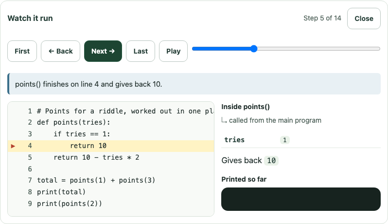
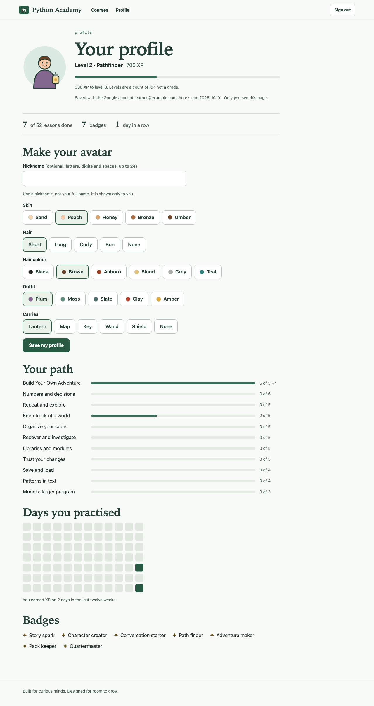

# Handoff 56: "Watch it run" and profiles

Date: 2026-11-20 (America/Toronto)  
Written by: Claude Code (implementer), in a separate git worktree  
For: the human maintainer, and ChatGPT or Claude chat (reviewer) without repository access  
Status: **in_review**: one pull request (#64), **based on #63: merge #63 first**. Not merged, not deployed. **One additive migration (0011). No new dependency. No change to the CSP, the import guard or how checks work. Two new API routes.**

## Starter prompt for the chat assistant

```text
Review two features on top of PR #63. 1. "Watch it run": the Python worker gains a trace mode that runs a
program once with sys.settrace and records each line of the learner's own code (the names in scope, the
function, how much had been printed), up to 400 steps; the page replays it with back, next, a slider and
play, and says each step in a sentence. Check that it cannot leak anything new, cannot be used to escape
the import guard, and that its sentences are true. 2. Profiles: GET and PUT /api/profile (migration
0011), an avatar from fixed choices and an optional nickname, plus a progress summary from the existing
ledgers. Check the validation, that the nickname never reaches anyone else or the history, and the
privacy wording.
```

## Run plan details

| Field | Value |
| --- | --- |
| Request | The owner's message of 2026-11-20: "make a pr for a different [one] now, come up with a new innovative idea for the interactive feature … professional and smart, not just images … and add a profile maker where you can have a profile associated with the google sign in that saves everything and your xp" |
| Base | `content/py-lessons-interactive` (#63), because the stepper builds on its lesson page; the PR targets that branch. **Merge #63 first**; GitHub then retargets this PR to `main` |
| Branch and worktree | `feat/profile-and-stepper`, `../python-academy-profile` |
| Stage IDs | None in `MASTER-RUN.md`. Suggested for the docs sync: `UI-08` Watch it run, `ID-02` profiles (assumptions; check against `build.md` section 13) |
| Part 2 boxes | None relied on. **Profiles store new personal data (an optional nickname)**: see section 4 and question 1 |

## 1. Watch it run (the new interactive feature)

The scenes from #63 show *what* a program did. "Watch it run" shows *how*: the order Python runs the lines in, which is the thing beginners find hardest to picture (loops, function calls, `return`). It is the professional tool real programmers use, a debugger, simplified for a grade 9 learner.

- **Where:** "Watch it run, step by step" under every worked example, and **Watch it run** beside Run on Try it and the challenge (on a checked challenge it uses the first visible case's replies and files, never a hidden case).
- **What it shows at each step:** the code with the line that just ran (✓, green) and the line that runs next (▶, yellow, `aria-current="step"`); the names in scope, with the ones that changed highlighted and their old value ("was 4"); inside a function, its own names and "called from the main program"; on a `return`, what the function gives back; and everything printed so far.
- **One sentence per step,** worked out from the recording: "Line 7 called points(), which starts with tries = 1. Next is line 3." "points() finishes on line 4 and gives back 10." "Line 3 ran. No name changed. It printed "Nova". Next is line 4." Screen readers hear it through a polite live region.
- **Controls:** First, Back, Next, Last, Play/Pause (one step every 0.65 s, stops at the end), and a slider. All are real buttons or a native range input, so the keyboard works.
- **Endings are honest:** "The program finished."; "Python stopped here with ZeroDivisionError on line 3."; "Stopped recording after 400 steps. A loop that runs this long may never end…"; or, for a program Python cannot read, a message that there are no steps.
- **It always matches the code:** editing the code closes the panel; nothing is replayed against code it was not recorded from.

### 1.1 The worker change (security-relevant)

`frontend/public/python-worker.js`, new message `mode: 'trace'` (`runTrace`):

- Same start as a Try it run: pinned Pyodide, network removed, **the import guard on**, files and the learner's own files as before, replies through the same `input()`.
- `__academy_trace` (defined after the guard; it imports nothing) compiles the program as `<exec>`, runs it in its own namespace with `sys.settrace`, and records only frames whose file is `<exec>`: Python's library, the worker's own code and the learner's other files are never traced.
- Each step's names are the scene snapshot from #63 (plain copies, Python's own names bound in advance), so a program cannot change how a step is recorded by naming something `list`.
- Limits: 400 steps (then it stops the program with an exception that `except Exception` cannot catch), 20,000 characters of output, and the page's 15-second stop. Printed text goes to a capped buffer inside Python, not to the page.
- `io` joins the modules the worker imports **before** the guard goes on, like `json` and `re`; the learner still cannot import it (tested by the existing guard tests, which pass unchanged).
- **Nothing leaves the browser:** a test steps through a whole program and checks that the page made no request other than loading.

## 2. Profiles

- **`/profile`**, linked from the header for signed-in students and parents. Signed out, it asks you to sign in with Google.
- **Avatar builder:** skin, hair, hair colour, outfit and what the avatar carries, each from a fixed list (`backend/app/profiles.py` `AVATAR_CHOICES`), drawn in SVG from classes. **No uploaded pictures**, so nothing from outside the app is ever shown and there is no image moderation to do.
- **Nickname:** optional, up to 24 characters, letters (any alphabet), digits, spaces, `.`, `'` and `-`. Extra spaces are tidied. The page says to use a nickname, not a full name, and that only you see it.
- **For students, from the ledgers that already exist:** XP, a level (every 500 XP; titles Explorer, Pathfinder, Trailblazer, Navigator, Cartographer, Lorekeeper; the page says levels are a count of XP, not a grade), lessons done of the released ones, badges, progress for each unit, a twelve-week grid of days with XP, and the current run of days.
- **"Saves everything with your Google account":** XP, badges and progress were already saved per account; the profile adds the avatar and nickname, saved with **Save my profile**. The page says which Google account it is saved with.

### 2.1 API and data

| Route | Who | Does |
| --- | --- | --- |
| `GET /api/profile` | the signed-in student or parent (401 signed out, 403 still being set up) | Their own profile and, for a student, the summary |
| `PUT /api/profile` | the same; rate-limited (20 a minute, 100 a day) | Saves `{nickname, avatar}` after validation; 422 with a plain message otherwise |

Migration **0011** adds `profiles (user_id PK → users, nickname, avatar, updated)`. Additive; the previous app version keeps working during a deploy; downgrade drops only that table. Saving records a `profile_saved` history event **with no detail**, so the nickname is never copied into the history. Nothing about a profile appears in any other answer (tested on `/api/me`, `/api/awards`, `/api/progress`, `/api/catalog`, `/api/recommendation`, `/api/history`). `docs/plan/retention.md` has a new row for profiles.

## Screenshots




## 3. Decisions and why (assumptions marked)

| Decision | Why |
| --- | --- |
| Stepper records once and replays, instead of pausing a live program | A worker cannot be paused mid-line safely; replaying a recording makes Back possible and keeps every safety limit of an ordinary run. **Assumption** |
| Steps show the state *before* the next line runs, and the sentence describes the line that just ran | That is what Python's tracer gives, and it is how real debuggers behave |
| 400 steps | Enough for every worked example and challenge in units 1 to 11; short enough to stay quick. **Assumption** |
| Fixed avatar choices, no uploads | No moderation, no outside images, nothing identifying |
| Nickname shown only to its owner, not to parents | Smallest change to who sees what. **Question 2** |
| Parents get a profile too, without the learning summary | They sign in with Google as well; they have no XP |
| Levels every 500 XP | Five lessons a level, roughly one unit. **Assumption** |

## 4. Privacy

The nickname is new personal data that a learner types. Mitigations: optional; short; limited characters (no `@`, so no email addresses); advice on the page to use a nickname; shown only to its owner; never in the history or another answer; deleted with the account when account deletion is built (S12). It is still covered by the open privacy-notice work (S11, boxes B-I8 and B-S2). See question 1.

## 5. How it was tested

| Command | Result |
| --- | --- |
| Backend, SQLite | **1,815 passed, 26 skipped** after the route-list and guard-order tests were updated for the new routes and the trace mode (they failed first, as they should) |
| Migration 0011 on PostgreSQL | In CI (no local PostgreSQL); the test is written for both |
| `npx tsc --noEmit`, `npm run build` | OK |
| `tests/profile-stepper.spec.ts` (new, real Pyodide) | **13 passed** |
| Full browser suite | **497 tests**: 492 passed with 2 workers. The unit 1 snapshot was re-recorded: no line removed, only the two **Watch it run** button labels added. The other 4 timed out under load and passed alone. A first run with 4 workers had 165 failures where Pyodide reported "unavailable" (could not start); the same specs passed alone and in the 2-worker run, so that run is not counted |

New backend tests (`tests/test_profiles.py`, 20, plus the migration test): 401 and 403 for signed-out and unenrolled people; the defaults; saving, re-saving one row, the empty-detail event; five refused nicknames (too long, `<script>`, an email, `;`, `{}`) and names in other alphabets accepted; five refused avatars (missing parts, an extra part, an unknown colour, a URL as an item); XP, level, badges and unit progress after two real lessons; levels and streak edges with fixed dates; a parent's profile; the nickname absent from six other answers; the rate limit at 21; and the recorded fixture equal to the real view.

New browser tests: stepping through a worked example with exact sentences, changed names and printed output; stepping into a function and seeing what it gives back; an endless loop stopped at 400 steps and moved through with the slider; an error located; editing closes the panel; Play stops at the end; stepping sends no request; the profile for signed-out visitors, students (level, progress, badges, active days, building and saving an avatar, the exact PUT body) and parents; axe at desktop and phone width for both, with no sideways scroll.

### 5.1 Deliberate-break checks

| What I broke | Caught by |
| --- | --- |
| B1. Any value accepted for an avatar part | `test_profiles.py`: **2 failed** |
| B2. The nickname written into the history event | `test_profiles.py`: **2 failed** |
| B3. Profiles open to accounts still being set up | `test_profiles.py`: **1 failed** |
| B4. The worker's 400-step limit removed | "a loop that never ends is stopped and explained": **1 failed** |

## 6. Limits

- Only the learner's main program is stepped through, not their other files.
- Names are shown as the scene snapshot copies them: lists past 24 items and long text are shortened.
- A recorded run uses the replies on the page; a program that reads random numbers without a seed may differ from the last ordinary run.
- Not seen on real devices, Safari, Firefox or with a screen reader; not on the live site.

## 7. Questions (each recommended, not yet confirmed)

1. **Is an optional nickname acceptable before the privacy notice exists?** *Recommended: yes, as it is optional, short, shown only to its owner and never in the history; list it in the notice when S11 is built.*
2. **Should a parent see their child's avatar and nickname in the family view?** *Recommended: the avatar only, in a later small PR.*
3. **Stage IDs `UI-08` and `ID-02`?** *Recommended: yes, added by the next docs sync.*
4. **Should a finished lesson ask "Watch it run" before the challenge, as a habit?** *Recommended: try it with your sister first.*

## 8. Live checks for you (after #63 and this merge)

1. Open any worked example, press **Watch it run, step by step**, and step with the keyboard (Tab to Next, then Enter).
2. On Try it in "Score the guess", press **Watch it run** and step into `points()`.
3. Sign in as a student, open **Profile** in the header, build an avatar, add a nickname, save, reload: it stays.
4. DevTools → Network while stepping: no request.

## 9. Removing the worktree safely

```sh
cd /Users/DEV/Projects/python-academy
git -C ../python-academy-profile status --short   # expect nothing
git worktree remove ../python-academy-profile
git branch -d feat/profile-and-stepper
```
