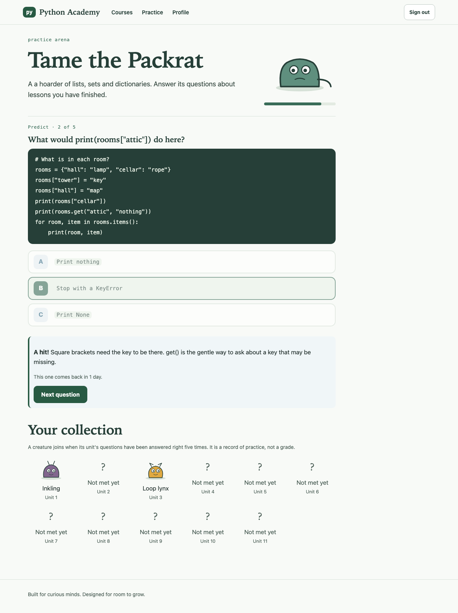

# Handoff 57: Practice Arena, mistake detectors, and a text policy

Date: 2026-11-20 (America/Toronto)  
Written by: Claude Code (implementer), in a separate git worktree  
Status: **in_review**: one pull request (#65), **based on #64: merge #63, then #64, then this**. One additive migration (**0012**). No new dependency, no CSP change, no change to how checks judge.

## Starter prompt for the chat assistant

```text
Review three features on top of #64. 1. The Practice Arena (/practice): spaced review cards (predict,
trace, arrange the lines, spot the bug) from finished lessons, scheduled 1, 3, 7 and 30 days apart,
played as a short battle against a creature per unit; no XP is ever given or taken. Check that answers
never reach the page before answering, and that every card is true Python. 2. POST /api/insights: mistake
detectors that read the code's syntax tree (never run it) and offer "a likely cause"; check they cannot
claim a verdict and do not fire on correct programs. 3. app/text_policy.py: one check for text a learner
types (personal details and the owner's blocked words); check it does not block ordinary names.
```

| Field | Value |
| --- | --- |
| Request | The owner's message of 2026-11-20: "think how do you teach as well as possible … Prodigy before they added all the pay-to-win was really good at keeping people learning … we will probably need content filters for typed-in words later, and smart things like better hinting systems and error detection systems" |
| Base | `feat/profile-and-stepper` (#64); merge order #63, #64, this |
| Branch and worktree | `feat/arena-and-insights`, `../python-academy-arena` |
| Stage IDs | None yet. This is **teaching-design.md sections 2.7 and 5** (spaced review, proposed there) and part of **ENG-04** (feedback). Suggested: `EDU-12` Practice Arena, `ENG-12` mistake detectors, `SEC-12` text policy |

## 1. What makes it Prodigy-like, and what keeps it honest

What kept people learning in early Prodigy: short rounds, a creature to beat, a collection that grows, and coming back because something is waiting. That is kept. What made it pay-to-win is not: **nothing is bought, no XP is given or taken, there is no streak to lose, and a creature joining your collection is labelled "a record of practice, not a grade"** (`build.md` section 4 rules out punitive streaks).

What makes it good teaching (`teaching-design.md` 2.7): **retrieval** (answering from memory, not re-reading), **spacing** (a right answer comes back after 1, then 3, 7 and 30 days; a wrong one tomorrow), **interleaving** (one card per lesson first, so the right idea has to be chosen), and **immediate feedback with a second try**: a wrong answer shows why, and the card comes back once at the end of the round, so every round can still be won.



## 2. The Practice Arena

- **99 cards** in `backend/content/review/py.json`, made by a script and checked by tests:
  - **predict** (52): each lesson's own predict card;
  - **arrange the lines** (15): from each worked example whose lines **no swap of two lines** can reorder into the same output (tested by running every swap);
  - **trace** (15): what a name holds at the end, **proved by running the code** and printing the name;
  - **spot the bug** (17): a program with one wrong line and its fix, **proved to behave differently**, and the answer being the only line that changes.
- **Only finished lessons' cards** are offered (`/api/review` reads the XP ledger). Due cards first, then new ones spread across lessons, then (only when nothing is due) practice ahead, labelled as such.
- **Answers stay on the server**: the page gets the options, or the lines already shuffled, never which is right (tested on every card). The second try in a round is checked on the page against the answer already shown, and does not change the schedule.
- **Creatures:** one per unit (Inkling, Sumbat, Loop lynx, Packrat, Callwing, Bugbear, Toolhound, Testudo, Scrollworm, Patternfox, Classaur), drawn from shapes in SVG; one joins the collection when its unit's cards have been answered right five times.
- **Migration 0012** adds `review_state (user_id, card_id, box, due, seen, correct, updated)`. Retention row added.

## 3. "A likely cause": mistake detectors

`backend/app/insights.py`, `POST /api/insights {lesson_id, code}`. Each detector reads the program's syntax tree, **never runs it**, and stores nothing. The lesson page asks for it after a check or run that did not pass, and shows "A likely cause … Spotted by reading your code. It may be wrong; the check decides." with **Go to line**. A separate route, so **the judge's answers are byte for byte unchanged** (no recording changed).

| Detector | Example it names |
| --- | --- |
| text-not-number | `secret = input()` then `secret > 5`: "`secret` holds the text from input() on line 1…" |
| reset-in-loop | `total = 0` inside the loop that adds to `total` |
| mutator-assigned | `pack = pack.append("map")` |
| print-not-return | a function that prints, whose result the program uses |
| quoted-name | `print("hero")` when `hero` is a variable (not `print("total", total)`) |
| loop-never-changes | a `while` whose test nothing in the body can change |
| return-in-loop | `return` as the last line inside a `for` in a function |
| self-missing | `name = name` in `__init__` |
| shadowed-builtin | `list = [...]` and later `list(...)` |

**Tested against every correct program the lessons know** (every reference, creative program, "other way" and worked example in units 1 to 11): no detector fires on any of them. Two false alarms found this way were fixed (a label printed beside its variable; a `while` whose test calls `input()`).

## 4. The text policy

`backend/app/text_policy.py`: one function, `problem(text)`, for **anything a learner types that is kept or may be shown**. Today the nickname uses it; future feedback, project titles and anything shared should too.

- **Personal details refused:** email addresses (also "name at gmail dot com"), links, phone numbers, and street-address shapes.
- **Blocked words:** `backend/content/policy/blocked-words.txt`, kept by you. Matched as **whole words** after undoing disguises (`sh1t`, `F*CK`, `a$$hole`, `Shiiit`), **never inside other words** ("Scunthorpe", "classic", "Dickens", "bass" pass, tested).
- It is a guard rail, not moderation; anything other people will see later still needs a report-and-review path.

## 5. How it was tested

| Command | Result |
| --- | --- |
| Backend, SQLite | **1,924 passed** |
| `tests/arena.spec.ts` (new) | **8 passed**: a whole round won; a wrong answer explained and retried; arrange-the-lines from the keyboard; locked before any lesson; signed out; a likely cause with Go to line; axe at desktop and phone |
| Full browser suite (2 workers) | **505 passed** |

Deliberate breaks, each undone: the answer sent with the card (**3 failed**); a label flagged as a quoted name (**1 failed**: the no-false-positive sweep); phone numbers allowed (**4 failed**).

## 6. Questions (each recommended, not yet confirmed)

1. **Creature names and the "tame" wording:** fine for a 13+ audience? *Recommended: yes; easy to rename in `review.py`.*
2. **Blocked-word list:** keep the short starter list, and grow it from real reports? *Recommended: yes.*
3. **Show tamed creatures on the profile?** *Recommended: yes, in a small follow-up.*
4. **Review cards for each new course** (CS in the next PR). *Recommended: yes, every course gets its own.*

## 7. Removing the worktree safely

```sh
cd /Users/DEV/Projects/python-academy
git -C ../python-academy-arena status --short   # expect nothing
git worktree remove ../python-academy-arena
git branch -d feat/arena-and-insights
```
