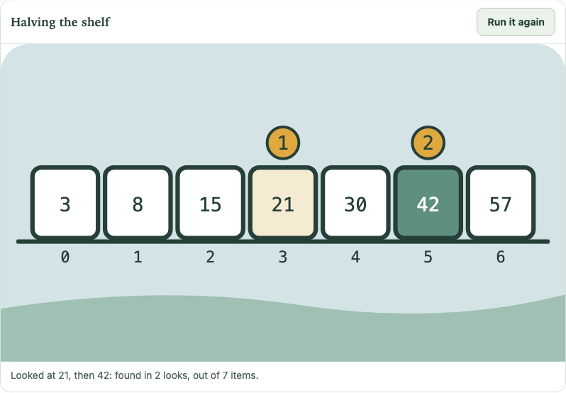
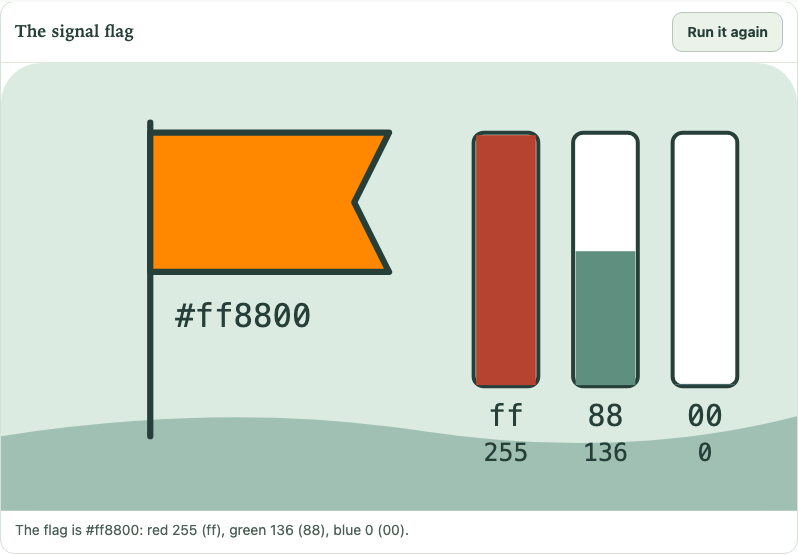

# Handoff 58: Computer Science Foundations opens, with units 1 and 3

Date: 2026-11-20 (America/Toronto)  
Written by: Claude Code (implementer), in a separate git worktree  
Status: **in_review**: one pull request ({{PR}}), **based on #65: merge #63, #64, #65, then this**. No migration, no new dependency, no CSP change, no change to how checks judge.

## Starter prompt for the chat assistant

```text
Review the first Computer Science Foundations content (docs/plan/courses/cs.md): unit 1 "How data is
stored" (cs.binary, cs.hexadecimal, cs.text-encoding, cs.float-limits) and unit 3 "Searching"
(cs.linear-search, cs.binary-search, cs.counting-steps). Check that each lesson teaches what its title
says, that hidden cases catch the wrong programs listed in backend/tests/test_cs_lessons.py, that the
binary search lesson really tells a binary search from a linear one, and that the scenes say only what
the run showed. Unit 2 (Thinking in steps) waits for its own pull request.
```

| Field | Value |
| --- | --- |
| Request | The owner's message of 2026-11-20: "you can also work on other things besides Python Foundations … better hinting systems and error detection systems will be very important too for each one" |
| Base | `feat/arena-and-insights` (#65) |
| Branch and worktree | `content/cs-foundations`, `../python-academy-cs` |
| Stage IDs | Course `cs` (catalog status `coming_soon` to `released`). No stage ID existed for CS content; suggested `CS1` (unit 1) and `CS3` (unit 3) |

## 1. What a learner gets

The course is **released** with units 1 and 3 open; units 2 and 4 to 7 are listed as *coming soon*, exactly as `cs.md` outlines them. Its prerequisites stay as they were: Python units 1 to 5 required, 6 to 8 suggested.

| Lesson | Story | Challenge (checked by calling the learner's functions) |
| --- | --- | --- |
| Lamps on the tower | Binary on a row of lamps | `to_binary(n)` and `from_binary(bits)` with `//` and `%` |
| Colours on the flags | Hex colour codes on signal flags | `hex_to_rgb("#ff8800")` and `rgb_to_hex(10, 11, 12)` |
| Coded messages | Characters as numbers, bytes | `shift(message, steps)` (wraps, negative, big) and `byte_count(text)` in UTF-8 |
| The ledger that would not balance | Why 0.1 + 0.2 is not 0.3 | `to_cents("4.35")` without `float()`, `add_prices([...])` exactly |
| Search the shelf | Linear search, counting looks | `find(items, target)` gives position and looks |
| Halve the shelf | Binary search | `binary_find(items, target)` gives position and looks |
| How the work grows | Counting steps, not seconds | `linear_worst`, `binary_worst`, `compare(sizes)` |

Every lesson has the same six cards as Python's, hints in three steps, error hints per case, a similar example with other names, and two "other ways". **Each lesson's hidden cases are proved to catch a named wrong program**, and each "other way" and creative program is proved to pass.

**Telling the two searches apart by behaviour, not by construct.** A linear search returns the right position, so position alone cannot catch it. The lesson asks for the number of looks too, which only the `(low + high) // 2` method gets right; a linear search handed in fails with "should return [5, 2], but it returned [5, 6]". The float lesson's first case, `4.35`, is chosen because `int(float("4.35") * 100)` is 434, so `float()` is caught by behaviour too, and its error hint says why.

## 2. Scenes: seven new drawings



| Lesson | Scene | Drawn from |
| --- | --- | --- |
| Binary | **The signal tower**: lamps on and off, place values under them, the total | the bits returned, a `lamps`/`bits` name, or a `0b…` line |
| Hexadecimal | **The signal flag**, raised in the real colour, with red, green and blue gauges | a returned code or list, `red`/`green`/`blue`, or a `#…` line; says when an amount does not fit in a byte |
| Text | **The coded message**: each character, its code, and its bytes as squares; or original over shifted | the call's text and what came back |
| Floats | **The ledger**: lines that drift marked ≈ in clay, exact ones = | printed lines and the returned total |
| Linear search | **The archive shelf**: looked-at boxes, the found one, the searcher standing at the last look | the list, and `[position, looks]` |
| Binary search | **Halving the shelf**: the order of the middles looked at | the list and target; it **re-does the halving itself**, so a wrong answer is shown beside the right one |
| Counting steps | **The step race**: one-by-one and halving bars for each size | printed sizes, or `compare()`'s table |

A checked call's arguments are read from the case's own description (`binary_find([3, 8, …], 42)`), which is already on the page; hidden cases are never drawn.



## 3. Practice Arena and hints for the new course

- **27 review cards** in `backend/content/review/cs.json` (7 predict, 13 trace, 5 spot-the-bug, 2 arrange-the-lines), each proved by running it, the same way as Python's. They join the arena once the lesson is finished.
- **Two creatures:** the **Bitmoth** (unit 1) and the **Seekowl** (unit 3).
- The **mistake detectors** from #65 already run on these lessons. The no-false-positive sweep now includes every CS reference, creative program and other way, and none fires.

## 4. How it was tested

| Command | Result |
| --- | --- |
| `tests/test_cs_lessons.py` (new, the shared lesson suite) | **154 passed** |
| `tests/test_cs_recordings.py` (new) | the recorded CS API is the real one |
| Backend, SQLite | {{BACKEND}} |
| `tests/cs.spec.ts` (new) | **21 passed**: catalog; unique scene titles; each example's scene sentence; each reference passes in Pyodide exactly as recorded; a linear search handed in shows the right halving; two Try it scenes; axe at desktop and phone |
| Full browser suite (2 workers) | {{BROWSER}} |

Re-recorded, each because the catalog now has CS: `units-4-11-api.json` (catalog only) and `arena-api.json` (two more creatures; its sample arrange-the-lines card is now a CS one).

Deliberate breaks, each undone: {{BREAKS}}

## 5. Questions (each recommended, not yet confirmed)

1. **Release CS with units 1 and 3 before unit 2?** Unit 2 (pseudocode, tracing, invariants) is mostly reasoning, which needs card kinds that are not built. *Recommended: yes; unit 3 needs only unit 1.*
2. **Stage IDs** `CS1` and `CS3`? *Recommended: yes, for the docs sync.*
3. **The home page** still names only Python. *Recommended: add CS to it after you have tried these lessons.*

## 6. Removing the worktree safely

```sh
cd /Users/DEV/Projects/python-academy
git -C ../python-academy-cs status --short   # expect nothing
git worktree remove ../python-academy-cs
git branch -d content/cs-foundations
```
