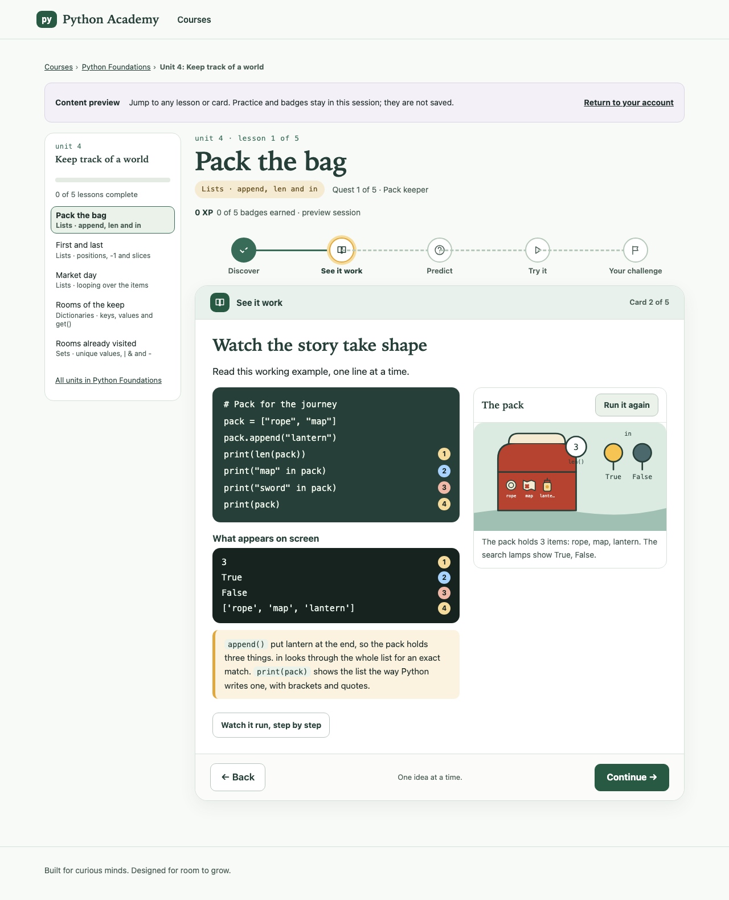
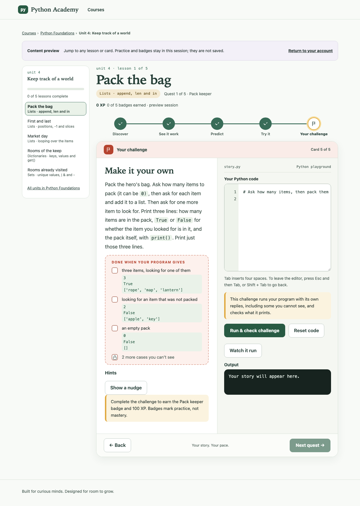

# Handoff 60: every lesson looked at, and the page reshaped

Date: 2026-11-20 (America/Toronto)  
Written by: Claude Code (implementer), in a separate git worktree  
Status: **in_review**: one pull request ({{PR}}), **based on #67**. Frontend layout, 20 scenes, 5 lesson texts, new rules and their tests. No migration, no dependency, no CSP change, no change to how checks judge.

## Starter prompt for the chat assistant

```text
Review the lesson page changes (docs/plan/lesson-page-rules.md). Every released lesson was screenshotted
and reviewed; the page layout changed for all of them (scene beside the output, the challenge's task,
Done when and hints together), code in lesson text is now shown as code, placeholder pictures are gone,
20 scenes were redrawn so they stop repeating the output and fill their frames, and five lessons now
explain tools they asked for without explaining. Check the rules are right and the tests enforce them.
```

| Field | Value |
| --- | --- |
| Request | The owner's message of 2026-11-20: go through each lesson visually and decide whether it could teach anyone anything; the visuals are in the wrong spots, hard to read, too full and too empty; reframe, reposition and reshape, for every lesson so far and forever; fix anything put on a page without being explored or explained |
| Base | `plan/py-final-project` (#67) |
| Branch and worktree | `ux/lesson-layout`, `../python-academy-ux` |

## 1. What the review found (all 59 lessons, desktop and phone)

1. **See it work:** the scene sat at the bottom, 800 px wide, below the code, output and note; letters were 30 px for a four-line program, while some labels were 6 px and others ran off the frame.
2. **Try it and Your challenge:** the editor column held editor, notes, buttons, output, an empty scene and, last, the hints; the left column was mostly empty, yet said "Hints are beside your code".
3. **Done when:** each case's description was squeezed to one word per line.
4. **Pictures:** 43 lessons showed the same placeholder "py" hills in the header and sidebar; on a phone it pushed the lesson a screen down.
5. **Text:** code in sentences was plain text.
6. **Scenes:** with the scene now beside the output, 12 scenes were seen to repeat the output; 8 were a small drawing in a mostly empty frame; 4 had clipped or unlabelled text.
7. **Content:** five lessons asked for, or hinted at, a tool no lesson had explained (`ceil()` and `round()` in the toolbox challenge, `abs()`, `min()`), and the string methods lesson listed eight methods in one sentence, two of them never used.

## 2. What changed



- **Layout (all lessons):** code full width, then output and note **beside** the scene (a 400 px column, sticky). On the challenge: task, Done when and hints on the left; editor, run, output, result, likely cause, then the scene on the right. No scene before a run. No footer note.
- **Code in text** is found and shown as code (`app/prose-runs.ts`), so authors keep writing sentences and unit 1's frozen text needs no change. It is checked against every lesson's text: joining the pieces gives back the text exactly.
- **No placeholder pictures** (header, sidebar, course page, home).
- **Scenes redrawn (20):** the pack, print or return, as the crow flies (now reads `hypot(3, 4)` from the code and draws the walk), the dice, the calendar (code dates ringed, with a legend), the storyboard, rooms on the map, the score table, hero cards, health and potions, the test report, the form checker, the highlighter, sorting into bins, the toolbox, labelled parcels, the tidiness meter, the repair kit (usable, damaged, started fresh), the crash report, the hero and the pack.
- **Scenes kept as they are**, though they echo some output, because each adds what the output cannot: the scene machine (marks the lines a function call replayed), the magnifier (the names behind each check line), the notebook (the file beside what was printed), the ledger (marks the lines that drift).
- **Content (5 lessons):** string methods' Discover card rewritten so each method it needs has an example (`find`, `startswith` dropped); the toolbox challenge explains `ceil()` and `round(x, 1)`; `abs()` and `min()`/`max()` explained in their hints.



## 3. Rules from now on

`docs/plan/lesson-page-rules.md`: **L1 to L6** (page), **S1 to S3** (scenes), **C1 to C3** (content). L1 to L6 are checked on every lesson by `frontend/tests/lesson-layout.spec.ts`; C1 to C3 by `backend/tests/test_lesson_clarity.py`.

## 4. How it was tested

| Command | Result |
| --- | --- |
| Backend, SQLite | **2,113 passed** |
| `tests/test_lesson_clarity.py` (new) | **4 passed** (C1 to C3 over all 59 lessons, and the check itself) |
| `tests/lesson-layout.spec.ts` (new) | **61 passed**: every one of the 59 lessons' worked example and scene (L1 to L4), the challenge layout (L5, L6), and the phone layout |
| Full browser suite (2 workers) | **585 passed, 2 failed**, both from intended changes: the hints test expected hints in the editor column, and the unit 1 snapshot. Both updated and passing |

The unit 1 snapshot was re-recorded. The only lines removed are the footer note, "Hints are beside your code", and the empty scene's text before a run; every one of the 20 hint captures is identical.

Deliberate breaks, each undone: `ceil()` asked for without its explanation (**1 failed**, C1); a 7 px scene label (**1 failed**, L2: "rope is 8.7px"); the scene put back under the output (**2 failed**, L1).

## 5. Questions (each recommended, not yet confirmed)

1. **Drop the placeholder pictures** rather than draw 43 more? *Recommended: yes; the scenes are each lesson's picture.*
2. **The C2 and C3 limits** (6 new tools, 130 words per Discover card)? *Recommended: yes; no current lesson needs more.*

## 6. Removing the worktree safely

```sh
cd /Users/DEV/Projects/python-academy
git -C ../python-academy-ux status --short   # expect nothing
git worktree remove ../python-academy-ux
git branch -d ux/lesson-layout
```
