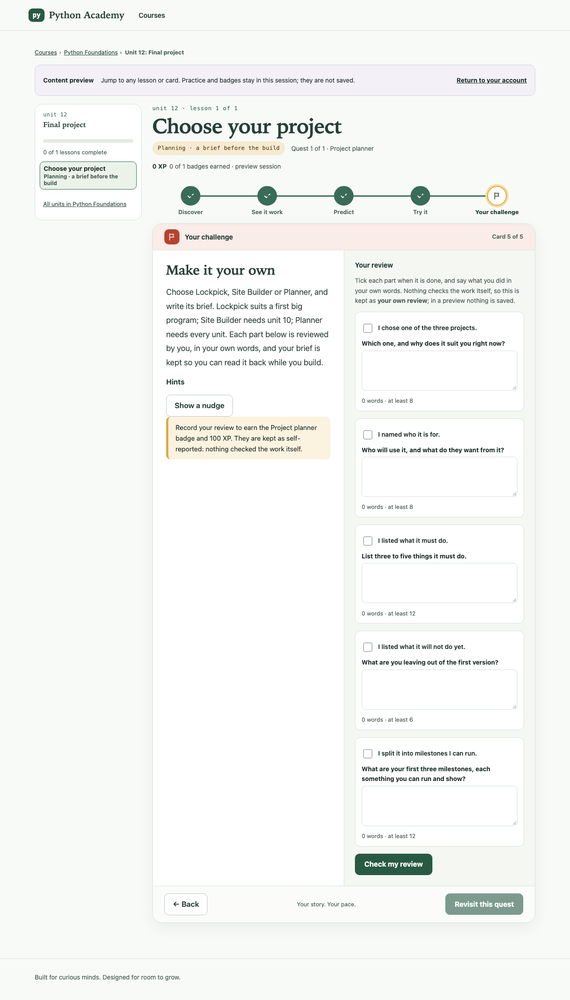

# Handoff 61: ENG-09, self-reviewed challenges, and the two lessons they open

Date: 2026-11-21 (America/Toronto)  
Written by: Claude Code (implementer), in a separate git worktree  
Status: **in_review**: one pull request ({{PR}}), **based on #68**. One additive migration (**0013**). No new dependency, no CSP change; code challenges are judged exactly as before.

## Starter prompt for the chat assistant

```text
Review ENG-09 (backend/app/self_review.py, /api/self-review, app/self-review.tsx): a challenge the learner
reviews themselves against a short rubric, in their own words. Check that nothing presents it as checked
work (XP source "self_reported", the page's wording, the response), that the writing checks cannot be
clicked through and do not refuse honest short answers, that personal details are refused, and that only
finished reviews are stored. Then review the two lessons it opens: py.when-not-oop (unit 11) and
py.final-brief (unit 12).
```

| Field | Value |
| --- | --- |
| Request | The owner's message of 2026-11-21: "ok do the next thing", which is step 1 of the build order in `docs/plan/courses/py-final-project.md` |
| Base | `ux/lesson-layout` (#68) |
| Branch and worktree | `feat/eng-09-self-review`, `../python-academy-eng09` |
| Stage IDs | **ENG-09** (backlog: proposed). Lessons `py.when-not-oop` (WD10 remainder) and `py.final-brief` (WD11, first of three) |

## 1. What ENG-09 is

A lesson's challenge can now be a **self review**: a short rubric (one to eight parts). For each part the learner ticks that it is done and says what they did, in their own words.

- **Nothing checks the work itself**, and nothing pretends to. The XP row's `source` is `self_reported` (the existing column; code challenges stay `practice`), the response says `evidence: self_reported`, and the page says so before and after: "They are kept as self-reported: nothing checked the work itself", then "Your review is saved, as self-reported."
- **What is checked is the writing**, so a review cannot be clicked through. Each part must be ticked; have enough words (set per part, 6 to 12 here); not mostly repeat the question; not repeat one word over and over; and pass the text policy (no personal details, no blocked words). Each note appears beside its own part and is read out with its text box.
- **Only finished reviews are kept** (`self_reviews`, migration **0013**): drafts stay on the page. A preview gets the same notes and saves nothing (`/api/self-review/preview`).
- XP and the badge are awarded **once**, as for code challenges (100 XP, decision 6).



## 2. The two lessons

| Lesson | Unit | What the learner does | Scene |
| --- | --- | --- | --- |
| **Not everything needs a class** (`py.when-not-oop`) | 11, now **complete** | Sees one hero as a class, as a dictionary and with a plain function; then reviews three of their own design choices | **Three shapes**: the object, the dictionary and the function from the run, each with when it fits |
| **Choose your project** (`py.final-brief`) | 12, now **released** (more lessons coming) | Reads a brief kept as a Python dictionary; then chooses Lockpick, Site Builder or Planner and writes its brief: who it is for, what it must do, what waits, and three milestones | **The brief board**: project, who it is for, must, not yet (or milestones) |

Both follow the lesson page rules (handoff 60): their scenes are checked by `lesson-layout.spec.ts` like every other lesson, and their text by `test_lesson_clarity.py`. Each has review cards for the Practice Arena (a predict and a trace card), and unit 12 has a creature, the **Keystone**.

## 3. How it was tested

| Command | Result |
| --- | --- |
{{RESULTS}}

## 4. Questions (each recommended, not yet confirmed)

1. **100 XP for a self review**, the same as a checked challenge, labelled self-reported? *Recommended: yes for lessons; the final project's 500 XP still needs the rubric review (decision 6).*
2. **Should a parent see the written reviews** in the family view? *Recommended: yes, read-only, in a later change; today they see the lesson as finished.*
3. **Word minimums** of 6 to 12 per part. *Recommended: keep, and adjust from real use.*

## 5. Removing the worktree safely

```sh
cd /Users/DEV/Projects/python-academy
git -C ../python-academy-eng09 status --short   # expect nothing
git worktree remove ../python-academy-eng09
git branch -d feat/eng-09-self-review
```
