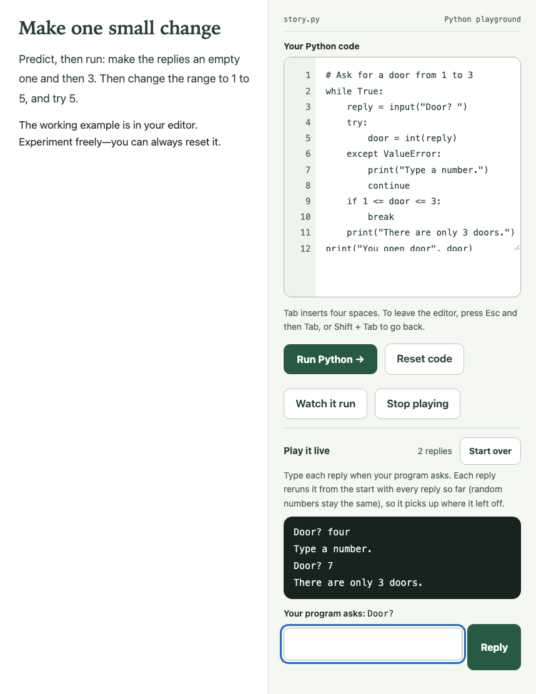

# Handoff 62: main catches up, the site questioned for "AI slop", and live play

Date: 2026-11-23 (America/Toronto)  
Written by: Claude Code (implementer), in separate git worktrees  
Status: **in_review**: three pull requests, **merge in order #70, #71, #72**. No migration, no new dependency, no CSP change. One additive API route (#71).

## Starter prompt for the chat assistant

```text
Review three PRs in order. #70 only brings ux/lesson-layout (#64 to #69) into main. #71 removes icon
squares, boxes inside boxes, shadows and slogans, fixes untrue counts and claims, and adds
GET /api/self-review/{lesson_id} so a recorded brief can be read back. #72 adds live play: a program that
calls input() can be played turn by turn, each reply re-running it from the start in a fresh worker with
one random seed per game. Check that live play cannot be swallowed by learner code, sends nothing to the
API, and leaves every normal run, check and recorded error exactly as it was.
```

| Field | Value |
| --- | --- |
| Request | The owner, 2026-11-23: "ok continue everything, continue improvements and remember, make sure you are looking at the layout and questioning... is this actually good or is it ai slop" |
| PRs | #70 `ux/lesson-layout` into `main`; #71 `ux/site-look`; #72 `feat/live-play` (based on #71) |
| Stage IDs | Site rules D1 to D6 (new, `docs/plan/lesson-page-rules.md`); **E2** live play (`py-final-project.md` section 3) |

## 1. #70: main was still at #63

#64 to #69 were a stack, each based on the one before, and each was merged into its base. So all six landed in `ux/lesson-layout` and **`main` (the live site) still ends at #63**. #70 merges `ux/lesson-layout` into `main`; it merges cleanly. From now on every PR targets `main`. #71 and #72 do, and their diffs shrink to their own change once #70 is in.

## 2. #71: every page questioned

Screenshots of the home, course, practice, profile and lesson pages at 1280 and 390 px. What did not earn its place went:

| Found | Now |
| --- | --- |
| Home: the five lesson steps as five boxes, each with an icon in a coloured square | A numbered row; each step's colour is a rule above it |
| Every lesson card's tab repeated the stepper's icon in a coloured square, on a tinted band | A plain tab: the card's name and "Card n of 5" |
| Self-review: each part a card inside the review panel | Parts divided by rules |
| Home, For parents: four boxed facts with ticks | A plain list divided by rules |
| Shadows under the lesson card and the home code preview | Borders only |
| "Built for curious minds. Designed for room to grow." on every page; "One idea at a time." and "Your story. Your pace." on every lesson card | A footer that says something true (your code runs in your browser); the card footer says "Choose the right answer to go on." only when Continue is waiting |
| "twelve units open, no on the way"; "1 lessons"; "Eleven of the twelve units are open" | "all twelve units open"; "1 lesson"; a footer that matches the catalog |
| The final brief promised "your brief is kept so you can read it back", but nothing read it back | `GET /api/self-review/{lesson_id}` (the signed-in learner's own latest review) fills the form back in: "This is the review you recorded on …" |
| The brief asked you to pick one of three projects without saying what they are | One line each: what it is, its size and hours, and when it fits |
| Signed-out Practice arena: a heading and a button | A tamed creature and how taming works, truthfully (cards from lessons you finished; a wrong answer only brings the question back tomorrow) |

## 3. #72: live play (E2)



Any program that calls `input()` gets **Play it live** next to Watch it run, in Try it and the challenge. The panel shows the program's screen, then "Your program asks: Door?" with a box for the reply.

- **How:** each reply re-runs the program from the start, in a fresh worker, with every reply so far (`live: true`). When the replies run out, `input()` raises `__academy_WaitingForReply`, a `BaseException`, so a learner's `except Exception` cannot swallow it; the worker reports what was asked. Each prompt and its reply are printed as one line, as a terminal shows them.
- **Same game every re-run:** one random seed per game, kept until Start over.
- **Fast enough to feel live:** while the player types, a spare worker loads and checks Python (`mode: 'warm'`). A reply then takes about 40 to 190 ms instead of 1.2 s. The worker is still used for one run only.
- **Unchanged:** normal runs, checks and Watch it run behave exactly as before. A missing reply in a normal run is still `EOFError: Add a player reply…`, at the same lines Python always reported (the live helpers are in a separate block so the recorded errors did not move). The 15-second and output limits apply to every run. Nothing is sent to the API.
- While playing, the typed-in replies and the empty Output give way to the game. Changing the code closes it.

## 4. Tests

- **#71:** backend 2,130 (a new read-back test: 401 signed out, 404 for a normal lesson, the latest of two reviews, never another learner's). Browser 591, including a new test where a recorded brief comes back ticked and a preview never requests it. Re-recorded: unit 1 snapshot (only the slogans changed), units 4 to 11 fixture (the brief's text), self-review fixture (adds the read-back replies).
- **#72:** `frontend/tests/live-play.spec.ts`, 6 tests with real Python:
  - play to the end, with the exact screen;
  - random numbers identical across re-runs;
  - `except Exception` cannot swallow the wait, and an error is explained;
  - the button appears only with `input()`, and an edit closes the game;
  - axe on desktop and phone.
  
  Full browser suite: 603 pass. The unit 1 snapshot was re-recorded; the only change is the new button on 12 cards.

## 5. Next

**E1, the project workspace**: a project's files saved for the learner and restored next time, with an opt-in "keep the files my program wrote". It needs an additive migration and goes through the text policy. After it, `py.game-loop` and `py.write-your-tests`, and **Lockpick opens**.

## 6. Questions for the owner

1. Merge #70 first. Without it the live site has none of the work since #63.
2. Earlier open questions still stand: 100 XP for a self review (recommended yes), and whether parents should see written reviews (recommended later).
