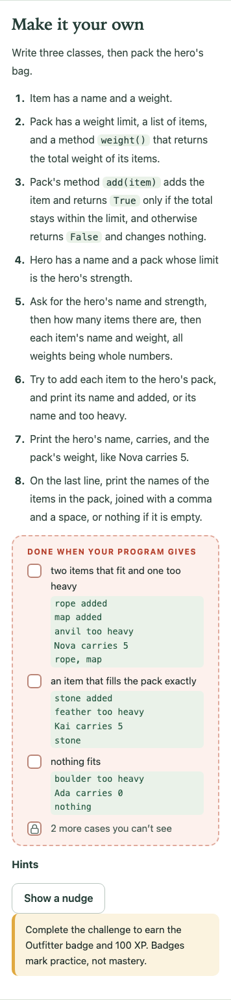

# Handoff 63: lessons in short pieces, and levels that take longer

Date: 2026-11-24 (America/Toronto)  
Written by: Claude Code (implementer), in a separate git worktree  
Status: **in_review**: one pull request, #73, **merge #72 first** (it is based on `feat/live-play`). No migration, no new dependency, no new route. The profile's `level` keeps its shape.

## Starter prompt for the chat assistant

```text
Review #73. Lesson text can now hold paragraphs (a blank line) and lists ("1. " steps, "- " items), and
59 long task texts were rewritten as a goal, numbered steps and a closing line, with the same meaning and
values; their challenge versions went up by one. 50 long explanations were split into paragraphs at a
sentence. A new test (rule C4) keeps every paragraph and step to 45 words. Levels now grow: each takes
300 XP more than the one before, and a level reached under the old 500-XP rule is kept. Check that no
task's meaning changed, and that nobody's shown level can go down.
```

| Field | Value |
| --- | --- |
| Request | The owner, 2026-11-24: "I still feel like it's hard to read some big paragraphs and it levels kinda quickly, but yeah keep adding and improving" |
| PR | #73 `ux/readable-lessons` into `main`, after #72 |
| Rules | **C4** (new, `docs/plan/lesson-page-rules.md`) |

## 1. Big paragraphs



Measured first. 54 of 61 challenges were over 50 words, each one paragraph; the longest, *A hero with a pack*, was 154. Explanations (the second paragraph of a Discover card) had a median of 50 words.

- **Lesson text can have shape.** A blank line starts a paragraph, `1. ` a numbered step, `- ` a list item (`frontend/app/prose.tsx`). Text with none of these renders exactly as before, so unit 1 is unchanged.
- **59 task texts** (56 challenges, 3 "Try it" tasks) are now a one-line goal, numbered steps, then what the check does. Most words are the old ones; many gained a short goal line, and no value, case or rule changed. Each reworded challenge's `version` went up by one, as `backend/content/README.md` asks; XP is never awarded twice for a new version.
- **50 long explanations** (43 second paragraphs and 7 opening ones) were split into paragraphs at the sentence nearest the middle; four more cuts were made by hand.
- **Rule C4**, tested over every released lesson: no paragraph or step over 45 words.

## 2. Levels

Every level took 500 XP, so a learner went up every five lessons, and all six titles were used up by lesson 25 of 61.

- **Now each level takes 300 XP more than the one before**: level 2 at 600 XP, 3 at 1,500, 4 at 2,700, 5 at 4,200, 6 at 6,000. The 61 lessons released today give 6,100 XP: level 6, Lorekeeper. The profile says "Each level takes 300 XP more than the one before."
- **Nobody goes down.** A level reached by XP earned before 2026-11-25 under the old rule is kept (`profiles.flat_level`). Its bar then runs from 0 to the next level's start, so "N XP to level n" stays true. **If this deploys after 2026-11-25, move `FLAT_LEVELS_UNTIL` to the deploy date.**
- No XP changes; only the level drawn from it.

## 3. Tests

- Backend 2,131 pass. New: C4, the curve, a kept level, and the date cut-off. Version pins in the unit 2 and 3 tests follow the reworded lessons.
- Browser: the 254 tests in the affected specs pass; the unit specs now read text as paragraphs and steps. The full suite ran once (589 pass); its 14 failures were fixtures re-recorded mid-run and are among the 254 that pass now.
- Re-recorded: CS, units 2, 3 and 4 to 11, self-review and profile fixtures (text and level only).

## 4. Next

E1, the project workspace, then `py.game-loop` and `py.write-your-tests`, and Lockpick opens.

## 5. Questions for the owner

1. Is 300 XP more per level the right pace? It is one number, `LEVEL_STEP` in `backend/app/profiles.py`.
2. Earlier questions still stand: 100 XP for a self review, and parents seeing written reviews.
