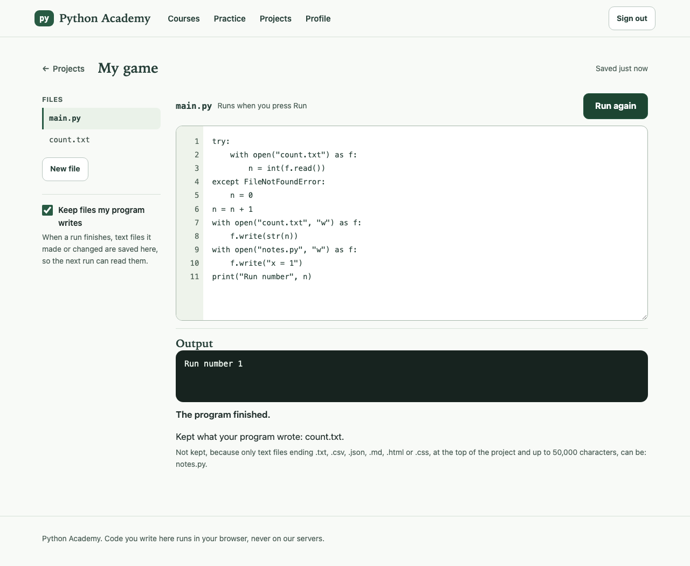
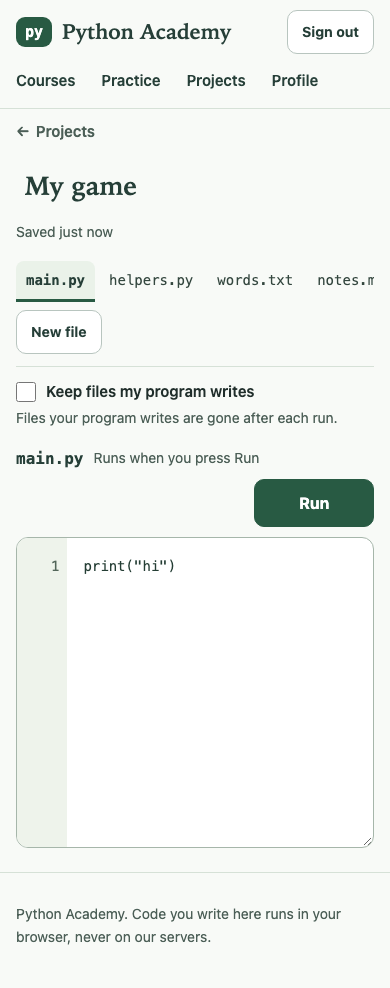

# Handoff 64: the project workspace (E1)

Date: 2026-11-26 (America/Toronto)  
Written by: Claude Code (implementer), in a separate git worktree  
Status: **in_review**: one pull request into `main`. Migration **0014** (adds a table only). No new dependency. No change to the Content-Security-Policy.

## Starter prompt for the chat assistant

```text
Review the project workspace (E1). Learners get /projects: start an empty project or one of the three
final projects, edit several files, and press Run, which plays main.py as live play does, with the other
.py files importable and the rest openable. Files save to the account a moment after typing stops; a save
from an older tab is refused (409) so it can never overwrite newer work. "Keep files my program writes"
adds text files a finished run made or changed to the project. Check that nobody can read or change
another learner's project, and that no starter claims more than exists today.
```

| Field | Value |
| --- | --- |
| Request | The owner, 2026-11-26: "continue from where we left off adding features, improve user experience" |
| Plan | `docs/plan/courses/py-final-project.md` section 3, E1; build order step 2 |
| Migration | 0014 `projects` |

## 1. What a learner sees



- **Projects** in the header (learners only). The page lists their projects and the starters: *Empty project*, and the three final projects, *Lockpick* (with `words.txt`), *Site Builder* (with `site.json`) and *Planner* (split into `main.py`, `commands.py`, `storage.py`). The final-project starters have empty versions of the functions in plan section 1, never the answers.
- **The workspace** (`/projects/<id>`): files on the left (a scrolling row on a phone), the open file in the editor, Rename and Delete for every file but `main.py`, and a line under the editor saying how the file is used (`import tools`, or `open("words.txt")`).
- **Run** plays `main.py` with live play (E2): a program that asks questions is answered as it asks. The panel is called Output; the page's own *Run again* starts over, so the panel has no second button.
- **Errors in another file** name it: the explanation says *tools.py, line 2*, and *Show tools.py, line 2* opens that file with the line marked. Python's own line number alone would have pointed at `main.py`.
- **Saving**: a moment after typing stops. The header says *Saved just now*, *Changes not saved yet*, or what went wrong, with *Try again*. A tab closed with unsaved changes asks first.
- **Keep files my program writes** (off by default). When a run finishes, text files it made or changed (`.txt .csv .json .md .html .css`, at the top of the project, up to 50,000 characters) are added and saved. With it off, the page says what the program wrote and that it is gone. Files that can never be kept (a `.py` file, a folder) are named with the reason.
- Signed out, `/projects` says what a project is before asking to sign in (rule D6).



## 2. Server (`backend/app/projects.py`, `main.py`)

| Route | Who | What |
| --- | --- | --- |
| `GET /api/project-starters` | anyone | The four starters and their file names |
| `GET /api/projects` | learner | Their projects, newest first |
| `POST /api/projects` | learner | A new project from a starter; at most 20 per account |
| `GET /api/projects/{id}` | the owner | The project and its files |
| `PUT /api/projects/{id}` | the owner | Title, files and the keep setting, with the revision last seen |
| `DELETE /api/projects/{id}` | the owner | Deletes it |

- **Nothing runs on the server.** Files are stored as text (one JSON column) and only the browser runs them.
- **Someone else's project answers 404**, exactly like one that does not exist.
- **Revisions.** Every save sends the revision it last saw; the update only applies where that revision is still current, so two tabs can never both win. The losing tab is told to reload, and stops saving and editing.
- **Limits:** 20 files, 50,000 characters each, 200,000 in all; names lowercase at the top of the project, `.py` names without `-` and never one of Python's own modules (the worker would refuse `random.py`). New rate limit `projects`: 60 a minute, 3,000 a day.
- **Text policy** on the title and `readme.md`, as the plan says. Not on code or data files: a save file with `2026-12-01` in it looks like a phone number to the policy, and nothing here is shown to anyone else.
- The account history records `project_created` with the starter's ID and `project_deleted`, never the title.

## 3. Worker

`collect: true` on a run adds `written` (changed or new text files) and `skipped` (names that cannot be kept) to the finished message. Live play passes it through. Nothing else in the worker changed.

## 4. Tests

- Backend: 2,167 pass. New: `tests/test_projects.py` (25), migration 0014, and the route lists in `test_sessions.py`.
- Browser: `tests/projects.spec.ts` (13) with real Pyodide: starting Lockpick, saving with revisions, running with a module and a data file, live replies, keeping written files across runs, the error in another file, file naming, a refused save, a stale tab, deleting, and phone and desktop widths. Live play and stepper specs pass.

## 5. Not done, and next

- **E4 project checks** (hidden cases inside the workspace) and the **insights** detectors on project code: next to `py.final-milestones`.
- **Parents** do not see projects yet; the plan says they may, through the family view.
- **E3 page preview** for Site Builder needs the owner's approval of a CSP change.
- `npm run build` once stopped on Next.js's warning that 16.4.3 has a known security advisory, then passed on a retry. Worth upgrading Next.js in its own pull request.

## 6. Questions for the owner

1. Is 20 projects per account, and 20 files per project, enough?
2. Should parents see their learner's projects (titles and files) in the family view?
