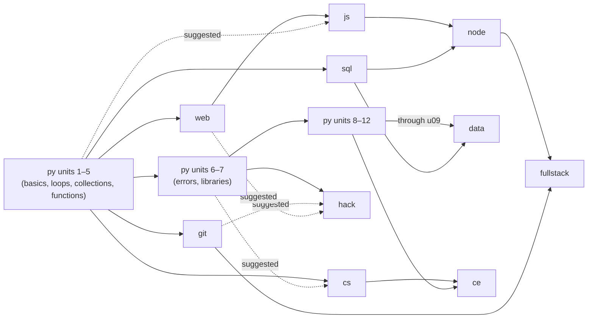

# Course catalog, learner goals, and recommendations

Last updated: 2026-10-24 (America/Toronto)  
Status: **proposed**, with maintainer decisions recorded in section 9 on 2026-10-24. Nothing in this document is implemented unless it is explicitly labelled as existing.  
Base commit: `a293798` on `main`.  
Related: [`build.md`](../../build.md) sections 3, 5, 9, 10, 11 and 13; [Issue #4](https://github.com/torontojohn/python-academy/issues/4) (optional skills check).

This document expands `build.md` into a concrete catalog proposal. Where the two disagree, `build.md` wins until this proposal is reviewed and either document is deliberately updated. Status words follow `build.md` section 18: proposed, ready, in_progress, in_review, verified, blocked, deferred.

Non-goals for the session that produced this document: no application code, database, settings, deployment, account-policy, or paid-service changes.

## 1. What exists today

| Item | Existing state |
| --- | --- |
| Lessons | Five adventure quests in `backend/app/curriculum.json`: `hello`, `variables`, `input`, `choices`, `adventure` |
| Cards per quest | Discover, See it work, Predict, Try it, Your challenge |
| Rewards | One practice badge per quest (Story spark, Character creator, Conversation starter, Path finder, Adventure maker); 100 XP per completed quest, computed from passing attempts |
| Progress storage | `attempts` rows keyed by `lesson_id`; no course, unit, version, goal, or placement records |
| Checker | `backend/app/lesson_checks.py` interprets strings, variables, `print()`, `input()`, string `+`, simple f-strings, and `if`/`else` with `==`/`!=` |
| Onboarding | Google sign-in, then date of birth; parent (over 25) or invited student (13 or older). No goal question and no skills check |

Everything below is **proposed**.

## 2. Learner goals chosen at sign-up

### When and how the goal is asked (proposed)

- Asked once, right after a student completes enrolment, on a single card. It can be skipped; skipping defaults to "Learn to code from scratch". It can be changed at any time from the learner's account page.
- One primary goal is used for recommendations. There is no secondary goal in the pilot (decision 1, section 9).
- The goal only changes **recommendations and ordering**. It never locks or hides a course, and it never changes the existing age rules or roles.
- Parents do not choose goals for learners. Parents can see a learner's goal and completed courses, but not placement answers (decision 2, section 9). The details are finalized with `build.md` backlog item ID-01.
- Preview sessions may try the goal card, but the choice stays in session memory and is not saved, matching existing preview behaviour.
- Independent adult learners (for example, the first-year maintainer) depend on ID-01 and are out of scope here. The goal design should work for them unchanged once that role exists.

### Goal-to-course map (proposed)

Course IDs are defined in section 3. "Recommended path" is an ordered list, and the recommendation engine (section 4) walks it.

| Goal (shown to learner) | Closest `build.md` mode | Recommended path | Why this order |
| --- | --- | --- | --- |
| Learn to code from scratch | Complete beginner | `py` → `git` → `web` → `js` → `sql` | Python gives a gentle first program; tools and web follow once basics are solid |
| Get ready for hackathons | Practical builder | `py` (through unit 7) → `hack` → `git` → `web` → `js` → `node` → `sql` | Hackathons reward scoping and shipping a small working app with a team. `hack` comes straight after Python unit 7, then Git, a web front end, and an API deepen the same skills. Units 8 to 12 of `py` are still recommended later |
| Prepare for university CS/engineering | First-year CS/engineering learner | `py` → `git` → `cs` → `sql` → `ce` electives | Depth and transfer: algorithms, representation, and C/memory build on solid Python |
| Build websites and apps | Practical builder | `py` (through unit 7) → `web` → `js` → `git` → `sql` → `node` → `fullstack` | Follows `build.md` stages 5 to 7 toward a deployed client/API/database project |
| Work with data | Practical builder | `py` → `sql` → `data` → `git` | SQL and Python data work answer real questions about a dataset |
| Just explore | Returning beginner / explorer | `py` unit 1, then a choice screen of every course whose prerequisites are met | No commitment; shows the breadth of the catalog |

"`py` (through unit 7)" means the recommendation moves on once `py.u01` to `py.u07` are complete; units 8 to 12 stay in the learner's path and are recommended again after the following course.

Every goal starts with `py`, consistent with "Python is the entry point" in `build.md` section 1. The optional skills check (section 4.2) can move a learner's starting point **within** `py`, but it does not skip the course outright.

## 3. Catalog structure

### 3.1 Hierarchy (proposed)

Modelled on the Khan Academy course > unit > lesson > exercise pattern, adapted to our teaching contract.

| Level | Definition | Today's equivalent | Example |
| --- | --- | --- | --- |
| Course | A coherent track with a final project and prerequisites | None (implicitly one course) | `py`, Python Foundations |
| Unit | A group of lessons around one idea, ending in a project milestone | The whole "Build Your Own Adventure" chapter | `py.u01`, Build Your Own Adventure |
| Lesson | One learning objective, taught with the card sequence | A quest | `hello`, Open the story |
| Task | One card: discover, example, predict, guided practice, or challenge. Projects and quizzes are also tasks | A card | `hello.challenge` |

`build.md` section 4 still applies: one teaching card at a time, and five cards is the current pattern, not a rule. A difficult idea becomes two lessons rather than one long card.

### 3.2 Stable IDs (proposed)

- IDs are lowercase ASCII, globally unique within their level, and **never reused** for different content. A meaning change gets a new ID; a wording or bug fix gets a new **version** of the same ID.
- Course IDs are short slugs: `py`, `hack`, `git`, `web`, `js`, `sql`, `node`, `cs`, `data`, `fullstack`, `ce`.
- Unit IDs: `<course>.u<NN>`, for example `py.u03`.
- Lesson IDs: the five existing lessons keep `hello`, `variables`, `input`, `choices`, `adventure` exactly and permanently, with no `py.`-prefixed alias, because `attempts.lesson_id` already stores them (decision 5). New lessons use `<course>.<slug>`, for example `py.while-loops`.
- Task IDs: `<lesson id>.<task slug>`, for example `hello.challenge`, `py.while-loops.predict`.
- Content records carry a `version` integer. Progress, evidence, and awards store both ID and version (`build.md` section 10, version changes).

Example lesson record (illustrative format, not final):

```json
{
  "id": "py.while-loops",
  "version": 1,
  "unit": "py.u03",
  "title": "Keep the story going",
  "objective": "Repeat instructions with while until a condition becomes false, and make sure the loop ends.",
  "prerequisite_skills": ["py.skill.if-else", "py.skill.comparison"],
  "skills_taught": ["py.skill.while-loop", "py.skill.loop-termination"],
  "tasks": [
    {"id": "py.while-loops.discover", "type": "discover"},
    {"id": "py.while-loops.example", "type": "example"},
    {"id": "py.while-loops.predict", "type": "predict"},
    {"id": "py.while-loops.guided", "type": "guided", "runtime": "pyodide"},
    {"id": "py.while-loops.challenge", "type": "challenge", "runtime": "pyodide", "validator": {"id": "behavior-tests", "version": 1}}
  ],
  "badge": null
}
```

### 3.3 Catalog (proposed)

Courses map to `build.md` section 5 stages. Only `py` unit 1 exists today.

Every course appears in the catalog. A course without released content is labelled **Coming soon** and cannot be started; its card can show the title, description, and planned units only (decision 8).

| Course ID | Title | `build.md` stage | Status |
| --- | --- | --- | --- |
| `py` | Python Foundations | 1 to 3 | proposed (unit 1 existing) |
| `hack` | Hackathon Ready | Not a `build.md` stage; applies the practical-builder projects and tools of sections 7 and 8 under time pressure | proposed (maintainer-approved addition; see 5.5) |
| `git` | Git and GitHub Essentials | 8 (introductory) and section 8 tutorials | proposed |
| `web` | Web Foundations: HTML and CSS | 5 | proposed |
| `js` | JavaScript and the DOM | 5 | proposed |
| `sql` | Data and SQL | 6 | proposed |
| `data` | Data Investigation with Python | 3 and 6 (CSV, aggregation, visualization project) | proposed |
| `cs` | Computer Science Foundations | 4 | proposed |
| `node` | Node.js and APIs | 7 | proposed |
| `fullstack` | Full-Stack Builder (capstone) | 7 and 8 | proposed |
| `ce` | Engineering Depth electives: C and memory, discrete foundations, numerical methods, embedded simulation | 9 | proposed, later |

### 3.4 Prerequisite map (proposed)

Two kinds of prerequisite:

- **Required**: the recommendation engine will not recommend a course until these are met. A learner can still start it by override (section 4.4).
- **Suggested**: listed on the course page as "helpful first"; never blocks a recommendation.

Prerequisites can name a whole course or specific units. Unit-level prerequisites let a learner branch after the common foundation, as `build.md` section 5 allows.

The diagram is an overview; the table below it is authoritative.



| Course | Required | Suggested |
| --- | --- | --- |
| `py` | None | None |
| `hack` | `py.u01` to `py.u07` | `git`, `web` |
| `git` | `py.u01` (so the learner has a file worth versioning) | `py.u05` |
| `web` | `py.u01` to `py.u03` (basic programming; HTML may start earlier per `build.md`) | `git` |
| `js` | `web`, plus `py.u01` to `py.u05` | `git` |
| `sql` | `py.u01` to `py.u04` (basic programming) | `web`, which can run alongside |
| `data` | `py` through `py.u09` (files, CSV/JSON), plus `sql` | `cs` |
| `cs` | `py.u01` to `py.u05` (loops, functions, collections) | `py.u06` to `py.u08` |
| `node` | `js` and `sql` (JavaScript, HTTP, SQL) | `git` |
| `fullstack` | `node` and `git` | `cs` |
| `ce` electives | `cs`, plus `py` complete | Relevant math per elective |

Content validation (section 7.1) must check that every referenced course or unit exists and that the graph has no cycles.

## 4. Recommended next course

### 4.1 Principles (proposed)

- Rule-based and deterministic: the same inputs always give the same recommendation. No paid AI services and no machine-learned ranking.
- Explainable: every recommendation shows a one-sentence reason built from the rule that fired.
- Advisory only: learners can always choose a different course. Missing prerequisites produce a note and a recap link, never a lock.
- Honest evidence: a placement skip satisfies a prerequisite for recommendation purposes, but never grants XP, badges, or course completion (Issue #4; `build.md` sections 9 and 10).

### 4.2 Inputs

| Input | Source | Notes |
| --- | --- | --- |
| Primary goal | Goal card (section 2) | Defaults to "Learn to code from scratch" |
| Goal path | Goal-to-course map | Ordered list of course IDs |
| Prerequisite map | Course content files | Required and suggested prerequisites |
| Completed units/courses | Earned completion evidence | A unit completes when every lesson challenge and the unit project milestone has passed |
| Placement evidence | Optional skills check (Issue #4) | Skill states per `build.md` section 9: unknown, introduced, practiced, independently demonstrated, due for review |
| In-progress course | Most recent learning activity | Paused courses are excluded if the learner paused them |
| Dismissed recommendations | Learner action | "Not now" hides a course from recommendations until the goal changes or the learner restores it |
| Release status | Course content files | Only released courses can be recommended as "start"; unreleased ones are "Coming soon" |

A prerequisite unit counts as **satisfied** when it is completed, **or** when placement shows every skill it teaches as "independently demonstrated". That means both a concept question and a different applied task show the skill, which is the pilot rule in `build.md` section 9. Conflicting evidence leaves the prerequisite unsatisfied and adds a refresher suggestion.

### 4.3 Rules, in order (proposed)

```text
recommend(learner):
  1. If the learner has an unfinished, unpaused course:
       recommend "continue <course> at <next unit/lesson>".
       Reason: "You're partway through <course>."
  2. candidates = goal path − completed courses − dismissed courses
     If the first candidate is not yet released, note it:
       "<course> is next on your path and is coming soon."
     Then continue with released candidates only.
  3. For each released candidate, in goal-path order:
       if all required prerequisites are satisfied:
         recommend it.
         Reason: "Next on your <goal> path, and you've finished <prereq>."
         Starting point = first unit whose skills are not all
         independently demonstrated (placement may start a learner
         later in py, with a recap card).
         stop.
  4. If no candidate is ready, take the first candidate and walk back
     through its unmet required prerequisites until one is ready.
       Reason: "<course> needs <prereq> first."
  5. If the goal path is exhausted: offer every unstarted released
     course whose prerequisites are met, plus the capstone for that goal.
       Reason: "You've completed your <goal> path."
     If nothing released remains: recommend revisiting completed work
     and show the Coming soon courses on the path.
       Reason: "You've finished everything available on your path so far."
```

Implementation notes (proposed):

- Write it as a pure function of the inputs above, in backend code with no I/O, so it can be unit tested exhaustively, for example with the `hypothesis` library already in `requirements.txt`.
- Store the rules version alongside any saved recommendation, so a later rules change can be explained.
- Placement only ever affects the **starting unit within `py`** and prerequisite satisfaction. It never removes a unit from the catalog, and skipped units stay accessible (Issue #4 acceptance criteria).

### 4.4 Override behaviour

- Every released course page has a "Start this course" action, whatever the recommendation says. Coming soon courses have no start action and cannot be started by override.
- If required prerequisites are unmet, show which ones and offer a short recap, then let the learner continue anyway.
- Overrides are recorded as a learner choice, so a product measure can review "placement override/refresher use" (`build.md` section 12).

### 4.5 Worked examples

| Learner | Inputs | Recommendation |
| --- | --- | --- |
| New student, goal "from scratch", no skills check | Nothing completed | `py` starting at unit 1, Reason: "Start of your Learn to code path." |
| Student, goal "hackathons", finished `py.u01`–`py.u07` | `hack` released, not started | `hack`. Reason: "Next on your hackathon path, and you've finished Python units 1–7." |
| Same student, but `hack` not yet released | `git` released | Note: "Hackathon Ready is next on your path and is coming soon." Then `git`, the next released course on the path |
| Student, goal "websites", placement showed print/variables/input/if-else independently | Nothing completed | `py` starting at unit 2 with a recap card. No unit 1 badges or XP awarded |
| Student, goal "data", finished `py`, overrides to start `node` | `sql` and `js` not done | Learner may start `node`; note: "Node.js usually comes after JavaScript and SQL" with recap links |

## 5. Python Foundations (`py`) outline

### 5.1 Scope

`py` takes a learner from a first `print()` toward the breadth of Harvard CS50P: functions, conditionals, loops, exceptions, libraries, unit tests, file I/O, regular expressions, and object-oriented programming. Explanations, projects, datasets, tests, and feedback are original. It is not CS50P, does not imply Harvard affiliation or credit, and does not claim equivalence (`build.md` section 6).

It follows the Python progression in `build.md` section 5. Where this outline splits one `build.md` chapter into two units, that follows the "split a difficult concept" guidance in `build.md` section 4.

Every unit ends with a **project milestone** in three versions: guided build, independent brief, and stretch extensions (`build.md` section 7). The adventure project grows across units 1 to 5, so early skills stay connected.

### 5.2 Units

**Runtime** below means the existing Pyodide browser worker unless noted. The **checker** column shows what assessment support is needed; see section 7.3.

| Unit | Title | Lessons (proposed IDs) | Project milestone | Checker needed |
| --- | --- | --- | --- | --- |
| `py.u01` | Build Your Own Adventure (**existing**) | `hello`, `variables`, `input`, `choices`, `adventure` | Adventure opening: setting, hero, player, choice | Existing bounded checker |
| `py.u02` | Numbers and decisions | `py.arithmetic`, `py.int-float`, `py.convert-input`, `py.compare`, `py.boolean-logic`, `py.elif` | Adventure gains a score and a riddle with numeric answers | Arithmetic, conversion, `elif`, `and`/`or`/`not` |
| `py.u03` | Repeat and explore | `py.while-loops`, `py.loop-termination`, `py.for-range`, `py.accumulate`, `py.nested-loops` | Replay a scene until the player quits; repeat a quiz | Loops with termination and step limits |
| `py.u04` | Keep track of a world | `py.lists`, `py.indexing`, `py.iterate-lists`, `py.dicts`, `py.sets` | Inventory, rooms, and scores | Collections; empty/single/many cases |
| `py.u05` | Organize your code | `py.functions`, `py.parameters`, `py.return-values`, `py.scope`, `py.decompose` | **Adventure v2**: replayable, data-driven scenes using functions (course midpoint project) | Calling learner functions with test inputs |
| `py.u06` | Recover and investigate | `py.tracebacks`, `py.debug-strategy`, `py.try-except`, `py.raise`, `py.validate-input` | Validate player input; diagnose and repair a broken adventure | Expected-exception and error-category checks |
| `py.u07` | Libraries and modules | `py.import`, `py.random`, `py.math-module`, `py.datetime`, `py.own-modules`, `py.packages-local` (local setup tutorial) | Quiz and spaced-practice tool, first version | Imports of an allowlisted standard library; seeded `random` |
| `py.u08` | Trust your changes | `py.assert-tests`, `py.test-cases`, `py.boundaries`, `py.type-hints`, `py.refactor` | Add tests that catch an intentionally broken version of the quiz tool | Run learner tests against correct and broken references |
| `py.u09` | Save and load | `py.text-files`, `py.json`, `py.csv`, `py.missing-data`, `py.environments` | Save and load the game or study tracker | Pyodide virtual filesystem with fixtures; explained file limits |
| `py.u10` | Patterns in text (core, skippable via placement; decision 7) | `py.string-methods`, `py.regex-basics`, `py.regex-groups`, `py.validate-formats` | Validate and extract data such as course codes from text | Regex behaviour checks |
| `py.u11` | Model a larger program | `py.classes`, `py.methods`, `py.composition`, `py.when-not-oop` | Inventory or simulation model, explaining why the abstraction helps | Object behaviour checks |
| `py.u12` | Final project | `py.final-brief`, `py.final-milestones`, `py.final-review` | Independent project: README, tests, demo, tradeoff explanation | Rubric (`build.md` section 7), not automated pass/fail alone |

Library and network exercises stay after fundamentals, with deterministic fixtures and no grading against a live public API (`build.md` section 5).

### 5.3 Project spine

| After unit | Project | Minimum deliverable |
| --- | --- | --- |
| 1 | Adventure opening (existing) | Two-path story using the player's name |
| 3 | Adventure with replay | Loop that replays scenes and always terminates |
| 5 | Adventure v2 | Functions and data-driven scenes; tested against more than one input |
| 7 | Quiz and spaced-practice tool v1 | Load questions, record answers, summarize results |
| 8 | Tested quiz tool | Tests that pass on the correct version and fail on a broken one |
| 9 | Save game or study tracker | Round trip of saved data; handles missing or invalid data |
| 11 | Model-based program | Classes with clear responsibilities |
| 12 | Final project | Learner-chosen project meeting the published rubric |

### 5.4 Path into later courses

After `py.u05`, the learner can branch to `git`, `web`, `sql`, or `cs` (section 3.4) while finishing `py`; after `py.u07`, `hack` also opens. The recommendation engine suggests the branch that matches the learner's goal.

### 5.5 Hackathon Ready (`hack`) outline

Status: proposed, approved for the catalog by the maintainer on 2026-10-24. Not a `build.md` section 5 stage; it is a short, practical course that applies Python foundations and the developer-tool tutorials (`build.md` section 8) to a time-boxed team project. It does not require attending a real hackathon, public posting, or paid hosting to earn its badges (`build.md` section 7).

Required: `py.u01` to `py.u07`. Suggested: `git`, `web`.

| Unit | Title | Focus | Evidence |
| --- | --- | --- | --- |
| `hack.u01` | Idea to MVP | Pick a problem and user; cut an idea down to a minimum viable product; write a one-paragraph scope and an explicit "not doing" list | Scope statement reviewed against a checklist |
| `hack.u02` | Time-boxing | Break the MVP into tasks that fit fixed time blocks; decide what to drop when time runs out | A time-boxed plan with a cut list |
| `hack.u03` | Teamwork with Git branches | One branch per feature, small pull requests, reviewing a teammate's diff, resolving a small conflict | Practice repository with two merged branches and one resolved conflict (simulation alone earns a lower evidence label, per `build.md` section 8) |
| `hack.u04` | Using public APIs safely | Reading API documentation, rate limits and terms of use; keeping keys out of frontend and source code; preferring keyless APIs or a small server-side proxy; handling offline and error responses | Project calls a keyless API or reads a key from an environment variable on the server; no key in source or browser code; works against a saved fixture when offline |
| `hack.u05` | Quick UI prototyping | Paper sketch, then a minimal working interface: a command-line flow first, or a simple web page if `web` is complete; accessibility basics still apply | Prototype a tester can complete one task with |
| `hack.u06` | Demo and pitching | A two-minute demo script: problem, live demo, what works, what's next; a backup recording or screenshots | Demo script and recorded or written walkthrough |
| `hack.u07` | Judging criteria | How typical criteria (impact, technical difficulty, design, completeness, presentation) are applied; self-assessing a project honestly | Self-assessment of the course project against a published rubric |

Assessment notes:

- Public API exercises use deterministic fixtures for any automated check, and never grade against a live public API (`build.md` section 5).
- Most `hack` evidence is a rubric-assessed project, not an automated pass/fail. Browser checks are used only where a task has deterministic behaviour.
- No learner code runs on the server; Git work happens in the learner's own practice repository.

## 6. XP and badge rules

These follow `build.md` section 10.

### 6.1 XP (proposed)

| Activity | XP | Notes |
| --- | --- | --- |
| Pass a lesson's challenge task | 100, once per lesson | Same as today for unit 1 |
| Pass a unit project milestone (guided or independent) | 200, once per unit | Independent brief and guided build share one award; stretch work earns a project badge, not extra XP |
| Course final project meeting the rubric | 500, once per course | Requires the rubric, not only automated checks |
| Viewing cards, answering predictions, using hints, navigating | 0 | No XP for clicking |
| Placement skip | 0 | Placement is a recommendation, not completion |
| Preview sessions | Session only | Never saved, as today |

- **Idempotent:** XP is recorded as an award row with a unique key `(learner, task id, task version)`, so retries, duplicate submissions, and re-running a passed challenge cannot inflate XP. Total XP is the sum of award rows, not a counter that is incremented.
- **Content versions:** a new version of a task does not re-award XP for a lesson already passed. Whether a major revision needs a refresher is decided per change, as `build.md` requires.
- **Hints:** using hints does not reduce XP. Hint usage is recorded as support data, never shown as a ranking.
- **No leaderboards and no streaks.** XP is private to the learner and visible to their parent under existing family rules.

### 6.2 Badges (proposed)

Badge categories match `build.md` section 10. Each badge has a stable ID and version, clear published criteria, and a text equivalent.

| Category | `py` examples | Required evidence |
| --- | --- | --- |
| Practice | The existing five unit 1 quest badges only. New lessons earn XP but no per-lesson badge, to avoid badge inflation | Quest challenge passed, labelled as practice |
| Skill | Number wrangler (u02), Loop navigator (u03), World keeper (u04), Function builder (u05) | Independent challenge plus a later, different variation of the skill |
| Project | Adventure v2 (u05), Quiz tool builder (u07), Data keeper (u09) | Published project rubric met; private demo or local delivery is acceptable |
| Engineering habit | Bug detective (u06), Test writer (u08) | Explain a real failure and add a meaningful regression check |
| Collaboration | First reviewed contribution (`git`), Team shipper (`hack.u03`) | A reviewed practice or project pull request, not account linking |
| Capstone | Python independent builder (u12) | Working project, tests, documentation, and explanation |

- Awarded once per `(learner, badge id, badge version)` under a database unique constraint.
- Never for clicking, linking an account, accepting placement, or finishing cards without the challenge.
- Browser-run checks produce **practice** evidence. Badges must not be described as certification of mastery (`build.md` section 11).
- Correction rule: if a grading bug wrongly awarded a badge, the award is marked corrected with a reason rather than silently deleted.
- Existing legacy behaviour stays: old arithmetic attempts under the `variables` ID do not earn Character creator.

## 7. Technical groundwork needed first

Mapped to `build.md` backlog IDs. None of this is started.

### 7.1 Content format (ENG-01)

- Move from one flat `curriculum.json` to versioned content files per course, for example `content/py/course.json` and `content/py/u01/hello.json`, with a typed schema shared by backend and frontend.
- Build/test-time validation:
  - IDs are unique and none are reused.
  - Every prerequisite and reference exists, and the prerequisite graph has no cycles.
  - Every challenge has trusted reference solutions, at least two where possible, plus misconception examples, all executed in the intended runtime (`build.md` section 12).
  - Each task's runtime supports its syntax.
- Keep `/api/lessons` working for the current UI until the new format is adopted, and represent the existing five lessons in the new format first, unchanged in behaviour.

### 7.2 Result states (ENG-01)

- Replace the single `passed` Boolean with `passed`, `needs_work`, `execution_error`, `unsupported`, or `service_error` (`build.md` section 11).
- Transition plan: the API returns both `result` and the existing `passed` field until the frontend uses `result`. `unsupported` and `service_error` say "Unable to assess", keep the learner's draft, and allow a retry.

### 7.3 What the checker cannot do yet

The existing checker (`backend/app/lesson_checks.py`) is a bounded interpreter for unit 1 only. It **cannot**:

- Do arithmetic: `+` only joins strings, and other operators are rejected. Unit 2 already needs more.
- Run `elif` chains with `and`/`or`/`not`, or comparisons other than `==` and `!=`.
- Run `while` or `for` loops, `range`, or check termination.
- Handle lists, dictionaries, sets, or indexing.
- Define or call functions; handle `return` or scope.
- Handle `try`/`except`, `raise`, `import`, file I/O, regular expressions, or classes.
- Verify output independently: it re-interprets the code and compares the result with the output the browser reports, so it is not tamper-resistant.

`build.md` section 11 says not to grow this into a pretend full Python implementation. Decided direction (decision 4, section 9):

- **Keep** the bounded checker for unit 1 and as a fast structural check.
- **Add** behaviour checks run in the learner's browser through the existing Pyodide worker. The worker runs the learner's code, then calls their functions or replays inputs against test cases defined in the content file, with step/time limits and a result state. This is practice-level evidence only, and learner code still never runs on the server.
- **Defer** any hosted evaluation service. It needs its own isolation, network restrictions, quotas, tests, and cost review, and must never run inside the main API service.

### 7.4 Database migrations (ENG-02)

- Adopt a migration tool, for example Alembic for SQLAlchemy. Start with a baseline migration that matches today's `create_all` tables exactly, then remove reliance on `create_all` for schema changes.
- Proposed new records, each with explicit unique constraints:

| Table | Purpose | Unique key |
| --- | --- | --- |
| `learner_goals` | Primary (and optional secondary) goal and history | `(user_id)` for the current goal |
| `course_progress` | Course/unit/lesson state, content version, resume point | `(user_id, course_id)` |
| `skill_evidence` | Placement, practice, and independent evidence per skill | Append-only rows |
| `assessment_sessions` | Skills check versions, responses, recommendation, learner choice | `(user_id, assessment_id, attempt_no)` |
| `xp_awards` | Idempotent XP ledger | `(user_id, task_id, task_version)` |
| `badge_awards` | Idempotent badges with evidence links | `(user_id, badge_id, badge_version)` |
| `recommendation_choices` | Dismissals and overrides | `(user_id, course_id)` |

- Migration tests must cover existing accounts and attempts, including the legacy `variables` arithmetic attempts, and backfill unit 1 XP and badges from existing passing attempts without double awarding.
- Award inserts run in the same transaction as the attempt that earns them.

### 7.5 Suggested order

1. ENG-01: content schema with the five existing lessons represented unchanged, plus result states.
2. ENG-02: migration baseline, then XP/badge ledgers with a backfill.
3. EDU-01 / Issue #4: placement questions for unit 1 skills.
4. Goal card and recommendation function, behind the existing student flow.
5. `py.u02` Numbers and decisions (decision 3), with browser behaviour checks; then EDU-03, unit 3 loops.

Each step is a separate small PR, per `build.md` section 13.

The maintainer's approved build order for the first stages (2026-10-24) is:

1. ENG-01: content format and result states; the five existing lessons behave exactly as before.
2. ENG-02: Alembic baseline, then XP and badge ledgers with a backfill; existing accounts survive.
3. Catalog interface: course catalog page (course cards with title, short description, progress, and Coming soon labels), course page with units and lessons, and a lesson page that keeps the one-card-at-a-time flow with a unit sidebar showing done, current, and not-started lessons (a collapsible menu on mobile).
4. Goal card at sign-up and the recommendation function, with tests.

Each stage is its own branch and pull request, reviewed by the maintainer before the next starts. Nothing is merged to `main` or deployed without the maintainer.

## 8. Risks and limits

- Browser-reported results remain practice evidence; nothing here makes grading tamper-resistant.
- A long catalog risks implying courses exist. Unreleased courses are shown, clearly labelled Coming soon, and cannot be started (decision 8).
- XP values and badge thresholds are starting proposals to pilot, not measured educational targets.
- Goal data and placement results are learner data. Retention, deletion, and parent visibility need decisions before storage (`build.md` section 12, broader-release gate).

## 9. Maintainer decisions

Decided by the maintainer on 2026-10-24. Each decision stays in effect until deliberately changed and recorded here (`build.md` section 18).

| # | Question | Decision | Alternatives considered | Consequence |
| --- | --- | --- | --- | --- |
| 1 | Single primary goal, or primary plus secondary? | Primary goal only for the pilot | Primary plus secondary | Simpler recommendation rules; revisit after the pilot |
| 2 | Can parents see a learner's goal, placement, and recommendations? | Goal and completed courses yes; placement answers no | Full visibility; no visibility | Finalize with ID-01 before adult learners exist |
| 3 | Next unit after groundwork | `py.u02` Numbers and decisions | `py.u03` loops first (`build.md` EDU-03) | Unit 3 builds on unit 2's arithmetic and comparison; EDU-03 follows |
| 4 | Checker strategy for units 2+ | Browser behaviour checks: the Pyodide worker runs learner code against test cases from the content file. Keep the bounded checker for unit 1 | Extend the bounded interpreter; hosted evaluation service | Practice-level evidence only; no learner code on the server; content files must carry test cases |
| 5 | Course-prefixed aliases for existing lesson IDs? | No; keep `hello`, `variables`, `input`, `choices`, `adventure` permanently | Add `py.hello` aliases | No migration of `attempts.lesson_id` needed |
| 6 | XP amounts and stretch work | 100 per lesson challenge, 200 per unit project, 500 per course final project; stretch work earns a badge only | Other amounts; XP for stretch work | Pilot values, revisited with evidence |
| 7 | Regular expressions (`py.u10`) | Core unit, skippable via placement | Optional elective | Course covers CS50P-level breadth |
| 8 | Unreleased courses in the catalog | Shown, clearly labelled "Coming soon", and not startable | Show `py` only; hide unreleased | Catalog shows the whole plan without implying content exists; recommendations skip unreleased courses |
| 9 | Hackathon goal path | `py` units 1–7, then `hack`, then branch | Full `py` course first | `hack` added as a new course (section 5.5) |
| 10 | Hackathon course | Add `hack` (Hackathon Ready): required `py.u01`–`py.u07`, suggested `git` and `web` | Teach hackathon skills inside `git` and `web` | New course not in `build.md` section 5; `build.md` should list it at its next revision |

## 10. Session record

- Created this proposal on branch `plan/course-catalog`. Documentation only.
- No application code, content, database, settings, or deployment changed.
- 2026-10-24: maintainer decisions 1 to 10 recorded in section 9; `hack` course added (section 5.5); approved build order added to section 7.5.
- Next concrete action: ENG-01 (content format and result states) on its own branch and pull request.
